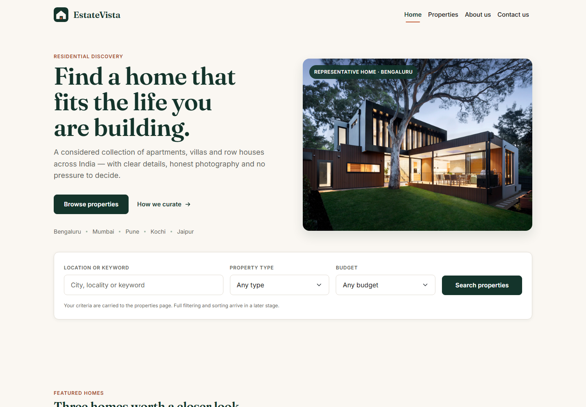
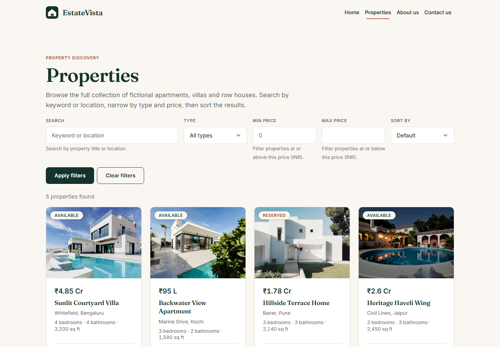
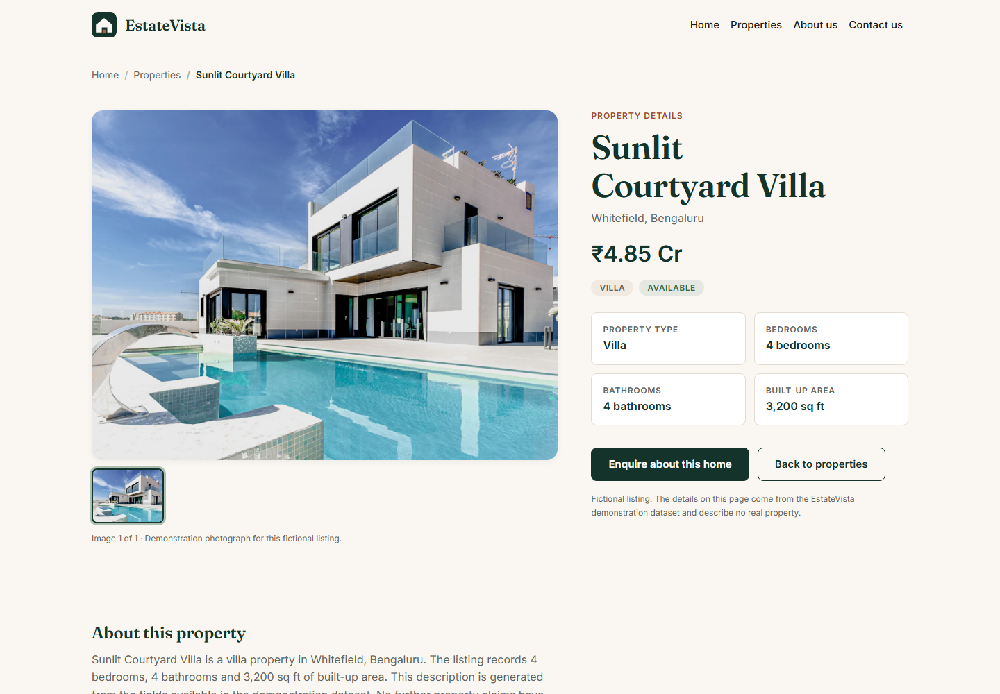

# EstateVista

A responsive, multi-page property discovery website built with static HTML, CSS
and vanilla JavaScript. It presents fictional property listings across India
with search, filtering, sorting, detail views, a small image gallery, an About
page, a Contact page with client-side validation, and a custom 404 page.

There is no framework, no build step, no backend and no database. All company
details, agent names, listings, prices, testimonials and contact details are
invented for demonstration purposes.

> **Fictional content notice.** EstateVista is a demonstration project. No
> listing on this site represents a real property, and no contact detail belongs
> to a real company.

---

## Repository and demo links

| Item | Value |
|---|---|
| GitHub repository | _TBD — add after the repository is created_ |
| Live demo | _TBD — add after the Vercel deployment_ |
| Deployment guide | [`DEPLOYMENT.md`](DEPLOYMENT.md) |
| Stage 5 QA record | [`docs/QA.md`](docs/QA.md) |

---

## Table of contents

- [Project overview](#project-overview)
- [Visual preview](#visual-preview)
- [Repository and demo links](#repository-and-demo-links)
- [Stage status](#stage-status)
- [Technology](#technology)
- [Project structure](#project-structure)
- [Pages](#pages)
- [Local development](#local-development)
- [Stylesheet order](#stylesheet-order)
- [Design tokens](#design-tokens)
- [Component foundations](#component-foundations)
- [Accessibility baseline](#accessibility-baseline)
- [Stage 5 QA summary](#stage-5-qa-summary)
- [Property data](#property-data)
- [Known limitations](#known-limitations)
- [Deployment](#deployment)
- [Future direction](#future-direction)
- [Credits](#credits)
- [Troubleshooting](#troubleshooting)
- [Roadmap](#roadmap)

---

## Project overview

EstateVista is a static demonstration of how residential property listings can
be presented with clarity and restraint. The site uses Indian Rupees (INR) and
a small, curated fictional dataset rather than a large generated catalogue.

Implemented functionality includes:

- A homepage hero, homepage search, featured-property rail and category links.
- A property listing page with keyword, type, minimum-price and maximum-price
  filters, sorting, and shareable query-string state.
- A property details page driven by `?id=<slug>`, with a selectable image
  gallery and a related-properties rail.
- An About page describing the fictional studio.
- A Contact page with a client-side validated demonstration form.
- A custom 404 page.

The site is intentionally front-end only. Search, filtering, gallery selection
and form validation run in the browser.

---

## Visual preview

Screenshots of the current build, captured from the locally served site at a
1440 × 1000 desktop viewport.

### Homepage



### Property listings



### Property details



---

## Stage status

**Stages 1–5 are complete.** Stage 6 — Documentation and deployment — is in
progress.

- Stage 1: Foundation and design system.
- Stage 2: Homepage, featured properties and mobile navigation.
- Stage 3: Property listings, filtering and sorting.
- Stage 4: Property details, About and Contact pages.
- Stage 5: Responsive, accessibility and functional QA.
- Stage 6: Documentation, repository hygiene and planned deployment.

GitHub setup and Vercel deployment are not complete yet. The repository links
above remain placeholders until those steps are performed.

---

## Technology

| Concern | Choice |
|---|---|
| Markup | HTML5 |
| Styling | CSS3 with custom properties |
| Behaviour | Vanilla JavaScript, ES5-style syntax with modern browser APIs such as `URLSearchParams` and `Element.closest` |
| UI framework | Bootstrap 5.3.3 via pinned jsDelivr CDN with Subresource Integrity (SRI) |
| Typefaces | Fraunces (headings) and Inter (body) via Google Fonts |
| Currency | Indian Rupees (INR, ₹) |
| Property data | Plain global array in `assets/js/data.js` |
| Build step | None |
| Hosting | Vercel static hosting (planned; not yet deployed) |

No `package.json` exists by design. There is nothing to install, bundle or
compile. Bootstrap and the web fonts are requested at runtime from public CDNs,
so a network connection is required for the full visual treatment. The CSS
includes fallback font stacks for offline or blocked-network use.

---

## Project structure

```text
EstateVista/
├── index.html                  Homepage
├── properties.html             Listing browse page
├── property-details.html       Single listing (?id=<slug>)
├── about.html                  Company and studio information
├── contact.html                Contact details and demonstration form
├── 404.html                    Custom not-found page
├── assets/
│   ├── css/
│   │   ├── theme.css           Tokens, Bootstrap overrides, base elements
│   │   ├── components.css      Buttons, badges, chips, cards, forms
│   │   ├── home.css            Homepage composition
│   │   ├── property-details.css Single-listing composition
│   │   ├── about.css           About-page composition
│   │   └── contact.css         Contact-page composition
│   ├── js/
│   │   ├── data.js             Fictional property dataset (global array)
│   │   ├── main.js             Shared progressive enhancement
│   │   ├── home.js             Featured rail and homepage search
│   │   ├── property-card.js    Shared property-card renderer
│   │   ├── properties.js       Listing filters, sorting and grid
│   │   ├── property-details.js Single-listing renderer and gallery
│   │   └── contact.js          Contact-form validation
│   └── images/
│       ├── about/              Studio interior photograph
│       ├── brand/              favicon.svg and property-placeholder.svg
│       ├── categories/         Apartment, villa and row-house tiles
│       ├── heroes/             Homepage hero photograph
│       ├── properties/         Five listing photographs
│       └── team/               Reserved directory; only .gitkeep is committed
├── docs/
│   ├── QA.md                   Stage 5 QA record
│   └── screenshots/            README preview images (3 PNGs)
├── DEPLOYMENT.md               Planned Vercel deployment guide
├── .gitattributes              Text and binary file handling
├── .gitignore
└── README.md
```

The `assets/images/properties/` and `assets/images/heroes/` directories retain
`.gitkeep` files so the directories exist even when empty. The `team/` directory
is reserved for future portraits; no team photography is currently committed.

---

## Pages

| Page | Purpose |
|---|---|
| `index.html` | Homepage with hero, search, featured properties and categories |
| `properties.html` | Full listing grid with filters, sorting and URL-driven state |
| `property-details.html` | Single property view selected by `?id=<slug>` |
| `about.html` | Fictional studio story, mission, values and team section |
| `contact.html` | Studio details and client-side validated demonstration form |
| `404.html` | Custom page for unmatched routes |

The listing and details pages depend on `assets/js/data.js`; the homepage also
uses it for the featured rail.

---

## Local development

The site is static, so any static file server works. Python's built-in server is
sufficient and requires no project installation.

From the project root:

```bash
python -m http.server 5500
```

Then open <http://localhost:5500/>.

An alternative if Python is unavailable:

```bash
npx serve .
```

`npx serve` downloads a temporary package on first use, so it requires Node.js
and network access.

**Why use a server instead of opening the files directly?** The pages load
relative assets and resolve query parameters such as `?id=` and the listing
filters. Serving over HTTP keeps that behaviour consistent across browsers.
Opening `index.html` through `file://` may work for basic reading, but it is not
the recommended development path.

The property dataset is a plain JavaScript global specifically so that no
`fetch()` or CORS setup is required. To stop the server, press `Ctrl+C` in the
terminal.

---

## Stylesheet order

This order is required — custom tokens must load after Bootstrap so the
overrides win:

1. Google Fonts stylesheet
2. Bootstrap 5.3.3 (`bootstrap.min.css`, CDN, with `integrity`)
3. `assets/css/theme.css`
4. `assets/css/components.css`
5. The page-specific stylesheet where one exists (`home.css`,
   `property-details.css`, `about.css` or `contact.css`)

Bootstrap's JavaScript bundle is included on every page because the responsive
navigation uses the Bootstrap collapse component.

---

## Design tokens

All tokens live in `:root` inside `assets/css/theme.css`. Use the token, never a
raw hex value.

### Colour

| Token | Value | Role |
|---|---|---|
| `--ev-forest-900` | `#14342B` | Primary brand, headings, primary buttons |
| `--ev-forest-700` | `#1E4D3F` | Hover and active states |
| `--ev-sage-300` | `#9DB5A5` | Focus ring, muted accents |
| `--ev-terracotta-500` | `#C05B36` | Accent marks and decorative fills |
| `--ev-terracotta-700` | `#A44A2A` | Accent text and accent buttons (AA on white) |
| `--ev-ivory-50` | `#FAF7F2` | Page background |
| `--ev-sand-100` | `#F0EAE0` | Alternate surfaces, image placeholders |
| `--ev-charcoal-900` | `#1C1C1A` | Body text |
| `--ev-slate-600` | `#5F6660` | Metadata and secondary text |
| `--ev-hairline` | `#E2DCD2` | Borders and dividers |
| `--ev-status-available` | `#2F6F4F` | "Available" status |

Contrast note: white text on `--ev-terracotta-500` measures about 4.4:1, which
is below the 4.5:1 AA threshold for normal text. Use `--ev-terracotta-700`
(≈5.8:1) whenever text sits on a terracotta fill. `--ev-terracotta-500` is for
non-text accents.

### Typography

- Headings: `--ev-font-display` (Fraunces), weight 600, tight tracking.
- Body and UI: `--ev-font-body` (Inter), base 16px, line-height 1.6.
- Metadata: `--ev-text-sm` (14px) with muted colour and tabular numerals.
- Prices use `font-variant-numeric: tabular-nums` so digits align across card
  grids.

### Spacing and layout

- 8px scale: `--ev-space-1` (4px, fine adjustments) through `--ev-space-9`
  (96px).
- Content width `--ev-container-max: 1240px`.
- Grid gutter `--ev-grid-gutter: 24px`, applied through `--bs-gutter-x`.
- Section rhythm `--ev-section-pad-y: clamp(40px, 6vw, 96px)`.
- Radii: 4 / 8 / 12 / 16 px plus a pill.
- Shadows are limited to three restrained tokens.

---

## Component foundations

- **Buttons** — `.btn-primary` (forest solid), `.btn-secondary` (forest
  outline), `.btn-accent` (terracotta solid), `.btn-ghost` (inline text),
  `.btn-sm`. All share a 48px minimum height, 8px radius and a 150ms transition.
- **Badges and chips** — `.ev-badge` with `--accent`, `--available`,
  `--neutral` modifiers; `.ev-chip` for filter controls using `aria-pressed`.
- **Property card** — `.card-estate` with `__media`, `__body`, `__price`,
  `__title`, `__meta`, `__footer`. The card uses a stretched link so the whole
  surface is clickable without nesting anchors. `property-card.js` is the shared
  renderer used by the listing grid and the related-properties rail. The homepage
  currently builds its cards in `home.js`; consolidating the two renderers is a
  future maintenance cleanup, not a functional difference.
- **Save control** — `.ev-favorite`, a glass-overlay button driven by
  `aria-pressed`.

---

## Accessibility baseline

- A visible `:focus-visible` outline (3px sage) is defined globally; Bootstrap
  outlines are never removed without a replacement.
- `.ev-skip-link` provides a keyboard bypass to `#main` on every page.
- Motion is suppressed under `prefers-reduced-motion: reduce`, including card
  lift and image zoom.
- Colour pairs were chosen to target AA contrast on body text; see the
  terracotta note above.
- Landmarks: every page has a single `<main id="main">`.
- Interactive components use native buttons, links and form controls where
  possible, with ARIA state kept in sync by JavaScript.

The project does not claim full WCAG conformance. See the Stage 5 QA record for
the scope and limits of the completed audit.

---

## Stage 5 QA summary

Stage 5 completed a responsive, accessibility and functional QA pass. The
reported coverage was:

- Six pages audited.
- Eight viewport sizes.
- Responsive layout and horizontal-overflow checks.
- Functional regression coverage across the site.
- Keyboard navigation and focus checks.
- JavaScript-disabled fallback checks.
- Axe-core scans with **zero violations across 18 audited runs**.

The full record is in [`docs/QA.md`](docs/QA.md). That record documents the
Stage 5 scope and does not certify later changes or claim full WCAG compliance.

---

## Property data

`assets/js/data.js` exposes `window.EV_PROPERTIES` — a plain array of five
fictional listings. It is a global rather than a fetched JSON file so pages work
without CORS or a JSON round-trip.

Prices are stored as whole rupees (`48500000`) and formatted at render time by
the shared helpers in `property-card.js` and the homepage card renderer in
`home.js`, using Indian conventions such as `₹4.85 Cr` and `₹95 L`.

Record shape:

| Field | Type | Notes |
|---|---|---|
| `id` | string | Slug used by `property-details.html?id=<slug>` |
| `title` | string | Display name |
| `type` | string | `apartment`, `villa`, `penthouse`, `rowhouse` |
| `status` | string | `available`, `reserved`, `sold` |
| `price` | number | Whole rupees |
| `city` / `locality` | string | Location |
| `bedrooms` / `bathrooms` | number | |
| `areaSqft` | number | Built-up area |
| `featured` | boolean | Home page highlight rail |
| `images` | string[] | Paths relative to the site root |

The details renderer also checks for an optional `amenities` array. The current
five records do not include that field, so the details page shows its documented
fallback text.

---

## Known limitations

- **Property listings and details require JavaScript.** The listing grid,
  featured rail, details view and gallery are rendered client-side. `<noscript>`
  notices explain the limitation, but the pages cannot show listings without
  JavaScript.
- **The contact form is client-side only.** It validates locally and does not
  send, store or forward submissions. There is no backend or form service.
- **Bootstrap and Google Fonts require network access.** A blocked CDN can
  remove Bootstrap styling or cause fallback fonts to appear. The CSS font
  stacks are intentional, but the site does not bundle local copies.
- **Property and company content is fictional.** Names, prices, addresses,
  telephone numbers, email addresses, testimonials and listings are invented.
- **There is no backend, database, account system, saved-search feature or chat
  service.** The site is a static front-end demonstration.

---

## Deployment

Deployment is planned for Vercel as a static site. It has not been completed
yet. The intended configuration and verification steps are documented in
[`DEPLOYMENT.md`](DEPLOYMENT.md).

Summary of the planned setup:

- Framework preset: **Other**.
- Build command: **None**.
- Output directory: **project root**.
- Production branch: **main**.
- GitHub integration so pushes to `main` trigger deployments.

The custom `404.html` is intended to handle unmatched routes. Its relative asset
and navigation paths are a known issue for nested missing URLs and need review
before deployment is considered complete; see `DEPLOYMENT.md`.

---

## Future direction

The following are **planned possibilities only** and are not implemented in the
current build:

- Motion and animation polish that respects reduced-motion preferences.
- A backend for real enquiry handling.
- A database-backed property catalogue.
- Chat or conversational assistance.

The current repository remains a static, front-end-only demonstration.

---

## Credits

- **Bootstrap 5.3.3** — front-end component framework, loaded from jsDelivr.
  See the official Bootstrap project for licensing information.
- **Google Fonts** — Fraunces and Inter, loaded from Google Fonts. Each family
  has its own license; verify the current terms on Google Fonts.
- **Images** — the repository does not record the origin, author or license of
  the WebP photographs. Image provenance and licensing **require verification**
  before public reuse or redistribution.

No image source or license is asserted here beyond what the repository can
currently establish.

---

## Troubleshooting

**Pages show unstyled content.** Confirm `theme.css` loads *after*
`bootstrap.min.css` and that the `integrity` attribute has not been edited by
hand.

**Fonts fall back to Georgia or a system sans-serif.** The Google Fonts
stylesheet requires network access. The fallback stacks in `--ev-font-display`
and `--ev-font-body` are intentional and keep the layout readable offline.

**Listings or featured properties are empty.** Confirm JavaScript is enabled and
that `assets/js/data.js` loads before the page-specific script. Check the browser
console for a blocked or missing file.

**The contact form appears to do nothing.** That is expected. It validates
locally and deliberately sends nothing; there is no backend.

**A nested missing URL produces an unstyled 404 page.** This is a known issue
with relative paths in `404.html`. It is documented in `DEPLOYMENT.md` and is
not fixed in the current documentation phase.

---

## Roadmap

1. ~~Stage 1 — Foundation and design system~~
2. ~~Stage 2 — Homepage and featured properties~~
3. ~~Stage 3 — Property listings, filtering and sorting~~
4. ~~Stage 4 — Property details, About and Contact~~
5. ~~Stage 5 — Comprehensive QA and accessibility~~
6. **Stage 6 — Documentation and deployment (in progress)**
   - Documentation and repository hygiene.
   - GitHub repository setup.
   - Vercel deployment and post-deployment verification.
