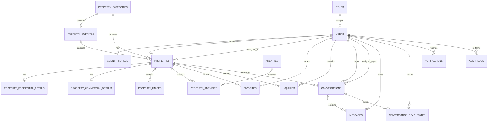

# ESTATEVISTA — Database Design & ERD

**Project:** EstateVista V2  
**Stage:** 1.4 — Database Design & ERD  
**Database:** PostgreSQL  
**ORM:** Spring Data JPA / Hibernate  
**Migration Tool:** Flyway  
**Status:** Proposed baseline — §23 records APPROVED clarifications; headers reconciled during Stage 1.6; Stage 1.9 audit corrections applied

---

# 1. Purpose

This document defines the proposed relational database structure for EstateVista V2.

It establishes:

- Database entities and relationships.
- Table structures, columns, and data types.
- Primary and foreign key relationships.
- Unique constraints and validation rules.
- Indexing strategy.
- Property-specific conversation and messaging structure.
- Data retention and deletion policies.
- Database migration strategy.

The schema is designed for a modular monolithic backend using Java, Spring Boot, Spring Data JPA, and PostgreSQL.

# 2. Database Design Principles

The database will follow these principles:

1. Use PostgreSQL as the primary relational database.
2. Use UUIDs as primary keys.
3. Enforce data integrity through foreign keys and constraints.
4. Avoid unnecessary duplication of data.
5. Use lookup tables for reusable classifications.
6. Store timestamps using `TIMESTAMPTZ`.
7. Preserve historical inquiry and conversation records.
8. Avoid hard-deleting records that are referenced by important business data.
9. Use database indexes for frequently queried fields.
10. Manage all schema changes through Flyway migrations.

## 2.1 Naming Conventions

| Element | Convention | Example |
|---|---|---|
| Tables | Snake case, plural | `users` |
| Columns | Snake case | `created_at` |
| Primary keys | `id` | `id` |
| Foreign keys | Referenced table + `_id` | `buyer_id` |
| Unique constraints | `uk_<table>_<columns>` | `uk_users_email` |
| Indexes | `idx_<table>_<columns>` | `idx_properties_status` |
| Boolean columns | `is_` prefix where appropriate | `is_read` |

# 3. Entity Overview

The database is divided into the following functional groups.

| Module | Tables |
|---|---|
| User Management | `users`, `roles`, `agent_profiles` |
| Property Management | `properties`, `property_categories`, `property_subtypes`, `property_residential_details`, `property_commercial_details` |
| Property Media | `property_images` |
| Property Amenities | `amenities`, `property_amenities` |
| Favorites | `favorites` |
| Inquiries | `inquiries` |
| Messaging | `conversations`, `messages`, `conversation_read_states` |
| Notifications | `notifications` |
| Audit | `audit_logs` |

# 4. Entity Relationship Diagram

## 4.1 Main Database ERD



## 4.2 Relationship Summary

| Relationship | Cardinality |
|---|---|
| Role → Users | One-to-Many |
| User → Agent Profile | One-to-One, optional |
| User → Properties Created | One-to-Many |
| Agent → Assigned Properties | One-to-Many |
| Property Category → Subtypes | One-to-Many |
| Property → Residential Details | One-to-One, optional |
| Property → Commercial Details | One-to-One, optional |
| Property → Images | One-to-Many |
| Property ↔ Amenities | Many-to-Many |
| Buyer ↔ Properties through Favorites | Many-to-Many |
| Buyer → Inquiries | One-to-Many |
| Property → Inquiries | One-to-Many |
| Buyer → Conversations | One-to-Many |
| Agent → Conversations | One-to-Many |
| Property → Conversations | One-to-Many |
| Conversation → Messages | One-to-Many |
| User → Messages | One-to-Many |
| Conversation → Read States | One-to-Many |
| User → Notifications | One-to-Many |

# 5. User Management

## 5.1 `roles`

Stores the available account roles.

| Column | Type | Constraints | Description |
|---|---|---|---|
| id | UUID | PK | Role identifier |
| name | VARCHAR(30) | UNIQUE, NOT NULL | Role name |
| description | VARCHAR(255) | NULL | Role description |
| created_at | TIMESTAMPTZ | NOT NULL | Creation timestamp |

Initial roles:

- `BUYER`
- `AGENT`
- `ADMIN`

Visitors do not require database accounts unless they register.

Each account has one primary role in the MVP.

## 5.2 `users`

Stores registered platform accounts.

| Column | Type | Constraints | Description |
|---|---|---|---|
| id | UUID | PK | User identifier |
| role_id | UUID | FK → roles.id, NOT NULL | User role |
| first_name | VARCHAR(100) | NOT NULL | First name |
| last_name | VARCHAR(100) | NOT NULL | Last name |
| email | VARCHAR(255) | UNIQUE, NOT NULL | Login email |
| password_hash | VARCHAR(255) | NOT NULL | Hashed password |
| phone | VARCHAR(20) | NULL | Contact number |
| account_status | VARCHAR(30) | NOT NULL | Account status |
| email_verified_at | TIMESTAMPTZ | NULL | Email verification timestamp |
| last_login_at | TIMESTAMPTZ | NULL | Last successful login |
| created_at | TIMESTAMPTZ | NOT NULL | Creation timestamp |
| updated_at | TIMESTAMPTZ | NOT NULL | Last update timestamp |

Proposed account statuses:

- `ACTIVE`
- `INACTIVE`
- `SUSPENDED`

Rules:

- Email addresses must be normalized before storage.
- Passwords must never be stored in plaintext.
- A suspended or inactive account must not be allowed to authenticate.
- Account deactivation should preserve related business records.
- Unique email comparison should be case-insensitive, preferably through a unique index on `LOWER(email)`.

## 5.3 `agent_profiles`

Stores additional information specific to agents.

| Column | Type | Constraints | Description |
|---|---|---|---|
| id | UUID | PK | Profile identifier |
| user_id | UUID | FK → users.id, UNIQUE, NOT NULL | Associated agent |
| agency_name | VARCHAR(150) | NULL | Agency name |
| license_number | VARCHAR(100) | NULL | Professional license |
| bio | TEXT | NULL | Agent introduction |
| profile_image_url | TEXT | NULL | Profile image |
| created_at | TIMESTAMPTZ | NOT NULL | Creation timestamp |
| updated_at | TIMESTAMPTZ | NOT NULL | Last update timestamp |

Rules:

- An agent account may have one agent profile.
- Buyer and administrator accounts should not have agent profiles.
- The backend must validate the user's role when creating an agent profile.

# 6. Property Management

## 6.1 `property_categories`

Stores broad property categories.

| Column | Type | Constraints | Description |
|---|---|---|---|
| id | UUID | PK | Category identifier |
| name | VARCHAR(50) | UNIQUE, NOT NULL | Category name |
| created_at | TIMESTAMPTZ | NOT NULL | Creation timestamp |

Initial categories:

- `RESIDENTIAL`
- `COMMERCIAL`

## 6.2 `property_subtypes`

Stores property subcategories.

| Column | Type | Constraints | Description |
|---|---|---|---|
| id | UUID | PK | Subtype identifier |
| category_id | UUID | FK → property_categories.id, NOT NULL | Parent category |
| name | VARCHAR(80) | NOT NULL | Subtype name |
| created_at | TIMESTAMPTZ | NOT NULL | Creation timestamp |

Example residential subtypes:

- Apartment
- Villa
- Independent House
- Penthouse
- Residential Plot

Example commercial subtypes:

- Office Space
- Retail Shop
- Showroom
- Warehouse
- Commercial Plot

Constraint:

`UNIQUE(category_id, name)`

The property table will also use a composite foreign key to ensure that the selected subtype belongs to its selected category.

## 6.3 `properties`

The central property listing table.

| Column | Type | Constraints | Description |
|---|---|---|---|
| id | UUID | PK | Property identifier |
| title | VARCHAR(200) | NOT NULL | Property title |
| slug | VARCHAR(220) | UNIQUE, NULL | SEO-friendly identifier |
| description | TEXT | NOT NULL | Property description |
| category_id | UUID | FK → property_categories.id, NOT NULL | Property category |
| subtype_id | UUID | NOT NULL | Property subtype |
| listing_type | VARCHAR(20) | NOT NULL | SALE or RENT |
| price | NUMERIC(14,2) | NOT NULL | Listing price |
| currency_code | CHAR(3) | NOT NULL | Currency |
| area_value | NUMERIC(12,2) | NULL | Property area |
| area_unit | VARCHAR(20) | NULL | Area measurement unit |
| address_line | VARCHAR(255) | NULL | Address |
| locality | VARCHAR(120) | NULL | Locality |
| city | VARCHAR(100) | NOT NULL | City |
| state | VARCHAR(100) | NOT NULL | State |
| country | VARCHAR(100) | NOT NULL | Country |
| postal_code | VARCHAR(20) | NULL | Postal code |
| latitude | NUMERIC(10,7) | NULL | Latitude |
| longitude | NUMERIC(10,7) | NULL | Longitude |
| status | VARCHAR(30) | NOT NULL | Listing status |
| primary_agent_id | UUID | FK → users.id, NOT NULL | Assigned agent |
| created_by | UUID | FK → users.id, NOT NULL | Creating administrator |
| updated_by | UUID | FK → users.id, NULL | Last updating user |
| published_at | TIMESTAMPTZ | NULL | Publication timestamp |
| created_at | TIMESTAMPTZ | NOT NULL | Creation timestamp |
| updated_at | TIMESTAMPTZ | NOT NULL | Last update timestamp |
| archived_at | TIMESTAMPTZ | NULL | Archival timestamp |

Proposed listing types:

- `SALE`
- `RENT`

Proposed property statuses:

- `DRAFT`
- `PUBLISHED`
- `UNAVAILABLE`
- `SOLD`
- `RENTED`
- `ARCHIVED`

These are proposed initial values. The final lifecycle and permitted transitions will be confirmed when the property-management workflow is designed.

**Public visibility rule (C-10/D-08, approved).** Without authorization, only records with `status = 'PUBLISHED'` are retrievable through public discovery and public detail, including their publicly servable images. `DRAFT`, `UNAVAILABLE`, `SOLD`, `RENTED`, and `ARCHIVED` records are excluded from public queries. Authorized participants retain access to historical references through authenticated surfaces. This is a query/authorization rule; it does not add or remove a status and does not change the lifecycle.

Rules:

1. Every property must have one primary agent.
2. Only an administrator can create and assign agent accounts to properties.
3. Only the assigned agent and authorized administrators can manage a property.
4. Public discovery returns only `PUBLISHED` properties (`status = 'PUBLISHED'`).
5. Archived properties must not appear in normal public discovery.
6. A property must not be physically deleted simply because it becomes unavailable.
7. The backend must verify that `primary_agent_id` references an active agent account.

The database can enforce the foreign key to `users`, but agent-role and account-status validation must also be enforced by the backend.

## 6.4 `property_residential_details`

Stores residential-specific attributes.

| Column | Type | Constraints | Description |
|---|---|---|---|
| property_id | UUID | PK, FK → properties.id | Associated property |
| bedrooms | SMALLINT | NULL | Bedroom count |
| bathrooms | SMALLINT | NULL | Bathroom count |
| balconies | SMALLINT | NULL | Balcony count |
| furnishing_status | VARCHAR(30) | NULL | Furnishing |
| floor_number | SMALLINT | NULL | Floor number |
| total_floors | SMALLINT | NULL | Building floor count |
| parking_spaces | SMALLINT | NULL | Parking spaces |

## 6.5 `property_commercial_details`

Stores commercial-specific attributes.

| Column | Type | Constraints | Description |
|---|---|---|---|
| property_id | UUID | PK, FK → properties.id | Associated property |
| parking_spaces | SMALLINT | NULL | Parking capacity |
| floor_number | SMALLINT | NULL | Floor number |
| total_floors | SMALLINT | NULL | Building floor count |
| washrooms | SMALLINT | NULL | Washroom count |
| power_backup | BOOLEAN | NULL | Power backup availability |
| suitable_for | VARCHAR(255) | NULL | Suitable business usage |

These extension tables prevent the main properties table from becoming overloaded with subtype-specific nullable columns.

A property should have the extension record appropriate to its category. This rule must be enforced by the backend initially; stronger database enforcement can be considered later if required.

# 7. Property Images

## 7.1 `property_images`

Stores references to externally hosted property images.

| Column | Type | Constraints | Description |
|---|---|---|---|
| id | UUID | PK | Image identifier |
| property_id | UUID | FK → properties.id, NOT NULL | Associated property |
| storage_provider | VARCHAR(30) | NOT NULL | Storage provider |
| storage_public_id | VARCHAR(255) | NULL | Provider asset identifier |
| image_url | TEXT | NOT NULL | Image URL |
| alt_text | VARCHAR(255) | NULL | Accessibility text |
| sort_order | INTEGER | NOT NULL | Display order |
| is_primary | BOOLEAN | NOT NULL | Primary image flag |
| created_at | TIMESTAMPTZ | NOT NULL | Upload timestamp |

Rules:

- Images are stored externally, not as binary data in PostgreSQL.
- A property can have multiple images.
- A property can have only one primary image.
- Deleting a property image record should not automatically delete the external file without an explicit storage cleanup operation.

A partial unique index should enforce one primary image per property:

`UNIQUE(property_id) WHERE is_primary = TRUE`

## 7.2 `property_image_deletion_outbox`

Created by Flyway V17 under the project-owner-approved deletion-outbox ADR (`STAGE_4_IMAGE_DELETION_OUTBOX_ADR.md`, 22 November 2026). Stores durable provider-cleanup work for images whose active metadata has already been removed. The row is inserted in the same transaction that deletes the `property_images` row, so a rollback leaves both metadata and provider bytes intact.

| Column | Type | Constraints | Description |
|---|---|---|---|
| id | UUID | PK | Cleanup task identifier |
| property_id | UUID | FK → properties.id, RESTRICT, NOT NULL | Owning property |
| image_id | UUID | NOT NULL | Removed image identifier (audit reference only) |
| storage_provider | VARCHAR(30) | NOT NULL | Provider name |
| storage_public_id | VARCHAR(255) | NULL | Provider asset identifier |
| actor_id | UUID | NULL | Principal that requested deletion |
| status | VARCHAR(20) | NOT NULL, CHECK | `PENDING`, `PROCESSING`, `FAILED`, `COMPLETED`, or `DEAD_LETTER` |
| attempts | INTEGER | NOT NULL, DEFAULT 0, CHECK ≥ 0 | Claim count |
| next_attempt_at | TIMESTAMPTZ | NOT NULL | Earliest retry time |
| last_attempt_at | TIMESTAMPTZ | NULL | Time of the most recent claim/attempt |
| completed_at | TIMESTAMPTZ | NULL | Time provider cleanup was confirmed |
| locked_until | TIMESTAMPTZ | NULL | Lease held by a worker |
| last_error | VARCHAR(255) | NULL | Safe failure class only; no provider diagnostics |
| created_at | TIMESTAMPTZ | NOT NULL | Task creation time |
| updated_at | TIMESTAMPTZ | NOT NULL | Last state change |

Rules:

- `UNIQUE (storage_provider, storage_public_id)` prevents duplicate cleanup tasks for the same asset.
- Due-task claim uses `(status, next_attempt_at)` and `(status, locked_until)` indexes with `FOR UPDATE SKIP LOCKED`; provider I/O never occurs inside a database transaction.
- Provider deletion is idempotent: `not found` is recorded as `COMPLETED / ALREADY_MISSING`.
- Failures retry with bounded exponential backoff; exhausted attempts become `DEAD_LETTER` and are audited.
- Manual recovery: set a dead-letter row to `PENDING`, reset `attempts = 0`, `next_attempt_at = now()`, `locked_until = NULL`, and `last_error = NULL`. The next worker poll retries it. Completed-row pruning requires the approved retention policy.
- The table stores identifiers only — never image bytes, credentials, signatures, or tokens.

# 8. Property Amenities

## 8.1 `amenities`

Stores reusable amenity definitions.

| Column | Type | Constraints | Description |
|---|---|---|---|
| id | UUID | PK | Amenity identifier |
| name | VARCHAR(100) | UNIQUE, NOT NULL | Amenity name |
| description | VARCHAR(255) | NULL | Description |
| created_at | TIMESTAMPTZ | NOT NULL | Creation timestamp |

Examples:

- Swimming Pool
- Gym
- Parking
- Security
- Garden
- Lift
- Power Backup
- Clubhouse

## 8.2 `property_amenities`

Join table connecting properties and amenities.

| Column | Type | Constraints | Description |
|---|---|---|---|
| property_id | UUID | PK, FK → properties.id | Property |
| amenity_id | UUID | PK, FK → amenities.id | Amenity |

Composite primary key:

`PRIMARY KEY(property_id, amenity_id)`

This prevents duplicate amenities on the same property.

# 9. Favorites

## 9.1 `favorites`

Stores properties saved by buyers.

| Column | Type | Constraints | Description |
|---|---|---|---|
| id | UUID | PK | Favorite identifier |
| buyer_id | UUID | FK → users.id, NOT NULL | Buyer |
| property_id | UUID | FK → properties.id, NOT NULL | Saved property |
| created_at | TIMESTAMPTZ | NOT NULL | Save timestamp |

Constraint:

`UNIQUE(buyer_id, property_id)`

Rules:

- Only buyer accounts can create favorites.
- A buyer cannot favorite the same property more than once.
- Removing a favorite removes the relationship, not the property.
- The backend must verify the user's role and ownership.

# 10. Inquiries

## 10.1 `inquiries`

Stores buyer inquiries submitted against properties.

| Column | Type | Constraints | Description |
|---|---|---|---|
| id | UUID | PK | Inquiry identifier |
| buyer_id | UUID | FK → users.id, NOT NULL | Submitting buyer |
| property_id | UUID | FK → properties.id, NOT NULL | Related property |
| assigned_agent_id | UUID | FK → users.id, NOT NULL | Agent at submission |
| subject | VARCHAR(200) | NULL | Inquiry subject |
| message | TEXT | NOT NULL | Inquiry message |
| status | VARCHAR(30) | NOT NULL | Inquiry status |
| created_at | TIMESTAMPTZ | NOT NULL | Submission timestamp |
| updated_at | TIMESTAMPTZ | NOT NULL | Last update timestamp |
| resolved_at | TIMESTAMPTZ | NULL | Resolution timestamp |

Proposed statuses:

- `NEW`
- `IN_PROGRESS`
- `RESOLVED`
- `CLOSED`

Rules:

- Inquiries are associated with the buyer and property.
- The agent assignment is captured at submission time.
- Existing inquiry history must not silently change when a property is reassigned.
- Buyers can access only their own inquiries.
- Agents can access inquiries according to the approved assignment and access policy.

The exact inquiry lifecycle and reassignment visibility rules remain subject to workflow approval.

# 11. Property-Specific Chat System

This is a core part of EstateVista V2.

The data model must preserve conversation history independently of the property's current availability or agent assignment.

## 11.1 `conversations`

Stores one buyer-agent conversation for a specific property.

| Column | Type | Constraints | Description |
|---|---|---|---|
| id | UUID | PK | Conversation identifier |
| buyer_id | UUID | FK → users.id, NOT NULL | Buyer |
| property_id | UUID | FK → properties.id, NOT NULL | Related property |
| assigned_agent_id | UUID | FK → users.id, NOT NULL | Agent captured at creation |
| status | VARCHAR(30) | NOT NULL | Conversation status |
| created_at | TIMESTAMPTZ | NOT NULL | Creation timestamp |
| updated_at | TIMESTAMPTZ | NOT NULL | Last activity timestamp |
| closed_at | TIMESTAMPTZ | NULL | Closure timestamp |

Constraint:

`UNIQUE(buyer_id, property_id)`

### Critical conversation rules

1. A buyer can have only one conversation per property.
2. The conversation stores the buyer, property, and assigned agent.
3. The original agent assignment is retained.
4. Reassigning the property does not automatically transfer existing conversations.
5. A property becoming unavailable does not delete or invalidate existing conversations.
6. Conversation history remains accessible according to the user's authorization.
7. The backend must verify that the assigned agent was eligible to receive the conversation when it was created.

The `assigned_agent_id` is a historical assignment snapshot. It must not be dynamically derived from `properties.primary_agent_id`.

This is important because the current property assignment and the original conversation assignment are separate pieces of information.

## 11.2 `messages`

Stores individual messages within conversations.

| Column | Type | Constraints | Description |
|---|---|---|---|
| id | UUID | PK | Message identifier |
| conversation_id | UUID | FK → conversations.id, NOT NULL | Conversation |
| sender_id | UUID | FK → users.id, NOT NULL | Message sender |
| message_type | VARCHAR(20) | NOT NULL | Message type |
| content | TEXT | NOT NULL | Message content |
| sent_at | TIMESTAMPTZ | NOT NULL | Sending timestamp |
| edited_at | TIMESTAMPTZ | NULL | Edit timestamp |
| deleted_at | TIMESTAMPTZ | NULL | Soft deletion timestamp |

Initial message type:

- `TEXT`

Rules:

- Only the buyer and assigned agent can participate in the conversation.
- The backend must verify that the sender is a valid participant.
- Messages must be returned in chronological order.
- Message history must remain available after property archival or unavailability.
- Message deletion should not physically remove historical records without an approved retention policy.

File attachments and image messages are outside the initial chat MVP unless added later.

## 11.3 `conversation_read_states`

Tracks read progress for each participant.

| Column | Type | Constraints | Description |
|---|---|---|---|
| conversation_id | UUID | PK, FK → conversations.id | Conversation |
| user_id | UUID | PK, FK → users.id | Participant |
| last_read_message_id | UUID | FK → messages.id, NULL | Last read message |
| last_read_at | TIMESTAMPTZ | NULL | Last read timestamp |

Composite primary key:

`PRIMARY KEY(conversation_id, user_id)`

Rules:

- Each conversation has read-state records for its two participants.
- The backend must verify that the user belongs to the conversation.
- The last-read message must belong to the same conversation.
- Read-state records are used to calculate unread message counts.

The initial implementation can use read timestamps and message identifiers rather than storing a separate read receipt row for every message.

# 12. Notifications

## 12.1 `notifications`

Stores notifications for registered users.

| Column | Type | Constraints | Description |
|---|---|---|---|
| id | UUID | PK | Notification identifier |
| recipient_id | UUID | FK → users.id, NOT NULL | Recipient |
| type | VARCHAR(50) | NOT NULL | Notification category |
| title | VARCHAR(200) | NOT NULL | Notification title |
| body | TEXT | NOT NULL | Notification content |
| resource_type | VARCHAR(50) | NULL | Related resource type |
| resource_id | UUID | NULL | Related resource identifier |
| is_read | BOOLEAN | NOT NULL | Read status |
| read_at | TIMESTAMPTZ | NULL | Read timestamp |
| created_at | TIMESTAMPTZ | NOT NULL | Creation timestamp |

Potential notification types:

- `NEW_INQUIRY`
- `NEW_MESSAGE`
- `PROPERTY_STATUS_CHANGED`
- `PROPERTY_ASSIGNED`
- `SYSTEM_NOTIFICATION`

Rules:

- Notifications belong to individual users.
- Users can only access their own notifications.
- Reading a notification updates `is_read` and `read_at`.
- Resource references are informational and do not replace normal authorization checks.

The `resource_type` and `resource_id` fields form a polymorphic reference. They intentionally do not have a conventional foreign key because they can reference different entity tables.

# 13. Audit Logs

## 13.1 `audit_logs`

Stores important administrative and business actions.

| Column | Type | Constraints | Description |
|---|---|---|---|
| id | UUID | PK | Audit identifier |
| actor_id | UUID | FK → users.id, NULL | User performing action |
| action | VARCHAR(100) | NOT NULL | Action name |
| entity_type | VARCHAR(80) | NOT NULL | Affected entity type |
| entity_id | UUID | NULL | Affected entity identifier |
| before_data | JSONB | NULL | Previous state |
| after_data | JSONB | NULL | New state |
| request_id | VARCHAR(100) | NULL | Request correlation identifier |
| ip_address | INET | NULL | Request IP |
| created_at | TIMESTAMPTZ | NOT NULL | Event timestamp |

Examples:

- Property created.
- Property updated.
- Property assigned to an agent.
- Agent account suspended.
- User account deactivated.
- Property archived.
- Administrative account action.

Rules:

- Audit records should be append-only.
- Normal application users must not be able to modify audit history.
- Sensitive information, including passwords and authentication tokens, must never be stored in audit JSON.
- `actor_id` can become NULL if an account is eventually removed, while the audit record remains.

# 14. Important Database Constraints

The following constraints should be implemented at the database level wherever possible.

| Entity | Constraint |
|---|---|
| Users | Unique normalized email |
| Users | Valid account status |
| Roles | Unique role name |
| Agent Profiles | One profile per agent |
| Property Subtypes | Unique name within category |
| Properties | Valid category/subtype combination |
| Properties | Positive listing price |
| Properties | Valid listing type and status |
| Properties | Valid latitude and longitude ranges |
| Property Images | One primary image per property |
| Property Amenities | Unique property/amenity combination |
| Favorites | Unique buyer/property combination |
| Inquiries | Valid buyer, property, and assigned agent references |
| Conversations | Unique buyer/property combination |
| Messages | Valid conversation and sender references |
| Read States | Unique conversation/user combination |
| Notifications | Valid recipient reference |

Additional role-specific rules, such as ensuring that a `buyer_id` references a buyer account or that an assigned agent has the `AGENT` role, must be enforced by the service layer.

# 15. Indexing Strategy

Indexes should support the application's most frequent queries.

## 15.1 Users

- Unique index on normalized email.
- Index on `role_id`.
- Index on `account_status`.

## 15.2 Properties

- Index on `status`.
- Index on `category_id`.
- Index on `subtype_id`.
- Index on `listing_type`.
- Index on `price`.
- Index on `city`.
- Index on `state`.
- Index on `primary_agent_id`.
- Index on `created_at`.

Composite indexes should be introduced for common discovery combinations after query patterns are validated.

Examples:

- `(status, category_id, listing_type)`
- `(status, city, price)`

## 15.3 Property Images

- Index on `(property_id, sort_order)`.

## 15.4 Favorites

- Unique index on `(buyer_id, property_id)`.
- Index on `(buyer_id, created_at)`.

## 15.5 Inquiries

- Index on `(buyer_id, created_at)`.
- Index on `(assigned_agent_id, status)`.
- Index on `(property_id, created_at)`.

## 15.6 Conversations

- Unique index on `(buyer_id, property_id)`.
- Index on `(buyer_id, updated_at)`.
- Index on `(assigned_agent_id, updated_at)`.

## 15.7 Messages

- Index on `(conversation_id, sent_at)`.
- Index on `(sender_id, sent_at)`.

## 15.8 Notifications

- Index on `(recipient_id, is_read, created_at)`.

## 15.9 Audit Logs

- Index on `(entity_type, entity_id)`.
- Index on `(actor_id, created_at)`.
- Index on `created_at`.

# 16. Data Types and Conventions

| Data | PostgreSQL Type | Reason |
|---|---|---|
| Primary keys | UUID | Stable identifiers |
| Foreign keys | UUID | Consistent relationships |
| Names | VARCHAR | Bounded text |
| Descriptions | TEXT | Long-form content |
| Prices | NUMERIC(14,2) | Accurate monetary values |
| Areas | NUMERIC(12,2) | Decimal measurements |
| Latitude/Longitude | NUMERIC(10,7) | Geographic coordinates |
| Boolean flags | BOOLEAN | True/false values |
| Timestamps | TIMESTAMPTZ | Timezone-aware storage |
| Audit snapshots | JSONB | Structured historical data |
| IP addresses | INET | Native PostgreSQL IP type |

## 16.1 UUID Generation

UUIDs will be generated by the application or through a PostgreSQL UUID-generation function.

The implementation must use one consistent approach across all entities.

## 16.2 Timestamps

All timestamps should be stored in UTC using `TIMESTAMPTZ`.

The frontend should display timestamps in the user's appropriate local timezone.

## 16.3 Monetary Values

Prices must use `NUMERIC`, not floating-point types.

Each property stores a currency code so the database does not assume that every listing must use the same currency.

# 17. Data Retention and Deletion Strategy

EstateVista must preserve important historical business records.

| Entity | Proposed Strategy |
|---|---|
| Users | Deactivate or suspend instead of immediate deletion |
| Agent Profiles | Retain while referenced; deactivate with account |
| Properties | Archive instead of physical deletion |
| Property Images | Remove through explicit storage cleanup |
| Favorites | Allow removal |
| Inquiries | Preserve historical records |
| Conversations | Preserve conversation history |
| Messages | Preserve history; soft deletion only where permitted |
| Notifications | Allow read-state updates and eventual cleanup policy |
| Audit Logs | Append-only retention |

## 17.1 Foreign Key Deletion Policy

The implementation should generally use:

- `RESTRICT` or `NO ACTION` for important business relationships.
- `CASCADE` only for dependent records that have no independent historical value.
- `SET NULL` where retaining the record is more important than retaining the reference.

For example, deleting a property must not cascade-delete its conversations or messages.

Physical deletion of users, properties, inquiries, and conversations requires an explicit retention and data-governance policy.

# 18. Property-Specific Chat Data Flow

The following describes the intended database behavior.

### Scenario

A buyer opens a property and starts a conversation with its assigned agent.

1. Backend identifies the authenticated buyer.
2. Backend retrieves the property's current assigned agent.
3. Backend checks whether a conversation already exists for that buyer and property.
4. If one exists, it returns the existing conversation.
5. Otherwise, it creates a conversation with:
   - `buyer_id`
   - `property_id`
   - `assigned_agent_id`
6. The first message is stored in `messages`.
7. Read-state records are created for both participants.
8. Notifications can be generated for the receiving participant.

### Agent Reassignment Scenario

Suppose Property A is initially assigned to Agent 1.

Buyer 1 starts a conversation with Agent 1.

Later, the administrator reassigns Property A to Agent 2.

Expected behavior:

- Existing conversation remains assigned to Agent 1.
- Existing messages remain unchanged.
- The original conversation is not silently transferred.
- New buyers starting conversations after reassignment are connected to Agent 2.
- Buyer 1 continues to see the original conversation.

This behavior is supported by storing `assigned_agent_id` directly in the `conversations` table.

The exact administrative handling of old conversations when an agent is deactivated remains a pending policy decision.

# 19. Flyway Migration Strategy

All schema changes must be managed through Flyway.

Migration files will be stored in:

```text
backend/
└── src/
    └── main/
        └── resources/
            └── db/
                └── migration/
```

Current and proposed migration sequence:

| Migration | Purpose |
|---|---|
| V1 | Create Spring Session JDBC tables (`V1__spring_session_schema.sql`, Stage 1.8) |
| V2 | Create roles and users |
| V3 | Create agent profiles |
| V4 | Create property categories and subtypes |
| V5 | Create properties and property detail tables |
| V6 | Create property images |
| V7 | Create amenities and property amenities |
| V8 | Create favorites |
| V9 | Create inquiries |
| V10 | Create conversations and messages |
| V11 | Create conversation read states |
| V12 | Create notifications |
| V13 | Create audit logs |
| V14 | Add indexes and additional constraints |

`V1__spring_session_schema.sql` is the framework-owned Spring Session JDBC schema approved by Security Architecture SD-03. It is the only migration that exists at Stage 1.8; the business-schema rows remain proposed and must not reuse version `V1`.

Migration rules:

1. Never modify a migration that has already been applied to a shared or deployed database.
2. Create a new migration for every subsequent schema change.
3. Keep migrations small and logically grouped.
4. Test migrations against a clean PostgreSQL database.
5. Verify foreign keys and constraints after migration.
6. Use Flyway's schema history table to track applied migrations.
7. Do not rely on Hibernate automatic schema updates in production.

Hibernate should validate the schema rather than independently modify production tables.

# 20. Database Security

The database design must support the following security requirements:

- Passwords stored only as secure hashes.
- No plaintext credentials in database records.
- Role-based access enforced by Spring Security and backend services.
- Buyers restricted to their own favorites, inquiries, conversations, and notifications.
- Agents restricted to their assigned properties and authorized related records.
- Administrators granted authorized management access.
- Sensitive audit data excluded from logs.
- Database credentials stored in environment variables or deployment secrets.
- Database connections encrypted where supported.
- Production database access restricted to authorized application services.

Frontend restrictions alone must never be treated as authorization.

# 21. Deferred Decisions

The following details are intentionally not finalized in this document. They should be resolved in the relevant implementation stages.

| Area | Pending Decision |
|---|---|
| Property lifecycle | Final status transitions and publishing rules |
| Property attributes | Final residential and commercial subtype fields |
| Location | Whether location requires a separate normalized location model |
| Currency | Supported currencies and default display currency |
| Agent deactivation | Handling of existing properties and conversations |
| Conversation reassignment | Whether administrators can manually transfer existing conversations |
| Inquiry workflow | Final status transitions and closure rules |
| Chat | Message editing, deletion, pagination, and retention |
| Notifications | In-app versus email delivery and delivery preferences |
| Images | Maximum upload count, file size, and allowed formats |
| Audit | Exact actions requiring audit records and retention duration |
| Account deletion | Data retention and privacy requirements |

Authentication is no longer a deferred database decision: `SECURITY_ARCHITECTURE.md` SD-01 settles the server-side session design, and `V1__spring_session_schema.sql` creates the Spring Session JDBC tables. The password-reset and account-activation token table remains a future migration (SD-11, SD-12).

These decisions should not be guessed during implementation. They must be approved before the relevant feature is built.

# 22. Final Design Summary

The proposed database provides the foundation for:

- User registration and role management.
- Individual agent profiles.
- Residential and commercial property listings.
- Property categorization and subtype-specific attributes.
- Property image and amenity management.
- Buyer favorites.
- Property inquiries.
- Persistent property-specific buyer-agent conversations.
- Real-time messaging support.
- Conversation read-state tracking.
- User notifications.
- Administrative audit history.

The design uses PostgreSQL relational constraints for data integrity, UUID identifiers for entity references, JSONB for flexible audit snapshots, and Flyway for controlled schema evolution.

# 23. Final Technical Review & Approved Clarifications

**Review Status:** APPROVED  
**Stage:** 1.4 — Database Design & ERD  
**Project:** EstateVista V2

The database design has been reviewed against the approved Product Requirements Document, Functional Requirements Document, and System Architecture.

The proposed structure is accepted as the baseline for backend implementation, subject to the following clarifications.

## 23.1 Required Schema Clarifications

### A. Property Subtype Integrity

The `property_subtypes` table must enforce:

- Primary key: `id`
- Unique constraint: `(category_id, id)`
- Unique constraint: `(category_id, name)`

The `properties` table must use a composite foreign key:

`(category_id, subtype_id) → property_subtypes(category_id, id)`

This prevents a property from referencing a subtype belonging to a different category.

### B. Conversation Read-State Integrity

The `conversation_read_states` table must ensure that:

- Only conversation participants can have read-state records.
- `last_read_message_id` belongs to the same conversation.
- A conversation has read-state records for its buyer and originally assigned agent.

These rules must be validated in the backend service layer. Additional database constraints or triggers may be introduced if necessary.

### C. Property Assignment Validation

The `properties.primary_agent_id` foreign key guarantees that the referenced user exists.

However, the backend must additionally verify that the referenced user:

- Has the `AGENT` role.
- Has an active account.
- Is eligible to receive the property assignment.

### D. Conversation Assignment Preservation

The following rule is mandatory:

`conversations.assigned_agent_id` stores the agent assigned when the conversation is created.

It must not automatically change when `properties.primary_agent_id` changes.

Existing conversations and messages must remain associated with their original participants unless an explicitly approved administrative transfer mechanism is introduced later.

### E. Email Uniqueness

Email addresses must be normalized before persistence.

A case-insensitive unique index should enforce uniqueness on the normalized email value, preventing accounts such as `User@example.com` and `user@example.com` from being registered separately.

## 23.2 Approved Design Decisions

| Area | Final Decision |
|---|---|
| Database | PostgreSQL |
| Primary identifiers | UUID |
| ORM | Spring Data JPA / Hibernate |
| Schema migrations | Flyway |
| User roles | One primary role per account |
| Property categories | Residential and Commercial |
| Property assignment | One primary agent per property |
| Favorites | Unique buyer-property relationship |
| Inquiries | Preserve agent assignment at submission |
| Conversations | One conversation per buyer-property |
| Conversation assignment | Preserve original assigned agent |
| Messages | Persisted relational records |
| Read tracking | Conversation-level participant read states |
| Notifications | Stored in PostgreSQL |
| Audit history | Append-only records |
| Property deletion | Archive instead of physical deletion |
| Public property visibility | Only `PUBLISHED` records are publicly retrievable; other statuses require authorization (C-10/D-08) |
| Message history | Preserve independently of property availability |

## 23.3 Implementation Restrictions

The following rules apply when implementing this design:

1. Do not introduce MongoDB or another database for chat.
2. Do not store property images as binary data in PostgreSQL.
3. Do not cascade-delete conversations or messages when a property becomes unavailable or archived.
4. Do not allow frontend-only authorization.
5. Do not modify previously applied Flyway migrations.
6. Do not introduce additional database entities without a documented requirement.
7. Do not silently change approved conversation assignment behavior.

## 23.4 Deferred Decisions

The deferred decisions in Section 21 remain open and must be resolved during their relevant development stages. Authentication is not deferred: `SECURITY_ARCHITECTURE.md` SD-01 resolves it as a design, and the Spring Session migration (`V1__spring_session_schema.sql`) exists and was validated locally in Stage 1.8. The password-reset and account-activation token migrations remain implementation tasks.

The approved database design does not imply that every proposed status, workflow, or retention policy is permanently finalized.

## 23.5 Final Approval

The database design is accepted as the implementation baseline for EstateVista V2.

No structural redesign is required before proceeding.