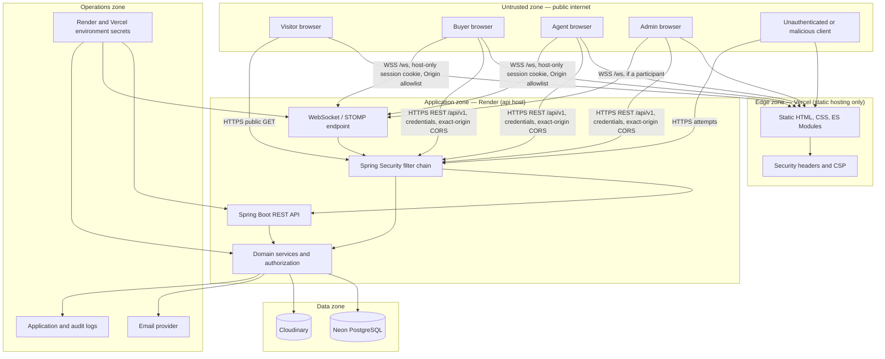

# EstateVista V2 — Security Architecture

## 1. Document Metadata

| Field | Value |
|---|---|
| Document | Security Architecture |
| Document ID | EV2-SEC-001 |
| Version | 0.5 |
| Status | **Approved** |
| Stage | 1.6 — Security Architecture |
| Project | EstateVista V2 |
| Prepared | 8 November 2026 |
| Revised | 11 November 2026 |
| Classification | Internal — Security Design |
| Owner | Architecture and Backend Security |
| Approval | **Approved** — Project owner technical approval delegated to the reviewing technical authority for this review (11 November 2026) |
| Supersedes | Versions 0.1, 0.2, 0.3, and 0.4 (retained in Section 22.4) |
| Change control | Section 22 |

### 1.1 Related documents

| Document | Role in this architecture |
|---|---|
| [`PRD.md`](PRD.md) | Product scope, roles, approved product decisions PD-01–PD-11, security non-functional requirements |
| [`FRD.md`](FRD.md) | Functional requirements FR-AUTH, FR-USER, FR-PROP, FR-DISC, FR-FAV, FR-INQ, FR-CHAT, FR-NOTIF, FR-DASH, FR-AUDIT, FR-VAL |
| [`SYSTEM_ARCHITECTURE.md`](SYSTEM_ARCHITECTURE.md) | Modular monolith, technology stack, deployment, WebSocket and authentication principles |
| [`DATABASE_DESIGN.md`](DATABASE_DESIGN.md) | Entities, ownership fields, constraints, retention, approved §23 clarifications |
| [`API_SPECIFICATION.md`](API_SPECIFICATION.md) | REST endpoints, WebSocket destinations, error contract, approved §25 clarifications |
| [`UI_UX_SPECIFICATION.md`](UI_UX_SPECIFICATION.md) | Interface security behaviour, role visibility, chat privacy, and deferred decisions D-01–D-47 (D-01, D-02, D-03, D-04, D-08, D-14, D-17, D-20, D-21, D-33, and D-47 settled) |

### 1.2 Status and interpretation

This document uses a fixed status vocabulary. A label states the evidence available at the time of writing; it is not a promise that the item is implemented.

| Label | Meaning |
|---|---|
| **Approved** | Technically justified, sufficiently specified, consistent with upstream requirements, and approved under delegated technical authority for this review (where owner approval was previously required). This does not imply implementation or verification. |
| **Pending Owner/Infrastructure Input** | Requires facts or decisions that cannot be established from available project evidence (for example specific hostnames, provider credentials, or an unpinned dependency selection). Must be resolved as an implementation or deployment prerequisite. |
| **Proposed** | Technically reasonable but not yet sufficiently established, or explicitly marked for implementation review. Must not be implemented as approved. |
| **Deferred** | Explicitly outside the current MVP scope (see §2.3 and §18.4). The affected feature must not ship until resolved. |
| **Implemented** | Only when actual implementation evidence exists. No decision in this document reaches this state. |
| **Verified** | Only when the required verification has actually been performed. No control in this document is Verified. |
| **Rejected** | Technically unsound or incompatible with approved requirements (for example JWT for the MVP, HTTP Basic, and `CookieCsrfTokenRepository`). |

The overall document status is **Approved**. Under project owner delegation, the five previously pending decisions are now **Approved** as technical designs where the evidence supports approval. This is **technical design approval only**: it does not authorise implementation, deployment, or Stage 1.8 work. The Stage 1.6 correction pass corrected specific contradictory statements in upstream documents; those corrections are recorded in Section 21.3. This document does not change source code, migrations, dependencies, environment files, deployment configuration, or runtime behaviour.

### 1.3 Table of contents

1. [Document Metadata](#1-document-metadata)
2. [Purpose and Scope](#2-purpose-and-scope)
3. [Security Principles](#3-security-principles)
4. [System Security Context](#4-system-security-context)
5. [Assets and Data Classification](#5-assets-and-data-classification)
6. [Trust Boundaries](#6-trust-boundaries)
7. [Threat Model](#7-threat-model)
8. [Authentication Architecture](#8-authentication-architecture)
9. [Password and Account Security](#9-password-and-account-security)
10. [Authorization and Access Control](#10-authorization-and-access-control)
11. [REST API Security](#11-rest-api-security)
12. [WebSocket and Chat Security](#12-websocket-and-chat-security)
13. [File Upload Security](#13-file-upload-security)
14. [Data Protection and Privacy](#14-data-protection-and-privacy)
15. [Administrative Security and Audit Logging](#15-administrative-security-and-audit-logging)
16. [Infrastructure and Deployment Security](#16-infrastructure-and-deployment-security)
17. [Security Testing Strategy](#17-security-testing-strategy)
18. [Security Decision Register](#18-security-decision-register)
19. [Requirements Traceability Matrix](#19-requirements-traceability-matrix)
20. [Implementation Security Checklist](#20-implementation-security-checklist)
21. [Risks, Dependencies and Deferred Decisions](#21-risks-dependencies-and-deferred-decisions)
22. [Approval and Change History](#22-approval-and-change-history)

### 1.4 Revision 0.5 approval scope

Version 0.5 supersedes 0.4. Version 0.4 is retained in Section 22.4 and remains the reviewed baseline. Version 0.5 is the **technical approval** revision under delegated project-owner authority; it does not authorize implementation or deployment.

1. **Delegated technical approval.** The project owner delegated authority to the reviewing technical authority to evaluate and approve technically justified security decisions in this review (11 November 2026). No individual backend, frontend, database, operations, or security reviewer approval is invented; Section 22.2 distinguishes the delegated owner authorization from stakeholder review.
2. **Five previously pending decisions approved as designs.** SD-01 (server-side session authentication), SD-03 (Spring Session JDBC schema), SD-11 (password reset), SD-12 (agent activation), and SD-48 (Option C hosting/cookie/CORS/WebSocket architecture) become **Approved** where the design is complete and consistent with upstream requirements. Their infrastructure and provider values remain explicit prerequisites.
3. **SD-53 approved as a design with a version gate.** The session-bound synchronizer CSRF mechanism is approved as a technical design. Stage 1.8 now pins Spring Boot 4.1.2 and Spring Security 7.1.2, and the dependency-version recheck against 7.1.2 is recorded in `DEVELOPMENT_SETUP.md` §12. The wiring and the Section 17 tests remain a non-blocking implementation gate; SD-53 is not Implemented or Verified.
4. **All remaining Proposed controls approved or retained as Deferred.** Section 18.7 records the delegated determinations for the controls that were Proposed in 0.4. Final totals: **46 Approved, 0 Pending Owner/Infrastructure Input, 0 Proposed, and 7 Deferred**. Every Deferred item remains outside the MVP or dependent on a later product/operations decision with a documented interim control.
5. **C-05 resolved.** ARC-010–ARC-013 are approved as the architectural provider selections already reflected in the approved deployment model and API contracts. Account creation, plan selection, credentials, and provider configuration remain deployment prerequisites. No account or integration is claimed to exist.
6. **C-10 / D-08 resolved.** Only `PUBLISHED` properties (and their images) are publicly retrievable. `DRAFT`, `UNAVAILABLE`, `SOLD`, `RENTED`, and `ARCHIVED` records are hidden from public discovery and direct public detail; authorized participants may still reach historical references through authenticated surfaces. This does not change the property lifecycle or create a new status.
7. **No inflated status.** No decision is marked Implemented or Verified, and no test is claimed as executed. Approval of a design is not evidence of implementation or deployment readiness.

The 0.3 CSRF architecture is preserved unchanged: a session-bound synchronizer token, server-side storage, memory-only frontend token, no CSRF cookie, `X-CSRF-TOKEN` response and request header, rotation, narrow exemptions, and Origin/Referer validation.

---

## 2. Purpose and Scope

### 2.1 Purpose

This document defines the security architecture for EstateVista V2. It translates the approved product, functional, architecture, database, API, and interface decisions into enforceable security controls for a Java/Spring Boot modular monolith, a Vanilla JavaScript frontend, PostgreSQL, WebSocket/STOMP messaging, and external image storage.

It is written to be implementation-ready: each control identifies the component responsible, the rule to enforce, the failure behaviour, and the verification method. It deliberately separates what is already approved from what is recommended and what remains undecided.

### 2.2 In scope

- Authentication, session lifecycle, logout, password management, password reset, and account status.
- Role-based and resource-level authorization for every approved REST endpoint and WebSocket operation.
- Property-level agent authorization and buyer record isolation.
- Conversation privacy, immutable original-agent assignment, and reassignment behaviour.
- REST API hardening: validation, injection prevention, CSRF, CORS, rate limits, error handling, security headers, and IDOR/BOLA prevention.
- WebSocket/STOMP connection, subscription, destination, sender, and message authorization.
- Property image upload validation, storage, delivery, and deletion controls.
- Data classification, personal data handling, retention, logging hygiene, and encryption expectations.
- Administrative protections, audit events, and security event logging.
- Infrastructure and deployment configuration for Vercel, Render, Neon, and Cloudinary.
- A practical threat model, security test strategy, decision register, traceability, and implementation checklist.

### 2.3 Out of scope

- Security implementation code, Spring Security configuration classes, filters, migrations, or dependency installation.
- Introducing new approved functionality or rewriting approved requirements. The Stage 1.6 correction pass only removed contradictions; every correction is recorded in Section 21.3 and does not change runtime behaviour.
- Payment, booking, mortgage, AI, voice/video, native mobile, and other PRD §10 exclusions.
- Legal privacy notices, data-processing agreements, or regulatory certification. This document identifies where such work is required; it does not provide legal advice.
- Administrative access to private conversation transcripts, which is not approved for the MVP.
- Multi-factor authentication, email verification, account deletion, and persistent "remember me" sessions, which remain deferred unless separately approved.
- A separate WebSocket specification. The WebSocket contract in API Specification §20 is the reference; System Architecture's former references to `WEBSOCKET_SPECIFICATION.md` were corrected in this pass (see Section 21.3, C-04).

### 2.4 Intended audience

Backend developers, frontend developers, database engineers, testers, reviewers, and the project owner. The document assumes familiarity with Spring Security, HTTP, browser security, PostgreSQL, and STOMP.

### 2.5 Method and sources

The architecture was derived by:

1. Extracting approved roles, ownership rules, and product decisions from PRD §4, §8, and §14.
2. Extracting functional security requirements from FRD §3, §4, §5, §9, §12, and §13.
3. Reviewing architecture trust boundaries, deployment, and authentication principles in System Architecture §3, §8, §9, §11, §12, and §16.
4. Reviewing ownership fields, constraints, retention rules, and approved clarifications in Database Design §5, §6, §10, §11, §13, §17, §20, and §23.
5. Reviewing endpoint access declarations and approved clarifications in API Specification §3, §6–§15, §17, §20, §21, and §25.
6. Reviewing interface security, role visibility, chat privacy, and deferred items in UI/UX Specification §5.7, §7.6–§7.11, §8.9, §9.6, §9.12, §10.1–§10.11, §11, §12.6–§12.7, §16.10, §17.5, §17.8, §17.11–§17.12, §18, and §20.

Where a source is ambiguous or contradictory, the conflict is recorded in Section 21.3 with both references and a recommended resolution. The Stage 1.6 correction pass applied the corrections the evidence supported; each is listed in Section 21.3 with the remaining action, if any.

### 2.6 Assumptions

- The backend is a single Spring Boot application deployed on Render. Horizontal scaling is not assumed for the first release.
- The frontend is static HTML/CSS/Vanilla JavaScript ES Modules deployed on Vercel, with no server-side rendering and no framework runtime.
- PostgreSQL is hosted on Neon and accessed only by the backend.
- Cloudinary (or a compatible object store) hosts property images; the backend owns credentials and performs every upload and deletion. The browser never uploads directly to Cloudinary.
- TLS is available on both Vercel and Render.
- The selected deployment can expose the frontend and API under custom hostnames on the same registrable domain (for example `app.example.com` and `api.example.com`). If custom domains are unavailable and the project remains on unrelated `*.vercel.app` and `*.onrender.com` hostnames, Option C is not viable and the deployment shape must be revisited before authenticated features ship (Section 8.5).
- The approved deployment choices are the target deployment for this document. System Architecture ARC-010–ARC-013 now record Cloudinary, Vercel, Render, and Neon as Approved; accounts, plans, and credentials remain deployment prerequisites (Section 21.3).
- No security control in this document is considered implemented until it is tested and evidenced under Section 17.

---

## 3. Security Principles

These principles govern every control in this document. When a specific rule is ambiguous, the principles decide the safer interpretation.

| ID | Principle | Practical implication for EstateVista |
|---|---|---|
| SP-01 | **Backend is the only security boundary** | Role checks, ownership checks, property assignment, and conversation participation are enforced in Spring services and repositories. Frontend hiding is usability only (System Architecture §4.4, §9.2; API §3.2; UI §18.1). |
| SP-02 | **Deny by default** | New endpoints, destinations, and methods are inaccessible until a matcher or method rule explicitly allows them. Unknown routes return `404`; missing authentication returns `401`; insufficient role returns `403`. |
| SP-03 | **Least privilege** | Buyers receive buyer capabilities, agents receive only assigned-property capabilities, and administrators receive platform management without private conversation content. Database and Cloudinary credentials use the minimum required scope. |
| SP-04 | **Complete mediation** | Every request is authorized, including requests that appear to be "read-only", WebSocket SEND frames, image deletions, and status changes. No cached authorization decision survives a role, status, or assignment change. |
| SP-05 | **Server-derived identity** | User IDs, buyer IDs, sender IDs, agent assignments, and creator fields come from the authenticated security context. Client-supplied identity, role, status, or assignment fields are ignored or rejected (API §20.4, §25.3; UI §17.8). |
| SP-06 | **Fail closed** | If authentication, authorization, session lookup, signature validation, or configuration is unavailable, the request is rejected. A broken dependency must not silently open access. |
| SP-07 | **Defense in depth** | Session cookies, CSRF tokens, origin checks, role rules, ownership queries, database constraints, validation, and audit operate together. No single control is assumed sufficient. |
| SP-08 | **Data minimisation** | Collect only fields the API requires; return only fields the caller is entitled to see; exclude passwords, tokens, internal notes, audit metadata, and private agent data from public responses (API §7.2; UI §18.6). |
| SP-09 | **Secure defaults** | Production starts with debug off, stack traces off, wildcard CORS off, unsigned uploads off, public database access off, and default credentials absent. |
| SP-10 | **Separation of duties** | Administrators create and assign properties; agents manage only assigned properties; buyers cannot perform agent or admin operations. No role can silently grant itself another role (FR-USER-003). |
| SP-11 | **Auditability** | Security-relevant state changes are recorded with actor, action, subject, time, and correlation ID. Audit records are append-only and never contain credentials or private message content (Database Design §13; FR-AUDIT-001–FR-AUDIT-004). |
| SP-12 | **Privacy by design** | Conversation content, inquiry content, contact details, and identifiers are treated as confidential. No admin transcript access, no message content in URLs or logs, and no unapproved tracking (UI §18.7, §18.11). |
| SP-13 | **Safe failure and safe errors** | Errors are consistent, non-enumerating, and free of stack traces, SQL, internal paths, secrets, or raw exception messages (API §17; UI §18.10). |
| SP-14 | **No security by obscurity** | Hidden UI controls, unguessable UUIDs, minified JavaScript, and private URLs are not authorization controls. Every object reference is authorized server-side. |
| SP-15 | **Verify, do not assume, provider guarantees** | Encryption at rest, backup encryption, DDoS protection, and email deliverability are provider-dependent. Each must be verified in the deployed configuration rather than asserted in documentation (Section 14.4, Section 16). |

---

## 4. System Security Context

### 4.1 Components and security responsibilities

| Component | Technology | Security responsibility |
|---|---|---|
| Browser frontend | HTML5, CSS3, Bootstrap 5.3.3, Vanilla JavaScript ES Modules | Render role-appropriate UI, validate for usability, avoid unsafe DOM insertion, never store credentials in readable storage, send CSRF token on mutations, close the socket on logout |
| REST API | Spring MVC, Spring Boot, `/api/v1` | Authenticate, authorize, validate, persist, audit, return safe errors |
| Authentication and authorization | Spring Security, session management, password encoder | Credential verification, session creation/rotation/invalidation, role and method rules, CSRF, security headers |
| WebSocket endpoint | Spring WebSocket, STOMP, `/ws` | Authenticate the handshake, authorize CONNECT/SUBSCRIBE/SEND, derive sender identity, persist before broadcast |
| Application services | Modular monolith modules: auth, user, property, favorite, inquiry, chat, notification, dashboard, audit, storage | Enforce domain rules, ownership, property assignment, conversation participation, transaction boundaries |
| Relational database | PostgreSQL on Neon, Spring Data JPA/Hibernate, Flyway | Enforce unique constraints and foreign keys, preserve history, provide durable sessions/tokens if approved, restrict network access |
| Image storage | Cloudinary or compatible object storage | Store and deliver images; credentials remain server-side; upload/delete only through the backend |
| Email delivery | Provider selected later | Deliver password-reset and account-activation messages; never receive plaintext passwords or reusable tokens beyond the intended link |
| Source control and CI | GitHub, Maven build, deployment pipelines | Prevent secret commits, run tests and dependency checks, gate deployment on passing security tests |

### 4.2 Deployment and trust zones



The hostnames in this diagram are examples for a same-site deployment, not production names. The diagram shows the approved **Option C** shape: Vercel serves static assets only, while the browser calls the REST API and WebSocket endpoint directly on the API host. Vercel is not shown as a REST or WebSocket proxy because external WebSocket proxying to Render has not been verified (Section 8.5.3). SD-48 approves this shape; the exact hostnames remain deployment configuration.

### 4.3 Data flows that cross a trust boundary

| Flow | Source | Destination | Security control |
|---|---|---|---|
| Public property discovery | Visitor browser | `GET /properties`, `/properties/featured`, `/properties/recent`, `/properties/{propertyId}`, `/properties/{propertyId}/related`, `/property-categories`, `/property-subtypes`, `/amenities` | Public access; only published/eligible records; no private agent fields; validated query parameters |
| Registration | Visitor browser | `POST /auth/register` | Public; rate limited; buyer role only; server-side validation; no admin/agent creation |
| Login | Any browser | `POST /auth/login` | Public; generic failure; rate limited; session rotation; account status check |
| Authenticated REST | Buyer/agent/admin browser | `https://api.example.com/api/v1/**` (direct, cross-origin) | Host-only session cookie, CSRF token on mutations, exact-origin credentialed CORS, role and ownership checks |
| Real-time message | Buyer/agent browser | `/app/chat.send` over `wss://api.example.com/ws` (direct) | Host-only session cookie, session-authenticated handshake, exact Origin allowlist, STOMP authorization, participant check, server-derived sender, persistence before broadcast |
| Private event delivery | Backend | `/user/queue/messages`, `/user/queue/notifications`, `/user/queue/errors` | Per-user destinations; per-session subscription; no arbitrary conversation destinations |
| Image upload | Agent/admin browser | `POST /properties/{propertyId}/images` on the API host | Session, CSRF, assignment check, multipart limits, magic-byte and image validation; the backend performs a server-side signed Cloudinary request. The browser never uploads to Cloudinary directly. |
| Image delivery | Public or authenticated browser | Cloudinary URL returned by API | Public images only for `PUBLISHED` properties; authenticated or signed delivery for unpublished images (SD-31, C-10) |
| Database access | Backend | Neon PostgreSQL | TLS, least-privilege role, private network/allowlist, no browser access |
| Password reset | Visitor browser | `POST /auth/forgot-password`, `POST /auth/reset-password` | Public, rate limited, neutral response, hashed single-use token, short expiry |
| Audit access | Admin browser | `GET /admin/audit-logs` | Admin role only; read-only; no export; no conversation content |

### 4.4 Technology constraints that shape security

- **No React and no frontend framework.** Security controls must work with static pages and ES Modules. There is no framework-level HTML escaping; the frontend must use `textContent`, `createElement`, and vetted helpers (UI §17.12).
- **Independent deployments.** Vercel and Render are different origins. The approved Option C keeps them same-site (for example `app.example.com` and `api.example.com`) but cross-origin, so the host-only session cookie is sent to the API host, CORS must allow the exact frontend origin with credentials, and the CSRF token must be deliverable to the frontend origin. WebSocket traffic goes directly to the API host. See Section 8.5; the exact hostnames remain deployment configuration.
- **Modular monolith.** One process and one database simplify transactions and audit but require strict module boundaries so that a controller cannot bypass a service-level ownership rule.
- **STOMP user destinations.** Private message delivery uses `/user/queue/*`; conversation-specific topics are not part of the approved contract and must not be introduced (API §20.2).
- **PostgreSQL constraints.** Unique `(buyer_id, property_id)` for conversations, unique `(buyer_id, property_id)` for favorites, and `assigned_agent_id` as an immutable historical snapshot are security-relevant integrity controls (Database Design §11, §23.1.D).
- **External image storage.** The backend never accepts a client-supplied storage URL as authoritative and never exposes Cloudinary API secrets (System Architecture §10.3; API §8.1).

---

## 5. Assets and Data Classification

### 5.1 Classification scheme

| Class | Definition | Examples | Handling |
|---|---|---|---|
| **Public** | Intended for unauthenticated display | Published property title, description, price, city, locality, public images, category and amenity names | May be cached and indexed; still validate and escape |
| **Internal** | Not secret but not for public display | Aggregate dashboard counts, audit metadata without personal content, deployment configuration names, correlation IDs | Authenticated or operational access only; no public API exposure |
| **Confidential** | Personal or business data whose disclosure harms a user or the platform, or a security token that must be readable only by the approved frontend origin | Names, emails, phone numbers, account status, favorites, inquiries, conversation metadata, message content, IP addresses, audit actor details; CSRF tokens (delivered through the CORS-exposed header, held in memory, not session credentials) | Authorized role/ownership only; encrypt in transit; minimise in logs; no public caching; CSRF tokens are never logged or placed in URLs |
| **Restricted** | Secrets whose disclosure compromises accounts or infrastructure | Password hashes, session identifiers, password-reset and activation tokens, database credentials, Cloudinary API secret, email API key, signing keys | Never returned to clients, never logged, never committed, encrypted at rest, rotated on compromise |

### 5.2 Asset inventory

| Asset | Class | Owner module | Primary threats | Primary controls |
|---|---|---|---|---|
| User credentials (password hashes) | Restricted | Auth/User | Offline cracking, credential stuffing, database leak | BCrypt/Argon2id, strong policy, no plaintext, restricted DB access, no logging |
| Session identifiers | Restricted | Auth | Hijacking, fixation | Host-only HttpOnly/Secure cookie, rotation, idle/absolute expiry, revocation |
| CSRF tokens | Confidential | Auth | CSRF bypass, token fixation, cookie tossing | Session-bound synchronizer token delivered only through the CORS-exposed `X-CSRF-TOKEN` response header; held in memory; never in a cookie or browser storage; rotation on session lifecycle; never logged |
| Password-reset and activation tokens | Restricted | Auth | Token theft, replay, enumeration | 256-bit random, hashed at rest, short expiry, single use, neutral responses |
| User profile and contact data | Confidential | User | Enumeration, unauthorised access, spam | Ownership checks, field allowlists, masking in logs |
| Buyer favorites | Confidential | Favorite | IDOR, cross-buyer disclosure | `buyer_id` from principal, unique constraint, scoped queries |
| Inquiries | Confidential | Inquiry | Cross-buyer/agent disclosure, content leakage | Buyer/agent ownership, historical assignment, no public exposure |
| Conversations and messages | Confidential | Chat | Unauthorized subscription, impersonation, transcript leakage, admin overreach | Participant checks, server-derived sender, immutable agent assignment, no admin transcript |
| Property records and assignments | Internal/Public | Property | Unauthorized modification, reassignment, archive abuse | Admin-only create/assign, assigned-agent update, audit, status rules |
| Property images and metadata | Public/Internal | Storage/Property | Malicious upload, unauthorized replacement/deletion, hotlinking | Auth, assignment, magic-byte validation, re-encode, server-side Cloudinary credentials |
| Audit logs | Internal/Confidential | Audit | Tampering, sensitive-data capture, unauthorized read | Append-only, admin-only read, redaction, restricted DB role |
| Database and service credentials | Restricted | Operations | Secret leakage, lateral movement | Environment secrets, least privilege, rotation, no Git, no logs |
| Application logs and metrics | Internal | Operations | PII leakage, reconnaissance | Structured logging, redaction, restricted access, retention |
| Backups | Confidential/Restricted | Operations | Theft, loss, ransomware | Encrypted provider backups, access control, restore testing |

### 5.3 Data classification rules by field

| Field / group | Class | Rule |
|---|---|---|
| `users.password_hash` | Restricted | Never serialized to any DTO; never logged; excluded from audit `before_data`/`after_data` |
| `users.email`, `users.phone`, `first_name`, `last_name` | Confidential | Return only to the owner or authorized admin; mask in logs; no public agent contact leakage unless the public contract includes it |
| `users.account_status`, `last_login_at`, `email_verified_at` | Confidential/Internal | Owner may see status; only admin may change; status changes audited |
| `agent_profiles` bio, agency, license | Internal/Confidential | Public only if the approved public property contract includes agent display; no private contact fields by default |
| `properties` address, coordinates | Public/Confidential | Published listings may expose location; exact address exposure must follow the approved property contract; unpublished records are not public |
| `favorites` | Confidential | Buyer-only; `buyer_id` derived from session |
| `inquiries.message`, `subject` | Confidential | Buyer owner, historically assigned agent, authorized admin; never public |
| `conversations` metadata | Confidential | Participants only; admin may see existence/count only if the API supplies it, never messages (UI §10.7) |
| `messages.content` | Confidential | Participants only; never logged, never in URLs, never in notification bodies beyond generic text |
| `conversation_read_states` | Confidential | Participant-only; no read receipts to the other participant (UI §11.9) |
| `audit_logs.before_data`/`after_data` | Confidential | Redact passwords, tokens, secrets, full message/inquiry content; append-only |
| `audit_logs.ip_address` | Confidential | Restricted access; retention policy; not exposed in public APIs |
| Session IDs, reset tokens, API secrets | Restricted | Never serialized to ordinary clients, logged, committed, or placed in URLs (except the reset token in the approved reset link flow, with mitigations in Section 9.5) |
| CSRF tokens | Confidential | Delivered only through the CORS-exposed `X-CSRF-TOKEN` response header and held in memory; never stored in a cookie, `localStorage`, `sessionStorage`, a URL, or an application log; never treated as a session credential; rotated at session lifecycle boundaries (Section 8.5.7) |

### 5.4 Data minimisation rules

1. Do not add profile fields that the API does not require (UI §18.6).
2. Do not return `password_hash`, `email_verified_at`, internal role IDs, audit metadata, or storage public IDs to ordinary clients.
3. Do not display buyer contact details to agents unless the API returns them and the product requires it (UI §18.6).
4. Do not include message or inquiry content in notification bodies, page titles, URLs, analytics, or error toasts (UI §18.7).
5. Do not cache personal data in shared browser storage. The approved frontend use of `localStorage` is limited to non-sensitive UI preferences, and even that is optional (UI §17.3).
6. Do not place tokens, passwords, or full message content in a URL (UI §18.5). The password-reset token is the documented exception; it must be short-lived, single-use, and protected from logging and referrer leakage.

---

## 6. Trust Boundaries

### 6.1 Boundary inventory

| ID | Boundary | Untrusted side | Trusted side | Controls at the boundary |
|---|---|---|---|---|
| TB-01 | Browser to Vercel static site | Public internet | Static frontend | HTTPS, security headers, no secrets in source, CSP, safe DOM insertion |
| TB-02 | Browser to Render REST API (direct, cross-origin) | Public internet | Spring Boot API | TLS, Spring Security filter chain, host-only session cookie, CSRF token, exact-origin credentialed CORS, rate limits, validation |
| TB-03 | Browser to Render WebSocket (direct) | Public internet | STOMP endpoint | WSS, host-only session cookie, handshake authentication, exact Origin allowlist, STOMP CONNECT/SUBSCRIBE/SEND authorization |
| TB-04 | API to PostgreSQL | Application network | Database | TLS, least-privilege DB role, connection pooling, private networking/allowlist, parameterised queries |
| TB-05 | API to Cloudinary | Application network | External storage | HTTPS, server-side credentials, signed/authorized operations, response validation |
| TB-06 | API to email provider | Application network | External provider | HTTPS, API key in secret store, no password in email body, rate limits, delivery logging without tokens |
| TB-07 | Operations to secrets | CI/CD and operator | Runtime environment | Environment variables/secret files, access control, rotation, no Git, no logs |
| TB-08 | Admin browser to admin APIs | Authenticated admin | Administrative functions | Admin role, re-authentication where sensitive, audit, no transcript access, no impersonation |
| TB-09 | Agent browser to assigned-property functions | Authenticated agent | Property module | Assignment check, active-agent check, no create/reassign, audit |
| TB-10 | Buyer browser to private records | Authenticated buyer | Buyer records | Principal-derived `buyer_id`, scoped queries, 404/403 policy, no cached data after revocation |

### 6.2 Boundary rules

1. **No direct browser-to-database path.** The frontend must never connect to PostgreSQL or hold database credentials (System Architecture §3.2).
2. **No direct browser-to-Cloudinary upload.** Uploads pass through the backend so that authorization, file validation, and metadata persistence happen atomically (System Architecture §10.2; API §8.1).
3. **No trust in client-supplied identity.** At TB-02 and TB-03, the principal is derived from the session, not from a request body, query parameter, header, or STOMP payload (API §25.3).
4. **No trust in client-supplied assignment.** `primary_agent_id`, `assigned_agent_id`, `created_by`, and `sender_id` are server-controlled (API §25.3; Database Design §23.1.D).
5. **No admin path into private conversations.** The admin boundary stops at inquiry metadata and audit records. There is no transcript reader and no `GET` of another participant's messages for an admin who is not a participant (API §15; UI §10.1, §18.7).
6. **No cross-tenant cache.** After a `403`, the frontend clears the affected region; the backend does not serve a cached representation to a different principal (UI §18.2).
7. **No implicit trust from network location.** Being inside Render or Neon does not grant application authorization. Service-to-service calls still carry a principal or an explicit system authorization.
8. **No CSRF cookie.** The CSRF token is a session-bound synchronizer token delivered through an explicitly CORS-exposed `X-CSRF-TOKEN` response header and held in frontend memory. No CSRF token is stored in any cookie, so a sibling subdomain cannot inject or overwrite one. The session cookie remains host-only on the API host (Section 8.5.2).

### 6.3 Trust assumptions that must be verified

| Assumption | Verification | If false |
|---|---|---|
| Vercel terminates TLS and serves only HTTPS | Inspect deployment settings and response headers | Enable HTTPS/HSTS; block HTTP |
| Render terminates TLS and forwards the correct client IP | Inspect `Forwarded`/`X-Forwarded-For` handling and `server.forward-headers-strategy` | Rate limiting and audit IPs become inaccurate |
| Neon requires TLS and restricts network access | Inspect connection string and Neon project settings | Enable SSL and IP allowlist before production |
| Cloudinary credentials are server-side only | Search frontend bundle and repository for secrets | Rotate secrets immediately; remove from frontend |
| Email provider is authenticated and domain-verified | Check SPF/DKIM/DMARC and API credentials | Reset/activation emails may be spoofed or undelivered |
| Session storage survives Render restarts and deploys | Verify Spring Session JDBC or equivalent | Users are logged out on every deploy; availability and security review required |

---

## 7. Threat Model

### 7.1 Method and risk scale

The model is asset- and boundary-driven. Each threat is mapped to the component that owns the control, the realistic attack path, the impact on EstateVista, and a verification method that can be automated or performed in a later stage.

**Risk** is the combination of **likelihood** (how feasible the attack is against the deployed design) and **impact** (confidentiality, integrity, availability, or business harm).

| Rating | Meaning | Response |
|---|---|---|
| **Critical** | Direct account or platform compromise, mass private-data exposure, or irreversible integrity loss | Must be mitigated before the affected feature ships; blocking |
| **High** | Serious confidentiality or integrity loss for one or more users, or reliable privilege escalation | Must be mitigated before production; may be feature-blocking |
| **Medium** | Limited disclosure or disruption, or an attack requiring significant preconditions | Mitigate in the implementing stage; verify before release |
| **Low** | Minor information gain or nuisance with strong existing controls | Accept with monitoring or fix opportunistically |

### 7.2 Threat actors

| Actor | Capability | Primary targets |
|---|---|---|
| Unauthenticated internet attacker | Automated scanning, credential stuffing, injection attempts, upload abuse | Login, registration, public APIs, WebSocket handshake, file upload |
| Malicious authenticated buyer | Valid buyer account, can enumerate UUIDs and manipulate requests | Other buyers' favorites, inquiries, conversations, notifications |
| Malicious or curious agent | Valid agent account, knows property and assignment identifiers | Other agents' properties, other agents' inquiries and conversations, reassignment |
| Compromised administrator account | High privilege, possibly phishing or session theft | User data, assignments, audit logs, platform integrity |
| Malicious insider or operator | Deployment, database, or secret access | Secrets, backups, audit history, private data |
| Automated bot / scraper | High request volume, distributed sources | Public listings, login, registration, password reset, chat |
| Supply-chain attacker | Compromised dependency, CDN, or provider | Backend build, frontend assets, image storage, email |

### 7.3 Threat register

| ID | Threat | Affected component | Attack scenario | Potential impact | Likelihood | Risk | Mitigation | Verification |
|---|---|---|---|---|---|---|---|---|
| T-01 | Brute-force and credential stuffing | `POST /auth/login` | Attacker replays breached email/password pairs or guesses passwords across many accounts | Account takeover, private-data exposure | High | **High** | Rate limits per IP and account, temporary lockout, generic errors, breached-password screening, audit failures, optional MFA for admins (deferred) | ST-AUTH-04, ST-AUTH-05; load test with repeated failures; confirm `429` and no account oracle |
| T-02 | Credential theft by phishing or malware | Login page, user devices | Attacker clones the login page or steals a password/session from a compromised browser | Account takeover | Medium | **High** | HTTPS, HSTS, clear domain, no password in URL, HttpOnly cookies, short session lifetime, user education, MFA deferred | Phishing simulation and header review; verify cookies are HttpOnly/Secure and not readable by JavaScript |
| T-03 | Session hijacking or fixation | Session cookie, Spring Security | Attacker fixes a known session ID before login or steals a cookie over an insecure channel | Impersonation, unauthorized actions | Medium | **Critical** | `Secure`, `HttpOnly`, `SameSite`, session ID rotation on login, TLS-only, idle/absolute expiry, logout invalidation, no session ID in URLs | ST-AUTH-06, ST-AUTH-07; inspect `Set-Cookie`; confirm rotation and invalidation |
| T-04 | Broken role-based access control | Spring Security matchers, controllers | Buyer calls an agent/admin endpoint, agent calls an admin endpoint, or a route is accidentally `permitAll` | Privilege escalation, data modification | Medium | **Critical** | Deny-by-default matchers, `@PreAuthorize`, method-level ownership service, endpoint inventory tests, review of every `permitAll` | ST-AUTHZ-01 to ST-AUTHZ-04; matrix test for every role and endpoint |
| T-05 | IDOR/BOLA on buyer records | Favorites, inquiries, conversations, notifications | Buyer changes a UUID in a path or query to read or modify another buyer's record | Private-data disclosure, integrity loss | High | **Critical** | Principal-derived `buyer_id`, scoped repository methods, 404 for out-of-scope records, no client-supplied owner fields | ST-AUTHZ-05 to ST-AUTHZ-08; two-buyer IDOR suite |
| T-06 | Agent property-assignment bypass | `PUT/PATCH /properties/{propertyId}`, image endpoints, status endpoint | Agent edits or uploads images to a property assigned to another agent, or attempts reassignment through an admin route | Unauthorized listing changes, brand damage | High | **High** | Assignment check on every property mutation, agent cannot call `POST /properties` or the assignment endpoint, active-account check, audit | ST-AUTHZ-09 to ST-AUTHZ-11; agent against another agent's property and assignment route |
| T-07 | SQL injection | JPA queries, native queries, search and sort parameters | Attacker injects SQL through filters, sort fields, or raw query concatenation | Data theft, data loss, database compromise | Medium | **High** | Parameterised queries/JPA bindings, no string concatenation, sort allowlist, validation, least-privilege DB role, WAF/rate limits as defence in depth | ST-API-01; fuzz search, sort, filter, and path parameters; code review for native SQL |
| T-08 | Cross-site scripting (XSS) | Property descriptions, inquiry/message content, names, alt text, error messages | Attacker stores `<script>` or an event handler in a field rendered with `innerHTML` | Session theft, actions as the victim, data exfiltration | High | **High** | Escape on output, `textContent`/`createElement`, no `innerHTML` with untrusted data, CSP without `unsafe-inline`, URL scheme validation, sanitise if rich text is ever approved | ST-API-02; Playwright payload suite; CSP report review |
| T-09 | Cross-site request forgery | Mutating REST requests | A malicious site submits a state-changing request using the victim's ambient session cookie | Unauthorized property, account, or message changes | Medium | **High** | Session-bound synchronizer token on every mutating request, exact-origin validation, `SameSite` cookies, no state change on `GET`, no CSRF cookie to toss | ST-CSRF-01 to ST-CSRF-14; ST-API-04 |
| T-10 | Malicious file upload | `POST /properties/{propertyId}/images` | Attacker uploads a polyglot, oversized image, decompression bomb, SVG with script, or executable disguised as an image | Storage abuse, XSS, server resource exhaustion, malware distribution | Medium | **High** | Extension/MIME/magic-byte checks, decode and re-encode, strip metadata, dimension/pixel limits, size limits, server-side Cloudinary upload, no SVG, rate limit | ST-UPLOAD-01 to ST-UPLOAD-07; malicious fixture suite |
| T-11 | WebSocket authorization bypass | `/ws`, STOMP SUBSCRIBE/SEND | Unauthenticated client connects, subscribes to another user's queue, or sends to a conversation without membership | Chat disclosure, impersonation, spam | Medium | **Critical** | Session-authenticated handshake, origin allowlist, CONNECT principal check, allowlist of user destinations, participant check per SEND, no arbitrary topics | ST-WS-01 to ST-WS-06; raw STOMP client tests |
| T-12 | Chat sender impersonation | `/app/chat.send` payload | Client supplies another user's `senderId` or manipulates `conversationId` | False attribution, fraud, privacy breach | High | **High** | Ignore/reject client `senderId`; derive sender from `Principal`; validate conversation membership; server-generated `id` and `sentAt` | ST-WS-03; send spoofed payloads and inspect persisted sender |
| T-13 | Conversation data leakage | Conversation list, messages, admin inquiry view, notifications | Wrong agent sees historical messages after reassignment; admin opens a transcript; notification leaks content | Privacy breach, trust loss | Medium | **Critical** | Immutable `assigned_agent_id`, participant-only queries, no admin transcript, generic notification text, no message content in logs/URLs | ST-CHAT-01 to ST-CHAT-05; reassignment scenario with two agents |
| T-14 | Unauthorized property modification or archive | Property endpoints, image endpoints, status endpoint | Agent modifies another property; buyer calls admin archive; attacker guesses a property ID | Listing corruption, data loss, business harm | Medium | **High** | Admin-only create/archive/assign, assigned-agent update, status transition allowlist, audit, version/optimistic locking (approved) | ST-AUTHZ-09, ST-AUTHZ-12; role and ownership matrix |
| T-15 | Privilege escalation through mass assignment | Registration, profile update, agent update, property create | Client submits `role`, `accountStatus`, `primaryAgentId`, `createdBy`, or `senderId` and the server binds it | Admin/agent takeover, unauthorized assignment | Medium | **Critical** | DTO allowlists, no entity binding from requests, ignore/reject protected fields, server-side role and status only, explicit tests | ST-API-05; submit every protected field and verify no state change |
| T-16 | Secret leakage | Git, frontend bundle, logs, error pages, CI output | API keys, database URL, or Cloudinary secret committed or exposed in a response | Full data/storage compromise | Medium | **Critical** | `.gitignore`, secret scanning, environment variables, no secrets in frontend, redaction, rotation, least privilege | ST-CONFIG-01; repository and bundle secret scan; grep built assets |
| T-17 | Denial of service and resource abuse | Login, registration, search, upload, chat, WebSocket | High-volume requests, oversized payloads, expensive search, connection exhaustion, message flooding | Outage, cost increase, degraded service | High | **High** | Edge/provider protections, request size limits, pagination caps, rate limits, timeouts, connection limits, async processing where appropriate | ST-RATE-01 to ST-RATE-04; load and soak tests |
| T-18 | Account enumeration | Login, registration, forgot-password, reset | Attacker distinguishes existing from non-existing emails by response, status, or timing | Targeted phishing, credential stuffing | High | **Medium** | Generic login error, neutral reset confirmation, consistent status/timing, registration conflict handled carefully, rate limits | ST-AUTH-08; compare responses and timings for known/unknown emails |
| T-19 | Password-reset token theft or replay | Reset link, `POST /auth/reset-password` | Token leaks via referrer, logs, shared device, or is reused after a reset | Account takeover | Medium | **Critical** | 256-bit random token, hashed at rest, short expiry, single use, invalidate prior tokens and sessions, `Referrer-Policy: no-referrer`, no logging | ST-AUTH-09 to ST-AUTH-11; reuse, expiry, and referrer tests |
| T-20 | Audit tampering or sensitive audit data | `audit_logs`, `GET /admin/audit-logs` | Attacker with DB access edits/deletes audit rows; application stores passwords or message content in `before_data` | Loss of accountability, secondary data breach | Low | **High** | Append-only application rules, restricted DB role, no update/delete endpoint, redaction, retention, integrity monitoring, backups | ST-AUDIT-01 to ST-AUDIT-03; attempt update/delete; inspect audit payloads |
| T-21 | Supply-chain or dependency compromise | Maven dependencies, CDN assets, provider SDKs | Malicious or vulnerable dependency executes in the backend or serves tampered frontend code | Full compromise | Medium | **High** | Pinned versions, dependency scanning, lockfiles where applicable, integrity attributes for CDN assets, minimal dependencies, review updates | ST-CONFIG-02; CI dependency scan; review SBOM |
| T-22 | Open redirect through `returnUrl` | Login redirect, protected-route guard | Attacker supplies an absolute or protocol-relative `returnUrl` to redirect users to a phishing site | Credential phishing | Medium | **Medium** | Accept only same-origin relative paths; reject absolute, protocol-relative, backslash, and `javascript:` values; test | ST-UI-01; Playwright redirect suite |
| T-23 | Clickjacking | Frontend pages, admin console | Attacker frames the site and tricks an admin into clicking destructive actions | Unauthorized admin action | Low | **Medium** | `Content-Security-Policy: frame-ancestors 'none'`, `X-Frame-Options: DENY`, no sensitive actions in frames | ST-CONFIG-03; header check |
| T-24 | Information disclosure through errors or logs | API error handler, logs, actuator, debug config | Stack trace, SQL, internal path, token, or message content appears in a response or log | Reconnaissance, privacy breach | Medium | **High** | Central exception handler, generic messages, no stack traces, redaction, production debug off, restricted actuator, log review | ST-API-09, ST-CONFIG-04; trigger errors and inspect responses/logs |
| T-25 | Reset/activation email spoofing or interception | Email provider, DNS | Attacker spoofs the sender domain or intercepts a reset link | Account takeover, phishing | Low | **Medium** | Domain verification, SPF/DKIM/DMARC, HTTPS-only links, short expiry, single use, provider API key in secret store | ST-CONFIG-05; DNS and email header review |
| T-26 | Unsafe image URL injection | Property image `src`, avatar, links | Server or attacker supplies `javascript:`, `data:text/html`, or an unexpected origin as an image/link URL | XSS, tracking, mixed content | Low | **Medium** | Validate scheme and host; allow only `https:` and approved Cloudinary/relative URLs; CSP `img-src`; never render SVG as markup | ST-UI-02; payload suite |

### 7.4 STRIDE coverage

| STRIDE category | EstateVista threats | Primary controls |
|---|---|---|
| **Spoofing** | T-02, T-03, T-12 | Strong authentication, session protection, server-derived sender |
| **Tampering** | T-06, T-14, T-20 | Authorization, assignment checks, append-only audit, DB constraints |
| **Repudiation** | T-20 | Audit trail with actor, action, subject, time, request ID |
| **Information disclosure** | T-05, T-13, T-18, T-24 | Ownership checks, participant checks, generic errors, redaction |
| **Denial of service** | T-17, T-10 | Rate limits, size limits, pagination caps, timeouts |
| **Elevation of privilege** | T-04, T-15 | Role matchers, DTO allowlists, deny-by-default |

### 7.5 Residual risks

Even after the controls are implemented, the following residual risks remain and must be accepted explicitly:

1. **Compromised administrator endpoint.** An attacker who controls an admin browser can perform admin actions until the session is revoked. MFA is not approved; the mitigation is short sessions, audit, anomaly alerts, and rapid deactivation.
2. **Compromised email account.** A reset link delivered to a compromised mailbox can be used before expiry. Short expiry and single use reduce the window; they do not eliminate it.
3. **Provider compromise.** A compromised Cloudinary, Neon, Render, or email provider can affect confidentiality or availability. Provider security assurances must be verified; this document does not claim guarantees.
4. **Browser third-party cookie restrictions and hostname layout.** Option C keeps the frontend and API same-site but cross-origin, so the host-only session cookie is sent to the API host on direct REST and WebSocket requests. If the deployment uses unrelated `vercel.app` and `onrender.com` hostnames, the cookie becomes cross-site and may be blocked or unreliable. This is a deployment blocker, not a code-level fix (Section 8.5).
5. **No MFA, email verification, or account-deletion workflow.** These are deferred; until resolved, account recovery and abuse response are weaker than a mature platform.
6. **No antivirus scanning.** Re-encoding and format restrictions reduce but do not eliminate malicious image content. If the threat profile changes, add scanning.
7. **No dedicated WAF or bot management in the approved stack.** Render/Vercel platform protections and application rate limits are the baseline; a CDN/WAF is a future option.

---

## 8. Authentication Architecture

### 8.1 Upstream state before this decision

The approved upstream documents intentionally left the final mechanism to this security design:

- System Architecture §9.3 delegates the session/cookie/CSRF/reset/activation controls to `SECURITY_ARCHITECTURE.md` and, following this review, records the approved mechanism.
- API Specification §3 states that implementation details will be finalised in the security design and that the contract only assumes the backend can identify the user and role.
- Database Design §21 previously listed the exact authentication and session/token mechanism as deferred; the Stage 1.9 audit reconciled it with SD-01, SD-03, SD-11, and SD-12.
- UI/UX Specification recorded the authentication mechanism as **D-20** and the password-reset token/delivery as **D-21**; both were Blocking in 0.4 and are now settled by SD-01 and SD-11.

This section resolves D-20 as **Approved** (SD-01, 11 November 2026). The design was technically complete in 0.4 and is now approved under delegated owner authority; implementation and deployment remain outstanding.

### 8.2 Options considered

| Option | How it works | Advantages | Disadvantages for EstateVista | Verdict |
|---|---|---|---|---|
| **A. Server-side session with an opaque cookie** | Spring Security creates a server-side session; the browser holds only an opaque session ID in an `HttpOnly` cookie | No credential readable by JavaScript; immediate server-side revocation; simple Spring Security integration; deactivation can delete sessions; no refresh-token table; CSRF is well understood | Requires shared session storage if the backend scales; cross-site deployment needs careful cookie/CORS design; CSRF protection required | **Approved (SD-01)** |
| B. JWT in an `HttpOnly` cookie | Signed token in a cookie; server validates signature | Stateless; no session lookup | Revocation is difficult; deactivation cannot invalidate an unexpired token without a denylist; token size; key management; CSRF still required; no benefit for a single modular monolith | Not recommended |
| C. Short-lived access JWT in memory plus refresh token in a cookie | Access token kept in JS memory; refresh token rotated | Limits XSS exposure of the access token; stateless API calls | Two-token lifecycle, rotation, reuse detection, revocation storage, clock skew, WebSocket token handoff; significantly more code and failure modes; refresh cookie still needs CSRF/origin protection | Not recommended for MVP |
| D. JWT in `localStorage` or `sessionStorage` | JavaScript reads and attaches a bearer token | Simple cross-origin API calls | Any XSS steals a long-lived credential; violates UI §18.3 ("do not store credentials, tokens, or session identifiers in `localStorage`"); no server-side revocation | **Rejected** |
| E. HTTP Basic authentication | Browser sends credentials on every request | Simple | Credentials repeated constantly; no logout semantics; poor UX; no session revocation; not suitable | Rejected |
| F. Social login / OIDC | External identity provider | Outsources credential handling | Not in scope; adds a provider and account-linking model; no approved requirement | Out of scope |

### 8.3 Recommendation

**Adopt server-side session authentication using an opaque session identifier in a first-party, `HttpOnly`, `Secure`, `SameSite=Lax` cookie.** Use Spring Security session management and Spring Session JDBC for durable session storage. Do not use JWT for the MVP. This decision is **Approved (SD-01, 11 November 2026)**.

The decision has three parts that are approved together:

1. **Authentication mechanism:** server-side session, not token-based.
2. **Deployment and cookie shape (Option C):** the frontend and API are served from the same registrable domain but different hostnames. The browser calls the REST API and opens the WebSocket directly on the API host. The `EV_SESSION` cookie is **host-only on the API host**, not on the frontend host and not on the parent domain. CORS allows only the exact frontend origin with credentials. The CSRF token is a session-bound synchronizer token exposed through the `X-CSRF-TOKEN` response header and held in memory (Sections 8.5.2–8.5.7).
3. **Session storage:** Spring Session JDBC so that a Render deploy or restart does not invalidate every session and so that sessions can be revoked by principal.

Recommended production shape:

```text
Browser
  |
  |  https://app.example.com
  v
Vercel static frontend (HTML/CSS/ES Modules, CSP and security headers)
  |
  |  https://api.example.com/api/v1/*      direct REST, fetch credentials: "include"
  |  wss://api.example.com/ws              direct WSS, EV_SESSION cookie, Origin check
  v
Render Spring Boot API and WebSocket endpoint
```

Under this shape:

- `EV_SESSION` is set by `api.example.com` with `Domain` omitted (host-only), `Path=/`, `HttpOnly`, `Secure`, `SameSite=Lax`. It is sent to `api.example.com` for REST and for the WebSocket handshake, but not to `app.example.com` or to Vercel static requests.
- The frontend uses `fetch(url, { credentials: "include" })` for authenticated REST calls. The API returns `Access-Control-Allow-Origin: https://app.example.com`, `Access-Control-Allow-Credentials: true`, and `Vary: Origin`. Wildcard credentialed CORS is prohibited.
- Because `app.example.com` and `api.example.com` are same-site, `SameSite=Lax` permits the session cookie on the cross-origin REST request and the WebSocket handshake. If the final hostnames are not on the same registrable domain, this architecture is not valid (Section 8.5.4).
- The CSRF token cannot be read from a host-only `api.example.com` cookie by JavaScript running on `app.example.com`, and it is deliberately not placed in a cookie at all. The backend binds a synchronizer token to the authenticated server-side session and returns it in the `X-CSRF-TOKEN` response header. The API exposes that header to exactly `https://app.example.com` through `Access-Control-Expose-Headers`. The frontend holds the token in memory and sends it in the `X-CSRF-TOKEN` request header on mutating calls. There is no `XSRF-TOKEN` cookie, so a sibling subdomain cannot inject a token cookie (Section 8.5.2).
- The WebSocket handshake is a direct `wss://api.example.com/ws` request. It carries the host-only session cookie and is validated against the exact `Origin: https://app.example.com`. CORS does not apply to WebSocket.
- Vercel is not used as a REST or WebSocket proxy. A same-origin rewrite would not by itself solve the WebSocket cookie problem, and external WebSocket proxying to Render has not been verified (Section 8.5.3).

`app.example.com` and `api.example.com` are examples of a same-site custom-domain layout. They are not invented endpoints or production hostnames; the actual domains, CORS origin, and WebSocket origin must be supplied as deployment configuration under SD-48. The `X-CSRF-TOKEN` response header and its CORS exposure are part of the approved API contract. If the project remains on unrelated `*.vercel.app` and `*.onrender.com` hostnames, the session cookie becomes cross-site and browser third-party cookie restrictions may block it. That is a deployment blocker (Section 8.5), not a reason to move credentials into JavaScript.

### 8.4 Session lifecycle

| Control | Approved rule | Rationale |
|---|---|---|
| Session creation | Created on successful `POST /auth/login`; registration does not auto-login unless a future API response explicitly establishes a session | UI §7.7 says not to auto-login unless the API returns a session |
| Session identifier | Opaque, high-entropy, generated by the container/Spring Session; never a JWT and never derived from user data | Prevents forgery and information leakage |
| Cookie name | `EV_SESSION` (configurable); do not expose the default name as a security control | Clear operational identification |
| `HttpOnly` | Always true | JavaScript cannot read the session cookie |
| `Secure` | Always true in production; local development may use HTTP only on `localhost` | Prevents cleartext transmission |
| `SameSite` | `Lax` in the Option C same-site deployment; `None` only if a documented cross-site exception is approved and browser support is accepted | CSRF defence in depth; `Lax` is sent on same-site REST requests and the WebSocket handshake |
| `Path` | `/` | The API and WebSocket handshake need the cookie |
| `Domain` | **Host-only on the API host** (omit `Domain`); never a parent-domain session cookie | Limits the session cookie to the API host. No CSRF cookie exists (Section 8.5.2). |
| `Max-Age` / `Expires` | Session cookie by default; persistent "remember me" is deferred (UI D-20) | No long-lived credential without approval |
| Rotation | Call `changeSessionId()` on successful login and on privilege change | Prevents session fixation |
| Idle timeout | 30 minutes of inactivity (approved) | Limits abandoned-session exposure |
| Absolute timeout | 12 hours from authentication (approved) | Limits long-lived sessions even with activity |
| Logout | `POST /auth/logout` with CSRF; invalidate the session, delete the server-side record, clear the cookie, clear the security context, and close the WebSocket through a session-destroyed listener (plus a client-side close). Do not assume session invalidation closes an established socket by itself. | FR-AUTH-003; UI §6.10; Section 12.15 |
| Password change | Verify current password; re-encode; invalidate all other sessions for the user; keep the current session and rotate its ID (approved) | FR-AUTH-007; limits stolen-session persistence |
| Password reset | Invalidate all sessions for the user after a successful reset | The old password may be compromised |
| Account deactivation/suspension | Invalidate all sessions for the user immediately | FR-AUTH-006 requires active access to end |
| Concurrent sessions | Allow multiple sessions per user initially; optionally cap at 5 and expire the oldest (approved) | Users commonly use multiple devices; a cap limits abuse |
| Session fixation | Rotate on login; never accept a client-supplied session ID | Standard session security |
| Session storage | Spring Session JDBC (`spring_session`, `spring_session_attributes`) | Survives restarts; enables revocation by principal; required schema change |
| CSRF token | Session-bound synchronizer token: a cryptographically random value (at least 256 bits) is stored as a server-side session attribute, exposed to the approved frontend origin through the `X-CSRF-TOKEN` response header, held in frontend memory, and required in the `X-CSRF-TOKEN` request header on mutations. No CSRF cookie is used. | The token is validated against the authenticated session, so a token from another session, an injected cookie, or a stored token cannot pass. Section 8.5.2. |
| CSRF token rotation | On successful login, session-ID rotation, privilege change, and password change; destroyed with the session on logout, expiry, deactivation, or suspension | Prevents token fixation and reuses after a session boundary (Section 8.5.7) |
| Remember me | Deferred; do not implement until a persistent-session policy is approved | UI §7.6 |
| "Sign out everywhere" | Not exposed; no approved endpoint or UI. Password change/reset and deactivation provide bulk revocation | Avoid inventing an endpoint |

**Session-cookie shadowing (defence in depth, approved under SD-02).** Removing the CSRF cookie eliminates CSRF cookie tossing, but it does not eliminate session-cookie shadowing. `EV_SESSION` is host-only, yet a sibling subdomain under the same registrable domain can still set a second cookie with the same name and `Domain=example.com`; the browser may then send both cookies to `api.example.com`, and a server that selects the wrong value could be fixed to an attacker-known session. This is a residual deployment risk, not a reason to reintroduce a JavaScript-readable credential. The approved hardening is to use the `__Host-` cookie-name prefix (which requires `Secure`, `Path=/`, and no `Domain`), reject requests that carry more than one plausible session cookie, and treat an ambiguous session cookie as unauthenticated. No existing test ID covers duplicate-cookie rejection; this hardening must be added to the test plan before it is claimed as verified, and it is not described as implemented in this pass.

### 8.5 Hosting, cookie, CORS, and CSRF implications

This is the most important deployment detail in the authentication design. The 0.1 draft combined a same-origin REST rewrite with a direct cross-origin WebSocket and a host-only session cookie. That combination was internally inconsistent: a host-only cookie issued through `app.example.com` is not sent to `api.example.com`, and an HTTP rewrite does not by itself prove that WebSocket upgrades are proxied. This section evaluates the three required options and selects one only where the evidence supports it.

#### 8.5.1 Options evaluated

| Option | Browser REST | Browser WebSocket | Session cookie scope | Security assessment | Deployment compatibility | Verdict |
|---|---|---|---|---|---|---|
| **A. Same-origin WebSocket proxy** | `https://app.example.com/api/*` rewritten to Render | `wss://app.example.com/ws` proxied to Render | Host-only on `app.example.com` | One browser origin; no CORS; session cookie not sent to a third-party host. Attractive if it works. | Vercel rewrites are documented for HTTP routing and external proxying. WebSocket support is documented for **Vercel Functions** (public beta, Fluid Compute), not for proxying an upgrade to an external Render service. **Not verified for this architecture.** | **Not selected.** Do not assume it works; a deployment spike with a real `wss://app.example.com/ws` connection and cookie is required before it can be approved. |
| **B. Shared parent-domain session cookie** | Direct to `https://api.example.com` | Direct to `wss://api.example.com` | `EV_SESSION` with `Domain=example.com` | Works technically on same-site subdomains, but the session cookie is sent to **every** subdomain and to Vercel static requests. Any untrusted or compromised sibling subdomain increases exposure. CSRF protection is still required. | Requires control of the parent domain, HTTPS on every subdomain, and no public-suffix mistake. Operationally simple but broadens the credential's scope. | **Not recommended.** Reject unless Option C is impossible and the broader exposure is explicitly accepted. |
| **C. Separate API-host session lifecycle** | Direct to `https://api.example.com/api/v1` with `credentials: "include"` | Direct to `wss://api.example.com/ws` with the session cookie | `EV_SESSION` host-only on `api.example.com`; no CSRF cookie; session-bound CSRF token delivered through the CORS-exposed `X-CSRF-TOKEN` response header and held in memory | Session credential stays scoped to the API host. The CSRF token is delivered only to the approved origin through an explicitly exposed header; it is not a cookie, so a sibling subdomain cannot toss one. Exact-origin credentialed CORS and an exact WebSocket `Origin` allowlist are mandatory. | Requires custom hostnames on one registrable domain and direct browser access to Render. No Vercel proxy is required. Vercel static hosting and Render's HTTPS/WebSocket runtime are the intended components; confirm plan-level support while configuring the deployment. | **Approved (SD-48, 11 November 2026).** This is the architecture used throughout this document. |

**Comparison summary:**

| Criterion | Option A | Option B | Option C |
|---|---|---|---|
| Session credential exposure | Narrow (frontend host) | Broad (parent domain and all subdomains) | Narrow (API host) |
| Browser cookie behaviour | One origin; simple if the proxy works | Requires `Domain`; sent to all subdomains | Host-only session cookie; no CSRF cookie |
| `SameSite` behaviour | `Lax` on one origin | `Lax` on same-site subdomains | `Lax` on same-site cross-origin REST and WSS |
| CSRF | Token still required | Token still required | Session-bound token delivered through the exposed `X-CSRF-TOKEN` header |
| CORS | Not required | Required, exact origin + credentials | Required, exact origin + credentials + exposed `X-CSRF-TOKEN` |
| WebSocket handshake authentication | Proxied cookie; depends on proxy | Session cookie on API host | Session cookie on API host; exact `Origin` check |
| Deployment compatibility | **Unverified for external WebSocket proxying** | Compatible with subdomain control | Compatible with custom domains; not with unrelated `vercel.app`/`onrender.com` hosts |
| Operational complexity | Proxy behaviour, timeouts, and upgrade support must be operated and monitored | Simple routing, broad cookie scope | CORS, CSRF header exposure/lifecycle, and WebSocket origin allowlist must be configured and tested |
| Overall | Not selected without evidence | Not selected; broader cookie scope | **Approved** |

#### 8.5.2 Selected architecture: Option C

**Credential and token layout:**

| Item | Transport | Attributes / exposure | Purpose | Readable by frontend JavaScript? |
|---|---|---|---|---|
| `EV_SESSION` | Cookie set by `api.example.com` | `Domain` omitted (host-only), `Path=/`, `HttpOnly`, `Secure`, `SameSite=Lax`, session cookie | Opaque server-side session identifier | **No** |
| CSRF token | `X-CSRF-TOKEN` response header on the authenticated bootstrap and login responses; `X-CSRF-TOKEN` request header on state-changing calls | `Access-Control-Expose-Headers: X-CSRF-TOKEN`; token bound to the authenticated session; held in frontend memory | Session-bound synchronizer token | **Yes**, only from the exact approved frontend origin, and only because CORS explicitly exposes the header |
| `XSRF-TOKEN` cookie | **Not used** | — | — | — |

**No CSRF cookie exists in this architecture.** The selected mechanism is a session-bound synchronizer token, not a double-submit cookie:

1. The backend generates a cryptographically secure random token (at least 256 bits) and stores it as an attribute of the authenticated server-side session.
2. On an authenticated safe request (principally `GET /api/v1/auth/me`) and on the successful login response, the backend writes the token to the `X-CSRF-TOKEN` response header.
3. CORS exposes `X-CSRF-TOKEN` to the exact frontend origin. No other origin can read it.
4. The frontend stores the token in memory only and sends it in the `X-CSRF-TOKEN` request header on mutating REST calls.
5. The backend validates the supplied header token against the token stored in the authenticated session. Missing, invalid, expired, or session-mismatched tokens are rejected with `403` and no state change.

**Why the previous parent-domain cookie default was superseded.** A double-submit cookie design compares a token in a cookie with a token in a request header. If a sibling subdomain under the same parent domain can set a cookie named `XSRF-TOKEN` with `Domain=example.com`, it can choose the cookie value; if the server's comparison is naive (cookie equals header), the attacker can satisfy it. Controlling the parent domain reduces the likelihood but is an operational promise, not a technical control. The synchronizer design removes the primitive entirely:

- There is no CSRF cookie to inject or overwrite.
- The token is stored server-side in the session, so a token minted for another session is rejected even if it is valid in isolation.
- The token is delivered through a CORS-exposed response header, which a cross-origin sibling subdomain cannot read because it is not the allowlisted origin.
- The HttpOnly `EV_SESSION` cookie remains unreadable by JavaScript, and the CSRF token is never treated as a credential by itself.

The trade-off is that the token must be bootstrapped after login and after a reload, and the frontend must handle a `403` by re-bootstrapping once. That lifecycle is defined in Section 8.5.7. The alternative—keeping a parent-domain cookie—is rejected because it cannot be made safe against cookie tossing without additional server-side binding, at which point the cookie adds no value over the header.

**Request rules:**

1. REST calls go directly to `https://api.example.com/api/v1/*` with `fetch(..., { credentials: "include" })`.
2. The API allows exactly `https://app.example.com` with `Access-Control-Allow-Credentials: true`, returns `Vary: Origin`, and exposes only the headers the frontend requires (Section 8.5.5). It never returns `Access-Control-Allow-Origin: *` with credentials.
3. WebSocket connections go directly to `wss://api.example.com/ws`. The browser sends `EV_SESSION` because the request is same-site and targets the API host. The server validates `Origin: https://app.example.com` exactly.
4. The session cookie is never sent to `app.example.com` or to Vercel static requests, and there is no CSRF cookie on any host.
5. The frontend obtains the CSRF token from `GET /auth/me` (or the login response), keeps it in memory, and sends it in `X-CSRF-TOKEN`. It never attempts to read `EV_SESSION`, never reads a CSRF cookie, and never writes the token to `localStorage` or `sessionStorage`.
6. Logout invalidates the session (which destroys the server-side token) and clears `EV_SESSION`; the frontend clears its in-memory token and user state and closes the socket.

**Why this is consistent:** the session credential lives exactly where it is used (the API host), and the CSRF token is bound to that session and delivered only to the one approved frontend origin. There is no cross-host cookie at all, so cookie tossing cannot reach the CSRF control. The architecture does not rely on a Vercel WebSocket proxy.

#### 8.5.3 Option A platform verification

Vercel's rewrite documentation describes routing a request to a different destination without changing the browser URL. That is HTTP proxying. Vercel's WebSocket documentation describes WebSocket connections served by **Vercel Functions** on Fluid Compute (public beta); it does not document proxying an external WebSocket upgrade to a third-party Render service.

Source check (8 November 2026):

- Vercel, "Rewrites on Vercel" (rewrites documentation): rewrites route requests to a destination without changing the URL; the documented examples are HTTP routes.
- Vercel, "Do Vercel Functions support WebSocket connections?": WebSocket connections are served by Vercel Functions, in public beta on Fluid Compute. The endpoint is a Vercel Function, not a proxy to an external service.

Neither source establishes support for proxying a browser WebSocket upgrade from a Vercel-hosted static site to Render. Therefore:

- Do not claim that a Vercel rewrite or `vercel.json` configuration proxies `wss://app.example.com/ws` to Render.
- Do not claim that a same-origin REST rewrite solves the direct-WebSocket cookie problem; the WebSocket would still need a proxy or a shared cookie domain.
- A future Option A approval would require a deployment spike that proves: the upgrade succeeds through the Vercel edge, cookies and `Origin` survive, idle/long-lived connections are supported, and the platform's timeout and payload limits are acceptable. Option A remains unverified; Option C is approved and does not require it (SD-48).

#### 8.5.4 If the frontend and API are unrelated hostnames

Examples: `https://estatevista.vercel.app` and `https://estatevista-api.onrender.com`.

- They are **cross-site**. A `SameSite=Lax` session cookie is not sent on cross-site `fetch` or the WebSocket handshake.
- `SameSite=None; Secure` may be required, but third-party cookie blocking in Safari, Firefox, and Chrome can prevent the cookie from being stored or sent. This is not a reliable production design.
- CORS must allow the exact frontend origin with `allowCredentials=true`; wildcard origins are prohibited.
- The CSRF token is delivered through a CORS-exposed response header, so it does not depend on a shared parent domain. Unrelated hostnames do not break CSRF delivery by themselves; the blocking problem is that the `SameSite=Lax` session cookie is cross-site and may not be sent at all.
- **Decision:** do not ship cross-site cookie authentication. Provision custom hostnames on one registrable domain (Option C). If that is impossible, revisit the authentication mechanism rather than weakening cookie security. Option C is the approved deployment shape (SD-48); the unrelated-hostname shape is rejected.

#### 8.5.5 CORS configuration (required under Option C)

CORS is required because the browser calls `api.example.com` from `app.example.com`. It is not optional under the selected architecture.

| Setting | Required value |
|---|---|
| Allowed origins | The exact production frontend origin (`https://app.example.com`) and exact local development origins; never `*` with credentials |
| Allowed methods | `GET`, `POST`, `PUT`, `PATCH`, `DELETE`, `OPTIONS` as required by the endpoint |
| Allowed headers | `Content-Type`, `X-CSRF-TOKEN`, `Accept`, `Origin`; add only headers the API actually uses |
| Exposed headers | `X-CSRF-TOKEN` is **required**. Do not expose internal diagnostics or any other header unless needed. |
| Allow credentials | `true` only for the exact approved origins |
| `Vary` | `Origin` on every CORS response, including errors |
| Preflight cache | 600 seconds (approved baseline) |
| Local development | The exact static-server origins, for example `http://localhost:5500` and `http://127.0.0.1:5500`; not a wildcard |
| WebSocket | CORS does not apply; use the exact `Origin` allowlist in the handshake (Section 12.3) |

`Access-Control-Expose-Headers: X-CSRF-TOKEN` is what makes the response header readable by `app.example.com` JavaScript. Without it, the browser hides the header even when the request is allowed. `Access-Control-Allow-Headers: X-CSRF-TOKEN` is what makes the preflight for the custom request header succeed. Neither replaces server-side validation of the token.

CORS is not an authorization control and does not replace CSRF protection. A disallowed origin must receive no `Access-Control-Allow-Origin` value and no credentials.

#### 8.5.6 CSRF rules

1. Every state-changing REST request (`POST`, `PUT`, `PATCH`, `DELETE`) requires a valid session-bound `X-CSRF-TOKEN` header, except the specific exempt rows in Section 8.5.10. That exemption covers only the four unauthenticated authentication POSTs; `POST /auth/logout` and `PATCH /users/me/password` still require the token.
2. `GET`, `HEAD`, and `OPTIONS` must never change state and do not require a CSRF token.
3. The frontend obtains the token from the successful login response or from the authenticated bootstrap `GET /auth/me`, stores it in memory only, and sends it in the `X-CSRF-TOKEN` request header. It never reads the token from a cookie and never persists it in `localStorage`, `sessionStorage`, IndexedDB, the URL, or a log.
4. The backend validates the header token against the token stored in the authenticated server-side session. A missing, invalid, expired, or session-mismatched token is rejected with `403`, no state change, and a security audit event.
5. The token is rotated on successful login, session-ID rotation, privilege change, and password change. It is destroyed with the session on logout, idle/absolute expiry, deactivation, and suspension (Section 8.5.7).
6. The backend validates `Origin` (and `Referer` where present) on state-changing requests in addition to the token. A disallowed origin is rejected even if the token is valid (Section 8.5.9).
7. The WebSocket handshake is a `GET`; CSRF does not apply to the handshake itself. STOMP `SEND` frames are protected by session authentication, the exact handshake origin, participant authorization, and the same-site cookie. CSRF on STOMP CONNECT remains Deferred (SD-40; Section 8.5.11).
8. `SameSite=Lax` is defence in depth, not a replacement for the synchronizer token.
9. Never put the CSRF token in a URL, query string, or WebSocket query parameter.
10. Never place the CSRF token in a cookie. Do not use `CookieCsrfTokenRepository`; it implements double-submit and would reintroduce the cookie-tossing weakness (Section 8.5.8).
11. On a `403` that the frontend identifies as a CSRF failure, it may re-bootstrap once with `GET /auth/me` and retry the request once. If the retry also fails, it clears state and signs the user out. It must not loop.
12. Do not disable CSRF for CORS, for a proxy, or to "make the frontend work". If the token cannot be delivered to the approved origin, fix the CORS/header exposure (Section 8.5.5) rather than removing the control.

#### 8.5.7 Token lifecycle

The following lifecycle is normative for the frontend and backend. "Bootstrap" means `GET /api/v1/auth/me` with `credentials: "include"`. A public compatibility bootstrap, `GET /api/v1/auth/csrf`, follows the same transport rule: it returns the session-bound token only in the CORS-exposed `X-CSRF-TOKEN` response header with `Cache-Control: no-store`; its JSON body has no token or alternative token field. It does not authenticate the caller, weaken session binding, broaden CSRF exemptions, or replace the authoritative authenticated `/auth/me` bootstrap.

| Event | Backend behaviour | Frontend behaviour |
|---|---|---|
| **Successful login** (`POST /auth/login`) | Create the session, rotate the session ID, generate a new CSRF token bound to that session, and return it in the `X-CSRF-TOKEN` response header (with the CORS exposure rules in Section 8.5.5). The token is not placed in the JSON body. | Read `X-CSRF-TOKEN` from the login response and keep it in memory. If the header is absent or unreadable, call the bootstrap endpoint before the first mutation. |
| **Authenticated bootstrap** (`GET /auth/me`) | Resolve the session, load or lazily generate the session-bound token, and set `X-CSRF-TOKEN` on the response. Include `Cache-Control: no-store`. | Store the token in the auth module's in-memory state. The bootstrap also restores the current user. |
| **Page reload or new tab** | The session cookie is still valid; the bootstrap returns the same session-bound token (or a fresh one if the session was rotated). | Run the bootstrap on application start. Do not attempt to recover the token from storage; none exists. |
| **Mutating request** | Require `X-CSRF-TOKEN`; compare it to the session token; reject on mismatch. | Attach the in-memory token to every `POST`/`PUT`/`PATCH`/`DELETE`. |
| **Session-ID rotation or privilege change** | Rotate the session ID and generate a new token; the old token is no longer valid. | Re-bootstrap after an operation that can rotate the session (for example a password change) or on the next `403`. |
| **Logout** (`POST /auth/logout`) | Require a valid token, invalidate the session, and thereby destroy the token; clear `EV_SESSION`; trigger WebSocket closure. | Clear the in-memory token, user state, and cached private data; close the socket; redirect. |
| **Idle or absolute expiry** | The session and token cease to exist. Any request is `401`. | Clear state and redirect to login. Do not retry with an old token. |
| **Password change** | Verify the current password, rotate the current session, invalidate other sessions, and issue a new token to the current session. | Re-bootstrap and replace the in-memory token. Other tabs will receive `403` and re-bootstrap once. |
| **Password reset** | Invalidate all sessions for the user, including their tokens. | Any surviving tab receives `401`/`403`, clears state, and signs out. |
| **Deactivation or suspension** | Invalidate all sessions; the token is destroyed. | Next request is `401`; sign out with an explanatory message. |
| **Multiple tabs** | Each tab has its own in-memory token for the same server-side session. The token value is normally identical because it is session-bound. | Tabs do not share tokens through storage. After a rotation, a stale tab receives `403`, re-bootstraps once, and retries once. |
| **Bootstrap failure** | Returns `401` when unauthenticated, `5xx` on server failure. | On `401`, show login. On `5xx`, show a safe error and do not attempt mutations; do not invent a token. |
| **Token absent or invalid** | `403`; no action; audit event. | Re-bootstrap once, retry once, then sign out. |

The token is never written to `localStorage`, `sessionStorage`, IndexedDB, a cookie, a URL, or an application log. The auth/API modules are the only frontend code that handles it (Section 20.9).

#### 8.5.8 Spring Security implementation feasibility

The session-bound synchronizer design **cannot** be implemented by simply configuring `CookieCsrfTokenRepository`:

- `CookieCsrfTokenRepository` is a double-submit repository. It writes the token to a cookie and validates the request token against that cookie. `withHttpOnlyFalse()` only makes the cookie readable by JavaScript; it does not bind the token to the server-side session and it reintroduces the cookie-tossing primitive.
- Spring Security already ships `HttpSessionCsrfTokenRepository`, which stores the `CsrfToken` in the `HttpSession` and never writes a cookie. That is the correct storage model for this design, so a fully custom repository is not automatically required merely to get session-bound storage.
- The gaps against this design are narrower: the default `HttpSessionCsrfTokenRepository` generates its token with `UUID.randomUUID()` (about 122 bits of randomness, not the 256-bit requirement), and neither the repository nor `CsrfFilter` writes the raw token to a response header. A thin custom repository or token generator, plus a response-header writer, is therefore still needed. The exact shape is an approved implementation decision; it has been rechecked against Spring Security 7.1.2 in `DEVELOPMENT_SETUP.md` §12.
- The default Spring Security CSRF header name is `X-CSRF-TOKEN`. That name is correct for this design, but the header is only a request-side convention; it does not by itself deliver the token to the frontend.

**Version-specific verification (9 November 2026).** The feasibility claims above were rechecked against the official Spring Security 6.5.11 API reference and source and the 7.1.2 source; the full findings are in Section 18.6. In both versions `HttpSessionCsrfTokenRepository` stores the token in the `HttpSession`, defaults the header to `X-CSRF-TOKEN`, generates with `UUID.randomUUID()`, and never writes a cookie. `CsrfTokenRepository.loadDeferredToken` exists since 5.8, so the token can stay deferred until first use. `CsrfAuthenticationStrategy` removes the token on successful authentication and supports a `setRequestHandler` hook, which is the supported place to write the post-rotation token. `XorCsrfTokenRequestAttributeHandler` is the default BREACH-masking handler; a plain `CsrfTokenRequestAttributeHandler` resolves the raw header value. Spring Security 7.1 adds a `csrf.spa()` shorthand that 6.5 does not have. These findings support approval of the design (SD-53). At the time of this review no dependency version was pinned; Stage 1.8 now pins Spring Boot 4.1.2 and Spring Security 7.1.2 and records the recheck in `DEVELOPMENT_SETUP.md` §12. The wiring must still be implemented and tested against that version.

The mechanism is recorded as **SD-53, Approved (design; version recheck gate)**. The baseline responsibilities are implemented in Stage 3.6 and verified in `docs/validation/STAGE_3_6_SD53_FINAL_VERIFICATION_REPORT.md`; they remain:

1. **Token storage and generation** (implementation options: extend or wrap `HttpSessionCsrfTokenRepository`, or write a working-name `SessionCsrfTokenRepository`): store the `CsrfToken` as an `HttpSession` attribute under a namespaced key, load it for the current session, save it on rotation, and clear it when the session is invalidated. Generate the token with `SecureRandom` at the required 256 bits rather than relying on the default `UUID` generator. It must never write a cookie.
2. **`CsrfFilter` wiring**: register the repository with `http.csrf(...)` and keep the `X-CSRF-TOKEN` header name. Use a `CsrfTokenRequestHandler` that resolves the raw header token against the session token. The exact handler choice must be verified against the Spring Security version in use. In particular, when BREACH masking is enabled (`XorCsrfTokenRequestAttributeHandler`), the handler must correctly resolve the unmasked header value rather than the masked request attribute; if a framework-provided SPA handler is available in the selected version, verify that it matches this session-backed, header-only flow before using it.
3. **Response-header writer**: a small filter, interceptor, or controller advice that writes the raw current token to `X-CSRF-TOKEN` on the authenticated bootstrap response and the successful login response. A custom repository may alternatively write the header from `saveToken`, but the chosen wiring must still cover the lazy-generation path. It must not write the token to a JSON body, a cookie, or a log.
4. **CORS wiring**: `CorsConfiguration.exposedHeaders("X-CSRF-TOKEN")` and `allowedHeaders(... "X-CSRF-TOKEN" ...)`, with exact origins and credentials (Section 8.5.5).
5. **Failure handling**: a JSON `403` for CSRF failure, no stack trace, and an audit event. Do not redirect to an HTML page.
6. **Rotation on authentication**: Spring Security's `CsrfAuthenticationStrategy` clears the token when authentication succeeds. Verify that the login response header is written after that strategy runs, so the browser receives the new session-bound token rather than the pre-authentication value. The password-change and privilege-change paths need the same ordering check.
7. **Persistence**: the token lives in `spring_session_attributes` through Spring Session JDBC; no new table is required beyond the session schema in SD-03. On session invalidation the attribute disappears with the session.

The exact Spring Security configuration is an approved design. The dependency version is selected (Spring Security 7.1.2 through Spring Boot 4.1.2), and the recheck is recorded in `DEVELOPMENT_SETUP.md` §12. Stage 3.6 wires a session-backed custom 256-bit generator (`com.estatevista.config.SecureCsrfTokenRepository`, 32 bytes / 256 bits from `java.security.SecureRandom`, URL-safe Base64 without padding), plain raw-header request handling, header-only token delivery, and JSON CSRF failure handling; verification evidence is recorded in `docs/validation/STAGE_3_6_SD53_FINAL_VERIFICATION_REPORT.md`. The broader Section 17 suite remains additional acceptance evidence for the full security architecture.

**BREACH consideration:** the token is delivered in a response header rather than in a compressed HTML body, which avoids the classic BREACH reflection path. If HTTP compression is enabled for responses that carry the header, the implementation must verify that the header is not attacker-reflected into the compressed body. Do not put the token in a page body.

#### 8.5.9 Origin and Referer validation

Origin/Referer validation and synchronizer-token validation are independent controls; both must pass on state-changing requests. The token proves that the caller can read a session-bound value from the approved origin. The origin check proves that the request was initiated by an approved browser origin. Neither substitutes for the other.

| Case | Decision |
|---|---|
| `Origin` present and exactly equal to an approved origin | Pass the origin check; still require a valid `X-CSRF-TOKEN` on mutations |
| `Origin` present but not approved (including `null`, a sibling subdomain, or an unrelated site) | Reject with `403`; no state change; audit security event |
| `Origin` absent, `Referer` present and exactly matching an approved origin | Pass the origin check; still require the token |
| `Origin` absent and `Referer` absent | Reject all state-changing browser requests. No non-browser client is approved for the browser API. Health checks and other safe `GET`s are unaffected. |
| Malformed, duplicated, or spoofed `Origin`/`Referer` | Reject; do not attempt to parse a "best" value |
| Safe `GET`/`HEAD`/`OPTIONS` | Origin validation is not required for state safety; CORS still restricts which origins can read the response |
| Unauthenticated authentication `POST`s (CSRF-exempt rows) | Origin validation is required even though CSRF is exempt (Section 8.5.10) |

`Referrer-Policy` on the frontend must not be assumed to strip `Origin`; `Origin` is a browser-controlled forbidden header and is not governed by `Referrer-Policy`. Browsers send `Origin` on cross-origin `fetch` and on `POST`; the `Referer` fallback covers legitimate same-origin requests that omit `Origin`. A reverse proxy must not add or rewrite `Origin`.

#### 8.5.10 Authentication endpoints and CSRF exemption rules

CSRF exemption is limited to endpoints that have no ambient authenticated session to abuse. It is never a blanket exemption for `/auth/**`, and it does not extend to logout, password change, or any authenticated read.

| Endpoint | Session | CSRF token | Compensating controls and reasoning |
|---|---|---|---|
| `POST /auth/register` | None | Exempt | Exact-origin check, rate limit, strict validation, enumeration-neutral response. The request creates an account but cannot read or change another user's data. |
| `POST /auth/login` | None before success | Exempt | Exact-origin check, rate limit, generic errors, session-ID rotation on success, no sensitive data in the response before authentication. Login CSRF (forcing a victim into an attacker's account) is mitigated by the origin check and `SameSite=Lax`; the response is not readable cross-origin. |
| `POST /auth/forgot-password` | None | Exempt | Exact-origin check, rate limit, neutral response, no account enumeration. |
| `POST /auth/reset-password` | None | Exempt | Exact-origin check, rate limit, single-use high-entropy token, neutral errors, and revocation of all sessions on success. |
| `POST /auth/logout` | Authenticated | **Required** | A state-changing request on the authenticated session; it must not be forgeable by a cross-site page. |
| `PATCH /users/me/password` | Authenticated | **Required** | A state-changing request on the authenticated session and a high-value action. |
| `GET /auth/me` | Authenticated | Not required (safe) | Bootstraps the token and current user with `Cache-Control: no-store`. |

Only the four unauthenticated rows above (`register`, `login`, `forgot-password`, `reset-password`) are CSRF-exempt. `POST /auth/logout` and `PATCH /users/me/password` are authenticated mutations and require `X-CSRF-TOKEN`. `GET /auth/me` is safe, so it needs no token, but it is the bootstrap that delivers the token.

No other public state-changing endpoint is approved. Adding one requires the same explicit reasoning and an approval record.

#### 8.5.11 WebSocket implications

The existing WebSocket design does not use the REST CSRF token, and this document does not silently change that decision.

- The handshake is an HTTP `GET` to `wss://api.example.com/ws`. It carries the host-only `EV_SESSION` cookie and is validated against the exact `Origin` allowlist. CORS does not apply to the handshake.
- A cross-site page cannot open a WebSocket to the API with the victim's cookie unless its origin is on the allowlist. A browser sends `Origin` on the WebSocket handshake; the server rejects a missing or unknown origin.
- The server derives the principal from the session, allowlists subscription destinations, checks conversation participation, and persists before broadcasting. Message frames are not simple cross-site form submissions and cannot be sent by an HTML form.
- **Residual risk:** if the approved frontend origin itself is compromised by XSS, an attacker can act as the user regardless of CSRF; CONNECT-level CSRF would not change that. If an additional origin is ever added to the allowlist, that origin can open a socket, so the allowlist must contain only the exact frontend origin. If SockJS or another HTTP fallback transport is enabled, those transports become subject to classic CSRF and would require the synchronizer token; the approved design assumes native WebSocket only.
- **Decision:** CONNECT-level CSRF remains **Deferred (SD-40), non-blocking**, with the backend lead as owner. Revisit it if a fallback transport is introduced, if the origin allowlist is broadened, or if a specific bypass is demonstrated. Do not weaken the session, origin, subscription, or participant checks in the meantime.

### 8.6 Spring Security configuration shape

This section describes responsibilities, not code.

| Concern | Configuration responsibility |
|---|---|
| Public matchers | `POST /api/v1/auth/register`, `POST /api/v1/auth/login`, `POST /api/v1/auth/forgot-password`, `POST /api/v1/auth/reset-password`; public `GET` property-discovery endpoints; static error routes |
| Authenticated matchers | `/api/v1/auth/logout`, `/api/v1/auth/me`, `/api/v1/users/me/**`, `/api/v1/notifications/**`, `/api/v1/dashboard/**`, `/api/v1/favorites/**`, `/api/v1/inquiries/**`, `/api/v1/conversations/**`, `/api/v1/agents/me/**`, `/api/v1/properties/**` mutations |
| Role matchers | `/api/v1/admin/**` → `ADMIN`; `/api/v1/agents/me/**` → `AGENT`; buyer-only mutations → `BUYER`; shared participant endpoints require an additional ownership check |
| Deny by default | `anyRequest().authenticated()` or deny; every `permitAll` entry reviewed and justified |
| Session policy | `IF_REQUIRED`; session fixation `changeSessionId`; cookie as above; Spring Session JDBC |
| CSRF | Enabled for REST with a session-bound repository (standard `HttpSessionCsrfTokenRepository` extended/wrapped, or an equivalent custom repository under SD-53), the `X-CSRF-TOKEN` header, and no CSRF cookie; expose the token through CORS on the authenticated bootstrap and login responses. Do not use `CookieCsrfTokenRepository`. Ignore only the four documented unauthenticated auth POSTs and the WebSocket handshake path. |
| CORS | Required under Option C: exact frontend origin, `allowCredentials=true`, allowed header `X-CSRF-TOKEN`, exposed header `X-CSRF-TOKEN`, `Vary: Origin`; no wildcard. Configured even though the API is same-site, because the browser origins differ. |
| Exception handling | JSON `401` for unauthenticated, JSON `403` for authenticated-but-forbidden, no HTML login redirect for `/api/**`; no stack traces |
| Headers | HSTS, `X-Content-Type-Options: nosniff`, `Referrer-Policy: no-referrer`, `Permissions-Policy`, `Cache-Control: no-store` on auth responses; CSP is served by Vercel for HTML |
| Password encoder | `BCryptPasswordEncoder(12)` or an approved Argon2id configuration |
| Authentication provider | Load user by normalized email; check `ACTIVE`; generic failure; no user enumeration |
| Logout | `POST` only; CSRF required; invalidate the session (which destroys the CSRF token); clear `EV_SESSION`; trigger WebSocket closure through the session-destroyed listener |
| WebSocket | Handshake interceptor reads the session and populates the principal; STOMP channel interceptor validates CONNECT, SUBSCRIBE, and SEND |
| Forwarded headers | The browser calls Render directly in Option C. Trust forwarded headers only from Render's edge; configure `server.forward-headers-strategy` and rate-limit using the forwarded client IP only when the immediate peer is trusted. Do not trust a client-supplied `X-Forwarded-For`. |
| Error and debug | `server.error.include-stacktrace=never`, `include-message=never` (custom validation handler supplies safe details), actuator restricted |

### 8.7 Required API and database changes (not made by this document)

These are follow-ups. They are listed here so they are not discovered during implementation.

| Change | Why it is required | Affected source | Status |
|---|---|---|---|
| Add `spring_session` and `spring_session_attributes` | Durable server-side sessions across Render restarts and deploys; revocation by principal | `V1__spring_session_schema.sql` (Database Design §19) | Approved (SD-03); migration exists and was validated locally in Stage 1.8; production deployment pending |
| Add a password-reset/account-token table | No reset or activation token storage exists today; storing a raw token is prohibited | New Flyway migration; Database Design §21 | Approved (SD-11, SD-12); migration pending |
| Add login-attempt/lockout persistence or an approved distributed rate-limit store | Brute-force protection must survive restarts and multiple instances | New migration or infrastructure decision | Approved (SD-13); storage choice pending |
| Add `users.credentials_updated_at` or equivalent | Optional: invalidate sessions issued before a password change if session attributes are insufficient | Database Design §5.2 | Optional |
| Define the agent activation flow | `POST /admin/agents` creates an account, but no activation or initial-password contract exists | API §5.1, §23; UI §10.4 | Approved (SD-12); implementation pending |
| Support activation-purpose tokens in `POST /auth/reset-password` rather than adding a new activation endpoint | Reusing a reset token for activation conflates two security flows unless the token carries an explicit purpose | API §3.3; UI §7.9 | Approved: purpose-scoped token through the existing reset contract (Section 18.7) |
| Define email verification (or explicitly defer it) | `users.email_verified_at` exists but no verification endpoint or workflow exists | Database Design §5.2; API §3.3 | Deferred (SD-16) |
| Approve the Option C hosting/session-cookie architecture | The 0.1 same-origin REST rewrite plus direct cross-origin WSS combination was inconsistent; Option C requires approved custom hostnames, a host-only session cookie, exact-origin CORS, and a WebSocket origin allowlist | System Architecture §12; API §2.1; Section 8.5 | Approved (SD-48); deployment values pending |
| Expose the session-bound CSRF token to the frontend origin | The approved API has no CSRF-token endpoint and the browser cannot read the host-only session. The approved design adds the `X-CSRF-TOKEN` response header on `GET /auth/me` and the login response, exposes it through CORS, and requires the session-backed repository (SD-53). No new endpoint is required. | API §3.3, §21; Sections 8.5.2, 8.5.8 | Approved (SD-53); version recheck completed against Spring Security 7.1.2 (`DEVELOPMENT_SETUP.md` §12); implementation and Section 17 tests pending |

**Do not implement a new endpoint for CSRF, activation, or email verification without an approved API change.** The approved CSRF design deliberately reuses `GET /auth/me` and the login response rather than adding an endpoint. Agent activation reuses the purpose-scoped reset contract.

The follow-ups map to decisions as follows: session tables → SD-03 (migration exists); reset/activation token table → SD-11 and SD-12; hosting and `X-CSRF-TOKEN` exposure → SD-48; authentication mechanism → SD-01. All are **Approved**; the token migrations, provider configuration, and deployment values remain implementation prerequisites (Section 18.3).

### 8.8 Login, registration, and logout flows

#### 8.8.1 Registration (`POST /auth/register`)

1. Rate limit by IP and normalized email.
2. Validate required fields, email format, password policy, and field lengths.
3. Normalize email (trim, lowercase) and check the case-insensitive unique index.
4. Force role `BUYER`; ignore any client-supplied role, status, or permissions.
5. Hash the password with the approved encoder; never log or return it.
6. Persist the user with `account_status = ACTIVE` (the current API response says `ACTIVE`; email verification is deferred).
7. Return `201` with the approved user fields; do not return a password, hash, token, or session.
8. Do not auto-login unless a future approved response explicitly establishes a session. The UI routes to login (UI §7.7).
9. Audit the registration event without the password or raw email in the log message.

#### 8.8.2 Login (`POST /auth/login`)

1. Rate limit by IP and normalized email; reject with `429` and `Retry-After` when exceeded.
2. Normalize email; load the user; if absent, still perform a dummy password comparison to reduce timing differences.
3. Reject non-`ACTIVE` accounts with the same generic message as invalid credentials.
4. Verify the password. On failure: increment the failure counter, audit, and return `401` with "Email or password is incorrect." Do not reveal which field failed.
5. On success: reset the failure counter, update `last_login_at`, rotate the session ID, store the authenticated principal, generate a new CSRF token bound to the new session, and return the approved user DTO.
6. Set the session cookie with the attributes in Section 8.4.
7. Set the `X-CSRF-TOKEN` response header to the new token; expose it to the approved origin through CORS. Do not include the session ID or CSRF token in the JSON body or in a cookie.
8. If the account is `INACTIVE` or `SUSPENDED`, do not create a session; invalidate any existing sessions for that user.

#### 8.8.3 Logout (`POST /auth/logout`)

1. Require authentication and a valid CSRF token.
2. Invalidate the server-side session and remove it from Spring Session; the session-bound CSRF token is destroyed with it.
3. Clear the host-only `EV_SESSION` cookie with `Max-Age=0` on the API host. There is no CSRF cookie to clear.
4. Clear the security context.
5. Close the WebSocket through the server-side session-destroyed listener; the client also closes the socket, clears the in-memory CSRF token and user state, and redirects (UI §6.10, §17.5). Do not rely on session invalidation alone to terminate an established socket.
6. If the session is already expired, return `204` or `200` idempotently; do not reveal whether a session existed.

#### 8.8.4 Current user (`GET /auth/me`)

- Returns the authenticated principal's approved fields.
- Returns `401` when no valid session exists.
- Must not be cached by shared caches (`Cache-Control: no-store`).
- Used by `auth.js` as the single bootstrap call per page (UI §17.5).
- Sets `X-CSRF-TOKEN` to the current session-bound token and exposes it through CORS; this is the authoritative token bootstrap.
- Returns `Cache-Control: no-store`; the token is not cached by a shared cache.

### 8.9 Why not JWT

JWT is not required merely because the frontend and backend are separately deployed. For EstateVista:

- The backend is a modular monolith with one database; there is no independent service that needs a self-contained token.
- FR-AUTH-006 requires deactivation to invalidate access. A stateless JWT remains valid until expiry unless a denylist or token-version check is added, which recreates server-side state.
- The frontend is Vanilla JavaScript with no trusted token vault. A JWT in `localStorage` is exposed to XSS; an in-memory JWT requires a refresh flow, rotation, reuse detection, and a WebSocket token handoff.
- Spring Security session management, CSRF, session fixation protection, and logout are mature and require less custom code.
- A JWT would add key management, clock-skew handling, token revocation, and refresh-token tables without a corresponding benefit for this deployment.

If a future requirement introduces a separate service, mobile client, or third-party API consumer, revisit the decision through a new security decision record. Do not migrate silently.

### 8.10 Failure behaviour

| Situation | Behaviour |
|---|---|
| Invalid credentials | `401`, generic message, audit failure, rate-limit counter increment |
| Missing session | `401` JSON for `/api/**`; no redirect from the API |
| Expired session | `401`; frontend clears state and redirects once with a session-expired message (UI §18.4) |
| Insufficient role | `403`; frontend shows access denied and keeps the session |
| Deactivated account with an existing session | Session revoked; session-destroyed listener closes the WebSocket; next request `401`; frontend signs out with an explanatory message (UI §16.10) |
| Session store unavailable | Fail closed: `503` or `401`, not an anonymous session |
| CSRF token missing/invalid | `403`; no state change; audit security event |
| Login rate limit exceeded | `429` with `Retry-After`; generic message; no account-status disclosure |
| Email provider unavailable during reset | The request still returns the neutral confirmation; the failure is logged internally; no account enumeration |

---

## 9. Password and Account Security

### 9.1 Password hashing

| Control | Approved decision | Notes |
|---|---|---|
| Algorithm | **BCrypt** with cost factor **12** (Spring Security `BCryptPasswordEncoder(12)`) | Approved requirement is "passwords must be securely hashed" (PRD §11; FR-AUTH-007); the algorithm and cost are approved (SD-09) |
| Alternative | **Argon2id** with 19 MiB memory, 2 iterations, 1 parallelism, 16-byte salt, 32-byte hash | Acceptable if the team standardises on Argon2id and adds the required dependency; do not mix algorithms without a migration plan |
| Encoding prefix | Use `DelegatingPasswordEncoder` with a stored prefix such as `{bcrypt}` | Allows a future algorithm migration and rehash-on-login |
| Salt | Unique per password, generated by the encoder | Never a global or static salt |
| Hash length | BCrypt produces a 60-character string; `password_hash VARCHAR(255)` is sufficient | Database Design §5.2 |
| Rehash | On successful login, if the stored hash uses an older cost or algorithm, rehash and update | Transparent upgrade; audit the change without the password |
| Comparison | Use the encoder's constant-time comparison; never compare with `equals` on raw strings | Prevents timing attacks |
| Storage | Only the hash; never plaintext, reversible encryption, or a password hint | PRD §11; Database Design §20 |
| Logging | Never log passwords, hashes, password-change payloads, or reset tokens | System Architecture §11.2; UI §18.10 |
| Memory | Do not cache passwords; avoid keeping them in DTOs longer than the request; do not include them in `toString()` | Reduces accidental leakage |
| Maximum input | Enforce a maximum of 72 UTF-8 bytes for BCrypt; reject longer input rather than silently truncating | BCrypt truncates beyond 72 bytes, which can create equivalent passwords |
| Null bytes | Reject passwords containing `U+0000` | Prevents truncation and parser confusion |
| Unicode | Accept Unicode; do not apply Unicode normalisation to the password | Normalisation can change the secret and cause lockouts |

### 9.2 Password policy

The policy is **approved (SD-10)** and is enforced at registration, password change, and password reset.

| Rule | Approved value | Rationale |
|---|---|---|
| Minimum length | 10 characters | Stronger than the current UI's conservative 8-character guidance (UI §7.7) while remaining usable |
| Maximum length | 64 characters and no more than 72 UTF-8 bytes | Supports passphrases; respects BCrypt's limit |
| Complexity | No forced upper/lower/number/symbol composition | Composition rules encourage predictable patterns; length and breach screening are stronger |
| Allowed characters | Any printable Unicode, including spaces | Supports passphrases and password managers |
| Trimming | Never trim whitespace | Spaces may be intentional |
| Common passwords | Reject a maintained blocklist of common/breached passwords (for example the top 100,000) | Reduces credential-stuffing success |
| Context words | Reject the user's email local part, first name, last name, and the platform name as the whole password or an obvious variant | Reduces guessability |
| Repetition | Reject a password equal to the previous password on change/reset | Prevents trivial reuse |
| Expiration | No forced periodic rotation | Modern guidance; rotation encourages weak variants |
| Security questions | Not used | Weak recovery channel |
| Strength feedback | Show guidance before submission; the server response is authoritative | UI §12.6 |
| Server enforcement | Enforce on `POST /auth/register`, `PATCH /users/me/password`, and `POST /auth/reset-password` | FR-VAL-001; backend is authoritative |
| Error messages | Describe the rule without echoing the password | Safe errors |
| Password managers | Allow paste and autofill; do not block password-manager use | Security and usability |
| Breach check privacy | If an external k-anonymity service is used, send only a SHA-1 prefix and document the privacy decision; otherwise use a local list | Avoid leaking passwords to a third party |

### 9.3 Password change (`PATCH /users/me/password`)

1. Require an authenticated session and a valid CSRF token.
2. Require the current password and verify it with the encoder.
3. Require the new password and confirmation; enforce the policy in Section 9.2.
4. Reject if the new password equals the current password.
5. Hash and store the new password; update `updated_at`.
6. Invalidate all other sessions for the user; keep the current session and rotate its ID (approved). Alternatively, invalidate all sessions and require re-login.
7. Audit the event with actor, time, and request ID; never record the password or hash.
8. Return a safe success response; do not return the hash.
9. Rate limit password-change attempts per user and IP.

### 9.4 Account status and activation

The database has `account_status` with the values `ACTIVE`, `INACTIVE`, and `SUSPENDED` (Database Design §5.2; approved as SD-14). The API exposes status changes through `PATCH /admin/users/{userId}/status` and `PATCH /admin/agents/{agentId}/status`.

| Status | Can authenticate? | Can use an existing session? | Behaviour |
|---|---|---|---|
| `ACTIVE` | Yes | Yes | Normal access |
| `INACTIVE` | No | No | Intended for newly created agents before activation and for accounts an administrator has deactivated |
| `SUSPENDED` | No | No | Administrative suspension; same authentication behaviour as inactive, with a distinct reason for audit |

Rules:

1. Only administrators may change account status (FR-AUTH-006; API §4.2, §5).
2. A status change to `INACTIVE` or `SUSPENDED` must revoke all sessions for that user immediately.
3. A status change must be audited (FR-AUDIT-003).
4. Public registration always creates a `BUYER` with the current approved status (`ACTIVE`); it must never create `AGENT` or `ADMIN` (FR-AUTH-008, FR-AUTH-009).
5. A deactivated agent's properties remain assigned until an administrator explicitly reassigns them (UI §10.4). Do not auto-reassign.
6. A deactivated agent's existing conversations remain associated with that agent (Database Design §18, §23.1.D). The policy for handling those conversations is **Deferred**; it must be approved before implementing agent deactivation.
7. Administrators must not be able to deactivate their own account or the last active administrator through the ordinary status endpoint (approved safeguard, SD-15). If it cannot be enforced without an API change, document the gap and enforce it in the service layer.
8. Reactivating an account restores the ability to log in but does not restore old sessions; the user signs in again.
9. Account deletion is not implemented. Users are deactivated; properties are archived; conversations, messages, inquiries, and audit records are preserved (Database Design §17; PRD §15). A deletion/erasure workflow remains **Deferred**.

### 9.5 Agent account creation and first-time access

This flow resolves the security side of **D-14** and is **Approved (SD-12)**. It reuses the existing reset-password contract with a purpose-scoped token, so no new conflicting endpoint is required.

Approved flow:

1. Administrator submits `POST /admin/agents` with first name, last name, email, optional phone, agency name, and bio (API §5.1).
2. Backend validates the email and creates a user with role `AGENT`, `account_status = INACTIVE`, and a linked `agent_profiles` row.
3. Backend generates a 256-bit random activation token, stores only its SHA-256 hash with a purpose of `ACCOUNT_ACTIVATION`, an expiry (approved: 72 hours), and the target user.
4. Backend emails an activation link to the agent. The link points to the approved frontend activation/reset page and contains the token; the token is not logged and is not returned in the API response.
5. The agent opens the link, sets a password that satisfies Section 9.2, and the backend verifies that the token purpose is `ACCOUNT_ACTIVATION` and the target is an `INACTIVE` `AGENT`, marks the token used, sets `account_status = ACTIVE`, records `email_verified_at` if the flow verifies mailbox control, and audits the event.
6. The administrator never knows or sets the agent's password. The API must not return a temporary password.
7. If email delivery is unavailable, the account remains `INACTIVE`. The administrator may retry provisioning through an approved operation; no predictable temporary password is used.
8. The success message must not claim an email was sent unless the backend confirms it (UI §10.4).

Approved upstream arrangement:

- The current API has no activation endpoint. The approved resolution is to extend `POST /auth/reset-password` to accept a purpose-scoped `ACCOUNT_ACTIVATION` token; the token purpose keeps the two flows distinct, and the endpoint contract is clarified in API §3.3 and §5.1. Do not add a duplicate activation endpoint.
- The database has no token table. An `account_tokens` or `password_reset_tokens` table is required (Section 9.8).
- The email provider and sender domain are not selected. This is part of D-21/D-14 and remains a deployment prerequisite for agent activation and password reset.

### 9.6 Password reset

The reset flow is **Approved (SD-11)**. The token mechanics are settled; the email provider, sender domain, and reset-token table migration remain implementation/deployment prerequisites.

#### 9.6.1 Request (`POST /auth/forgot-password`)

1. Rate limit by IP and normalized email (approved: 3 requests per email per hour, 10 per IP per hour).
2. Validate the email format only; do not reveal whether an account exists.
3. If an active account exists, invalidate prior unused reset tokens for that user, generate a new 256-bit token, store its SHA-256 hash with an expiry (approved: 30 minutes), and send the reset link.
4. If no account exists, perform a comparable amount of work and return the same response.
5. Always return the neutral confirmation: "If an account exists for that email, a reset link has been sent." (UI §7.8).
6. Do not include the token, email, or account status in the response or logs.
7. Log the request outcome internally with a correlation ID, not the raw token.

#### 9.6.2 Reset (`POST /auth/reset-password`)

1. Accept the token and new password. The exact field names must follow the approved contract when implemented (UI §7.9).
2. Hash the presented token with SHA-256 and look up the stored hash. Use a constant-time comparison where applicable.
3. Reject if the token is unknown, expired, already used, or its purpose does not match the flow. A `PASSWORD_RESET` token must belong to an `ACTIVE` account. An `ACCOUNT_ACTIVATION` token must belong to an `INACTIVE` `AGENT` created for activation. A reset token must never activate an account, and an activation token must never reset an active account's password. Return a generic invalid/expired message; do not reveal which condition failed.
4. Enforce the password policy.
5. Update the password hash, mark the token used, and invalidate all other unused tokens for the user.
6. Revoke all sessions for the user.
7. Audit the reset event without the token or password.
8. Return a generic success response.
9. Rate limit reset attempts by IP and token.

#### 9.6.3 Token and link handling

| Control | Approved rule |
|---|---|
| Token generation | 32 bytes from a cryptographically secure random generator, encoded as URL-safe Base64 (43 characters) |
| Storage | SHA-256 hash only; never store the raw token |
| Expiry | 30 minutes for password reset; 72 hours for agent activation (approved) |
| Single use | Mark `used_at`; reject reuse even if the token has not expired |
| One active token | Invalidate prior unused tokens when a new one is issued |
| Link transport | HTTPS only; token in the approved reset URL; `Referrer-Policy: no-referrer` on the reset page; no third-party scripts on that page |
| Logging | Never log the raw token, the full reset URL, or the email body |
| Browser history | Remove the token from the visible URL with `history.replaceState` after the page reads it, where practical |
| Email content | Generic, no password, no account details beyond the reset purpose, short expiry, "if you did not request this, ignore it" |
| Delivery | Email provider selected at deployment; SPF/DKIM/DMARC configured; API key in the secret store (D-21 prerequisite) |
| Enumeration | Same response and comparable timing for known and unknown emails |
| Revocation | A successful reset revokes all sessions and all other reset tokens |

### 9.7 Brute-force and login-attempt controls

The thresholds are **approved baselines** (SD-13) and may be tuned after load testing. A baseline must exist before authentication ships.

| Control | Approved baseline | Behaviour |
|---|---|---|
| Per-account + per-IP failures | 5 failed logins in 15 minutes | Temporary lock for 15 minutes; `429`; generic message; audit |
| Per-account failures across IPs | 10 failed logins in 1 hour | Temporary lock for 30 minutes; do not disclose the lock state |
| Per-IP failures across accounts | 20 failed logins in 15 minutes | `429` for 15 minutes; protect shared networks from a single noisy IP |
| Login requests per IP | 10 per minute | `429` with `Retry-After` |
| Registration per IP | 5 per hour | `429`; no account creation |
| Forgot-password per email | 3 per hour | Neutral response even when limited, or `429` only if the UI can handle it without enumeration |
| Reset attempts per IP | 10 per hour | `429` |
| Password-change attempts per user | 5 per 15 minutes | `429`; keep the session |
| Lock reset | Successful login or expiry | Reset the counter; do not require admin intervention |
| Account-lockout DoS | Avoid permanent lockout; use short temporary windows and monitor | An attacker cannot permanently lock a known account with a few requests |
| Credential-stuffing detection | Correlate failures by IP/ASN, alert on spikes, optionally require a CAPTCHA after thresholds | CAPTCHA is not in the approved stack; treat as a future control |
| Audit | Record each failure with normalized email hash or user ID, IP, user agent, reason code, and request ID | Never record the attempted password |
| Admin MFA | Deferred; recommended before broad production use | Stronger protection for the highest-privilege role |

### 9.8 Credential and token storage rules

| Value | Storage rule |
|---|---|
| Password | Never stored; only a salted hash in `users.password_hash` |
| Password hash | Restricted database column; never serialized; never logged; excluded from audit JSON |
| Session ID | Server-side session store; browser cookie only; never in JSON, URLs, logs, or audit |
| CSRF token | Session-bound synchronizer token delivered only through the CORS-exposed `X-CSRF-TOKEN` response header; held in memory; not a session credential or password equivalent; never logged, never placed in a cookie, URL, or browser storage; rotated at session lifecycle boundaries |
| Password-reset token | SHA-256 hash in a dedicated table; raw value only in the email link |
| Activation token | SHA-256 hash in a dedicated table; raw value only in the email link |
| Cloudinary API secret | Render environment secret; never in frontend or database |
| Database credentials | Render environment secret; never in frontend or repository |
| Email API key | Render environment secret; never in frontend or repository |
| JWT/signing keys | Not applicable under the recommended session design; if JWT is later approved, use a managed secret and rotation plan |

### 9.9 Account enumeration prevention

| Surface | Rule |
|---|---|
| Login | One generic message for invalid email, invalid password, inactive account, and suspended account: "Email or password is incorrect." |
| Registration | Do not return a field-level "email already exists" message if a neutral conflict message is acceptable; if the UI requires a field error, rate limit heavily and accept the limited enumeration trade-off. The current UI expects an inline duplicate-email error (UI §10.4) — this is a documented trade-off, not a hidden guarantee. |
| Forgot password | Always the same neutral confirmation; same status code; comparable timing |
| Reset password | Generic invalid/expired message; do not reveal whether the token, user, or expiry failed |
| `GET /auth/me` | `401` when unauthenticated; no email or role disclosure |
| Timing | Perform a dummy hash when the user does not exist; avoid early returns that create a large timing difference |
| Rate limits | Apply to all enumeration surfaces, including registration and reset |

### 9.10 Required schema and API follow-ups

| Follow-up | Detail | Status |
|---|---|---|
| Session tables | `spring_session`, `spring_session_attributes` (Spring Session JDBC) | Approved (SD-03); `V1__spring_session_schema.sql` exists and was validated locally in Stage 1.8; production deployment pending |
| Token table | `password_reset_tokens` or `account_tokens` with `id`, `user_id`, `token_hash`, `purpose`, `expires_at`, `used_at`, `created_at`, `requested_ip` | Approved (SD-11, SD-12); migration pending |
| Login attempts | Table or columns for failure counts/lock expiry, or an approved distributed store | Approved (SD-13); storage implementation pending |
| Credential timestamp | Optional `credentials_updated_at` on `users` | Optional |
| Activation endpoint | Reuse `POST /auth/reset-password` with an `ACCOUNT_ACTIVATION` purpose; no duplicate endpoint | Approved (SD-12) |
| Email verification | `email_verified_at` exists but no endpoint; either implement or explicitly defer | Deferred (SD-16) |
| Email provider | Provider, sender domain, SPF/DKIM/DMARC, API key storage | Deployment prerequisite (SD-11) |
| Account deletion | Retention/erasure policy and any endpoint | Deferred (SD-17) |

---

## 10. Authorization and Access Control

### 10.1 Model

EstateVista uses **role-based access control with resource-level ownership and assignment checks**. A role alone never grants access to a specific record.

| Layer | Responsibility | Examples |
|---|---|---|
| Route/role layer | Reject unauthenticated requests and roles that cannot use an endpoint at all | `/admin/**` requires `ADMIN`; `/agents/me/**` requires `AGENT`; buyer-only mutations require `BUYER` |
| Service/ownership layer | Verify the principal owns or is assigned to the specific record | Buyer's `buyer_id`; agent's `primary_agent_id`; conversation participant; inquiry assignee |
| Repository layer | Scope queries so an unscoped `findById` cannot leak another user's record | `findByIdAndBuyerId`, `findByConversationIdAndParticipant`, `findByPropertyIdAndPrimaryAgentId` |
| Database layer | Enforce uniqueness and referential integrity | `UNIQUE(buyer_id, property_id)` on conversations; one primary agent per property; foreign keys |
| Presentation layer | Hide actions the role cannot use; never the security boundary | No admin transcript UI; no agent create-property action; no buyer admin navigation |

The principal is represented by the authenticated user ID and role from Spring Security. A controller must not accept `userId`, `buyerId`, `senderId`, `role`, `accountStatus`, `primaryAgentId`, or `createdBy` as an authority-bearing request field.

### 10.2 Role definitions

| Role | Authentication | Scope | Explicitly cannot |
|---|---|---|---|
| `VISITOR` | None | Public property discovery, public images, registration, login, password reset | Access private records; use buyer/agent/admin endpoints |
| `BUYER` | Required | Own profile, own favorites, own inquiries, own conversations, own notifications, buyer dashboard | Access agent/admin operations; access another buyer's records; create properties; manage images; read audit logs |
| `AGENT` | Required | Own agent profile, assigned properties, authorized inquiries, conversations where they are the original assigned agent, own notifications, agent dashboard | Create properties; reassign properties; manage properties assigned to other agents; access admin data; read audit logs; access another agent's conversations |
| `ADMIN` | Required | Platform user/agent/property/inquiry management, assignments, audit history, dashboards, notifications | Read private conversation content unless a participant; impersonate users; change own role; access password hashes; bypass audit |

### 10.3 Permission matrix

Legend: **Yes** = allowed within the stated scope; **Own** = only the authenticated buyer's records; **Assigned** = only records tied to the agent's assignment; **No** = denied; **N/A** = role cannot reach the endpoint.

| Capability | Visitor | Buyer | Agent | Admin | Scope / condition |
|---|---|---|---|---|---|
| Browse published properties | Yes | Yes | Yes | Yes | Public and eligible for public display |
| View public property details/images | Yes | Yes | Yes | Yes | Only records the API returns as publicly visible |
| Register a buyer account | Yes | No | No | No | Creates `BUYER` only |
| Log in / log out | Yes | Yes | Yes | Yes | Session lifecycle |
| View/update own profile | No | Yes | Yes | Yes | Own profile; protected fields not editable |
| Change own password | No | Yes | Yes | Yes | Current password required |
| Manage own favorites | No | Own | No | No | `buyer_id` from session |
| Submit an inquiry | No | Yes | No | No | Buyer initiates on a property; agent derived from current assignment |
| View own inquiries | No | Own | No | No | Buyer-only |
| View assigned-property inquiries | No | No | Assigned | Yes | Historical inquiry `assigned_agent_id`; admin sees all |
| Update inquiry status | No | No | Assigned | Yes | Authorized agent/admin; transitions TBD (D-09) |
| Create a conversation | No | Yes | No | No | Buyer only; one per buyer-property; current assigned agent captured |
| View own conversations | No | Own | Assigned | No | Buyer is participant; agent is original `assigned_agent_id`; admin has no list |
| View conversation details/messages | No | Participant | Participant | No | Buyer or original assigned agent only; admin is not a participant |
| Send a message | No | Participant | Participant | No | WebSocket; sender derived from principal |
| Update read state | No | Participant | Participant | No | REST `PATCH /conversations/{conversationId}/read-state` |
| Update conversation status | No | No | Participant | **No** | Original assigned agent only (Approved, SD-36; API §25.1.E). Administrators have no conversation-status or transcript access. |
| View own notifications | No | Own | Own | Own | `recipient_id` from session |
| Create property | No | No | No | Yes | Admin only (PD-03/PD-04; API §25.1.G) |
| Update property | No | No | Assigned | Yes | Current `primary_agent_id` or admin |
| Update property status | No | No | Assigned | Yes | Allowed transitions TBD (D-07); archive is admin-only |
| Archive property | No | No | No | Yes | Logical archive; preserves history |
| Assign/reassign agent | No | No | No | Yes | One active agent with `AGENT` role |
| Upload/replace/reorder/delete images | No | No | Assigned | Yes | Current assignment; archived or not-assigned blocks agent |
| Set primary image | No | No | Assigned | Yes | Exactly one primary image per property |
| View platform users | No | No | No | Yes | Admin endpoints; no password hashes |
| Create/manage agent accounts | No | No | No | Yes | Activation flow; no admin-set password |
| Change account status | No | No | No | Yes | Cannot target own/last active admin where enforceable |
| View platform statistics | No | No | No | Yes | Admin dashboard |
| View audit history | No | No | No | Yes | Read-only; append-only records |
| Read private conversation transcript | No | Participant | Participant | **No** | Not approved for MVP; no endpoint/UI |

### 10.4 Endpoint access matrix

The endpoint list is the approved API Specification. This table does not invent endpoints; it restates the access rule and adds the ownership condition required to enforce it.

#### 10.4.1 Authentication and self-service

| Method | Endpoint | Allowed | Ownership / condition | Failure |
|---|---|---|---|---|
| POST | `/auth/register` | Visitor | Buyer role only; rate limited | `400`, `409`, `429` |
| POST | `/auth/login` | Public | Valid active credentials; session created | `401`, `429` |
| POST | `/auth/logout` | Authenticated | Current session; CSRF | `401`, `403` |
| GET | `/auth/me` | Authenticated | Current principal | `401` |
| POST | `/auth/forgot-password` | Public | Neutral response; rate limited | `202`/`200` neutral, `429` |
| POST | `/auth/reset-password` | Public with valid token | Token hash, expiry, single use, active user | `400` generic, `429` |
| GET | `/users/me` | Authenticated | Self only | `401` |
| PATCH | `/users/me` | Authenticated | Self only; no role/status fields | `400`, `401` |
| PATCH | `/users/me/password` | Authenticated | Self; current password; policy | `400`, `401`, `403`, `429` |

#### 10.4.2 User and agent administration

| Method | Endpoint | Allowed | Ownership / condition | Failure |
|---|---|---|---|---|
| GET | `/admin/users` | Admin | Platform users; no password hashes | `401`, `403` |
| GET | `/admin/users/{userId}` | Admin | Any user; safe DTO | `401`, `403`, `404` |
| PATCH | `/admin/users/{userId}/status` | Admin | Any user except own/last active admin where enforceable; audit | `401`, `403`, `404`, `409` |
| POST | `/admin/agents` | Admin | Creates `AGENT`; activation flow; no password in response | `400`, `401`, `403`, `409` |
| GET | `/admin/agents` | Admin | Platform agents | `401`, `403` |
| GET | `/admin/agents/{agentId}` | Admin | Any agent | `401`, `403`, `404` |
| PATCH | `/admin/agents/{agentId}` | Admin | Profile fields only; not role/status/password | `400`, `401`, `403`, `404` |
| PATCH | `/admin/agents/{agentId}/status` | Admin | Agent only; audit; revoke sessions | `401`, `403`, `404`, `409` |
| GET | `/agents/me` | Agent | Self | `401`, `403` |
| PATCH | `/agents/me` | Agent | Self; permitted fields only; no role/status/assignment | `400`, `401`, `403` |
| GET | `/agents/me/properties` | Agent | `primary_agent_id = principal` | `401`, `403` |
| GET | `/agents/me/inquiries` | Agent | `assigned_agent_id = principal` (historical) | `401`, `403` |
| GET | `/agents/me/conversations` | Agent | `assigned_agent_id = principal` (original) | `401`, `403` |

#### 10.4.3 Property management and discovery

| Method | Endpoint | Allowed | Ownership / condition | Failure |
|---|---|---|---|---|
| POST | `/properties` | Admin | Admin only; `primaryAgentId` is required and must reference an active `AGENT` (SD-35, Approved; API §6.1) | `401`, `403`, `400` |
| GET | `/properties` | Public | Eligible public records; validated query | `400` |
| GET | `/properties/featured` | Public | Eligible public records | — |
| GET | `/properties/recent` | Public | Eligible public records | — |
| GET | `/properties/{propertyId}` | Public | Public/eligible record; non-visible returns not found or `404` | `404` |
| GET | `/properties/{propertyId}/related` | Public | Eligible public records | `404` |
| PUT | `/properties/{propertyId}` | Assigned Agent / Admin | Current `primary_agent_id`; admin any | `401`, `403`, `404` |
| PATCH | `/properties/{propertyId}` | Assigned Agent / Admin | Current assignment; field allowlist | `400`, `401`, `403`, `404` |
| PATCH | `/properties/{propertyId}/status` | Admin / authorized Agent | Current assignment; one authoritative transition table: agents may publish, unpublish, republish, and record matching `SOLD`/`RENTED` outcomes for assigned listings; reopening `SOLD`/`RENTED` and every transition to `ARCHIVED` remain `ADMIN`-only (D-06 reconciliation). This clarifies the former “no admin-only statuses for agents” wording without changing a role gate or endpoint. | `400`, `401`, `403`, `404`, `409`, `422` |
| DELETE | `/properties/{propertyId}` | Admin | Logical archive; preserves history | `401`, `403`, `404`, `409` |
| GET | `/admin/properties` | Admin | Platform properties; includes archived only if approved | `401`, `403` |
| PATCH | `/admin/properties/{propertyId}/assignment` | Admin | Validate active `AGENT`; one primary; audit | `400`, `401`, `403`, `404`, `409` |
| GET | `/property-categories` | Public | Public lookup | — |
| GET | `/property-subtypes` | Public | Public lookup | — |
| GET | `/amenities` | Public | Public lookup | — |

For every public property endpoint above, **eligible** means `properties.status = 'PUBLISHED'` and the property is not otherwise withdrawn (C-10/D-08). `DRAFT`, `UNAVAILABLE`, `SOLD`, `RENTED`, and `ARCHIVED` records are excluded from discovery, featured, recent, related, and direct public detail. The filter is applied in the query, not only in the presenter, so pagination totals and related-property selection cannot leak hidden records. Authenticated historical access is governed by the ownership rules in Sections 10.4.5–10.4.7 and the retention rules in Section 14.8.

**D-06 wording reconciliation (Stage 4.1).** The former condition “no admin-only statuses for agents” meant that no status value is reserved exclusively for administrators; it did not mean that every transition is available to an agent. The authoritative lifecycle table in `PROPERTY_DOMAIN_DESIGN.md` §4.3 reserves reopening completed `SOLD`/`RENTED` listings and all archival for `ADMIN`, while assigned agents retain the ordinary publish, unpublish, republish, and matching-outcome transitions. No endpoint, role gate, status value, or public-visibility rule is changed by this clarification.

#### 10.4.4 Property images

| Method | Endpoint | Allowed | Ownership / condition | Failure |
|---|---|---|---|---|
| POST | `/properties/{propertyId}/images` | Assigned Agent / Admin | Current assignment; multipart validation | `400`, `401`, `403`, `404`, `413`, `415` |
| GET | `/properties/{propertyId}/images` | Public subject to visibility | Only images for a publicly visible property; restricted for unpublished | `404`, `403` |
| PATCH | `/properties/{propertyId}/images/{imageId}` | Assigned Agent / Admin | Image belongs to property; current assignment | `400`, `401`, `403`, `404` |
| DELETE | `/properties/{propertyId}/images/{imageId}` | Assigned Agent / Admin | Image belongs to property; current assignment | `401`, `403`, `404` |
| PATCH | `/properties/{propertyId}/images/{imageId}/primary` | Assigned Agent / Admin | Image belongs to property; one primary | `400`, `401`, `403`, `404`, `409` |

#### 10.4.5 Favorites and inquiries

| Method | Endpoint | Allowed | Ownership / condition | Failure |
|---|---|---|---|---|
| POST | `/favorites/{propertyId}` | Buyer | `buyer_id` from session; property eligible | `401`, `403`, `404`, `409` |
| DELETE | `/favorites/{propertyId}` | Buyer | `buyer_id` from session | `401`, `403`, `404` |
| GET | `/favorites` | Buyer | Own only | `401`, `403` |
| GET | `/favorites/{propertyId}/status` | Buyer | Own only | `401`, `403` |
| POST | `/properties/{propertyId}/inquiries` | Buyer | Buyer from session; property eligible; no client agent ID | `400`, `401`, `403`, `404`, `409` |
| GET | `/inquiries/me` | Buyer | Own only | `401`, `403` |
| GET | `/inquiries/{inquiryId}` | Buyer / Authorized Agent / Admin | Buyer owner; agent historical assignee; admin any | `401`, `403`, `404` |
| GET | `/agents/me/inquiries` | Agent | Historical `assigned_agent_id` | `401`, `403` |
| GET | `/admin/inquiries` | Admin | All inquiry metadata; no conversation messages | `401`, `403` |
| PATCH | `/inquiries/{inquiryId}/status` | Authorized Agent / Admin | Historical assignee or admin; transition allowlist | `400`, `401`, `403`, `404`, `409` |

#### 10.4.6 Conversations, messages, and notifications

| Method | Endpoint | Allowed | Ownership / condition | Failure |
|---|---|---|---|---|
| POST | `/properties/{propertyId}/conversations` | Buyer | Buyer from session; property has a current active agent; return existing by unique key | `400`, `401`, `403`, `404`, `409` |
| GET | `/conversations` | Buyer / Agent | Buyer `buyer_id`; agent original `assigned_agent_id`; no admin list | `401`, `403` |
| GET | `/conversations/{conversationId}` | Participants | Buyer or original assigned agent only | `401`, `403`, `404` |
| GET | `/conversations/{conversationId}/messages` | Participants | Same; paginated chronological history | `401`, `403`, `404` |
| PATCH | `/conversations/{conversationId}/read-state` | Participants | Same; `lastReadMessageId` must belong to conversation | `400`, `401`, `403`, `404` |
| PATCH | `/conversations/{conversationId}/status` | Original assigned agent | **Approved (SD-36):** original assigned agent only; administrators are denied | `400`, `401`, `403`, `404`, `409` |
| GET | `/notifications` | Authenticated | `recipient_id` from session | `401` |
| GET | `/notifications/unread-count` | Authenticated | Own only | `401` |
| PATCH | `/notifications/{notificationId}/read` | Owner | `recipient_id` from session | `401`, `403`, `404` |
| PATCH | `/notifications/read-all` | Authenticated | Own only | `401` |

#### 10.4.7 Dashboards and administration

| Method | Endpoint | Allowed | Ownership / condition | Failure |
|---|---|---|---|---|
| GET | `/dashboard/buyer` | Buyer | Own aggregates | `401`, `403` |
| GET | `/dashboard/agent` | Agent | Assigned aggregates | `401`, `403` |
| GET | `/dashboard/admin` | Admin | Platform aggregates | `401`, `403` |
| GET | `/admin/overview` | Admin | Platform overview | `401`, `403` |
| GET | `/admin/audit-logs` | Admin | Read-only; paginated | `401`, `403` |

### 10.5 Ownership and scoping rules

| Resource | Ownership field | Query rule | Special rule |
|---|---|---|---|
| User profile | `users.id` | `principal.id` only | Never accept a target user ID for self-service updates |
| Favorites | `favorites.buyer_id` | `buyer_id = principal.id` | Unique `(buyer_id, property_id)` |
| Inquiries (buyer) | `inquiries.buyer_id` | `buyer_id = principal.id` | Buyer can read only own |
| Inquiries (agent) | `inquiries.assigned_agent_id` | `assigned_agent_id = principal.id` | Historical assignment; a new property agent does not inherit old inquiries |
| Conversations (buyer) | `conversations.buyer_id` | `buyer_id = principal.id` | Buyer retains access after property reassignment/archival |
| Conversations (agent) | `conversations.assigned_agent_id` | `assigned_agent_id = principal.id` | Original agent only; not `properties.primary_agent_id` |
| Messages | `messages.conversation_id` + participant | Resolve conversation first; then participant check | Never query a message by ID alone without its conversation |
| Read states | `(conversation_id, user_id)` | Participant check; message belongs to conversation | No read receipts exposed to the other participant |
| Notifications | `notifications.recipient_id` | `recipient_id = principal.id` | `resource_id` does not replace authorization |
| Properties (agent) | `properties.primary_agent_id` | `primary_agent_id = principal.id` | Current assignment for management |
| Properties (admin) | none | Platform-wide | Still audit every mutation |
| Audit logs | none | Admin-only | Append-only; no update/delete endpoint |

### 10.6 Property-level access and assignment

1. **One primary agent per property.** The database stores `properties.primary_agent_id NOT NULL` (Database Design §6.3) and the assignment endpoint is `PATCH /admin/properties/{propertyId}/assignment` (API §6.1).
2. **Administrator-only creation and assignment.** `POST /properties` is Admin; agents cannot call it. `PATCH /admin/properties/{propertyId}/assignment` is Admin; agents cannot call it (API §25.1.G; PD-03/PD-04).
3. **Agent management scope.** `PUT/PATCH /properties/{propertyId}`, status changes, and image operations require `primary_agent_id = principal.id` at the time of the request. An assignment change takes effect immediately for management, even if the agent's page is stale.
4. **Active-agent validation.** Assignment must verify that the target user has the `AGENT` role and `account_status = ACTIVE` (Database Design §23.1.C). A buyer or inactive agent cannot be assigned.
5. **No self-assignment.** Agents cannot change `primary_agent_id`, `created_by`, or `updated_by`.
6. **No unassigned state.** `properties.primary_agent_id` is `NOT NULL` and every property is created with a valid primary agent (Database Design §6.3, §23.1.C; PRD PD-03). The create-property contract requires `primaryAgentId`; the former UI unassigned queue has been removed (API §6.1, §25.1.G; UI §10.5–§10.6). This is **Approved (SD-35)**; it is no longer a Blocking decision.
7. **Archived properties.** Archival is logical (`DELETE /properties/{propertyId}`); it does not delete inquiries, conversations, messages, or audit records (API §25.1.C). Agents cannot manage archived properties; admin access is read/manage per the approved admin behavior.
8. **Property images.** Image mutations follow the same current-assignment rule as property updates. Public image reads are limited to publicly visible properties; unpublished images must not be retrievable through a public guessable URL without an approved delivery control (SD-31).

### 10.7 Conversation and reassignment authorization

This section restates the approved rules and turns them into enforceable predicates.

**Approved rules:**

- One conversation per buyer-property combination (`UNIQUE(buyer_id, property_id)`; PRD PD-07; Database Design §11.1).
- A conversation stores the buyer, property, and `assigned_agent_id` captured at creation (Database Design §11.1).
- The original agent assignment is retained and must not be dynamically derived from `properties.primary_agent_id` (Database Design §11.1, §23.1.D).
- Reassigning a property does not transfer existing conversations (PRD PD-09; FR-CHAT-012; API §25.1.F).
- The original agent remains associated with the conversation and retains authorized access to its history.
- The newly assigned agent does not automatically gain access to historical conversations.
- Property unavailability or archival does not delete or invalidate conversation history (PRD PD-08; FR-CHAT-011; API §25.1.C).
- Only the buyer and the original assigned agent can access the conversation; clients cannot subscribe to arbitrary private destinations (API §25.1.E).

**Authorization predicate:**

```text
canAccessConversation(principal, conversation):
  principal != null
  and (
    (principal.role == BUYER and conversation.buyerId == principal.id)
    or
    (principal.role == AGENT and conversation.assignedAgentId == principal.id)
  )
```

The predicate deliberately does **not** include:

- `principal.role == ADMIN`
- `property.primaryAgentId == principal.id`
- `conversation.property.primaryAgentId == principal.id`

**Consequences:**

| Scenario | Buyer access | Original agent | New agent | Admin |
|---|---|---|---|---|
| Conversation created with Agent 1 | Yes | Yes | No | No |
| Property reassigned to Agent 2 | Yes | Yes | No (historical) | No |
| New conversation after reassignment | New buyer only | No (unless assigned) | Yes (as original for the new conversation) | No |
| Property becomes unavailable/archived | Yes | Yes | No | No |
| Agent 1 deactivated | Buyer keeps history; agent cannot authenticate | No (account inactive) | No | Policy deferred |
| Agent 2 tries a known conversation ID | No | No | `403`/not available | No |

**Implementation rules:**

1. `POST /properties/{propertyId}/conversations` resolves the buyer from the session and the agent from `properties.primary_agent_id` at creation. It never accepts `buyerId` or `assignedAgentId` from the client.
2. If a conversation already exists for `(buyer_id, property_id)`, return it with `200`; never create a duplicate or resend an initial message (API §25.1.A).
3. `POST /properties/{propertyId}/conversations` requires the property to have a primary agent; every property does, because creation requires one (SD-35, Approved). If that agent's account is not `ACTIVE`, creation fails safely rather than opening an unattended conversation; the exact status follows the approved API error contract.
4. `GET /conversations`, `GET /conversations/{id}`, `GET /conversations/{id}/messages`, and `PATCH /conversations/{id}/read-state` use the predicate above.
5. `GET /agents/me/conversations` must not be implemented as "conversations for my currently assigned properties". It must use `assigned_agent_id = principal.id`.
6. No endpoint may update `conversations.assigned_agent_id`. There is no administrative transfer mechanism in the approved API. If one is ever introduced, it requires a new approved decision and audit. The conversation-status endpoint is limited to the original assigned agent; administrators are denied (SD-36, Approved; API §25.1.E; Database Design §23.1.D).
7. Admin inquiry views may show inquiry metadata and the inquiry message, but must not link to or return conversation messages (UI §10.7).
8. Notifications for a new message go only to the other participant; the notification body uses generic text and does not include message content (UI §18.7).

### 10.8 Buyer private-data isolation

| Data | Buyer A can see Buyer B's data? | Enforcement |
|---|---|---|
| Profile | No | `/users/me` uses the principal; no target ID |
| Favorites | No | `buyer_id = principal.id` |
| Inquiries | No | `buyer_id = principal.id` |
| Conversations and messages | No | Participant predicate; buyer ID from session |
| Notifications | No | `recipient_id = principal.id` |
| Dashboard | No | Aggregates scoped to principal |
| Uploaded images | No private buyer uploads in scope; property images are property-scoped | Property authorization, not buyer ownership |

Additional rules:

- A buyer cannot change their own role or account status (FR-AUTH-005; FR-USER-003). The DTO must not contain those fields.
- A buyer cannot submit an inquiry or conversation with a client-supplied agent ID; the agent is derived from property assignment.
- A buyer cannot mark another buyer's notification read.
- A buyer cannot access agent-only endpoints even if the UI is bypassed.
- A `403` must not reveal the existence of another buyer's record; use a generic "not available" message (UI §8.9, §18.2).

### 10.9 Administrator privileges and limits

Administrators have platform-wide management authority, but not unlimited data access.

| Allowed | Not allowed / constrained |
|---|---|
| View/search users and agents (safe DTOs) | View password hashes or reset tokens |
| Change account status | Impersonate a user (no endpoint, no UI) |
| Create/update/deactivate agents | Set an agent's password directly |
| Create/update/archive properties | Read private conversation messages |
| Assign/reassign one primary agent | Bypass audit or edit audit records |
| View/manage inquiries | Export audit data (not approved) |
| View audit history (read-only) | Change their own role / create admins through public registration |
| View platform stats | Access another user's notifications, favorites, or buyer dashboard |

Administrative safeguards:

1. Admin endpoints require `ADMIN` at the route level and are audited.
2. Sensitive admin mutations require a confirmation in the UI and an audit event in the backend (UI §10.1).
3. The last active administrator must not be deactivated or demoted through an ordinary status change (approved, SD-15; enforce in the service layer).
4. Admin sessions use the same idle/absolute limits; the shorter 15-minute admin idle timeout is approved (SD-49).
5. Admin MFA is **Deferred**. Until approved, the compensating controls are strong passwords, short sessions, audit, anomaly monitoring, and rapid deactivation.
6. An admin who is also a conversation participant? The role model has one primary role per account (Database Design §5.1). An admin account is not a buyer/agent participant. If a person needs both roles, separate accounts are required; role switching is not supported.

### 10.10 Unauthorized and forbidden responses

| Situation | Status | Body | Notes |
|---|---|---|---|
| No session on a protected endpoint | `401` | Standard error envelope, generic | API clients do not get an HTML login redirect |
| Invalid/expired session | `401` | Generic; `WWW-Authenticate` not required for cookie auth | Frontend clears state and redirects once |
| Authenticated but wrong role | `403` | Generic access-denied | Do not include record data |
| Authenticated but not the owner/assignee | `403` or `404` | Generic "not available" | The approved API defines `403` for insufficient permission and `404` for not accessible; prefer `403` for consistency with UI §8.9/§9.12, and use `404` for genuinely absent records. Avoid a response that confirms the existence of another user's record. |
| Resource genuinely absent | `404` | Standard error envelope | Do not leak whether it existed |
| Duplicate/conflict | `409` | Conflict code | Favorites and conversations rely on uniqueness |
| Invalid business state | `409` or `422` | Validation/business code | Property lifecycle: illegal or same-status transitions return `409`; `422` is reserved for unmet publication prerequisites (PROPERTY_API_DESIGN §4.8, D-06). The two codes are not interchangeable. |
| Rate limited | `429` | `Retry-After` | Generic, no account-status disclosure |
| Payload too large / unsupported media | `413` / `415` | File-specific, safe | Upload only |
| Server/configuration failure | `500`/`503` | Generic; correlation ID | No stack trace or SQL |

Frontend behaviour: `401` clears local auth state and redirects to login with a session-expired message; `403` shows the access-denied panel and keeps the session; `404` shows a not-found/not-available state (UI §7.10, §16.5, §18.2).

### 10.11 Authorization implementation rules

1. **Use method security and a domain authorization service.** Route matchers handle roles; service methods handle ownership. Do not rely on controllers alone.
2. **Never use an unscoped `findById` for a protected record.** Use a repository method that includes the principal's ID or a conversation participant predicate.
3. **Re-check assignment on every mutation.** A stale page must not grant access after a reassignment.
4. **Re-check account status.** A session for a deactivated account must be revoked; if a filter re-checks status, it must fail closed.
5. **Reject unknown fields.** Prefer DTOs that do not contain protected fields. If a shared DTO is used, explicitly ignore or reject `role`, `accountStatus`, `primaryAgentId`, `assignedAgentId`, `createdBy`, `updatedBy`, `senderId`, `buyerId`, and audit fields.
6. **Do not trust path IDs for ownership.** A path ID identifies the target; the principal identifies the actor. Both are required.
7. **Use transactions and uniqueness.** Conversation creation and favorite creation must tolerate concurrent duplicate attempts via database constraints and a safe `409`.
8. **Do not cache authorization decisions.** Cache only immutable reference data. Re-evaluate role, status, assignment, and participation on each request.
9. **Audit denials selectively.** Log authorization failures with principal, route, target type, correlation ID, and reason code; do not log request bodies containing private content.
10. **Test the matrix, not just the happy path.** Every role × endpoint × ownership combination in Section 10.4 must have a negative test (Section 17).

---

## 11. REST API Security

### 11.1 Request pipeline

Every request passes through the following ordered controls. A failure at any stage stops the request.

```text
TLS termination (Render)
  -> forwarded-header handling (trusted proxy only)
  -> request-size and rate-limit filter
  -> Spring Security authentication filter (session lookup)
  -> CSRF filter (mutating methods)
  -> CORS filter (required for the Option C cross-origin API call)
  -> authorization matcher / method security
  -> controller validation (@Valid, DTO allowlist, content type)
  -> service ownership and business-rule checks
  -> repository query (parameterised, scoped)
  -> transaction / persistence
  -> audit event (for sensitive mutations)
  -> response DTO mapping
  -> security headers and safe error handling
```

### 11.2 Authentication and session checks

1. Public endpoints are explicitly matched. Everything else requires a valid session.
2. The session is resolved from the `EV_SESSION` cookie; the server loads the principal and role from the session store.
3. Do not accept a user ID, email, role, or token from a request header, query parameter, or body as authentication.
4. A missing, expired, invalid, or revoked session returns `401` with the standard JSON error; it must not redirect to an HTML login page for `/api/**`.
5. A deactivated or suspended account must not be able to use an existing session (Section 9.4).
6. If the session store is unavailable, fail closed (`503`/`401`), not anonymous.
7. `GET /auth/me` is the only bootstrap call the frontend needs; do not add per-component authentication calls (UI §17.5).

### 11.3 Authorization checks

1. Route-level rules reject obvious role mismatches before the controller.
2. The service layer re-checks ownership, assignment, and participation using the authenticated principal.
3. Repositories use scoped queries; a controller must never load an entity by ID and return it without a service-level authorization decision.
4. The authorization matrix in Section 10.4 is the implementation contract. Any endpoint not listed is denied until reviewed.
5. A role check alone is insufficient for buyer records, agent-assigned properties, inquiries, conversations, notifications, and images.
6. Administrative endpoints are role-checked and audited; they are not exempt from validation or rate limits.
7. Denials are logged with a reason code, route, principal ID, and correlation ID. Do not log the request body for auth, profile, inquiry, or chat endpoints (UI §18.10).

### 11.4 Request validation and input handling

| Control | Requirement |
|---|---|
| Bean Validation | Use `@Valid` on every request DTO; annotate required fields, lengths, ranges, patterns, and cross-field rules |
| DTO allowlist | Request DTOs contain only fields the operation accepts. Do not bind JPA entities directly from JSON (API §25.1.H) |
| Protected fields | `role`, `accountStatus`, `primaryAgentId`, `assignedAgentId`, `createdBy`, `updatedBy`, `buyerId`, `senderId`, `passwordHash`, `id`, `createdAt`, `updatedAt`, and audit fields are never accepted from ordinary clients |
| Unknown fields | Configure strict handling for security-sensitive endpoints (reject unknown properties) or explicitly ignore them; never bind them to protected state |
| Content type | Require `application/json` for JSON endpoints and `multipart/form-data` for uploads; reject incompatible types with `415` |
| UUIDs | Validate UUID syntax; an invalid ID returns `400`, not a database error |
| Enums | Validate against the approved values; reject unknown listing types, statuses, roles, and message types |
| Strings | Enforce maximum lengths matching the database; reject null bytes and disallowed control characters; trim display fields but never passwords |
| Email | Trim, lowercase, validate format, enforce unique normalized value (Database Design §23.1.E) |
| Prices and areas | Positive/zero rules as appropriate; reject `NaN`, infinity, and out-of-range values |
| Coordinates | Latitude −90..90; longitude −180..180 (API §18) |
| Category/subtype | Validate that the subtype belongs to the category; rely on the composite foreign key and service check (Database Design §23.1.A) |
| Status transitions | Validate against the approved transition map when it exists (D-07); do not accept arbitrary status strings |
| Query parameters | Validate page, size, sort, filters, and identifier formats; reject unknown sort fields |
| Multipart | Enforce file count, size, type, and field name (Section 13) |
| Error details | Return field-level validation errors without echoing secrets or raw exception text |

Validation is mandatory on the backend even when the frontend validates the same field (FR-VAL-001; API §18; UI §12.1).

### 11.5 SQL injection prevention

1. Use Spring Data JPA derived queries, JPQL with bound parameters, or `CriteriaBuilder`. Do not concatenate user input into SQL or JPQL.
2. Native queries are allowed only when necessary and must use named or positional parameters. Every native query is reviewed.
3. Sort fields come from an allowlist per endpoint; never pass a raw `sort` string into SQL.
4. Search keywords are bound parameters. If `LIKE` is used, escape `%`, `_`, and the escape character, and document the behaviour.
5. Dynamic filters are built through `Specification`/`CriteriaBuilder`, not string assembly.
6. The application database role has only the required DML privileges; it is not a superuser and cannot alter schemas. Flyway uses a separate migration role where practical.
7. Database errors are never returned to the client; the global exception handler maps them to a generic `500` with a correlation ID.
8. Least-privilege, TLS, and network restrictions reduce the impact of a hypothetical injection (Section 14).

### 11.6 XSS prevention

| Context | Rule |
|---|---|
| API responses | Return JSON with `Content-Type: application/json`; do not return HTML for API errors |
| Frontend text | Use `textContent` or `createElement`; never `innerHTML` with user or server content (UI §17.12) |
| Attributes | Set attributes through DOM APIs; validate URL schemes before assigning `href` or `src` |
| URLs | Allow only `https:`, same-origin relative paths, and approved `data:image/` values; reject `javascript:`, `data:text/html`, and unknown schemes (UI §17.12, §18.5) |
| Property descriptions | Plain text in the current scope. If rich text is ever approved, sanitise with an allowlist and a maintained library; do not hand-roll a sanitiser |
| Error messages | Do not reflect user input into an HTML error page; use the JSON error envelope |
| File names / alt text | Render as text, escaped; do not inject into HTML templates |
| CSP | A restrictive `Content-Security-Policy` on the frontend as defence in depth (Section 11.12) |
| Stored content | Treat names, inquiry subjects/messages, chat messages, property titles/descriptions, alt text, and agency/bio fields as untrusted |
| SVG | Do not render uploaded SVG as markup; the recommended allowlist excludes SVG entirely (Section 13) |

### 11.7 CSRF protection

CSRF is required because the recommended authentication uses an ambient cookie. The rules are defined in Section 8.5.6; the lifecycle is in Section 8.5.7. Implementation specifics:

- Enable Spring Security CSRF for all mutating REST requests.
- Use a session-bound repository: either extend/wrap Spring Security's `HttpSessionCsrfTokenRepository` or implement an equivalent (SD-53) that stores the token in the authenticated `HttpSession` and never writes a cookie. Generate at least 256 bits of randomness rather than relying on the default `UUID` generator. **Do not use `CookieCsrfTokenRepository`** for this design; it implements double-submit and would reintroduce the cookie-tossing weakness described in Section 8.5.2. A thin custom repository or token generator plus a response-header writer is nonetheless required for the 256-bit and delivery requirements (Section 8.5.8).
- Require the token in the `X-CSRF-TOKEN` request header. The frontend obtains it from the `X-CSRF-TOKEN` response header on `GET /auth/me` or the login response, exposes it through CORS (`Access-Control-Expose-Headers`), and holds it in memory only. If the public compatibility `GET /auth/csrf` is used, it likewise returns the token only in the header with `Cache-Control: no-store` and never in its JSON body.
- Ignore CSRF only for the four unauthenticated authentication POSTs identified in Section 8.5.10 and the WebSocket handshake path; logout and password change are not exempt. Document every exception and its compensating controls.
- Rotate the token on login, session-ID rotation, privilege change, and password change. The token is destroyed with the session on logout, expiry, deactivation, or suspension.
- Validate `Origin`/`Referer` on state-changing requests in addition to the token (Section 8.5.9). Reject a missing Origin and Referer on a state-changing browser request.
- Return `403` on a missing/invalid/session-mismatched token; do not perform the action.
- Do not disable CSRF globally to "make the frontend work". If the header cannot be delivered to the approved origin, fix the CORS exposure (Section 8.5.5) rather than removing the control.
- Do not put the CSRF token in a URL, query string, WebSocket query parameter, cookie, `localStorage`, or `sessionStorage`.
- `SameSite=Lax` is additional protection, not a replacement.
- `GET` must be safe; no state change on `GET`.

### 11.8 CORS configuration

CORS is required under Option C because the browser calls the API host directly from the frontend origin. The recommended same-site custom-domain layout does not remove the cross-origin requirement.

| Item | Rule |
|---|---|
| Allowed origins | The exact production frontend origin and exact local development origins; no wildcard with credentials |
| Credentials | `true` only for those exact origins |
| Methods | Only methods used by the API |
| Headers | `Content-Type`, `X-CSRF-TOKEN`, `Accept`, `Origin`; add only what is used |
| Exposed headers | `X-CSRF-TOKEN` is required so the approved frontend origin can read the synchronizer token. Never expose internal diagnostics or other headers unless required. |
| `Vary` | `Origin` on every CORS response, including error responses |
| Preflight cache | 600 seconds (approved baseline) |
| Error responses | CORS errors do not reveal whether a route exists |
| WebSocket | CORS does not apply to WebSocket; use an explicit `Origin` allowlist in the handshake (Section 12.3) |

Production must never use `Access-Control-Allow-Origin: *` together with `Allow-Credentials: true` (System Architecture §12.4). CORS is not an authentication or authorization control; every request is still authenticated and authorized server-side.

### 11.9 Rate limiting

Rate limits protect authentication, expensive reads, uploads, and messaging. The approved baselines are in the table and may be tuned after load testing.

| Surface | Approved baseline | Response |
|---|---|---|
| Login | 10 requests/minute/IP; 5 failures/15 min/account+IP | `429` with `Retry-After` |
| Registration | 5/hour/IP | `429` |
| Forgot password | 3/hour/email; 10/hour/IP | Neutral response; `429` only if safe |
| Reset password | 10/hour/IP | `429` |
| Public search | 120 requests/minute/IP; page size ≤ 100 | `429` |
| Property detail | 300 requests/minute/IP | `429` |
| Authenticated API (general) | 300 requests/minute/user | `429` |
| Image upload | 20/hour/user; 10 images/property | `429`/`400` |
| Chat send | 30 messages/minute/user; 10/minute/conversation | `429`/STOMP error |
| WebSocket connections | 5 concurrent connections/user | Reject or close oldest |
| Admin mutations | 60/minute/admin | `429` |

Implementation:

- Use a servlet filter or Spring Security filter for HTTP limits and a STOMP interceptor for WebSocket limits.
- Key by authenticated user ID where available; otherwise by IP. Avoid keying only by a spoofable header.
- Trust `X-Forwarded-For` only from the deployed proxy; otherwise use the socket address.
- Store counters in memory for a single instance; if Render scales horizontally, use a shared store (database or approved cache). Do not assume in-memory counters are global.
- Return `429` with `Retry-After`; log the limit event without sensitive data.
- Do not use rate limiting as the only brute-force control; combine with account lockout and auditing.

### 11.10 Request size, pagination, and query abuse limits

| Limit | Approved value |
|---|---|
| General JSON request body | 1 MB |
| Login/registration/password body | 16 KB |
| Multipart file | 5 MB (Section 13) |
| Multipart request | 6 MB |
| URL length | 2 KB |
| Header size | Server default; reject oversized headers at the proxy where possible |
| Page size | Default 12 for discovery, 20 for management; maximum 100 (API §19) |
| Page number | Non-negative; reject extreme offsets that cause expensive scans |
| Sort | Explicit allowlist per endpoint |
| Keyword length | 100 characters |
| `amenityIds` | Maximum 20 IDs |
| Date range | Maximum 365 days for audit/inquiry filters (approved) |
| Chat message | 2,000 characters and 32 KB STOMP frame (approved, SD-38) |
| Inquiry message | 5,000 characters (approved) |
| Property description | Database `TEXT`; enforce a product limit (for example 20,000 characters) and a request-size cap |
| Image count | 10 per property (approved, SD-30) |
| Image dimensions | 6,000 × 6,000 and 40 megapixels (approved, SD-30) |

Pagination rules:

- Zero-based API pages (API §19).
- Reject `size > 100`.
- Reject unknown sort fields and unsupported sort directions.
- Do not expose total counts if computing them is prohibitively expensive; the approved response includes `meta` when available.
- Large message histories use pagination; do not load an entire conversation by default.

### 11.11 Error responses and information disclosure

All errors use the approved envelope (API §17):

```json
{
  "success": false,
  "error": {
    "code": "VALIDATION_ERROR",
    "message": "The supplied data is invalid",
    "details": [
      { "field": "email", "message": "A valid email address is required" }
    ]
  },
  "timestamp": "2026-11-08T10:30:00Z",
  "path": "/api/v1/auth/register"
}
```

Rules:

1. Do not include stack traces, SQL, class names, file paths, database hostnames, or secret values.
2. Do not include the submitted password, token, cookie, or full message/inquiry content in an error.
3. Use a correlation ID for `500`/`503`; log the detail server-side.
4. `401` and `403` bodies are generic. Do not distinguish "wrong password" from "unknown email" or "inactive account" on login.
5. `404` does not confirm whether a record exists if the caller is not authorized.
6. Validation details may name the field and the rule; they must not echo the rejected secret value.
7. Production disables stack traces and debug endpoints (Section 16.7).
8. API errors are JSON even for `/api/**` when the request is unauthenticated; do not return the frontend HTML login page.

### 11.12 HTTP security headers

The frontend HTML is served by Vercel; the API is served by Render. Apply the appropriate headers at each layer.

#### Frontend (Vercel)

| Header | Approved value |
|---|---|
| `Strict-Transport-Security` | `max-age=31536000; includeSubDomains; preload` after verifying every subdomain is HTTPS |
| `Content-Security-Policy` | `default-src 'self'; base-uri 'none'; object-src 'none'; frame-ancestors 'none'; form-action 'self'; script-src 'self'; style-src 'self' https://fonts.googleapis.com; font-src 'self' https://fonts.gstatic.com; img-src 'self' data: https://res.cloudinary.com; connect-src 'self' https://api.example.com wss://api.example.com; upgrade-insecure-requests` |
| `X-Content-Type-Options` | `nosniff` |
| `X-Frame-Options` | `DENY` (legacy; CSP `frame-ancestors` is primary) |
| `Referrer-Policy` | `no-referrer` (especially on reset-password and auth pages) |
| `Permissions-Policy` | `camera=(), microphone=(), geolocation=(), payment=()` |
| `Cross-Origin-Opener-Policy` | `same-origin` |
| `Cross-Origin-Resource-Policy` | `same-origin` (do not break the approved Cloudinary image delivery) |
| `Cache-Control` | `no-store` for authenticated pages where the server controls headers; static public pages may use appropriate caching |

CSP notes:

- Avoid `unsafe-inline` and `unsafe-eval`. The frontend must not use inline event handlers or inline scripts (UI §17.1).
- If Bootstrap or another approved library requires inline styles, use the narrowest possible directive (for example `style-src-attr 'unsafe-inline'`) and document the exception. Prefer self-hosted assets with integrity attributes.
- If Google Fonts is retained, allow only the exact font origins; self-hosting is the stricter option (UI §18.11).
- `connect-src` must include the exact API origin (`https://api.example.com`) and WebSocket origin (`wss://api.example.com`); do not use `*`. These are examples; replace them with the deployment hostnames supplied under SD-48.
- `img-src` must include the Cloudinary delivery host and `data:` only if approved for previews.

#### API (Render)

| Header | Approved value |
|---|---|
| `Strict-Transport-Security` | Same HSTS policy where the API is HTTPS-only |
| `X-Content-Type-Options` | `nosniff` |
| `Referrer-Policy` | `no-referrer` |
| `Cache-Control` | `no-store` on authenticated, auth, and error responses; public GETs may be cacheable only with explicit policy |
| `Content-Type` | `application/json; charset=UTF-8` for JSON responses |
| `X-Frame-Options` | `DENY` (API responses are not framed) |
| `Permissions-Policy` | Restrictive |
| `Vary` | `Origin` on every CORS response under Option C |

Do not expose `Server`, framework version, or internal build details in headers where the platform allows suppression.

### 11.13 Sensitive field handling

| Direction | Rule |
|---|---|
| Request | Reject or ignore `role`, `accountStatus`, `primaryAgentId`, `assignedAgentId`, `buyerId`, `senderId`, `createdBy`, `updatedBy`, `passwordHash`, `id` (on create), audit fields |
| Response | Never return `password_hash`, reset/activation token hashes, session IDs, CSRF tokens, internal role IDs, storage public IDs, or audit internals |
| Error | Never echo passwords, tokens, cookies, or full private content |
| Logs | Never log request bodies for auth, profile, inquiry, or chat; redact emails/phones where logging is necessary |
| Audit | Never store passwords, hashes, tokens, session IDs, or full message/inquiry content in `before_data`/`after_data` |
| DTO mapping | Use explicit response DTOs; do not serialize JPA entities (API §25.1.H) |
| JSON | Ensure `@JsonIgnore`/mapping excludes sensitive fields even if an entity is accidentally returned |

### 11.14 IDOR/BOLA prevention

1. Every object reference is authorized, even when it is a UUID.
2. Do not rely on unguessable IDs. UUIDs reduce guessing but do not replace authorization.
3. Use scoped repository queries rather than "find by ID then compare in memory" as the only control.
4. For nested routes (`/properties/{propertyId}/images/{imageId}`), verify that the image belongs to the property and that the principal may manage that property.
5. For conversation routes, verify participation before loading messages or read state.
6. For inquiry routes, verify buyer ownership, historical agent assignment, or admin role.
7. For notifications, verify `recipient_id` before marking read.
8. Test every object reference with two different users of the same role and with a different role.

### 11.15 HTTP methods, status, and idempotency

| Concern | Rule |
|---|---|
| Unsupported method | `405`, no state change |
| `GET` safety | No state change, no CSRF requirement, safe caching rules |
| `PUT` | Full replacement semantics per API; still validate and authorize |
| `PATCH` | Partial update with a field allowlist; reject protected fields |
| `DELETE` | Archive property or remove a relationship per API §25.1.C; idempotent where practical |
| Duplicate favorite | Unique constraint; return `409` or treat as already saved per the approved UI (UI §17.9) |
| Duplicate conversation | Unique constraint; return the existing conversation with `200` (API §25.1.A) |
| Duplicate message | No approved idempotency key yet (D-23); client retries may duplicate; document the risk and add an idempotency key only after approval |
| Concurrent assignment | Use optimistic locking/versioning (approved) or a transaction with a fresh read; return `409` on conflict |
| Concurrent status change | Re-read state inside the transaction; return `409` for an illegal or same-status transition and `422` only for unmet publication prerequisites (D-06) |

### 11.16 API inventory and deny-by-default

- All application endpoints live under `/api/v1` (API §2.1).
- Actuator and management endpoints must not be publicly reachable; if enabled, restrict to `ADMIN` or health-only and use a separate port/path.
- OpenAPI/Swagger is deferred (API §23); if enabled, protect it in production.
- Every new endpoint requires a row in Section 10.4, a validation rule, an authorization rule, and tests.
- No endpoint may be added to satisfy a frontend convenience without an approved API change (API §25.3, §25.4).

### 11.17 Logging and correlation

- Generate or accept a correlation ID per request; return it in the error envelope only if safe; log it with the server-side detail.
- Log method, path template (not raw personal identifiers where avoidable), status, latency, principal ID (or anonymised), and correlation ID.
- Do not log cookies, `Authorization` headers, CSRF tokens, passwords, reset tokens, or message/inquiry bodies.
- Authentication failures log a reason code, not the attempted password or a full email.
- Rate-limit and authorization denials are security events; feed them into monitoring and alerting (Section 15).
- Log retention and access follow Section 14.9.

---

## 12. WebSocket and Chat Security

### 12.1 Contract and scope

The approved real-time contract is:

| Item | Value |
|---|---|
| Endpoint | `/ws` on the API host; production example `wss://api.example.com/ws` (API §20.1) |
| Hosting | Direct browser-to-API-host WebSocket under Option C; not proxied through Vercel (Section 8.5; SD-48) |
| Protocol | WebSocket with STOMP (System Architecture §8; API §20) |
| Client subscriptions | `/user/queue/messages`, `/user/queue/notifications`, `/user/queue/errors` (API §20.2) |
| Client send destination | `/app/chat.send` (API §20.3) |
| Read state | `PATCH /conversations/{conversationId}/read-state`; `/app/chat.read` is not used initially (API §25.1.B) |
| Sender identity | Derived from the authenticated connection, never from the payload (API §20.4) |
| Persistence | Message is persisted before broadcast (API §20.7; System Architecture §8.3) |

There is no approved conversation-specific topic, no typing indicator, no presence, no attachment message, and no admin transcript. Do not add them without a new approved requirement.

### 12.2 Threat surface

| Surface | Risk | Control |
|---|---|---|
| Handshake | Unauthenticated or cross-site connection | Host-only session cookie on the API host, exact origin allowlist, TLS/WSS; no query-string token |
| STOMP CONNECT | Missing or spoofed principal | Server-populated principal; reject null |
| SUBSCRIBE | Subscribe to another user's queue or an arbitrary destination | Exact user-destination allowlist; reject topics and wildcards |
| SEND | Send to a conversation without membership | Participant predicate per message |
| Payload | Spoofed `senderId`, forged IDs/timestamps | Ignore client identity/time fields; generate server-side |
| Content | XSS, oversized content, flooding | Plain text, length limits, rate limits, output escaping |
| Broadcast | Message leaked to the wrong user | Per-user destinations; recipient derived from conversation, not client input |
| Session end | Orphaned socket or continued access | Session invalidation, disconnect handling, re-authentication |
| Reconnect | Missed or replayed messages | REST history fetch, dedupe by message ID, authorization on every fetch |

### 12.3 Connection authentication

1. The WebSocket handshake is an HTTP `GET /ws` request to the API host (for example `wss://api.example.com/ws`). The browser sends the host-only `EV_SESSION` cookie, subject to the cookie's `SameSite` and `Secure` attributes.
2. A `HandshakeInterceptor` resolves the session and the authenticated principal before the upgrade. If no valid session exists, reject with `401` before the WebSocket is established.
3. Do not accept a token, user ID, email, or role in the WebSocket URL, query string, subprotocol, or first STOMP frame as the authentication source.
4. Do not use a query-string token; it leaks through logs, proxies, and browser history.
5. The handshake must require WSS in production. Plain `ws://` is allowed only for local development.
6. The server validates the `Origin` header against the exact approved frontend origins (production and local development). A missing or unknown origin is rejected. Do not use `*`, `setAllowedOriginPatterns("*")`, or origin reflection.
7. CORS does not apply to the WebSocket handshake; the `Origin` allowlist is the control. The API must not rely on CORS to protect the socket.
8. If the deployment is cross-site (unrelated hostnames) and the cookie cannot be sent reliably, stop and fix the deployment (Section 8.5.4); do not disable authentication or move the session token into the URL.
9. The session must be the same session used for REST. A WebSocket connection must not outlive its session. Implement a session-destroyed listener and/or a per-frame or heartbeat session re-check that closes the connection; do not assume Spring Session invalidation closes an established socket by itself.

### 12.4 STOMP CONNECT authorization

1. A `ChannelInterceptor` inspects `StompCommand.CONNECT`.
2. The principal must already be present from the handshake. If `accessor.getUser()` is null, reject the CONNECT.
3. Do not trust the STOMP `login` header or any client-supplied principal field. If present, ignore it.
4. Set the authenticated principal on the STOMP session so that `/user/**` destinations resolve correctly.
5. Reject a second CONNECT on an already-authenticated session if it attempts to change identity.
6. CSRF is not required for the handshake itself because it is a `GET`; the handshake relies on the session cookie, exact `Origin` validation, and `SameSite=Lax`. The REST `X-CSRF-TOKEN` is not sent on STOMP frames. Requiring a CSRF header on CONNECT is deferred (SD-40; Section 8.5.11). If implemented, validate it against the session and do not put it in the URL or STOMP headers that are logged.
7. Record the authenticated user ID and session ID in the WebSocket session attributes for authorization and disconnect cleanup. Do not log the session ID or CSRF token.

### 12.5 Subscription authorization

Allow only these exact destinations:

- `/user/queue/messages`
- `/user/queue/notifications`
- `/user/queue/errors`

Reject:

- `/topic/**`
- `/queue/**`
- `/user/{anything}/queue/**` other than the current user's resolved destination
- `/app/**` subscriptions
- wildcard destinations
- any destination containing a conversation ID, property ID, or user ID chosen by the client

Spring's user-destination resolution maps `/user/queue/*` to the current session's principal. That is necessary but not sufficient: explicitly validate the destination string and reject anything outside the allowlist. Test with a raw STOMP client that attempts to subscribe to another user's queue.

A client must never receive messages for a conversation it is not a participant in. The server sends only to the buyer and the original assigned agent for that conversation.

### 12.6 Destination and operation authorization

| Operation | Destination | Authorization |
|---|---|---|
| Send message | `/app/chat.send` | Authenticated participant of the target conversation |
| Receive messages | `/user/queue/messages` | Per-user destination; server sends only authorized conversation events |
| Receive notifications | `/user/queue/notifications` | Per-user destination; recipient derived server-side |
| Receive errors | `/user/queue/errors` | Per-user destination; no sensitive detail |
| Update read state | `PATCH /conversations/{conversationId}/read-state` | Authenticated participant; REST, not STOMP |
| Update conversation status | `PATCH /conversations/{conversationId}/status` | Original assigned agent only (Approved, SD-36); administrators denied |

There is no approved client destination for creating a conversation, listing conversations, fetching history, or updating read state over STOMP. Those are REST operations (API §11–§12).

### 12.7 Sender identity and message ownership

The payload for `/app/chat.send` is:

```json
{
  "conversationId": "uuid",
  "content": "I would like to schedule a visit."
}
```

Rules:

1. The sender is `principal.id` from the authenticated connection. Never read `senderId` from the payload.
2. If the client supplies `senderId`, `id`, `sentAt`, `messageType`, `conversationId` (other than the target), or any audit field, ignore or reject it. Do not persist it.
3. The server generates the message ID and `sent_at` timestamp. Client timestamps are not authoritative.
4. The server sets `message_type = TEXT`; no other type is approved.
5. The server verifies that the conversation exists and that the principal is the buyer or the original assigned agent.
6. The server verifies that the target conversation ID is a UUID and that it belongs to the authenticated participant; it does not trust the conversation's property or agent fields from the client.
7. The server persists the message in a transaction and only then broadcasts it. A broadcast must not precede a successful commit.
8. If persistence fails, no success event is sent; an error goes to `/user/queue/errors`.
9. If broadcast fails after commit, the message remains persisted; the recipient retrieves it on reconnect or refresh. Do not delete it because delivery failed.

### 12.8 Conversation participant verification

Use the predicate from Section 10.7:

```text
canAccessConversation(principal, conversation) =
  principal != null and (
    (principal.role == BUYER and conversation.buyerId == principal.id)
    or
    (principal.role == AGENT and conversation.assignedAgentId == principal.id)
  )
```

This predicate is checked:

- When a message is sent.
- When history is fetched over REST.
- When read state is updated.
- When a conversation detail is fetched.
- When a conversation event is about to be delivered (the recipient is derived from the conversation, not from the sender's claim).

It is **not** satisfied by:

- Being the current `primary_agent_id` of the property after a reassignment.
- Being an administrator.
- Knowing the conversation UUID.
- Being the sender of a different conversation.

### 12.9 Property-specific conversation isolation

1. A conversation is tied to one buyer and one property (`UNIQUE(buyer_id, property_id)`; Database Design §11.1).
2. A buyer with conversations for several properties receives separate events; the payload identifies the conversation and property.
3. Do not create a property-wide topic or broadcast messages to all users interested in a property.
4. Do not deliver a message to a user who is not a participant, even if that user is the property's current agent.
5. A property reassignment does not change the conversation's `assigned_agent_id`; the original agent continues to receive events for that conversation and the new agent does not.
6. A property becoming unavailable or archived does not remove participants or delete history. Whether sending remains enabled is a product rule; the security baseline is that participant authorization is unchanged and no third party gains access.
7. A buyer's conversation list and message access are scoped by `buyer_id`; an agent's are scoped by `assigned_agent_id` (Section 10.5).

### 12.10 Spoofing and impersonation prevention

| Attack | Prevention |
|---|---|
| Supplying another user's `senderId` | Ignore the field; use the principal |
| Supplying a conversation ID that belongs to someone else | Participant check; error without confirming existence |
| Supplying a message ID or timestamp | Server generates both |
| Connecting with another user's session cookie | Cookie is `HttpOnly`/`Secure`; TLS; short session; rotation; revocation on logout/password change/deactivation |
| Subscribing to another user's queue | `/user/**` resolves to the session principal; exact destination allowlist; raw STOMP tests |
| Sending a STOMP frame after logout | A session-destroyed listener closes the socket, and every SEND re-checks the session/principal; a stale frame is rejected even if the socket has not yet closed |
| Replaying a captured frame | Session-bound principal; no bearer token in the frame; rate limits; server-generated IDs |
| Admin pretending to be a participant | Admin is not a participant; no transcript endpoint; participant predicate excludes admin |

### 12.11 Message validation and size restrictions

| Rule | Approved value |
|---|---|
| Content required | Non-empty after trimming; reject whitespace-only |
| Content length | 2,000 characters (approved, SD-38) |
| STOMP frame size | 32 KB maximum (approved) |
| Encoding | Valid UTF-8; reject malformed input |
| Control characters | Allow newline and tab; reject other control characters and null bytes |
| HTML | Stored and delivered as plain text; the frontend escapes it; no HTML rendering |
| Attachments | Not approved; reject or ignore attachment fields |
| Message type | `TEXT` only |
| Editing/deletion | Not approved; no client operation |
| Read receipts | Not displayed to the other participant; read state is internal |
| Duplicate handling | Deduplicate by server message ID on the client; idempotency key is deferred (D-23) |
| Error response | Generic code/message; do not echo the full content |

### 12.12 Rate limiting and abuse prevention

| Control | Approved baseline |
|---|---|
| Messages per user | 30 per minute |
| Messages per conversation | 10 per minute per sender |
| Concurrent WebSocket connections per user | 5 |
| Connection attempts per IP | 20 per minute |
| Subscription changes | 20 per minute per session |
| Oversized frame | Reject and close or send an error |
| Repeated invalid destination | Log, count, and close after a threshold |
| Flood after warning | Temporary send restriction; error event; audit security event |
| Backpressure | Do not buffer unbounded messages; reject when the queue is saturated |
| Persistence failure | No broadcast; error event; alert if sustained |

Rate limiting must not rely on a client-supplied user ID. Key by the authenticated principal and, for connection-level limits, by IP.

### 12.13 Persistence, ordering, and broadcast

1. Validate the request.
2. Begin a transaction; load the conversation and verify participation.
3. Insert the message with server-generated ID, `sender_id`, `sent_at`, and `TEXT` type.
4. Commit the transaction.
5. Broadcast the persisted message to the buyer and the original assigned agent through the server-side user-destination mechanism (the client's own subscription remains `/user/queue/messages`); derive recipients from the conversation, never from a client-supplied topic or user ID.
6. Create/update unread state and a notification for the recipient, using generic notification text (API §20.7; FR-NOTIF-002).
7. If a recipient is offline, the message remains in PostgreSQL and is retrieved on reconnect (FR-CHAT-014).
8. Order by `sent_at` and a deterministic tiebreaker (for example `id`); return chronological order (FR-CHAT-013).
9. Do not broadcast the client's optimistic temporary message as if it were persisted.
10. Do not send a success acknowledgement before commit.

### 12.14 Read-state security

- Read state is updated only through `PATCH /conversations/{conversationId}/read-state` for the initial implementation (API §25.1.B; UI §11.9).
- The server verifies participation and that `lastReadMessageId` belongs to the same conversation.
- A participant can update only their own read state; the user ID comes from the session, not the body.
- The other participant's read position is never exposed. There are no read receipts (UI §11.1, §11.9).
- `/app/chat.read` is not used. If it is implemented later, it must apply the same participant and message-ownership checks, and the API contract must be updated first.
- Debounce client updates; the server must tolerate repeated updates idempotently.
- Do not use read state to authorize message access.

### 12.15 Disconnect, expiry, and reconnection

| Event | Behaviour |
|---|---|
| Logout | Invalidate the session; a server-side session-destroyed listener closes the WebSocket; clear subscriptions and client state (UI §17.5). Do not rely on invalidation alone. |
| Session idle/absolute expiry | The socket must not outlive the session. A session-destroyed listener or heartbeat re-check closes it; the next SEND is rejected even if the close is delayed; the client redirects to login |
| Network drop | Client reconnects with exponential backoff and jitter; stop on authentication failure (UI §11.10) |
| Reconnect success | Re-subscribe to the three user queues; fetch missed messages from REST; dedupe by message ID (FR-CHAT-014) |
| Reconnect with an expired session | Handshake fails; client stops retrying and redirects to login (UI §11.10) |
| Server restart | Sessions are durable if Spring Session JDBC is used; messages are durable in PostgreSQL; clients reconnect and resync |
| Multiple tabs | Each tab has its own STOMP session but the same authenticated principal; messages may arrive in each; the UI deduplicates |
| Account deactivation | Sessions revoked; sockets close; no further messages |
| Role/assignment change | The participant predicate is re-evaluated on every SEND; a stale socket cannot bypass it |

### 12.16 Error handling

Errors are sent to `/user/queue/errors` with a safe payload:

```json
{
  "code": "MESSAGE_REJECTED",
  "message": "The message could not be sent.",
  "conversationId": "uuid"
}
```

Rules:

- Do not include stack traces, SQL, internal paths, or raw exception messages.
- Do not echo the message content.
- Use distinct internal reason codes for logging (not necessarily exposed to the client): `NOT_AUTHENTICATED`, `NOT_A_PARTICIPANT`, `CONVERSATION_NOT_FOUND`, `INVALID_PAYLOAD`, `MESSAGE_TOO_LARGE`, `RATE_LIMITED`, `PERSISTENCE_FAILED`.
- For a conversation the user cannot access, use a generic "not available" message; do not confirm existence.
- Log the correlation ID, principal ID, destination, and reason; do not log the content.
- The client shows a plain explanation and does not expose raw codes (UI §11.15).

### 12.17 WebSocket CSRF and origin policy

- The handshake is a `GET`; the CSRF token is not required for the handshake itself.
- The server must validate `Origin` against the exact allowlist. Do not reflect an arbitrary origin.
- Under Option C, the browser connects directly to `wss://api.example.com/ws` and sends the host-only `EV_SESSION` cookie because the frontend and API are same-site. The cookie must be `SameSite=Lax`; a cross-site socket with `SameSite=None` is a last resort and is not recommended.
- A same-origin Vercel WebSocket proxy is **not** claimed as supported; it requires a verified deployment spike (Section 8.5.3).
- STOMP frames do not carry the REST `X-CSRF-TOKEN` by default. The controls are the authenticated session, the exact origin check, the subscription allowlist, the participant check, and the same-site cookie. Message frames are not simple cross-site form submissions.
- **Residual risk:** the origin allowlist must contain only the exact frontend origin. If the approved origin is compromised by XSS, an attacker acts as the user regardless of CSRF. If an HTTP fallback transport (for example SockJS) is introduced, it becomes subject to classic CSRF and the synchronizer token must be added to that path.
- CONNECT-level CSRF remains **Deferred (SD-40), non-blocking**, owned by the backend lead. Revisit it if a fallback transport, a broader origin allowlist, or a demonstrated bypass appears. The full reasoning is in Section 8.5.11.
- A deferred hardening is to require the CSRF token as a STOMP CONNECT header for state-changing frames (SD-40). If implemented, validate it server-side and never put it in the URL or a query parameter.
- Do not enable a permissive `setAllowedOriginPatterns("*")`.
- Do not accept a `token` query parameter or subprotocol as authentication.
- Do not disable the origin check because a native client needs to connect; native/mobile clients are out of scope.

### 12.18 Implementation checklist for chat

- [ ] Handshake goes directly to the approved API host and rejects no-session, bad-origin, and query-token requests.
- [ ] CONNECT requires a server-populated principal.
- [ ] SUBSCRIBE allows only the three user queues.
- [ ] SEND allows only `/app/chat.send`.
- [ ] Sender ID, message ID, and timestamp are server-generated.
- [ ] Participant predicate is applied to every SEND and history read.
- [ ] `assigned_agent_id` is used for agent access, not `primary_agent_id`.
- [ ] Admin cannot subscribe to or read conversations.
- [ ] Message is persisted before broadcast.
- [ ] Message content is length-limited and plain text.
- [ ] Rate limits and connection limits are enforced.
- [ ] Logout and session expiry close the socket through a session-destroyed listener or session re-check; invalidation alone is not assumed to close it.
- [ ] Reconnect resyncs from REST and deduplicates.
- [ ] Errors are generic and contain no content or stack traces.
- [ ] Tests cover raw STOMP, spoofing, cross-conversation, and reassignment.

---

## 13. File Upload Security

### 13.1 Scope and endpoints

Property images are the only approved upload type in the MVP. The approved endpoints are (API §8):

| Method | Endpoint | Access |
|---|---|---|
| POST | `/properties/{propertyId}/images` | Assigned Agent / Admin |
| GET | `/properties/{propertyId}/images` | Public, subject to visibility |
| PATCH | `/properties/{propertyId}/images/{imageId}` | Assigned Agent / Admin |
| DELETE | `/properties/{propertyId}/images/{imageId}` | Assigned Agent / Admin |
| PATCH | `/properties/{propertyId}/images/{imageId}/primary` | Assigned Agent / Admin |

Uploads use `multipart/form-data` with the field `file` (API §8.1). There are no buyer uploads, chat attachments, avatars, or documents in the approved MVP.

### 13.2 Division of responsibility

| Layer | Responsibility | Not sufficient alone |
|---|---|---|
| Frontend | Convenience check: accepted extensions/MIME, size warning, preview, accessible errors | Never the security boundary; a direct API call bypasses it |
| Backend | Mandatory authorization, size limits, content detection, decode, re-encode, storage, metadata, audit | Must not trust the filename, extension, or `Content-Type` |
| Cloudinary | Storage, transformation, delivery; accepts only backend-authenticated (signed) upload requests from the server | Must not be configured for unsigned client uploads, a browser direct-upload preset, or exposed secrets |
| Database | Metadata and ownership references | Cannot validate file bytes |

The backend is authoritative (API §8.1; UI §18.8). The approved architecture is **backend-mediated**: the browser posts the file to Spring Boot, Spring Boot validates it and performs the Cloudinary upload with server-held credentials, and only then is metadata persisted. The browser never receives the Cloudinary API secret, a signature, or an upload preset.

### 13.3 Allowed file types (approved, SD-30)

| Format | Allowed | Notes |
|---|---|---|
| JPEG/JPG | Yes | Most common property photo; re-encode to strip metadata |
| PNG | Yes | Lossless; reject animated PNG or take a single frame |
| WebP | Yes | Modern format; verify the `RIFF`/`WEBP` signature |
| GIF | No | Animation and palette tricks add risk without a product need |
| SVG | **No** | Executable markup and XSS risk; do not accept even if rendered as an image (UI §18.8) |
| BMP/TIFF/HEIC | No | Not needed; avoid extra decoders |
| PDF, DOCX, ZIP, video | No | Out of scope |

The allowlist is **approved (SD-30)**; the server denies formats outside it.

### 13.4 Mandatory backend validation pipeline

The browser uploads only to the Spring Boot endpoint. It does not call Cloudinary, and the backend does not return a Cloudinary signature or API secret to the browser.

Apply the checks in this order. A failure returns `400`/`415`/`413` with a safe message and never stores the file.

1. **Authentication and CSRF.** Require a valid session and a valid CSRF token.
2. **Authorization.** Load the property; require `primary_agent_id = principal.id` for an agent, or `ADMIN`. Reject archived properties and properties not assigned to the requesting agent.
3. **Rate limit and size limit.** Enforce per-user upload limits and the multipart max file/request size before reading the entire stream.
4. **Content type.** Require `multipart/form-data`; reject a missing file part or multiple files if only one is supported.
5. **Filename.** Ignore the client filename for storage. Sanitise it if displayed; never use it as a path.
6. **Extension allowlist.** Check the extension as a first filter, but do not rely on it.
7. **Declared MIME allowlist.** Check `image/jpeg`, `image/png`, and `image/webp`; do not rely on it.
8. **Magic-byte/signature validation.** Verify the actual bytes:
   - JPEG: `FF D8 FF`
   - PNG: `89 50 4E 47 0D 0A 1A 0A`
   - WebP: `RIFF` at offset 0 and `WEBP` at offset 8
9. **Decoder validation.** Use `ImageIO` readers (with a vetted WebP plugin if WebP is retained) or a maintained content-detection library. Reject if no reader is found or decoding fails.
10. **Dimension and pixel checks.** Read width/height before full decode. Reject zero, negative, excessive dimensions, or excessive pixel count.
11. **Animation/multi-frame check.** Reject animated formats or process only the first frame if the product requires it. Do not store an animated payload by default.
12. **Full decode and re-encode.** Decode the image, correct orientation, and re-encode to a canonical format (JPEG/PNG/WebP). Re-encoding neutralises polyglot payloads and strips most metadata.
13. **Metadata stripping.** Remove EXIF, GPS, comments, and embedded profiles. Property photos should not leak the photographer's location or device data.
14. **Alt text.** Validate length (for example 255 characters), escape on output, and never treat it as HTML.
15. **Storage.** Upload the re-encoded bytes to Cloudinary from the backend using server-side credentials. The backend authenticates the Cloudinary request (a "signed" request) with the server-held API secret; the secret and the request signature never leave the server. Verify the provider response before persisting metadata.
16. **Database transaction.** Save `property_id`, `storage_provider`, `storage_public_id`, `image_url`, `alt_text`, `sort_order`, and `is_primary`. If the database write fails, delete the just-uploaded asset (compensating action) or mark it for cleanup.
17. **Audit.** Record the upload event with property ID, actor, image ID, and result; never log the file bytes.
18. **Response.** Return safe metadata, not provider credentials or internal paths.

### 13.5 Size, dimension, and count limits (approved, SD-30)

| Limit | Approved value | Rationale |
|---|---|---|
| Max file size | 5 MB | Realistic property photo size; limits resource abuse |
| Max request size | 6 MB | Allows multipart overhead |
| Min dimensions | 200 × 200 | Avoids unusable thumbnails |
| Max dimensions | 6,000 × 6,000 | Prevents huge images and memory pressure |
| Max pixels | 40 megapixels | Blocks decompression bombs |
| Max images per property | 10 | Matches the UI's image-manager scope; confirm with product |
| Max alt text | 255 characters | Matches database `VARCHAR(255)` |
| Max files per request | 1 | The API contract shows a single `file` field; multiple selection only if the API supports it (UI §9.6) |
| Allowed formats | JPEG, PNG, WebP | Section 13.3 |

These values are **approved (SD-30)**. The UI reads limits from configuration; the server enforces them authoritatively. Changing the frontend text alone is not sufficient.

### 13.6 Malicious-file prevention

| Threat | Control |
|---|---|
| Executable disguised as an image | Magic-byte check, decoder validation, re-encode; no executable serving |
| Polyglot (valid image + script/HTML) | Re-encode; serve with `Content-Type: image/*`; `X-Content-Type-Options: nosniff`; no SVG |
| SVG with script | Reject SVG entirely (approved, SD-30) |
| Decompression bomb | Dimension/pixel limits before full decode; catch `OutOfMemoryError` at the boundary; process with bounded buffers |
| Animated payload | Reject animation or take one frame |
| Path traversal in filename | Ignore the client filename; generate a UUID public ID; never concatenate a path |
| Filename XSS | Render filenames as text; escape; truncate |
| Metadata privacy leak | Strip EXIF/GPS during re-encode |
| Malware | Re-encode reduces but does not guarantee safety; antivirus scanning is not in the approved stack. Document as a residual risk; add scanning if the threat profile requires it. |
| Storage abuse | Size/count/rate limits; cleanup of orphaned assets |
| Unauthorized replacement | Ownership check; immutable `property_id` and `storage_public_id`; metadata-only PATCH |
| Unauthorized deletion | Ownership check; delete only through the backend; audit |
| Hotlinking | Public images are expected for published properties; use provider delivery controls if abuse appears. Do not expose private image URLs. |
| SSRF through image URL | The backend uploads bytes, not a client-supplied URL. If a URL import is ever added, validate scheme/host and block private IPs. |

### 13.7 Upload authorization

1. Agents may upload only to properties where `primary_agent_id = principal.id`.
2. Administrators may upload to any property.
3. Buyers cannot upload property images.
4. An archived property must reject agent uploads; the UI blocks the action and the backend enforces it (UI §9.6). There is no unassigned property state (SD-35, Approved).
5. The property must exist; an invalid or unknown property ID returns `404` without revealing whether it exists to an unauthorized caller.
6. The `propertyId` in the path is the target; the principal is the actor. Both are checked.
7. A reassignment takes effect immediately: the old agent loses upload rights on the next request; the new agent gains them for future uploads.
8. CSRF and rate limits apply to every upload and deletion.

### 13.8 Cloudinary and credential security

| Control | Rule |
|---|---|
| Credentials | `cloud_name`, `api_key`, and `api_secret` are server-side environment secrets (Render). Never in the frontend, repository, database, or logs. |
| Upload mode | The backend performs a server-side signed upload through the Cloudinary SDK. "Signed" means the backend authenticates the Cloudinary API request with the server-held API secret; it does **not** mean the browser receives a signature. Do not use an unsigned upload preset. |
| Direct browser upload | **Prohibited.** The browser never uploads to Cloudinary and never receives an API secret, signature, or upload preset. All bytes pass through Spring Boot so authentication, authorization, validation, re-encoding, and metadata persistence cannot be bypassed. Do not add a signed direct-upload flow without an approved architecture change and a new threat review. |
| Upload path | Browser → `POST /properties/{propertyId}/images` (Spring Boot) → validation/re-encode → server-side Cloudinary request → metadata persistence → response. |
| Folder | Use a deterministic folder such as `estatevista/properties/{propertyId}`; do not let the client choose an arbitrary path. |
| Public ID | Generate a UUID or another non-guessable, server-controlled ID; do not use the original filename. |
| Overwrite | Disable overwrite by default; a replacement creates a new asset and the old one is deleted after the database update. |
| Allowed formats | Configure the provider allowlist to match Section 13.3. |
| Transformations | Limit dimensions and quality; serve `f_auto,q_auto` where appropriate; do not allow arbitrary client transformations. |
| Metadata | Configure stripping of metadata; do not rely on the browser to remove EXIF. |
| Delivery | Published property images may use the provider CDN. Unpublished/archived images use authenticated/signed delivery or a backend proxy (approved, SD-31). |
| Deletion | Delete by `storage_public_id` through the backend after an ownership check; set `invalidate=true` where supported. |
| Error handling | Do not expose provider error bodies, request signatures, or API keys to the client. |
| Rotation | Rotate the API secret on suspected compromise and after operator turnover. |

### 13.9 Secure upload workflow

```text
Agent/Admin browser
  -> POST /properties/{propertyId}/images (multipart, session cookie, CSRF header)
  -> Spring Security authentication + role
  -> property assignment/admin check
  -> rate limit + multipart size limit
  -> magic-byte + decoder + dimension checks
  -> decode + re-encode + strip metadata
  -> server-side signed Cloudinary request (server credentials; no signature returned to browser)
  -> DB transaction: property_images row
  -> audit event
  -> 201 with safe image metadata
```

Failure handling:

- Validation failure: `400`/`415`, no Cloudinary call, no DB row.
- Cloudinary failure: `502`/`503` with a safe message; no DB row; log the provider error server-side without secrets.
- DB failure after Cloudinary success: delete the asset or record a cleanup task; return a safe error.
- Duplicate primary image: database partial unique index and transaction; return `409`.
- Client disconnect: the server may still finish; do not leave an orphan without a cleanup path.

### 13.10 Replacement and deletion workflow

**Replace metadata (`PATCH /properties/{propertyId}/images/{imageId}`):**

- Allow only `alt_text`, `sort_order`, and other approved metadata fields.
- Do not allow `property_id`, `storage_provider`, `storage_public_id`, `image_url`, or `is_primary` through this endpoint if they are not explicitly part of the contract.
- Verify the image belongs to the property and the principal may manage the property.

**Set primary (`PATCH .../primary`):**

- Verify ownership and that the image belongs to the property.
- In a transaction, clear the previous primary and set the new one.
- Rely on the partial unique index `UNIQUE(property_id) WHERE is_primary = TRUE` (Database Design §7.1).
- Return `409` on a concurrent conflict; do not leave two primaries.

**Delete (`DELETE .../images/{imageId}`):**

- Verify ownership and image membership.
- Delete the database record and the external asset through the backend; if the provider deletion fails, retain a cleanup task and do not claim complete success.
- Do not cascade-delete the property or any other image.
- If the deleted image was primary, either require a new primary selection or apply an approved automatic rule; the UI must state which will happen (UI §9.6).
- Audit the deletion with image ID, property ID, actor, and result.

### 13.11 Public versus private image access

| Property state | Image access | Recommended delivery |
|---|---|---|
| Published and publicly visible | Public | Cloudinary CDN URL; no authentication required |
| Draft/unpublished | Restricted | Authenticated/signed URL or backend proxy; do not expose a public CDN URL |
| Archived/unavailable | Admin/authorized only, or a public placeholder | Signed URL or backend proxy; the public listing should not expose the original |
| Deleted | Not accessible | Remove the asset and the database row; invalidate CDN cache where supported |

Public image URLs are inherently shareable. Do not treat an unguessable URL as authorization for unpublished content. If the product requires strict privacy for unpublished images, use signed delivery with a short expiry.

### 13.12 Unauthorized modification protection

1. Every image mutation checks `propertyId`, `imageId`, ownership, and role.
2. An agent cannot mutate an image on a property that is not currently assigned to them.
3. An agent cannot change the property ID of an image.
4. An agent cannot set an image from another property as primary.
5. A buyer cannot mutate images.
6. An admin can mutate images but the action is audited.
7. Image IDs are UUIDs, but authorization does not rely on unguessability.
8. Deletion and replacement are idempotent where practical; a missing image returns `404` without leaking other data.
9. The frontend does not accept an arbitrary image URL from a user for display; it uses the URL returned by the approved API and validates the scheme (UI §17.12, §18.8).

### 13.13 Frontend validation (convenience only)

- `accept="image/jpeg,image/png,image/webp"` and a visible format hint.
- A conservative size check before upload; the server is authoritative.
- Preview with `URL.createObjectURL`; revoke the URL when done.
- Show the filename as text, escaped.
- Do not render uploaded SVG as markup.
- Do not auto-upload on selection unless an approved auto-save flow exists (UI §12.7).
- Show per-file progress and specific `413`/`415` errors.
- Do not claim success until the server confirms.
- Read limits from configuration when available; otherwise show a generic message (UI §9.6).

### 13.14 Logging and audit

| Event | Audit | Log |
|---|---|---|
| Upload succeeded | Yes: actor, property, image ID, provider, timestamp | Summary only; no bytes or secrets |
| Upload rejected | Optional security event | Reason code, size, detected type, principal |
| Metadata updated | Yes | Summary |
| Primary changed | Yes | Previous/new image ID |
| Image deleted | Yes | Image ID, property ID, actor |
| Provider failure | Yes (failure outcome) | Provider status/error code; no secret |
| Authorization denied | Security event | Principal, route, reason; no file content |

Never log the file bytes, the Cloudinary API secret, signed upload parameters, or a full private image URL.

### 13.15 Approved decisions and deferred items

| Item | Status | Reference |
|---|---|---|
| Backend-mediated upload path (browser → Spring Boot → Cloudinary) | **Approved** | System Architecture §10.2–10.3; API §8.1 |
| Server-side signed Cloudinary request; no signature/secret in the browser | **Approved** (SD-30) | Section 13.8 |
| Allowed formats (JPEG/PNG/WebP, no SVG) | **Approved** (SD-30) | UI D-25 |
| Maximum size (5 MB), dimensions, pixel count, count | **Approved** (SD-30) | UI D-25 |
| Re-encode and metadata stripping | **Approved** (SD-30) | Section 13.4 |
| Private delivery for unpublished images | **Approved** (SD-31) | Section 13.8 |
| Image reorder persistence | Deferred | UI D-26; API §8 |
| Multiple-file upload | Deferred | UI §9.6; API §8.1 |
| Antivirus scanning | Deferred | Not in the approved stack |
| CDN/WAF abuse controls | Deferred | Infrastructure |

### 13.16 Upload security tests

See Section 17.7 for concrete scenarios, including valid JPEG/PNG/WebP, wrong extension, wrong MIME, SVG, polyglot, oversized file, decompression bomb, unauthorized agent, cross-property image ID, duplicate primary, deletion by a non-owner, a Cloudinary failure, and a check that the response contains no signature or secret that would enable a direct browser upload.

---

## 14. Data Protection and Privacy

### 14.1 Principles

1. Collect only what the approved API and product require (Section 5.4).
2. Use personal data only for the purpose for which it was collected.
3. Keep private content out of logs, URLs, notifications, analytics, and error messages.
4. Encrypt data in transit and rely on verified provider controls at rest.
5. Retain business and conversation history; deactivate rather than delete accounts unless an approved erasure policy exists.
6. Restrict access by role and ownership, not by obscurity.
7. Do not introduce third-party trackers, advertising scripts, or social embeds (UI §18.11).
8. Document provider guarantees only after verification; do not assert them from marketing material.

### 14.2 Personal data inventory

| Data | Source | Purpose | Class | Recipients | Retention |
|---|---|---|---|---|---|
| First name, last name | Registration, admin agent creation, profile | Identity, display, communication | Confidential | Owner, authorized agent/admin where required, platform | While account exists; deactivate rather than delete |
| Email | Registration, admin agent creation | Login, password reset, account communication | Confidential | Owner, authorized admin; email provider for reset/activation | While account exists |
| Phone | Optional registration/profile/agent creation | Contact | Confidential | Owner, authorized admin/agent where required | While account exists |
| Password hash | Registration, reset, change | Authentication | Restricted | Auth service and restricted DB only | Until changed/deleted |
| Account status, last login | System | Access control, audit | Confidential/Internal | Owner, admin, audit | While account exists; audit retained |
| IP address, user agent | Requests, audit | Security, abuse prevention, audit | Confidential | Security/operations, audit | Defined log/audit retention |
| Favorites | Buyer action | Saved properties | Confidential | Buyer only | Until removed or account closed |
| Inquiries | Buyer action | Property inquiry workflow | Confidential | Buyer, historical assigned agent, admin | Preserved with property/inquiry history |
| Conversations/messages | Buyer/agent action | Property-specific communication | Confidential | Buyer and original assigned agent only | Preserved; property archival does not delete |
| Read states | System | Unread counts | Confidential | Participant only | With conversation |
| Notifications | System | User awareness | Confidential | Recipient only | Cleanup policy deferred |
| Property data and images | Admin/agent | Listing publication | Public/Internal | Public where published | Archive rather than delete |
| Audit records | System | Accountability | Internal/Confidential | Admin, operations | Append-only; retention deferred |
| Reset/activation tokens | System | Account recovery/provisioning | Restricted | Auth service; user via email link | Short expiry; hash retained only as needed for audit/cleanup |

### 14.3 Encryption in transit

| Path | Requirement |
|---|---|
| Browser to Vercel | HTTPS only; HSTS after verification; no mixed content |
| Browser to API host (Render) REST | HTTPS only; TLS 1.2+; host-only secure session cookie; exact-origin credentialed CORS |
| Browser to API host (Render) WebSocket | WSS only in production; no `ws://`; host-only session cookie; exact `Origin` allowlist |
| Render to Neon | TLS required (`sslmode=require` or stronger); verify the certificate where supported |
| Render to Cloudinary | HTTPS only |
| Render to email provider | HTTPS only |
| CI/CD to providers | HTTPS and scoped tokens |
| Operator database access | TLS and least privilege; avoid direct production access where possible |

Mixed content is prohibited. The frontend must not load scripts, styles, fonts, or images over HTTP. The CSP `upgrade-insecure-requests` directive is defence in depth, not a substitute for correct URLs.

### 14.4 Encryption at rest

| Store | Requirement | Verification |
|---|---|---|
| Neon PostgreSQL | Provider-managed encryption at rest for the database, backups, and storage volumes | Confirm in the Neon project/plan documentation and contract for the selected region; do not assume from the product name |
| Cloudinary | Provider-managed encryption at rest for stored assets | Confirm in the Cloudinary account/plan documentation; confirm retention and deletion behaviour |
| Render | No persistent application disk is assumed; temporary files must be cleaned. If a disk is added, verify encryption | Inspect the Render service configuration |
| Backups | Encrypted at rest and in transit; access restricted | Confirm the provider's backup encryption and access controls |
| Logs | Stored in the provider's log system; access restricted; retention set | Confirm the log store's encryption and access policy |
| Local development | No production data; use synthetic data; do not copy production dumps to laptops | Process and review |

This document does **not** claim that a provider encrypts data merely because it is a managed service. The deployment owner must verify the selected plan, region, and configuration. If a provider cannot meet the requirement, use application-level encryption or a different provider before storing production data.

### 14.5 Database connection and access security

1. The backend connects with a dedicated application role, not the database owner or a superuser.
2. The application role has only the DML privileges it needs; schema changes use a separate migration role where practical.
3. Flyway migrations are applied by the deployment process, not by an interactive production user.
4. The connection uses TLS. Prefer certificate verification (`verify-full`) where the provider supports it; at minimum require TLS.
5. Neon network access is restricted to the backend's egress where the plan supports it. Do not expose PostgreSQL to the public internet without a documented reason.
6. Use a connection pool with sane limits and timeouts; a pool exhaustion attack must fail closed.
7. Do not log the database URL, password, or full connection string.
8. Do not grant the frontend or browser any database access.
9. Backups and read replicas inherit the same access restrictions.
10. Rotate database credentials on suspected compromise and after operator turnover; update the Render secret and redeploy.

### 14.6 Password and credential protection

Passwords are hashed (Section 9.1). They are never encrypted reversibly, never stored in plaintext, never returned by an API, never logged, and never placed in an email, URL, or audit record. Session IDs, reset tokens, and API secrets are Restricted; CSRF tokens are Confidential but readable only by the approved frontend origin (Section 5.3). All of them follow Section 9.8 and are never logged.

### 14.7 Conversation privacy

- Only the buyer and the original assigned agent can access a conversation (Section 10.7).
- Administrators have no transcript access in the MVP (Section 10.9).
- Do not include message content in notification bodies beyond generic text; the API example uses generic text (UI §18.7).
- Do not put message content in page titles, URLs, analytics, or error toasts.
- Do not implement typing indicators or presence; they leak activity (UI §18.7).
- On logout, close the socket and clear in-memory message state where practical.
- Do not persist messages in `localStorage` or `sessionStorage`.
- Read states are internal; do not display the other participant's read position (UI §11.9).
- Conversation history survives property archival and agent reassignment; it is not deleted by unrelated property changes.

### 14.8 Retention and deletion

| Entity | Retention direction | Deletion rule | Status |
|---|---|---|---|
| Users | While active, then deactivated/suspended | Do not hard-delete while referenced; account deletion policy deferred | Deferred (SD-17; Database Design §17) |
| Agent profiles | While the agent account exists | Deactivate with the account; retain historical references | Deferred (SD-17; Database Design §17) |
| Properties | Publish, then archive | Logical archive; do not physically delete referenced records | Approved for logical archive (API §25.1.C) |
| Property images | While the property/image record exists | Remove through explicit storage cleanup | Approved cleanup (SD-32); retention duration Deferred |
| Favorites | Until removed | Remove the relationship, not the property | Deferred (SD-17; Database Design §17) |
| Inquiries | Preserve historical records | Do not delete through property archival; inquiry retention policy deferred | Deferred (SD-17; Database Design §17) |
| Conversations | Preserve | Do not delete through property archival or reassignment | Approved (PRD PD-08; Database Design §23.1.D) |
| Messages | Preserve | Soft deletion only if an approved policy exists; no client delete in MVP | Deferred (SD-17; Database Design §17) |
| Read states | With the conversation | Delete with the conversation if a future policy permits | Deferred |
| Notifications | Until read/cleanup | Read-state updates; eventual cleanup policy deferred | Deferred |
| Audit logs | Append-only | No update/delete endpoint; retention period deferred | Approved append-only (Database Design §13); duration Deferred (SD-51) |
| Application logs | 30–90 days | Automatic rotation; security events may be retained longer | Deferred (SD-51) |
| Backups | 7–30 days depending on provider plan | Expire automatically; restore testing | Deferred (SD-51); provider values to verify (SD-46) |
| Session records | Until expiry/logout | Delete on logout; expire idle/absolute | Approved (SD-03, SD-04) |
| Reset/activation tokens | Until expiry/use | Mark used; delete or retain hash for audit | Approved (SD-11, SD-12) |

Deletion constraints:

1. Deleting a buyer must not erase the agent's conversation history without an approved policy. Prefer deactivation/anonymisation over hard deletion.
2. Deleting an agent must not erase the buyer's conversation history. The conversation retains the historical agent reference; the agent account is deactivated.
3. Deleting a property is a logical archive; it must not cascade to inquiries, conversations, or messages (Database Design §17.1, §23.3).
4. An erasure request that conflicts with another participant's history or audit obligations requires a documented policy. This is **Deferred**; do not improvise it in code.
5. Audit records remain even if the actor account is later removed; `actor_id` may become null while the record remains (Database Design §13).

### 14.9 Logging and monitoring privacy

| Rule | Detail |
|---|---|
| No secrets | Never log passwords, hashes, session IDs, CSRF tokens, reset/activation tokens, API keys, or cookies |
| No private content | Never log full message or inquiry content, attachments, or private image URLs |
| Minimise PII | Mask or hash email/phone where the log purpose does not require the full value; do not log full request bodies for auth, profile, inquiry, or chat |
| Correlation | Use a request/correlation ID to trace an event without logging the payload |
| IP addresses | Log only where needed for security/audit; restrict access; define retention |
| User agent | May be logged for security; treat as confidential |
| Error detail | Server logs may contain exception detail; client responses must not |
| Access | Logs are restricted to operations/security; not exposed to ordinary admins or users |
| Retention | Automatic rotation; do not keep debug logs indefinitely |
| Analytics | No third-party analytics or tracking in the MVP (UI §18.11) |
| Crash reporting | Not in scope; if added, scrub PII and tokens before transmission |

### 14.10 Browser storage and frontend data handling

| Storage | Allowed use | Prohibited |
|---|---|---|
| Cookie | `EV_SESSION` (host-only on the API host, HttpOnly, Secure, SameSite=Lax). No CSRF cookie exists. | A session token in a non-HttpOnly cookie; a parent-domain session cookie; any CSRF token in a cookie; long-lived "remember me" without approval |
| `localStorage` | Non-sensitive UI preferences (for example last selected filter), optional | Credentials, tokens (including the CSRF token), session IDs, messages, inquiry content, personal data |
| `sessionStorage` | Optional non-sensitive draft only if explicitly approved (UI §7.3) | Credentials, tokens (including the CSRF token), messages, full personal data |
| In-memory state | Current user, current page data, loaded messages for the open conversation, and the CSRF token | Persisting beyond logout; sharing across users on a shared device |
| Cache | Only with explicit server headers; no service worker in scope | Caching authenticated/private responses; stale permission data |
| URL | Identifiers needed for routing (property, conversation) | Tokens, passwords, message content, full personal data |

On logout, clear in-memory state, close the socket, and remove any cached private data. On a shared device, the next user must not see the previous user's private pages through the back button; use `Cache-Control: no-store` and re-check authentication on load.

### 14.11 Third parties and data sharing

| Provider | Data shared | Purpose | Requirement |
|---|---|---|---|
| Vercel | Static assets, request metadata | Frontend hosting | Verify privacy/security terms; no secrets in frontend |
| Render | Application runtime, logs, environment secrets | Backend hosting | Verify access controls, log retention, secret handling |
| Neon | Database data and backups | Database hosting | Verify encryption, network restrictions, backup policy |
| Cloudinary | Property images and metadata, uploaded only through the backend | Image storage/delivery | Verify encryption, retention, access; do not upload private user documents; the browser never receives credentials or an upload signature |
| Email provider | Email address, reset/activation link | Transactional email | Verify data handling, retention, domain authentication; do not send passwords |
| GitHub | Source code | Source control | No secrets; branch protection; access control |

No advertising, analytics, social embed, or data-broker integration is approved. Google Fonts is the only external asset dependency inherited from V1; if a stricter privacy posture is required, self-host the fonts and record the decision rather than adding new third parties (UI §18.11).

### 14.12 Privacy notice and user communication

- Explain in plain language what registration, profile, inquiry, and chat forms collect and why, if a privacy notice is approved. Do not invent legal copy (UI §18.11).
- Provide an account-help path through the Contact page.
- Do not claim that an email was sent unless the backend confirms it (UI §7.8, §10.4).
- Do not claim that data is deleted or encrypted unless the behaviour is implemented and verified.
- The privacy notice and any consent mechanism are outside this document and require a separate approved artefact.

### 14.13 Provider verification checklist

- [ ] Neon TLS is required and the connection uses it.
- [ ] Neon at-rest encryption is confirmed for the selected plan/region.
- [ ] Neon backups are enabled, encrypted, and restorable; retention is known.
- [ ] Neon network access is restricted to the backend.
- [ ] Cloudinary credentials are server-side only.
- [ ] Cloudinary at-rest encryption and retention are confirmed.
- [ ] Cloudinary unsigned uploads and browser direct-upload presets are disabled.
- [ ] No Cloudinary API secret, upload signature, or signing key is present in the frontend bundle or any browser response.
- [ ] Render environment secrets are set and not visible in logs.
- [ ] Render log retention and access are understood.
- [ ] Vercel environment variables contain no secrets that the frontend can read.
- [ ] Email provider domain authentication (SPF/DKIM/DMARC) is configured.
- [ ] No analytics/tracking scripts are present.
- [ ] No production data is used in local development.

---

## 15. Administrative Security and Audit Logging

### 15.1 Administrator account protection

Administrators are the highest-privilege role and the most valuable target.

| Control | Requirement |
|---|---|
| Account creation | No public registration can create an admin (FR-AUTH-009). Admin accounts are provisioned through a controlled deployment/seed process, not through `POST /auth/register`. |
| Unique accounts | Each administrator has an individual account; shared admin credentials are prohibited. |
| Password | Same policy as Section 9.2 or stronger; never shared or stored outside a password manager. |
| Session | Same secure cookie and CSRF controls; shorter 15-minute idle timeout for admin sessions (approved, SD-49). |
| MFA | Deferred for the MVP (SD-50); recommended as the next security increment. Until then, compensate with strong passwords, short sessions, audit, and monitoring. |
| Role changes | No API promotes a user to admin. If a future role-management feature is added, it requires a new approved decision, dual control, and audit. |
| Deactivation | An admin account can be deactivated by another admin; the last active admin must not be deactivated through the ordinary status endpoint (approved safeguard, SD-15). |
| Impersonation | No impersonation feature and no "login as user" endpoint. |
| Sensitive actions | Confirm in the UI, authorize on the backend, and audit. Do not rely on the UI confirmation as a security control. |
| Compromise response | Revoke sessions, rotate credentials, review audit/security logs, notify the project owner, and preserve evidence. |

### 15.2 Role and permission changes

- The MVP uses one primary role per account (`BUYER`, `AGENT`, `ADMIN`) and has no public role-change endpoint (Database Design §5.1, §23.2; FR-USER-003).
- Users cannot change their own role or grant themselves permissions (FR-USER-003; API §4.1).
- Agent creation is a separate admin flow and always assigns `AGENT` (FR-AUTH-008; API §5.1).
- If a future role-management feature is approved, it must:
  1. Be restricted to a dedicated admin capability.
  2. Validate the target role and the actor's authority.
  3. Prevent removal of the last active admin.
  4. Revoke the target user's sessions on a role change.
  5. Audit the before/after role and the actor.
  6. Be covered by privilege-escalation tests.
- Role changes must never be possible through profile update, agent profile update, or mass assignment.

### 15.3 Agent account management

| Action | Endpoint | Security rule |
|---|---|---|
| Create agent | `POST /admin/agents` | Admin only; creates `AGENT` with `INACTIVE` status; activation token; no password in response; audit |
| List/view agents | `GET /admin/agents`, `GET /admin/agents/{agentId}` | Admin only; safe DTO; no password hash |
| Update agent profile | `PATCH /admin/agents/{agentId}` | Admin only; profile fields; role/status not editable here |
| Change agent status | `PATCH /admin/agents/{agentId}/status` | Admin only; revoke sessions on deactivation; properties remain assigned; audit |
| Agent self-profile | `GET/PATCH /agents/me` | Agent only; permitted fields; no role/status/assignment |
| Agent property list | `GET /agents/me/properties` | Current assignments only |
| Agent inquiry list | `GET /agents/me/inquiries` | Historical `assigned_agent_id` only |
| Agent conversation list | `GET /agents/me/conversations` | Original `assigned_agent_id` only |

Rules:

1. The initial password/activation workflow is approved as **SD-12** (D-14 resolved). Do not create an agent with a predictable or admin-known password.
2. Deactivating an agent does not automatically reassign properties (UI §10.4) and does not transfer conversations (Database Design §18). The handling of a deactivated agent's conversations is **Deferred** and must be approved before that feature ships.
3. An agent cannot reactivate themselves or change their own status.
4. Agent profile updates cannot change `user_id`, role, status, assignments, or audit fields.
5. Agent creation must validate unique, normalized email and return a safe `409`.

### 15.4 Property creation and assignment

| Action | Endpoint | Rule |
|---|---|---|
| Create property | `POST /properties` | Admin only; `created_by` from the principal; validate category/subtype, price, status, and assignment |
| Update property | `PUT/PATCH /properties/{propertyId}` | Assigned agent or admin; field allowlist; no `primary_agent_id`/`created_by` from an agent |
| Change status | `PATCH /properties/{propertyId}/status` | Admin or current agent; allowed transitions; archive is admin-only |
| Archive | `DELETE /properties/{propertyId}` | Admin only; logical archive; preserve inquiries/conversations/messages/audit |
| Assign/reassign | `PATCH /admin/properties/{propertyId}/assignment` | Admin only; target must be an active `AGENT`; one primary; audit |

Security requirements:

1. Validate the agent's role and active status before assignment (Database Design §23.1.C).
2. Reassignment changes the property manager only; it does not change `conversations.assigned_agent_id` (Database Design §23.1.D).
3. The UI must warn that existing conversations remain with the current agent and must not imply a transfer (UI §10.6).
4. Archive must not physically delete historical records (API §25.1.C).
5. Every property must have one primary agent at creation; there is no unassigned state (SD-35, Approved; Database Design §23.1.C).
6. Audit before/after values for status, assignment, and archive.
7. A property creation request must not accept `createdBy`, `updatedBy`, or an arbitrary status/agent from an unauthorized caller.

### 15.5 Sensitive data access

| Data | Admin access | Constraint |
|---|---|---|
| User profile | Yes, admin endpoints | Safe DTO; no password hash or token |
| Agent profile | Yes, admin endpoints | Safe DTO; no password hash |
| Account status | Yes via dedicated status endpoint | Audited; cannot target own/last active admin where enforceable |
| Inquiries | Yes via `GET /admin/inquiries`, `GET /inquiries/{inquiryId}` | Inquiry metadata/message; no conversation messages |
| Conversations/messages | **No** | Admin is not a participant; no transcript UI or endpoint |
| Favorites | No platform-wide endpoint | Do not add one without an approved requirement |
| Notifications | Own only | Admin does not read another user's notifications |
| Audit logs | Yes, read-only | `GET /admin/audit-logs`; no edit/delete/export |
| Password/reset tokens | **No** | Never displayed or returned |
| Cloudinary/DB secrets | **No** | Operations only; never in admin UI |

### 15.6 Audit model

The existing `audit_logs` table (Database Design §13.1) is the audit store:

| Column | Use |
|---|---|
| `id` | UUID audit record ID |
| `actor_id` | Authenticated user who performed the action; null for system actions; may become null if an account is removed |
| `action` | Stable action code (for example `PROPERTY_AGENT_ASSIGNED`) |
| `entity_type` | Affected entity type (for example `PROPERTY`, `USER`, `AGENT`, `INQUIRY`, `CONVERSATION`) |
| `entity_id` | Affected record ID |
| `before_data` | Redacted previous state (JSONB) |
| `after_data` | Redacted new state (JSONB) |
| `request_id` | Correlation ID |
| `ip_address` | Request IP where available |
| `created_at` | Server timestamp |

Rules:

1. Audit records are append-only. There is no update or delete endpoint.
2. The application database role should not have `UPDATE`/`DELETE` on `audit_logs` if the deployment can separate privileges; use insert-only access for the audit writer.
3. `before_data`/`after_data` contain only the fields needed to explain the change. Redact passwords, hashes, tokens, session IDs, secrets, full message/inquiry content, and unnecessary PII.
4. Audit writes are part of the same transaction as the state change where possible; if the audit write fails, the security-sensitive mutation should fail closed or be retried, not silently succeed without a record.
5. Audit access is admin-only and paginated; no export in the MVP (UI §10.9).
6. Retention duration is **Deferred**; until approved, retain append-only records and do not delete them.
7. Audit records are not a substitute for application logs; security events may be in both, with different retention.

### 15.7 Events to audit

| Area | Action codes (approved naming) | Required data (redacted) |
|---|---|---|
| Authentication | `AUTH_LOGIN_SUCCESS`, `AUTH_LOGIN_FAILURE`, `AUTH_LOGOUT` | Actor ID (if known), result, reason code, IP, request ID; never password |
| Password | `AUTH_PASSWORD_CHANGE`, `AUTH_PASSWORD_RESET_REQUEST`, `AUTH_PASSWORD_RESET_COMPLETE` | Actor/target user ID, result; never password/token |
| Sessions | `AUTH_SESSION_REVOKED` | Target user ID, reason (logout/password change/deactivation), actor |
| Users | `USER_STATUS_CHANGED` | Target user ID, before/after status, actor |
| Agents | `AGENT_CREATED`, `AGENT_UPDATED`, `AGENT_STATUS_CHANGED` | Agent/user ID, changed fields, before/after status, actor |
| Properties | `PROPERTY_CREATED`, `PROPERTY_UPDATED`, `PROPERTY_STATUS_CHANGED`, `PROPERTY_ARCHIVED` | Property ID, changed fields/status, actor |
| Assignment | `PROPERTY_AGENT_ASSIGNED`, `PROPERTY_AGENT_REASSIGNED` | Property ID, previous/new agent ID, actor |
| Images | `PROPERTY_IMAGE_UPLOADED`, `PROPERTY_IMAGE_UPDATED`, `PROPERTY_IMAGE_DELETED`, `PROPERTY_IMAGE_PRIMARY_CHANGED` | Property/image ID, actor, result |
| Inquiries | `INQUIRY_STATUS_CHANGED` | Inquiry ID, before/after status, actor |
| Conversations | `CONVERSATION_STATUS_CHANGED` | Conversation ID, before/after status, actor (no message content) |
| Audit access | `AUDIT_LOG_ACCESSED` (optional) | Admin ID, filters, request ID; no record contents |
| Security | `SECURITY_ACCESS_DENIED`, `SECURITY_CSRF_FAILURE`, `SECURITY_RATE_LIMIT_TRIGGERED`, `SECURITY_WS_AUTH_FAILURE` | Actor (if known), route/destination, reason code, IP, request ID |
| Administration | `ADMIN_ACCOUNT_PROVISIONED`, `ROLE_CHANGED` (future) | Target ID, before/after role, actor; dual control for role changes |

Do not audit the content of a message or inquiry as `before_data`/`after_data`. Audit the fact and the metadata, not the private content.

### 15.8 Values that must never be logged or audited

- Passwords, password hashes, password-change payloads.
- Session IDs, session cookies, CSRF tokens.
- Password-reset and activation tokens, raw or hashed where the hash could enable verification.
- Cloudinary API secret, API key, signed upload parameters.
- Database URL, username, password, or full connection string.
- Email API key or other provider secrets.
- Full message content, inquiry content, or attachment bytes.
- Full private image URLs for unpublished records.
- Payment or financial data (out of scope).
- Government identifiers or other special-category data (not collected).

If a debug log would contain one of these, do not write it. Use a correlation ID and a reason code instead.

### 15.9 Audit access, integrity, and retention

- `GET /admin/audit-logs` is admin-only; a non-admin receives `403`; an unauthenticated request receives `401`.
- The audit UI is read-only; no edit, delete, replay, or export (UI §10.9).
- Unknown action codes render as a neutral raw code plus available metadata; do not hide them (UI §10.9).
- Pagination defaults to 20 and caps at 100.
- Audit records are protected by database access controls, backups, and provider encryption (verified per Section 14.4).
- Integrity monitoring should detect unexpected deletes/updates or gaps. If a database role can update audit rows, that is a finding.
- Retention is **Deferred**; do not invent a period. Preserve until an approved retention schedule exists.
- Audit access itself may be logged (`AUDIT_LOG_ACCESSED`) for accountability; if it creates excessive noise, log only broad access and not every page.

### 15.10 Security monitoring and alerting

| Signal | Threshold (approved baseline) | Response |
|---|---|---|
| Repeated login failures | Spike per IP/account; 20+ failures/5 min | Alert; temporary block; review |
| High `403`/`401` rate | Sustained above baseline | Investigate enumeration/IDOR attempts |
| `429` spikes | Sustained | Investigate abuse or a misconfigured client |
| Admin status/assignment changes | Any | Review in audit; alert on unusual volume |
| Mass image upload/delete | Above baseline | Investigate abuse or compromised agent |
| WebSocket auth failures | Repeated | Investigate token/cookie/origin issues or attack |
| CSRF failures | Repeated | Investigate cross-site attempt or client bug |
| Audit access anomalies | Unusual volume/time | Investigate admin compromise |
| Dependency vulnerability | High/Critical | Patch or mitigate before release |
| Provider errors | Sustained Cloudinary/email/DB failures | Incident response; check secrets/quotas |

The approved stack has no SIEM. Use Render/Vercel logs, provider alerts, and a documented manual review process. Do not add a third-party monitoring service without a privacy review.

### 15.11 Unauthorized administrative actions

1. The backend rejects the action with `403`; the UI shows the access-denied panel and keeps the session (UI §10.11).
2. The denial is logged as a security event with actor, route, target type, and correlation ID.
3. No record data is returned; do not confirm whether the target exists.
4. Repeated attempts trigger an alert and may lead to session revocation.
5. A compromised admin session is revoked, credentials rotated, and the audit trail reviewed.
6. No admin action is silently retried; a failed action is reported and can be retried explicitly (UI §18.9).

### 15.12 Administrative UI safeguards (defence in depth)

- Confirmation dialogs for status changes, assignment, archive, and deletion.
- Consequence text that does not overpromise (for example, do not say conversations transfer; do not say an email was sent unless confirmed).
- No create-property or assignment action for agents.
- No transcript reader, no impersonation, no password reset action.
- No bulk operations until approved.
- No optimistic success; wait for the server.
- Display the audit consequence only when the API returns an audit reference; do not fabricate one (UI §10.6).
- Redact sensitive fields in tables and detail panels.

### 15.13 Verification

- Attempt every admin endpoint as buyer and agent; expect `403`.
- Attempt status/assignment changes as a non-admin; expect `403` and an audit/security event.
- Verify admin can read audit logs but not conversation messages.
- Verify `before_data`/`after_data` contain no passwords, tokens, or message content.
- Attempt to update/delete an audit row; expect denial or no endpoint.
- Verify a deactivated admin cannot use an existing session.
- Verify the last active admin safeguard, if implemented.

---

## 16. Infrastructure and Deployment Security

### 16.1 Deployment topology and responsibilities

| Layer | Provider (status) | Security responsibility |
|---|---|---|
| Static frontend | Vercel (ARC-011, **Approved**) | HTTPS, security headers/CSP, no secrets, immutable deployments, preview-environment access control |
| Backend API and WebSocket | Render (ARC-012, **Approved**) | HTTPS/WSS, environment secrets, log redaction, runtime hardening, health checks, scaling |
| PostgreSQL | Neon (ARC-013, **Approved**) | TLS, at-rest encryption, network restrictions, backups, least-privilege roles |
| Image storage | Cloudinary (ARC-010, **Approved**) | Signed server-side upload, at-rest encryption, delivery controls, credential protection |
| Source and CI | GitHub (ARC-014, **Approved**) | Branch protection, secret scanning, review, least-privilege tokens |
| Transactional email | Provider not selected (**Deployment prerequisite**, SD-11) | Domain authentication, API-key custody, no sensitive content in email |

ARC-010–ARC-013 are **Approved** as the architectural provider selections (Section 21.3, C-05). This document describes the security controls for those providers; accounts, plans, regions, quotas, and credentials remain deployment prerequisites, and no integration is claimed.

### 16.2 Environment separation

| Environment | Purpose | Data | Secrets |
|---|---|---|---|
| Local development | Development on a workstation | Synthetic data only | Local `.env` or IDE configuration, never committed |
| Preview / staging (optional) | Review before release | Synthetic or anonymised data | Separate provider project, separate secrets, access restricted |
| Production | Live service | Real user and business data | Render/Vercel secret stores only; least privilege; rotation plan |

Rules:

1. Never point a development or test environment at the production database.
2. Never copy a production database dump to a laptop. If realistic data is needed, generate synthetic records.
3. Use different Cloudinary folders or accounts for non-production so a test upload cannot overwrite or delete production media.
4. Use different email credentials or a sandbox mode for non-production so test resets cannot reach real users.
5. Preview deployments must not be publicly indexable and should require authentication if they contain realistic data.
6. Production debug, verbose SQL logging, and developer error pages are disabled (Section 16.7).

### 16.3 Environment variables and secrets

| Secret | Owner | Storage | Never |
|---|---|---|---|
| `DATABASE_URL` / DB username and password | Backend operations | Render environment secret | Frontend, repository, logs, screenshots |
| `CLOUDINARY_CLOUD_NAME` | Backend operations | Render environment variable | The cloud name is not a secret, but keep configuration centralised and never pair it with an exposed API secret |
| `CLOUDINARY_API_KEY` | Backend operations | Render environment secret | Frontend bundle |
| `CLOUDINARY_API_SECRET` | Backend operations | Render environment secret | Frontend, repository, logs, error responses |
| `SESSION_COOKIE_SECRET` / server keys (if used) | Backend operations | Render environment secret | Repository, logs |
| Email provider API key | Backend operations | Render environment secret | Frontend, repository |
| `SPRING_PROFILES_ACTIVE` | Deployment configuration | Render environment variable | Not a secret, but keep consistent per environment |
| `APP_ALLOWED_ORIGINS` | Deployment configuration | Render environment variable | Not a secret; must be exact, never `*` |
| `APP_FRONTEND_BASE_URL` | Deployment configuration | Render environment variable | Used to build reset/activation links; must be HTTPS in production |

Rules:

1. Secrets live only in the provider's secret store or a local untracked file.
2. `.env`, `application-prod.yml` with real values, keystores, and credential files are git-ignored.
3. The frontend receives no backend secret. Only public configuration (API base URL, public Cloudinary cloud name if required for display) may be exposed, and only deliberately.
4. Do not embed secrets in build output, source maps, or comments.
5. Redact secrets in logs, error handlers, CI output, and screenshots.
6. Rotate a secret immediately if it is committed, logged, or shared. Rotating means updating the provider secret and redeploying, then verifying the old value fails.
7. Use least-privilege provider tokens: the Cloudinary key should not have account-wide administrative rights if a narrower scope is available; the database role should not be an owner; CI tokens should be scoped to the repository.
8. Access to provider dashboards requires individual accounts and strong passwords; shared logins are prohibited.

### 16.4 Database infrastructure security

1. Require TLS for the Neon connection and verify the certificate where the driver and plan support it.
2. Restrict network access to the backend's egress where Neon supports it; do not allow arbitrary public connections.
3. Use a dedicated application role with DML-only privileges and a separate migration role where practical.
4. Do not expose the database port publicly for convenience.
5. Set connection-pool limits and timeouts; fail closed when the pool is exhausted.
6. Enable provider backups and verify restoration on a schedule (Section 16.10).
7. Do not enable extensions or superuser features that the application does not need.
8. Monitor connection failures and unusual query volume.
9. Store the connection string only in the secret store; never in the frontend or repository.
10. Apply Flyway migrations through the deployment process with a reviewed migration file.

### 16.5 Cloudinary infrastructure security

Covered in Section 13.8. Infrastructure-specific rules:

- Use server-side signed uploads only; disable unsigned presets and browser direct-upload presets.
- Keep the API secret in Render; never send it, a signature, or a signing key to the browser. The browser uploads only to Spring Boot.
- Restrict the account to the required capabilities.
- Use a deterministic folder and server-generated public IDs.
- Configure allowed formats and transformations to match the approved upload policy.
- Review provider access logs for unusual upload/delete volume.
- Rotate the API secret on suspected compromise.
- Confirm at-rest encryption and retention for the selected plan before production.

### 16.6 HTTPS, domains, and transport

1. Production frontend and API must be HTTPS-only. HTTP requests redirect to HTTPS at the edge.
2. WebSocket must be WSS in production. Reject `ws://` outside local development.
3. HSTS is enabled only after every relevant subdomain is HTTPS-capable; otherwise a misconfiguration can lock users out.
4. Cookies are `Secure` in production (Section 8.4).
5. Do not mix content. All scripts, styles, fonts, images, and API calls use HTTPS.
6. The API must not be reachable over plain HTTP from the browser, even if Render also exposes an HTTP port internally.
7. The reset/activation link uses the approved HTTPS frontend origin and never an IP address.
8. Verify TLS configuration and certificate validity after every domain change.
9. If a custom domain is introduced, configure DNS securely and remove stale DNS records.
10. The Option C hostname/CORS/WebSocket-origin shape is **approved** (SD-48); the exact hostnames, CORS origin, and WebSocket origin are deployment configuration. The session cookie is host-only on the API host; there is no CSRF cookie, and the session-bound CSRF token is delivered through the CORS-exposed `X-CSRF-TOKEN` response header. A Vercel WebSocket proxy is not assumed to work without a deployment spike (Section 8.5.3).

### 16.7 Production hardening and debug exposure

| Risk | Control |
|---|---|
| Stack traces in responses | `server.error.include-stacktrace=never`, `include-message=never`; custom JSON error handler |
| Verbose SQL logging | Disable `show-sql` and bind-parameter logging in production |
| Spring Boot Actuator | Not publicly exposed; if enabled, restrict to health on a separate path/port and require authorization for other endpoints |
| Swagger/OpenAPI | Deferred; if enabled in production, protect it or disable it entirely |
| Debug endpoints | No custom debug endpoints; none reachable without admin |
| Default error page | Replace with the JSON envelope for `/api/**` |
| Server banner | Suppress framework/server version headers where the platform allows |
| Directory listing | Not applicable to the API; Vercel static hosting must not expose source directories |
| Source maps | Do not publish source maps containing secrets or internal comments; decide deliberately |
| File system | Do not write user files to the application filesystem except temporary files that are deleted |
| Temporary files | Use a bounded temp directory and delete files in a `finally` block |
| JVM/OS | Use a supported runtime version, apply security patches, and avoid running as root |
| Container/user | Render's managed runtime should run as a non-root user; verify |

### 16.8 Network and application-layer protections

1. The browser talks only to the frontend origin and the approved API/WebSocket origins.
2. The backend exposes only the HTTP(S) port and WebSocket path it needs.
3. Database and provider credentials are not reachable from the frontend.
4. Platform DDoS protections are the baseline; application rate limits and request-size limits are mandatory (Section 11.9–11.10).
5. No inbound access to the database from arbitrary internet hosts.
6. CORS is restricted to the exact frontend origin with credentials under Option C (Section 11.8); no wildcard. WebSocket uses a separate exact `Origin` allowlist (Section 12.3).
7. The `X-Forwarded-For` header is trusted only from the deployed proxy; otherwise the socket address is used.
8. A CDN/WAF is not in the approved stack. If added later, it must not break WebSocket or cookie handling, and the privacy impact must be reviewed.

### 16.9 Dependency and supply-chain security

| Control | Requirement |
|---|---|
| Pinning | Pin Maven and npm/static asset versions; use a lockfile where applicable |
| Vulnerability scanning | Run a dependency scan in CI and on a schedule; fail on Critical/High where feasible |
| Updates | Review and apply security updates promptly; do not auto-merge unreviewed dependency updates |
| Minimal dependencies | Avoid adding a library for a small utility; every dependency increases attack surface |
| Frontend CDN assets | Prefer self-hosting Bootstrap 5.3.3 and fonts; if a CDN is used, add Subresource Integrity and a pinned version |
| Provider SDKs | Keep the Cloudinary SDK and database driver current; review release notes for security fixes |
| Build reproducibility | Build from a clean checkout; do not commit build output with embedded secrets |
| SBOM | Generate a software bill of materials (approved, SD-45) |
| Untrusted code | Never execute user-supplied scripts, templates, or expressions |
| CI permissions | Use least-privilege tokens; do not expose secrets to pull requests from forks |

### 16.10 Backup, recovery, and availability

| Item | Approved requirement |
|---|---|
| Database backup | Enable provider backups; define retention (for example 7–30 days) and verify encryption |
| Restore test | Restore to a non-production environment on a schedule and confirm data integrity |
| Image assets | Rely on Cloudinary durability; confirm retention and deletion behaviour; keep the database references consistent |
| Configuration backup | Keep the infrastructure/secret inventory in a secure, access-controlled location (not in the repository) |
| Recovery objective | Define RPO/RTO with the project owner; values still required (SD-46) |
| Health check | Expose a minimal health endpoint that does not reveal internals; restrict detailed health data |
| Graceful degradation | If Cloudinary, email, or the database is unavailable, return a safe error; do not silently drop data |
| Session durability | Spring Session JDBC so a Render restart does not sign everyone out (SD-03) |
| Message durability | PostgreSQL persistence before broadcast (Section 12.13) |
| Incident runbook | Document who rotates secrets, revokes sessions, restores backups, and communicates with users |

### 16.11 Deployment pipeline security

1. Build and test on every change; do not deploy an unbuilt or untested artifact.
2. Require review for changes to security configuration, authentication, authorization, database migrations, and deployment files.
3. Apply Flyway migrations as a controlled step; review destructive migrations and back up first.
4. Deploy the backend and frontend with immutable version identifiers so a rollback is possible.
5. Never deploy from a developer laptop directly to production.
6. Keep environment-specific configuration outside the artifact.
7. Verify the deployed headers, cookies, CORS, and health endpoint after each deployment (Section 16.12).
8. Roll back if a security regression is detected; do not "fix forward" blindly on authentication.
9. Keep the previous known-good artifact available.
10. Record deployment time, version, and operator in the change history or deployment log.

### 16.12 Deployment verification checklist

- [ ] Frontend served over HTTPS with HSTS and the approved CSP.
- [ ] API served over HTTPS; HTTP redirects or is unavailable.
- [ ] WebSocket available over WSS only on the approved API host, with an exact `Origin` allowlist; no query-string token.
- [ ] `EV_SESSION` cookie is host-only on the API host, `HttpOnly`, `Secure`, `SameSite=Lax`, `Path=/`; it is not sent to the frontend host.
- [ ] `XSRF-TOKEN` cookie does not exist; no CSRF token is stored in any cookie.
- [ ] The session-bound CSRF token is exposed only through `Access-Control-Expose-Headers: X-CSRF-TOKEN` to the exact frontend origin, with `Access-Control-Allow-Credentials: true`.
- [ ] CORS allows only the exact frontend origin with credentials and returns `Vary: Origin`.
- [ ] Database connection uses TLS and a least-privilege role.
- [ ] Cloudinary unsigned uploads are disabled and secrets are server-side.
- [ ] No secret appears in the frontend bundle, source maps, or logs.
- [ ] Actuator/debug/Swagger endpoints are not publicly reachable.
- [ ] Error responses contain no stack trace, SQL, or secret.
- [ ] Security headers are present on both frontend and API.
- [ ] Rate limits and request-size limits are active.
- [ ] Backups are enabled and a restore has been tested.
- [ ] Email domain authentication is configured (when the provider is selected).
- [ ] Logs are retained, access-controlled, and free of sensitive data.
- [ ] Dependency scan shows no unresolved Critical/High vulnerability.
- [ ] Rollback procedure is documented and tested.

---

## 17. Security Testing Strategy

### 17.1 Approach

Security testing is layered so that a failure is caught at the cheapest possible level:

| Layer | Tooling | What it proves |
|---|---|---|
| Unit tests | JUnit 5, Mockito | Policy, predicate, token, and validation logic |
| Integration tests | Spring Boot Test, MockMvc, Testcontainers PostgreSQL where available | Security filters, CSRF, session behaviour, persistence constraints, repository scoping |
| WebSocket tests | Spring `WebSocketStompClient` plus a raw STOMP client | Handshake, CONNECT, SUBSCRIBE, SEND, participant checks |
| API tests | Postman/Newman or REST Assured | Endpoint matrix, status codes, authorization, error envelopes |
| End-to-end tests | Playwright | Browser cookies, redirects, role-based UI, XSS output handling, upload flows |
| Static and dependency checks | CI scanners | Secrets, vulnerable dependencies, dangerous patterns |
| Manual review | Checklist and code review | Configuration, headers, deployment, provider settings |

Tests must run against a configuration that resembles production for the controls under test: secure cookies can be asserted from `Set-Cookie` even on localhost; CSRF, CORS, and origin checks must not be disabled in the test profile.

### 17.2 Authentication tests

| ID | Scenario | Steps | Expected result |
|---|---|---|---|
| ST-AUTH-01 | Valid login | Register a buyer, log in with correct credentials | `200`; `EV_SESSION` set host-only on the API host with `HttpOnly`, `Secure`, `SameSite=Lax`; no token in body; `GET /auth/me` returns the user |
| ST-AUTH-02 | Invalid password | Log in with a wrong password | `401`; generic message; no session cookie; audit failure recorded |
| ST-AUTH-03 | Unknown email | Log in with an unregistered email | `401`; identical body/status to ST-AUTH-02; timing broadly comparable |
| ST-AUTH-04 | Account lockout threshold | Submit the configured number of failures for one account | `429` with `Retry-After`; correct password still rejected during the lock; audit recorded |
| ST-AUTH-05 | Distributed credential stuffing | Attempt many accounts from one IP | Per-IP limit triggers `429`; no account enumeration; no successful login |
| ST-AUTH-06 | Session fixation | Obtain a session before login, then log in | Session ID changes on login; the pre-login ID is invalid |
| ST-AUTH-07 | Logout and revocation | Log in, call `POST /auth/logout`, reuse the old cookie | `204`/`200`; cookie cleared; subsequent protected request `401`; WebSocket closed |
| ST-AUTH-08 | Enumeration comparison | Compare responses and timing for known/unknown email on login, register, forgot-password, and reset | No reliable difference; forgot-password always neutral |
| ST-AUTH-09 | Reset token single use | Request a reset, use the token, then reuse it | First succeeds; second returns a generic invalid/expired error |
| ST-AUTH-10 | Reset token expiry | Use a token after the configured expiry | Rejected with the same generic error; no password change |
| ST-AUTH-11 | Reset link leakage | Inspect referrer behaviour, logs, and browser history on the reset page | No token in `Referer`, logs, or server access log; `Referrer-Policy: no-referrer` |
| ST-AUTH-12 | Password change invalidation | Log in on two clients, change the password on one | Other session revoked (or the documented alternative); old password fails; new password works |
| ST-AUTH-13 | Account status enforcement | Deactivate a user with an active session | Next request `401`; WebSocket closed; login rejected with the generic message |
| ST-AUTH-14 | Malformed/oversized auth payload | Send a huge password, null bytes, and invalid JSON | Safe `400`/`413`; no stack trace; no account lockout unless the policy says so |
| ST-AUTH-15 | Option C cross-origin session and CSRF bootstrap | From `https://app.example.com`, log in against `https://api.example.com` with `credentials: "include"`; read `X-CSRF-TOKEN`; perform a mutating call with `X-CSRF-TOKEN` | `EV_SESSION` is host-only on the API host and not readable by JavaScript; the CSRF token is readable only through the CORS-exposed `X-CSRF-TOKEN` header and contains no session ID; the mutating call succeeds with the header and fails without it; no CSRF cookie exists; neither token is written to `localStorage`/`sessionStorage` |

### 17.3 Authorization tests

| ID | Scenario | Expected result |
|---|---|---|
| ST-AUTHZ-01 | Buyer calls every `/admin/**` endpoint | `403` for each; no data returned; denial logged |
| ST-AUTHZ-02 | Agent calls every `/admin/**` endpoint | `403`; agent cannot create properties or agents |
| ST-AUTHZ-03 | Visitor calls protected buyer/agent/admin endpoints | `401` with the JSON envelope; no HTML redirect |
| ST-AUTHZ-04 | Deny-by-default inventory | Every route has an explicit rule; no unintended `permitAll`; unmatched route denied |
| ST-AUTHZ-05 | Buyer A accesses Buyer B favorites/notifications | `403`/`404`; no record data; no state change |
| ST-AUTHZ-06 | Buyer A accesses Buyer B inquiries | `403`/`404`; no inquiry content |
| ST-AUTHZ-07 | Buyer A accesses Buyer B conversations/messages | `403`/`404`; no messages; WebSocket delivery also blocked |
| ST-AUTHZ-08 | Buyer A accesses Buyer B profile/dashboard | Cannot target another user; aggregates are scoped to the principal |
| ST-AUTHZ-09 | Agent mutates a property assigned to another agent | `403`/`404`; update, status, and image calls all fail |
| ST-AUTHZ-10 | Agent calls `POST /properties` or the assignment endpoint | `403`; no property created; no assignment changed |
| ST-AUTHZ-11 | Agent uses an image ID from another property | `403`/`404`; no metadata change, no deletion |
| ST-AUTHZ-12 | Buyer attempts property status/archive or image mutation | `403`; no state change |
| ST-AUTHZ-13 | Admin accesses conversation endpoints | Denied by the approved policy (SD-36); admin cannot read a transcript |
| ST-AUTHZ-14 | Deactivated user with a valid cookie | `401` on every protected route; session revoked |
| ST-AUTHZ-15 | Role escalation via profile update | `role`/`accountStatus` in the payload is ignored or rejected; role unchanged |

### 17.4 REST API security tests

| ID | Scenario | Expected result |
|---|---|---|
| ST-API-01 | SQL injection in search, sort, filter, and path parameters | No SQL error; parameterised behaviour; safe `400` for invalid sort |
| ST-API-02 | Stored XSS in property title/description, inquiry, message, name, alt text | Payload rendered as text; no script execution; CSP not violated |
| ST-API-03 | Reflected XSS in error or query echo | No reflection in HTML; JSON error only |
| ST-API-04 | CSRF: missing token, wrong token, cross-origin form post | `403`; no state change; audit event |
| ST-API-05 | Mass assignment of protected fields | `role`, `accountStatus`, `primaryAgentId`, `buyerId`, `senderId`, `createdBy`, `passwordHash` never applied |
| ST-API-06 | IDOR/BOLA sweep with two users per role | Every object reference returns only the owner's/participant's data |
| ST-API-07 | Invalid UUID, unknown enum, negative page, oversized page | Safe `400`; page size above the cap rejected |
| ST-API-08 | Oversized JSON body and deeply nested payload | `413`/`400`; no memory exhaustion; no stack trace |
| ST-API-09 | Error disclosure | No stack trace, SQL, class name, file path, secret, or full private content |
| ST-API-10 | Unsupported method and wrong content type | `405`/`415`; no state change |
| ST-API-11 | Duplicate favorite/conversation | Uniqueness enforced; safe `409` or documented idempotent response |
| ST-API-12 | Security headers | HSTS, `nosniff`, `Referrer-Policy`, `frame-ancestors`/`X-Frame-Options` present as configured |
| ST-API-13 | Cache headers on private responses | `Cache-Control: no-store` where required; no private data in shared caches |
| ST-API-14 | CORS and CSRF delivery | Exact frontend origin allowed with credentials and `Vary: Origin`; other origins rejected; preflight permits `X-CSRF-TOKEN`; `Access-Control-Expose-Headers` includes `X-CSRF-TOKEN`; no wildcard with credentials; the frontend can read the CSRF header and cannot read `EV_SESSION` |

**CSRF synchronizer-token tests.** These tests are requirements, not evidence of execution. They apply to the approved design in Sections 8.5.2–8.5.9 and must run with CSRF enabled. The suite defines 14 CSRF test IDs (`ST-CSRF-01` to `ST-CSRF-14`); the document's full test inventory is 110 unique IDs across the ST-AUTH, ST-AUTHZ, ST-API, ST-CSRF, ST-WS, ST-CHAT, ST-UPLOAD, ST-CONFIG, ST-UI, ST-RATE, and ST-AUDIT groups. No test in this document has been executed as part of this review.

| ID | Scenario | Expected result |
|---|---|---|
| ST-CSRF-01 | Token issuance on login | Successful login returns `X-CSRF-TOKEN`; the token is high-entropy; it is absent from the JSON body, `Set-Cookie`, and logs |
| ST-CSRF-02 | Token availability through bootstrap | Authenticated `GET /auth/me` returns the same session-bound token in `X-CSRF-TOKEN` with `Cache-Control: no-store`; the frontend can bootstrap after reload |
| ST-CSRF-03 | CORS exposure of the token header | The approved origin can read `X-CSRF-TOKEN`; a non-approved origin cannot; `Access-Control-Expose-Headers` is present on allowed responses |
| ST-CSRF-04 | Missing token on a mutation | `403`; no state change; audit event; no stack trace |
| ST-CSRF-05 | Invalid or forged token | `403`; no state change; the value is rejected, not logged, and not echoed |
| ST-CSRF-06 | Token associated with the authenticated session | The token is stored as a session attribute; a token generated for the same session validates, and deleting the session attribute invalidates it |
| ST-CSRF-07 | Token from another session | A valid token from session A presented with session B's cookie is rejected with `403` and no state change |
| ST-CSRF-08 | Rotation after login and lifecycle changes | After login, session-ID rotation, privilege change, or password change, the old token is rejected and the new token succeeds |
| ST-CSRF-09 | Invalidated session token | After logout, idle/absolute expiry, deactivation, or suspension, the old token is rejected (`401`/`403`) and cannot perform an action |
| ST-CSRF-10 | No client-side persistence | Inspect `localStorage`, `sessionStorage`, IndexedDB, cookies, URLs, browser history, and application logs: no CSRF token is present; it exists only in memory |
| ST-CSRF-11 | Parent-domain cookie injection (cookie tossing) | A sibling subdomain sets `XSRF-TOKEN` and `X-CSRF-TOKEN` cookies with `Domain=example.com`; a mutation sends only the injected cookie and no valid header token; the request is rejected; the cookie is never treated as a token |
| ST-CSRF-12 | Exact-origin validation remains enforced | A state-changing request with a valid token but a disallowed `Origin`, or with neither `Origin` nor `Referer`, is rejected with `403`; an allowed exact origin succeeds |
| ST-CSRF-13 | Credentialed CORS does not permit wildcard origins | `Access-Control-Allow-Origin: *` never appears with `Access-Control-Allow-Credentials: true`; the exact origin is echoed and `Vary: Origin` is returned |
| ST-CSRF-14 | Mutating-endpoint completeness sweep | Every authenticated `POST`/`PUT`/`PATCH`/`DELETE` rejects a missing or invalid token; the only exemptions are the four unauthenticated auth POSTs in Section 8.5.10, which still enforce exact-origin checks |

### 17.5 WebSocket and chat tests

| ID | Scenario | Expected result |
|---|---|---|
| ST-WS-01 | Connect with no session | Handshake rejected (`401`); no STOMP session |
| ST-WS-02 | Connect with a disallowed/missing `Origin` | Direct handshake to the API host rejected; no information leakage |
| ST-WS-03 | Send a payload with another user's `senderId`, a forged `id`, and a forged timestamp | Server ignores/rejects the fields; persisted sender is the principal; ID/time are server-generated |
| ST-WS-04 | Subscribe to `/topic/**`, `/queue/**`, and another user's queue | Subscription rejected; no messages delivered |
| ST-WS-05 | Send to a conversation the principal is not part of | Error to `/user/queue/errors`; no persistence; no broadcast; no existence confirmation |
| ST-WS-06 | Persistence and ordering | Message persisted before broadcast; chronological order; recipient receives it; offline recipient retrieves it from REST |
| ST-WS-07 | Reconnect and resync | Missed messages retrieved from REST; duplicates deduplicated by message ID |
| ST-WS-08 | Logout/session expiry with an open socket | Socket closed or next SEND rejected; no further delivery |
| ST-WS-09 | Message size/flood | Oversized frame rejected; rate limit triggers an error and does not overwhelm the server |
| ST-WS-10 | XSS in message content | Delivered as text; rendered with `textContent`; no execution |
| ST-WS-11 | Read state for a foreign message/conversation | Rejected; read state is scoped to the participant |
| ST-WS-12 | Admin subscribes to a conversation | No conversation topic exists; admin receives no transcript |
| ST-WS-13 | Query-string/subprotocol token authentication: attempt `wss://api.example.com/ws?token=...` and a token-bearing subprotocol with no session cookie | Handshake rejected; the token is not accepted, logged, or echoed; only the host-only session cookie authenticates |

### 17.6 Chat privacy and notification tests

| ID | Scenario | Expected result |
|---|---|---|
| ST-CHAT-01 | Buyer B requests Buyer A's conversation and messages over REST | `403`/`404`; no messages returned; no existence confirmation |
| ST-CHAT-02 | Property reassigned from Agent 1 to Agent 2; Agent 1 requests the old conversation | Agent 1 still has access; the conversation's `assigned_agent_id` is unchanged |
| ST-CHAT-03 | Agent 2 requests the historical conversation after reassignment | Denied; the new agent does not inherit history |
| ST-CHAT-04 | Admin requests a conversation or transcript | Denied by the approved policy (SD-36); no endpoint/UI exists |
| ST-CHAT-05 | New message notification | Generic text; no message content; only the other participant receives it; unread count updates |
| ST-CHAT-06 | Buyer retains history after property archival/unavailability | History remains readable; no third party gains access |

### 17.7 File upload tests

| ID | Scenario | Expected result |
|---|---|---|
| ST-UPLOAD-01 | Valid JPEG, PNG, WebP by the assigned agent | `201`; stored; metadata returned; audit recorded |
| ST-UPLOAD-02 | Wrong extension, wrong MIME, and mismatched pair | `415`/`400`; no storage; no database row |
| ST-UPLOAD-03 | SVG, HTML, script, and image/HTML polyglot | Rejected; no stored asset; no execution |
| ST-UPLOAD-04 | Oversized file and decompression bomb | `413`/`400`; bounded memory; no process crash |
| ST-UPLOAD-05 | Unauthorized agent, buyer, and cross-property image ID | `403`/`404`; no upload, update, or deletion |
| ST-UPLOAD-06 | Duplicate primary and concurrent primary change | One primary only; `409` on conflict; database index enforced |
| ST-UPLOAD-07 | Cloudinary failure and database failure after upload | Safe error; no DB row; asset cleaned up or queued for cleanup; no secret in the response |
| ST-UPLOAD-08 | Metadata stripping | EXIF/GPS removed from the stored/re-encoded image |
| ST-UPLOAD-09 | Filename with traversal or XSS characters | Filename not used as a path; rendered escaped as text |
| ST-UPLOAD-10 | No direct browser-to-Cloudinary path: inspect the upload request and response, the frontend bundle, and the browser network log | The browser sends the file only to Spring Boot; no Cloudinary API secret, signature, signing key, or upload preset is present; the browser makes no direct Cloudinary upload request |

### 17.8 Security configuration and UI tests

| ID | Scenario | Expected result |
|---|---|---|
| ST-CONFIG-01 | Secret scan of repository and built frontend | No secret, key, or credential found |
| ST-CONFIG-02 | Dependency scan | No unresolved Critical/High vulnerability; report reviewed |
| ST-CONFIG-03 | Clickjacking | `frame-ancestors 'none'`/`X-Frame-Options: DENY`; framing blocked |
| ST-CONFIG-04 | Debug and actuator exposure | Not publicly reachable; no environment or bean details |
| ST-CONFIG-05 | Email domain authentication | SPF/DKIM/DMARC pass; links use HTTPS; no password in email |
| ST-CONFIG-06 | Cookie attributes and scope | `EV_SESSION` is host-only on the API host with `HttpOnly`, `Secure`, `SameSite=Lax`, `Path=/`; no CSRF cookie exists; the CSRF token is delivered only through the CORS-exposed `X-CSRF-TOKEN` header; no session ID in JSON |
| ST-CONFIG-07 | Production configuration diff | Debug off, stack traces off, exact CORS origins, secure cookies |
| ST-UI-01 | `returnUrl` open redirect | Absolute, protocol-relative, backslash, and `javascript:` values rejected; only same-origin paths accepted |
| ST-UI-02 | URL scheme injection in image/link rendering | Only approved `https:` values, same-origin relative paths, and `data:image` values accepted; no `javascript:` execution |
| ST-UI-03 | Role-based visibility | Buyer sees no admin/agent actions; agent sees no create/assign; admin sees no transcript reader |
| ST-UI-04 | Session expiry in the browser | Clears state, closes the socket, redirects once with a session-expired message |
| ST-UI-05 | Logout on a shared device | Back button does not reveal private pages; state cleared; `no-store` respected |
| ST-UI-06 | Error rendering | Errors shown as text; no HTML injection; no sensitive detail |

### 17.9 Rate-limit and abuse tests

| ID | Scenario | Expected result |
|---|---|---|
| ST-RATE-01 | Login/registration/forgot-password bursts | `429` with `Retry-After`; no account creation; neutral reset response |
| ST-RATE-02 | Public search bursts and page-size abuse | `429` above threshold; `size > 100` rejected |
| ST-RATE-03 | Chat message flood and connection flood | Send limit and connection cap enforced; error event; server remains responsive |
| ST-RATE-04 | Upload/delete bursts | Per-user limit enforced; no orphan explosion; audit recorded |
| ST-RATE-05 | Large pagination/date range | Extreme offsets and ranges rejected or bounded |

### 17.10 Audit tests

| ID | Scenario | Expected result |
|---|---|---|
| ST-AUDIT-01 | Perform each sensitive action | One append-only audit record per action with actor, action, entity, timestamp, request ID |
| ST-AUDIT-02 | Inspect `before_data`/`after_data` | No password, hash, token, session ID, secret, or full message/inquiry content |
| ST-AUDIT-03 | Non-admin accesses `GET /admin/audit-logs`; admin attempts update/delete | `403` for non-admin; no update/delete endpoint; records unchanged |
| ST-AUDIT-04 | Audit write failure during a sensitive mutation | Mutation fails closed or is retried; it is not silently unaudited |
| ST-AUDIT-05 | Unknown action code rendering | Neutral raw code plus metadata; no crash |

### 17.11 Test data and environment rules

1. Use synthetic users, properties, and messages. Do not use production data.
2. Create at least two buyers, two agents, and two admins so cross-user tests are meaningful.
3. Include one property assigned to Agent 1, one assigned to Agent 2, one archived property, and one with a reassignment history.
4. Include one buyer with conversations before and after reassignment to prove the original-agent rule.
5. Reset the database between destructive suites; keep deterministic fixtures.
6. Do not weaken security controls in the test profile to make tests pass.
7. Do not commit real credentials in test configuration; use disposable, synthetic fixtures and environment variables for any local secret.
8. Run the authorization and upload suites on every release candidate.

### 17.12 Exit criteria for Stage 1.8 and later implementation

- Every Critical/High threat in Section 7.3 has a passing automated or documented manual test.
- Every endpoint in Section 10.4 has at least one positive and one negative authorization test.
- No unresolved Critical/High dependency vulnerability at release.
- No secret in the repository or frontend bundle.
- Deployment verification checklist (Section 16.12) is complete, including the Option C cross-origin REST, `X-CSRF-TOKEN` header exposure, no-CSRF-cookie, and direct-WSS checks.
- The formerly blocking decisions in Section 18 are approved as technical designs; their implementation and deployment prerequisites are recorded and must be complete before release.
- Test evidence is attached to the release record; this document is not evidence by itself.

---

## 18. Security Decision Register

### 18.1 How to read the register

- **Approved** means the decision is established by an approved upstream document, an approved product/architecture/database/API decision, or an explicit delegated technical determination recorded in Section 18.7. This document records it and must not be read as re-approving upstream content.
- **Pending Owner/Infrastructure Input** means the decision is sound but requires facts that cannot be established from project evidence (for example exact hostnames, provider credentials, or an unpinned dependency version). It must not be implemented as approved until the input is recorded. No decision currently carries this status.
- **Proposed** means the decision is technically reasonable but not yet established. It must not be implemented as approved. No decision currently carries this status.
- **Deferred** means it cannot be settled from the current documents or needs a later product/deployment/provider decision. The affected feature must not ship until it is resolved.
- **Blocking** means implementation of the affected feature cannot safely proceed without a decision. **Non-blocking** means the feature can be implemented with the stated interim behaviour, but the decision must be resolved before production sign-off where relevant. **Resolved** means this pass settled the decision; the register keeps the row for traceability.

The document also uses **Implemented**, **Verified**, and **Rejected** as lifecycle states (Section 1.2). No register item is Implemented or Verified; the document is design-only.

The UI/UX register uses `D-xx` identifiers. This register uses `SD-xx` and maps to `D-xx` only where the item is the same concern. `SD-48` is specific to this document (same-site hosting) and has no `D-xx` equivalent. Section 18.5 records the resolution evidence for the formerly blocking decisions; Section 18.6 records the Spring Security verification for SD-53; Section 18.7 records the delegated technical determinations.

### 18.2 Decision table

| ID | Decision | Status | Blocking | Upstream / related | Required action |
|---|---|---|---|---|---|
| SD-01 | Use server-side session authentication with an opaque first-party cookie; do not use JWT for the MVP | **Approved** | Resolved (was Blocking, D-20) | System Architecture §9.3, ARC-016; API §3; DB §19, §21; UI D-20 | Implement the mechanism; deployment hostnames remain prerequisites (SD-48) |
| SD-02 | Cookie `EV_SESSION`: host-only on the API host (omit `Domain`), `HttpOnly`, `Secure`, `SameSite=Lax`, `Path=/`; rotate on login. `EV_SESSION` is never parent-domain. | **Approved** | Non-blocking | D-20; Section 8.5.2 | Verify host scope and attributes in deployment |
| SD-03 | Store sessions in Spring Session JDBC (`spring_session`, `spring_session_attributes`) | **Approved** | Resolved (was Blocking, schema) | DB §19; Render restarts | `V1__spring_session_schema.sql` exists and is locally validated; production migration timing and deployment remain |
| SD-04 | Idle timeout 30 minutes, absolute 12 hours, allow multiple sessions, optional cap of 5 | **Approved** | Non-blocking | D-20, D-35 | Implement in Spring Security and verify |
| SD-05 | CSRF uses a **session-bound synchronizer token**, not a double-submit cookie. A cryptographically random token is stored in the authenticated session, exposed to the exact frontend origin through the CORS-exposed `X-CSRF-TOKEN` response header, held in memory, and required in the `X-CSRF-TOKEN` request header on mutations. No CSRF cookie. This supersedes the 0.2 parent-domain `XSRF-TOKEN` cookie default, which was vulnerable to cookie tossing. | **Approved** | Non-blocking | D-20; Sections 8.5.2, 8.5.6–8.5.9 | Implement and pass the cookie-tossing and cross-session tests |
| SD-06 | CORS: exact frontend origin only, `allowCredentials=true`, explicit headers, `Vary: Origin`, no wildcard | **Approved** | Non-blocking | System Architecture §12.4; Section 11.8 | Configure with the exact approved origin; the origin value is a deployment prerequisite |
| SD-07 | `/api/**` returns JSON `401`/`403`; no HTML login redirect | **Approved** | Non-blocking | API §17; UI §18.4 | Implement in the exception handling entry point |
| SD-08 | Public registration creates `BUYER` only; agents/admins are created by admins | **Approved** | Non-blocking | FR-AUTH-001, FR-AUTH-008, FR-AUTH-009; PD-04 | Enforce server-side; test mass assignment |
| SD-09 | Password hashing: BCrypt cost 12; Argon2id acceptable if standardised; rehash on login | **Approved** | Non-blocking | FR-AUTH-007; PRD §11 | Document encoder configuration; verify cost |
| SD-10 | Password policy: 10–64 characters, no forced composition, blocklist, context-word rejection, no periodic rotation | **Approved** | Non-blocking | FR-AUTH-007, FR-VAL-001; UI §7.7, §12.6 | Enforce; keep UI guidance consistent |
| SD-11 | Password reset: 256-bit token, SHA-256 hash at rest, 30-minute expiry, single use, email delivery, all sessions revoked | **Approved** | Resolved (was Blocking, D-21) | API §3.3; UI §7.8–7.9 | Email provider, sender domain, credentials, and token-table migration remain deployment/implementation prerequisites |
| SD-12 | Agent activation: create as `INACTIVE`, 256-bit activation token, 72-hour expiry, agent sets own password; no admin-known password | **Approved** | Resolved (was Blocking, D-14) | API §5.1, §23; UI §10.4; FR-AUTH-008 | Implement the purpose-scoped token through the existing reset flow (Section 18.7); email delivery shares the SD-11 prerequisite |
| SD-13 | Brute-force controls: 5 failures/15 min per account+IP, 10/hour per account, 20/15 min per IP, temporary lockout | **Approved** | Non-blocking | PRD §11; API §3 | Implement thresholds; provide persistence or a distributed store |
| SD-14 | `account_status` values `ACTIVE`/`INACTIVE`/`SUSPENDED`; non-active cannot authenticate; status change revokes sessions | **Approved** | Non-blocking | FR-AUTH-006; DB §5.2; API §4.2, §5 | Implement semantics and the revoke-on-change behaviour |
| SD-15 | Prevent deactivation/demotion of the last active administrator and self-deactivation through the ordinary status endpoint | **Approved** | Non-blocking | FR-AUTH-009 | Enforce in the service layer |
| SD-16 | Email verification | **Deferred** | Non-blocking | DB `email_verified_at`; API §3.3 | Outside MVP; do not claim verified email |
| SD-17 | Account deletion and data-erasure workflow | **Deferred** | Non-blocking | DB §17; PRD §15 | Outside MVP; deactivate and preserve history |
| SD-18 | Deny-by-default route rules plus method security and a domain authorization service | **Approved** | Non-blocking | FR-AUTH-004; System Architecture §9 | Implement and review every `permitAll` |
| SD-19 | Ownership and assignment checks use scoped repository queries, not unscoped `findById` | **Approved** | Non-blocking | FR-FAV-005, FR-INQ-006, FR-CHAT-010, FR-NOTIF-006 | Implement and test every object reference |
| SD-20 | Conversation access: buyer participant or original `assigned_agent_id` only; admin excluded | **Approved** | Non-blocking | DB §11.1, §23.1.D; API §25.1.F; PRD PD-09; FR-CHAT-012; UI D-33 | Carry forward; no reassignment transfer |
| SD-21 | No administrator transcript access or admin conversation list in the MVP | **Approved** | Non-blocking | UI D-16, §10.7; API §12 | Implement no endpoint/UI; do not add later without approval |
| SD-22 | Buyer private data is scoped by principal; protected fields are rejected from requests | **Approved** | Non-blocking | FR-USER-003, FR-FAV-005, FR-INQ-006, FR-NOTIF-006; UI §10.8 | Enforce with DTOs and scoped repositories |
| SD-23 | Use `403` for authenticated-but-forbidden and `404` for genuinely absent resources; avoid existence disclosure | **Approved** | Non-blocking | UI §8.9, §18.2; API §17 | Confirm the exact status per endpoint during implementation |
| SD-24 | DTO allowlists, Bean Validation, reject protected fields, no entity binding | **Approved** | Non-blocking | API §25.1.H; FR-VAL-001 | Implement on every request type |
| SD-25 | Rate limits per IP/user for login, registration, reset, search, upload, chat, admin mutations | **Approved** | Non-blocking | PRD §11 | Implement baseline; provide shared storage if scaled |
| SD-26 | Request-size and pagination caps: 1 MB JSON, 16 KB auth, page size ≤ 100, sort allowlist | **Approved** | Non-blocking | API §19 | Enforce server-side |
| SD-27 | Standard JSON error envelope without stack traces or internal detail | **Approved** | Non-blocking | API §17 | Implement; verify no leakage |
| SD-28 | Security headers: HSTS, `nosniff`, `Referrer-Policy`, CSP, frame denial, permissions policy | **Approved** | Non-blocking | System Architecture §12.4; UI §18.11 | Configure the CSP and headers at Vercel/Render |
| SD-29 | Message idempotency key for retries | **Deferred** | Non-blocking (D-23) | API §20; UI §11.10 | Outside MVP; document duplicate risk if retried |
| SD-30 | Upload allowlist JPEG/PNG/WebP (no SVG), 5 MB, dimension/pixel limits, decode/re-encode, strip metadata | **Approved** | Non-blocking (D-25) | API §8.1; UI §9.6, §18.8 | Implement and verify limits before upload ships |
| SD-31 | Restrict unpublished/archived image delivery (signed URL or backend proxy) | **Approved** | Non-blocking (before draft images) | API §8; DB §7.1 | Implement with the `PUBLISHED`-only visibility rule (C-10) |
| SD-32 | Clean up orphaned Cloudinary assets when the database write fails | **Approved** | Non-blocking | API §8 | Implement a compensating delete or cleanup task |
| SD-33 | Antivirus/malware scanning for uploads | **Deferred** | Non-blocking | Not in approved stack | Outside MVP; re-encode and restrict formats in the interim |
| SD-34 | WebSocket handshake connects directly to the API host and uses the same host-only session; require WSS, an exact origin allowlist, and no query-string token | **Approved** | Non-blocking | System Architecture §8.5; API §20.1; Section 12.3 | Implement with a handshake interceptor; verify cookie scope in deployment |
| SD-35 | Every property is created with one primary agent; `primary_agent_id` is `NOT NULL`; there is no unassigned state | **Approved** | Resolved (was Blocking) | DB §6.3, §23.1.C; PRD PD-03; API §6.1, §25.1.G; UI §10.5–§10.6 | Already enforceable; create-property requires `primaryAgentId` and the UI unassigned queue is removed |
| SD-36 | `PATCH /conversations/{id}/status`: original assigned agent only; administrators have no conversation or transcript access | **Approved** | Resolved (was Blocking) | API §25.1.E; DB §23.1.D; UI D-16 | Already enforceable; implement the original-agent check and deny admin access |
| SD-37 | Allow only `/user/queue/messages`, `/user/queue/notifications`, `/user/queue/errors` subscriptions; reject topics and wildcards | **Approved** | Non-blocking | API §20.2, §20.5, §25.1.E | Implement and test with a raw STOMP client |
| SD-38 | Chat message limit 2,000 characters, 32 KB frame, 30 messages/min/user, 10/min/conversation | **Approved** | Non-blocking (D-24) | API §20; UI §11.15 | Enforce server-side |
| SD-39 | Read state via `PATCH /conversations/{id}/read-state`; `/app/chat.read` unused initially | **Approved** | Non-blocking | API §25.1.B; UI D-04, §11.9 | Implement REST only |
| SD-40 | Require a CSRF token on STOMP CONNECT as defence in depth | **Deferred** | Non-blocking | System Architecture §8.5 | Outside MVP; rely on session, origin, participant, and same-site cookie controls |
| SD-41 | Store all secrets in Render/Vercel secret stores; rotate on exposure; least privilege | **Approved** | Non-blocking | System Architecture §11.2 | Implement before the first production deploy |
| SD-42 | HTTPS-only frontend/API, WSS-only socket, HSTS after verification, TLS to Neon | **Approved** | Non-blocking | ARC-011–ARC-013 | Verify per deployment |
| SD-43 | Dedicated DML-only DB role, TLS, network restriction, separate migration role where practical | **Approved** | Non-blocking | DB §19; Neon configuration | Configure and verify |
| SD-44 | Redact logs; never log secrets, tokens, passwords, or private content; define retention | **Approved** | Non-blocking | System Architecture §11.2; UI §18.10 | Implement logback configuration and review |
| SD-45 | Dependency scanning and SBOM generation in CI | **Approved** | Non-blocking | Supply chain | Add to CI and review findings |
| SD-46 | Enable provider backups, verify restore, define RPO/RTO with the owner | **Approved** | Non-blocking | Database Design §17 | Test restoration before launch |
| SD-47 | Disable debug/stack traces/SQL logging in production; restrict actuator/Swagger | **Approved** | Non-blocking | API §17 | Verify per release |
| SD-48 | Hosting and session-cookie architecture. **Option C:** frontend on Vercel and API on Render under separate hosts on the same registrable domain; direct credentialed REST and direct WSS to the API host; host-only `EV_SESSION` on the API host; exact-origin CORS; session-bound CSRF token via the exposed `X-CSRF-TOKEN` header (no CSRF cookie). Option A (Vercel WebSocket proxy) is unverified; Option B (parent-domain session cookie) is rejected. | **Approved** | Resolved (was Blocking, deployment values pending) | System Architecture §12; ARC-011, ARC-012; Section 8.5 | Implement with the exact hostnames, CORS origin, `X-CSRF-TOKEN` exposure, and WebSocket origin supplied as deployment configuration; a Vercel proxy must not be assumed to support WebSocket upgrades without a deployment spike |
| SD-49 | Shorter idle timeout for administrator sessions (15 minutes) | **Approved** | Non-blocking | FR-AUTH-009 | Implement and verify |
| SD-50 | MFA for administrators | **Deferred** | Non-blocking | Not in approved requirements | Outside MVP; compensate with session/audit controls |
| SD-51 | Audit-log retention period | **Deferred** | Non-blocking | DB §13 | Outside MVP; preserve append-only records until decided |
| SD-52 | Self-host Bootstrap/fonts where practical; CSP without `unsafe-inline`/`unsafe-eval` | **Approved** | Non-blocking | ARC-004; UI §18.11 | Implement asset strategy; configure headers |
| SD-53 | Implement the session-bound synchronizer CSRF mechanism with a session-backed repository — extend/wrap the standard `HttpSessionCsrfTokenRepository`, or an equivalent custom `CsrfTokenRepository` — that stores the token in the `HttpSession` and never writes a cookie; generate at least 256 bits, expose the raw token through `X-CSRF-TOKEN`, resolve the header correctly (including BREACH-masking handler behaviour), write the header after authentication rotation, and integrate the JSON `403` handler. `CookieCsrfTokenRepository` is explicitly not used. | **Approved** (design); Stage 3.6 implementation wired and verified for SD-53 entropy/lifecycle/contract in `docs/validation/STAGE_3_6_SD53_FINAL_VERIFICATION_REPORT.md` | Non-blocking | Section 8.5.8; SD-05; `DEVELOPMENT_SETUP.md` §12 | Broader Section 17 acceptance evidence remains for the full security architecture |

### 18.3 Decision summary and resolved blockers

Status totals across the 53 decisions: **46 Approved**, **0 Pending Owner/Infrastructure Input**, **0 Proposed**, and **7 Deferred** (SD-16, SD-17, SD-29, SD-33, SD-40, SD-50, SD-51). No decision is Implemented or Verified.

The five decisions that were pending in 0.4 are resolved under the delegated technical authority recorded in Section 22.2:

| ID | Former blocker | Resolution | Remaining implementation/deployment prerequisite |
|---|---|---|---|
| SD-01 | Authentication mechanism (D-20) | Server-side session with an opaque host-only cookie approved; JWT and HTTP Basic rejected | Implement; deployment hostnames required (SD-48) |
| SD-03 | Session schema/migration | Spring Session JDBC schema approved as the session store | Add the Flyway migration at implementation time |
| SD-11 | Reset token and email delivery (D-21) | 256-bit single-use token, SHA-256 hash at rest, 30-minute expiry, session revocation approved | Select email provider/sender domain; add the token table migration |
| SD-12 | Agent activation (D-14) | `INACTIVE` creation plus 256-bit 72-hour single-use activation token through the existing reset flow approved | Implement; shares the email-delivery prerequisite with SD-11 |
| SD-48 | Hosting/session-cookie architecture | Option C architecture approved; Option B rejected; Option A unverified | Supply exact hostnames, CORS origin, `X-CSRF-TOKEN` exposure, and WebSocket origin as deployment configuration |

SD-53 is approved as a design. Spring Boot 4.1.2 and Spring Security 7.1.2 are pinned in the repository, and the Section 18.6 verification was repeated against 7.1.2 in `DEVELOPMENT_SETUP.md` §12. Stage 3.6 wires the implementation and records verification evidence in `docs/validation/STAGE_3_6_SD53_FINAL_VERIFICATION_REPORT.md`; the broader Section 17 suite remains additional acceptance evidence for the full security architecture.

No approved decision may be silently changed in code, and no implementation may claim Verified status until the Section 17 tests pass.

### 18.4 Deferred item summary

| ID | Deferred item | Interim behaviour |
|---|---|---|
| SD-16 | Email verification | Do not claim a verified email; registration returns the current approved status |
| SD-17 | Account deletion/erasure | Deactivate; preserve history and audit |
| SD-29 | Message idempotency | Warn on retry; do not claim exactly-once delivery |
| SD-33 | Antivirus scanning | Re-encode, restrict formats, monitor |
| SD-40 | WebSocket CSRF on CONNECT | Rely on session, origin, participant, and same-site cookie controls |
| SD-50 | Admin MFA | Strong password, short session, audit, monitoring |
| SD-51 | Audit retention | Preserve append-only records; do not delete |

### 18.5 Decision dossier

This dossier records what the repository actually evidences and how each formerly blocking item was resolved. The five entries that carry implementation or deployment prerequisites (SD-01, SD-03, SD-11, SD-12, SD-48) were approved as technical designs under delegated authority; their missing deployment or implementation facts are recorded as prerequisites rather than invented.

#### SD-01 — Authentication mechanism

| Field | Record |
|---|---|
| Repository evidence | System Architecture §9.3 delegates the mechanism to the security design; at 0.4, API §3 assumed only backend identity resolution, Database Design §21 deferred the mechanism, and UI D-20 was Blocking. At 0.4 no authentication code or configuration existed. Stage 1.8 now provides the deny-by-default security shell and session schema, but no authentication implementation. |
| Resolution | Server-side session with an opaque `HttpOnly` cookie, Spring Security session management, and Spring Session JDBC (Section 8.3). JWT and HTTP Basic are rejected in Section 8.2. |
| Status | **Approved** (technical design, 11 November 2026). |
| Remaining prerequisite | Implement the mechanism; the deployment hostnames in SD-48 must exist before authenticated features are deployed. |

#### SD-03 — Session schema

| Field | Record |
|---|---|
| Repository evidence | At the 0.4 review, Database Design §21 deferred the session mechanism and the schema defined no `spring_session` or `spring_session_attributes` tables. Stage 1.8 now provides `V1__spring_session_schema.sql` and records local validation in `DEVELOPMENT_SETUP.md` §10. Section 8.4 and Section 9.10 require durable sessions for restarts and revocation. |
| Resolution | Both Spring Session JDBC tables are provided in the Flyway migration `V1__spring_session_schema.sql` (Section 8.7; Database Design §19). |
| Status | **Approved** — the schema design is the standard Spring Session JDBC layout, and the migration exists. |
| Remaining prerequisite | Production deployment, migration timing on the deployed database, and session-lifecycle tests remain. The migration was validated only on the local Stage 1.8 database. |

#### SD-11 — Password reset

| Field | Record |
|---|---|
| Repository evidence | API §3.3 defines `POST /auth/forgot-password` and `POST /auth/reset-password`; UI D-21 was Blocking; at 0.4 there was no token table, no email provider, and no sender domain. No reset-token table exists at Stage 1.8 either. |
| Resolution | 256-bit token, SHA-256 hash at rest, 30-minute expiry, single use, one active token, neutral responses, all sessions revoked on success (Section 9.6.3). |
| Status | **Approved** (technical design). |
| Remaining prerequisite | Select and configure the email provider and sender domain; add the token table migration. No repository artifact records either. |

#### SD-12 — Agent activation

| Field | Record |
|---|---|
| Repository evidence | In the 0.4 baseline, API §5.1 created an agent account without an activation or initial-password contract; API §23 and UI D-14 recorded activation as unresolved; no activation endpoint or token purpose existed. |
| Resolution | Create the agent as `INACTIVE`, issue a 256-bit activation token with a 72-hour expiry, let the agent set their own password, and never return a temporary password. The token is a purpose-scoped single-use token redeemed through the existing `POST /auth/reset-password` contract rather than a new conflicting endpoint (Section 18.7). |
| Status | **Approved** (technical design). |
| Remaining prerequisite | Implement the purpose scope and state transition; delivery shares the SD-11 email-provider prerequisite. |

#### SD-35 — Property assignment

| Field | Record |
|---|---|
| Repository evidence | Database Design §6.3 declares `properties.primary_agent_id` `NOT NULL`; §23.1.C requires an active `AGENT`; PRD PD-03 states each property has one primary assigned agent; API §25.1.G makes creation and assignment admin-only; API §6.1 now requires `primaryAgentId`; UI §10.5–§10.6 no longer describe an unassigned queue. |
| Resolution | Every property is created with exactly one primary agent. There is no unassigned state and no nullable interim. |
| Status | **Approved** — established by the approved upstream decisions, not by this document. |
| Missing | Nothing for design. Implementation must enforce the `NOT NULL` constraint and validate the agent's role and `ACTIVE` status. |

#### SD-36 — Conversation status authority

| Field | Record |
|---|---|
| Repository evidence | Database Design §23.1.D preserves the original `assigned_agent_id`; API §25.1.E limits conversation access to the buyer and original assigned agent and denies administrators; UI D-16 and §10.7 prohibit admin transcripts. |
| Resolution | Only the original assigned agent may change conversation status. Administrators have no conversation list, transcript, or status authority. |
| Status | **Approved** — established by the approved database and API clarifications. |
| Missing | Nothing for design. Implementation must enforce the original-agent predicate. |

#### SD-48 — Hosting and session-cookie architecture

| Field | Record |
|---|---|
| Repository evidence | System Architecture §12 names Vercel/Render/Neon/Cloudinary as the deployment model (ARC-010–ARC-013, now Approved); API §21 requires CORS restrictions but fixes no origin; no custom hostnames, exact CORS origin, `X-CSRF-TOKEN` exposure value, or WebSocket origin exists in the repository. |
| Resolution | Option C: same registrable domain with separate frontend and API hosts; direct credentialed REST and direct WSS to the API host; host-only `EV_SESSION`; exact-origin CORS; exposed `X-CSRF-TOKEN`; exact WebSocket `Origin` (Section 8.5). Option B (parent-domain cookie) is rejected; Option A (Vercel WebSocket proxy) is unverified. |
| Status | **Approved** (architecture, 11 November 2026). |
| Remaining prerequisite | Supply the production frontend hostname, API hostname, exact CORS origin, `X-CSRF-TOKEN` exposure configuration, and WebSocket origin allowlist as deployment configuration. A deployment spike is required before relying on Option A. |

### 18.6 SD-53 Spring Security compatibility verification

This verification was performed on 9 November 2026 against the official Spring Security 6.5.11 API reference and source and the 7.1.2 source. It demonstrates compatibility; it does not claim implementation, and no code was written.

| Finding | Spring Security 6.5.11 | Spring Security 7.1.2 | Consequence for SD-53 |
|---|---|---|---|
| Session-backed storage | `HttpSessionCsrfTokenRepository` stores the token in the `HttpSession` and never writes a cookie | Same | The standard repository is the correct storage baseline; a fully custom repository is not required for storage. |
| Default header name | `X-CSRF-TOKEN` | `X-CSRF-TOKEN` | The design's header name matches the framework default. |
| Token generation | `UUID.randomUUID()` (about 122 bits) | `UUID.randomUUID()` (about 122 bits) | A custom 256-bit generator was required to meet the design; Stage 3.6 implements it via `SecureCsrfTokenRepository` (32 bytes / 256 bits from `SecureRandom`). |
| Deferred token loading | `CsrfTokenRepository.loadDeferredToken` available (since 5.8) | Available | The token can remain deferred until first use, which suits header-only delivery. |
| Rotation on authentication | `CsrfAuthenticationStrategy` removes the token on success; supports `setRequestHandler` | Same | The post-authentication header write must be ordered after this strategy; the hook is the supported place. |
| BREACH masking | `XorCsrfTokenRequestAttributeHandler` is the default | Same, plus `csrf.spa()` shorthand | The handler must resolve the raw header value; 6.5 needs the explicit SPA-style handler configuration that 7.1 can express with `csrf.spa()`. |
| Cookie repository | `CookieCsrfTokenRepository` is double-submit and cookie-based | Same | Explicitly rejected: it reintroduces cookie tossing and is not session-bound. |
| CORS exposure | `exposedHeaders("X-CSRF-TOKEN")` required | Same | The CORS contract in Section 8.5.5 is still required. |

At the time of this review no Spring Boot or Spring Security version was pinned. Stage 1.8 pinned Spring Boot 4.1.2 and Spring Security 7.1.2 and repeated this check against 7.1.2 in `DEVELOPMENT_SETUP.md` §12. Stage 3.6 implements the SD-53 wiring (session-backed custom 256-bit `SecureRandom` token generation, plain raw-header request handling, header-only delivery, and lifecycle/audit behavior) and verifies it in `docs/validation/STAGE_3_6_SD53_FINAL_VERIFICATION_REPORT.md`. The broader Section 17 test suite remains additional acceptance evidence for the full security architecture.

### 18.7 Delegated technical determinations

On 11 November 2026 the project owner delegated technical approval authority to the reviewing technical authority for this Stage 1.6 review. The determinations below record the technical reasoning. They approve designs, not infrastructure availability, implementation, or verification.

| Decision | Determination | Technical reasoning | Evidence | Prerequisite / residual risk |
|---|---|---|---|---|
| SD-01 | **Approved** | Server-side opaque session cookies keep credentials out of JavaScript, support immediate revocation, and work for REST and WebSocket if the socket authenticates from the same host-only session. JWT would add token storage, rotation, and revocation complexity the MVP does not need. | System Architecture §9.3, §12; API §3; Database Design §21; Section 8.2–8.3 | Hostnames (SD-48); implementation and session-lifecycle tests |
| SD-03 | **Approved** | Spring Session JDBC is the standard durable store for a Spring Boot monolith on Render; it survives restarts and supports the revocation model. The two-table schema is framework-owned and low-risk. | Database Design §19; Section 8.4, §8.7, §9.10; `V1__spring_session_schema.sql`; `DEVELOPMENT_SETUP.md` §10 | Production deployment and session-lifecycle tests remain; the local migration is validated |
| SD-11 | **Approved** | 256-bit random tokens make guessing infeasible; storing only a SHA-256 hash limits damage from a database read; 30-minute single-use expiry plus session revocation blocks replay and stolen-session reuse. Neutral responses resist enumeration. | API §3.3; UI D-21; Section 9.6.3 | Email provider, sender domain, credentials; token-table migration |
| SD-12 | **Approved** | Creating the agent `INACTIVE` with a single-use 72-hour purpose-scoped token removes admin-known passwords. Reusing the existing reset contract avoids a second conflicting token endpoint while keeping purpose separation. | API §5.1, §3.3, §23; UI D-14; FR-AUTH-008; Section 9.5 | Email delivery (SD-11); implement purpose scope and an `INACTIVE` → `ACTIVE` transition |
| SD-48 | **Approved** | Option C keeps the session cookie host-only and first-party for REST and WebSocket requests sent directly to the API host, and avoids a parent-domain cookie and an unverified WebSocket proxy. Exact-origin credentialed CORS with exposed `X-CSRF-TOKEN` is internally consistent with the CSRF design. | System Architecture §12; ARC-011–ARC-013; Section 8.5, §11.8, §12.3 | Exact hostnames, CORS origin, `X-CSRF-TOKEN` exposure, WebSocket origin; deployment spike if Option A is chosen |
| SD-53 | **Approved** (design); implemented and verified for SD-53 scope in Stage 3.6 | A session-bound synchronizer token with no CSRF cookie avoids double-submit and cookie-tossing weaknesses. `SecureCsrfTokenRepository` provides session-backed storage with 32-byte `SecureRandom` generation and header-only delivery completes the design. | Spring Security 6.5.11/7.1.2 references; Section 8.5.8, §18.6; `DEVELOPMENT_SETUP.md` §12; `docs/validation/STAGE_3_6_SD53_FINAL_VERIFICATION_REPORT.md` | Broader ST-CSRF/Section 17 acceptance evidence remains for the full security architecture |
| ARC-010–ARC-013 | **Approved** | The approved deployment model and API contracts already assume Vercel, Render, Neon, and Cloudinary. Selecting them makes the architecture internally consistent; alternatives would require rewriting the deployment and upload design. | System Architecture §12; API §8, §21; Section 13.8, §16 | Accounts, plans, credentials, regions, quotas, and provider security settings remain deployment prerequisites; no integration is claimed |
| C-10 / D-08 | **Approved** | Only `PUBLISHED` records are publicly retrievable. This prevents draft, unavailable, sold, rented, and archived listing data (and images) from leaking through discovery or direct detail, while authenticated participants can still reach historical references. It adds no status and changes no lifecycle. | PRD §6.1; FRD FR-DISC-010; Database Design §6.3; API §7; UI D-08 | Implement the filter in every public query and image path; historical access stays authenticated |

The 33 controls that were Proposed in 0.4 are approved by the same delegated authority where they are consistent with the approved stack and requirements. Each remains an implementation obligation with the acceptance evidence in Section 17; none is Implemented or Verified.

---

## 19. Requirements Traceability Matrix

### 19.1 Product decisions

| ID | Approved product decision | Security control location |
|---|---|---|
| PD-01 | Retain the existing repository for V2 | §16.3 (no secrets in Git), §16.9 (repository and supply-chain security) |
| PD-02 | Use individual agent accounts | §15.1, §15.3 (no shared credentials; per-agent audit) |
| PD-03 | Each property has one primary assigned agent | §10.6, §15.4, SD-35 |
| PD-04 | Administrators create and manage agent accounts | §9.5, §15.3, SD-12 |
| PD-05 | Agents manage assigned properties | §10.4.3, §10.6, §15.4 |
| PD-06 | Buyer-agent conversations are property-specific | §10.7, §12.9 |
| PD-07 | One conversation per buyer-property combination | §10.7, §11.15, §12.9 |
| PD-08 | Chat history persists if a property becomes unavailable | §10.7, §12.9, §14.8 |
| PD-09 | Reassignment does not silently transfer existing conversations | §10.7, §12.9, §14.7, SD-20 |
| PD-10 | Support residential and commercial properties | §11.4 (category/subtype validation) |
| PD-11 | Keep the frontend based on Vanilla JavaScript | §8.2, §11.6, §14.10 (no token storage; DOM-safe rendering) |

### 19.2 Architecture decisions

| ID | Decision | Status in System Architecture | Security treatment |
|---|---|---|---|
| ARC-001 | Modular monolith | Approved | §4.1; single trust boundary set |
| ARC-002 | Java/Spring Boot | Approved | §8.6, §11.1 |
| ARC-003 | Vanilla JavaScript frontend | Approved | §11.6, §14.10, §17.8 |
| ARC-004 | Bootstrap 5.3.3 | Approved | §11.12, §16.9, SD-52 |
| ARC-005 | PostgreSQL | Approved | §14.4–14.5, §16.4 |
| ARC-006 | Spring Data JPA/Hibernate | Approved | §11.5, §11.13 |
| ARC-007 | Flyway migrations | Approved | §8.7, §16.4 |
| ARC-008 | REST APIs | Approved | §11 |
| ARC-009 | WebSocket + STOMP | Approved | §12 |
| ARC-010 | Cloudinary/compatible storage | Approved | §13.8, §16.5; C-05 resolved |
| ARC-011 | Vercel frontend | Approved | §16.1–16.2, §16.6; C-05 resolved |
| ARC-012 | Render backend | Approved | §16.1, §16.7–16.8; C-05 resolved |
| ARC-013 | Neon PostgreSQL | Approved | §14.4–14.5, §16.4; C-05 resolved |
| ARC-014 | Existing GitHub repository | Approved | §16.3, §16.9 |
| ARC-015 | Independent frontend/backend deployments | Approved | §8.5, §16.6; Option C selected (direct REST/WSS to the API host) in SD-48 |
| ARC-016 | Finalise authentication during security design | Resolved upstream by SD-01 | SD-01 is Approved (Section 18.7); implementation remains an obligation |

### 19.3 Functional requirements

#### Authentication and users

| Requirement | Summary | Control location | Verification |
|---|---|---|---|
| FR-AUTH-001 | Buyer registration | §8.8.1, §9.2, §11.4 | ST-AUTH-01, ST-AUTH-08 |
| FR-AUTH-002 | User login | §8.8.2 | ST-AUTH-01 to ST-AUTH-05 |
| FR-AUTH-003 | Logout | §8.8.3, §12.15 | ST-AUTH-07 |
| FR-AUTH-004 | Role-based access | §10.1–10.4 | ST-AUTHZ-01 to ST-AUTHZ-04 |
| FR-AUTH-005 | Account profile | §10.5, §11.13 | ST-AUTHZ-08, ST-API-05 |
| FR-AUTH-006 | Account status | §9.4, §8.7 | ST-AUTH-07, ST-AUTH-13 |
| FR-AUTH-007 | Password management | §9.1–9.3, §9.6 | ST-AUTH-09 to ST-AUTH-12 |
| FR-AUTH-008 | Agent account creation | §9.5, §15.3, SD-12 | ST-AUTHZ-02 |
| FR-AUTH-009 | Administrative account protection | §15.1–15.2, SD-15 | ST-AUTHZ-04 |
| FR-USER-001 | Buyer management | §10.4.2, §10.9 | ST-AUTHZ-01 |
| FR-USER-002 | Agent management | §15.3 | ST-AUTHZ-02 |
| FR-USER-003 | Role integrity | §10.11, §15.2 | ST-API-05, ST-AUTHZ-15 |
| FR-USER-004 | User search | §10.9, §11.9–11.10 | ST-RATE-02, ST-API-07 |

#### Properties and discovery

| Requirement | Summary | Control location | Verification |
|---|---|---|---|
| FR-PROP-001 | Create property | §10.6, §15.4 | ST-AUTHZ-10 |
| FR-PROP-002 | Property categories | §11.4 | ST-API-07 |
| FR-PROP-003 | Property details | §11.6 | ST-API-02 |
| FR-PROP-004 | Update property | §10.6, §15.4 | ST-AUTHZ-09 |
| FR-PROP-005 | Delete/archive property | §10.6, §14.8 | ST-AUTHZ-12 |
| FR-PROP-006 | Property images | §13 | ST-UPLOAD-01 to ST-UPLOAD-10 |
| FR-PROP-007 | Property assignment | §10.6, §15.4 | ST-AUTHZ-10 |
| FR-PROP-008 | Agent reassignment | §10.7, §15.4 | ST-CHAT-02, ST-CHAT-03 |
| FR-PROP-009 | Property status | §10.4.3, §10.6 | ST-AUTHZ-12 |
| FR-PROP-010 | Agent property access | §10.4.2, §10.6 | ST-AUTHZ-09 |
| FR-DISC-001 | Property listing | §10.4.3, §11.9 | ST-RATE-02 |
| FR-DISC-002 | Keyword search | §11.4–11.5 | ST-API-01 |
| FR-DISC-003 | Category filtering | §11.4 | ST-API-07 |
| FR-DISC-004 | Location filtering | §11.4 | ST-API-07 |
| FR-DISC-005 | Price filtering | §11.4 | ST-API-07 |
| FR-DISC-006 | Listing type filtering | §11.4 | ST-API-07 |
| FR-DISC-007 | Sorting | §11.5, §11.10 | ST-API-01, ST-RATE-02 |
| FR-DISC-008 | Pagination | §11.10 | ST-RATE-02, ST-RATE-05 |
| FR-DISC-009 | Property details | §11.6, §11.12 | ST-API-02 |
| FR-DISC-010 | Unavailable properties | §10.4.3, §13.11; SD-31, D-08 | ST-AUTHZ-12 |

#### Favorites, inquiries, and chat

| Requirement | Summary | Control location | Verification |
|---|---|---|---|
| FR-FAV-001 | Add favorite | §10.5, §10.8 | ST-AUTHZ-05 |
| FR-FAV-002 | Remove favorite | §10.5, §10.8 | ST-AUTHZ-05 |
| FR-FAV-003 | View favorites | §10.5 | ST-AUTHZ-05 |
| FR-FAV-004 | Duplicate prevention | §10.5, §11.15 | ST-API-11 |
| FR-FAV-005 | Access control | §10.8 | ST-AUTHZ-05 |
| FR-INQ-001 | Submit inquiry | §10.4.5 | ST-AUTHZ-06 |
| FR-INQ-002 | Inquiry association | §10.5 | ST-AUTHZ-06 |
| FR-INQ-003 | Buyer inquiry history | §10.5 | ST-AUTHZ-06 |
| FR-INQ-004 | Agent inquiry access | §10.5 | ST-AUTHZ-06 |
| FR-INQ-005 | Inquiry management | §10.3, §10.4.5; D-09 | ST-AUTHZ-06 |
| FR-INQ-006 | Inquiry access control | §10.3, §10.9 | ST-AUTHZ-06 |
| FR-CHAT-001 | Initiate conversation | §10.7, §12.9 | ST-CHAT-01 |
| FR-CHAT-002 | Conversation association | §10.7 | ST-CHAT-02 |
| FR-CHAT-003 | Unique conversation | §10.7, §11.15 | ST-API-11 |
| FR-CHAT-004 | Send message | §12.6–12.8 | ST-WS-03, ST-WS-05 |
| FR-CHAT-005 | Persistent messages | §12.13 | ST-WS-06 |
| FR-CHAT-006 | Message history | §10.7, §12.8 | ST-CHAT-01, ST-CHAT-02 |
| FR-CHAT-007 | Real-time delivery | §12.3–12.6 | ST-WS-01 to ST-WS-06 |
| FR-CHAT-008 | Message timestamps | §12.7 | ST-WS-03 |
| FR-CHAT-009 | Unread messages | §12.13–12.14 | ST-CHAT-05 |
| FR-CHAT-010 | Conversation access control | §10.7, §12.8 | ST-WS-05, ST-CHAT-01 |
| FR-CHAT-011 | Property availability | §10.7, §12.9 | ST-CHAT-02, ST-CHAT-06 |
| FR-CHAT-012 | Agent reassignment | §10.7, §12.9 | ST-CHAT-02, ST-CHAT-03 |
| FR-CHAT-013 | Message ordering | §12.13 | ST-WS-06 |
| FR-CHAT-014 | Connection recovery | §12.15 | ST-WS-07 |

#### Notifications, dashboards, audit, and validation

| Requirement | Summary | Control location | Verification |
|---|---|---|---|
| FR-NOTIF-001 | New inquiry notification | §10.5, §12.13 | ST-CHAT-05 |
| FR-NOTIF-002 | New message notification | §12.13, §14.7 | ST-CHAT-05 |
| FR-NOTIF-003 | Property assignment notification | §15.4 | ST-AUTHZ-10 |
| FR-NOTIF-004 | Notification listing | §10.5, §12.5 | ST-AUTHZ-05 |
| FR-NOTIF-005 | Read status | §12.14 | ST-AUTHZ-05 |
| FR-NOTIF-006 | Notification access | §10.5, §10.8 | ST-AUTHZ-05 |
| FR-DASH-001 | Buyer dashboard | §10.5 | ST-AUTHZ-08 |
| FR-DASH-002 | Agent dashboard | §10.5 | ST-AUTHZ-09 |
| FR-DASH-003 | Administrator dashboard | §10.9 | ST-AUTHZ-01 |
| FR-DASH-004 | Role-specific access | §10.2–10.4 | ST-AUTHZ-01 to ST-AUTHZ-03 |
| FR-AUDIT-001 | Administrative activity | §15.6–15.7 | ST-AUDIT-01, ST-AUDIT-03 |
| FR-AUDIT-002 | Property changes | §15.7 | ST-AUDIT-01 |
| FR-AUDIT-003 | Account changes | §15.7 | ST-AUDIT-01 |
| FR-AUDIT-004 | Audit access | §15.9 | ST-AUDIT-03 |
| FR-VAL-001 | Input validation | §11.4 | ST-API-05, ST-API-07 |
| FR-VAL-002 | Consistent errors | §11.11 | ST-API-09 |
| FR-VAL-003 | Unauthorized requests | §10.10 | ST-AUTHZ-03 |
| FR-VAL-004 | Missing resources | §10.10 | ST-API-09 |
| FR-VAL-005 | Duplicate operations | §11.15 | ST-API-11, ST-CHAT-01 |

### 19.4 Coverage summary and known gaps

- **All 77 FR IDs** appear above. No requirement ID was invented; the list is taken from `FRD.md`.
- **All 11 PD IDs** and **all 16 ARC IDs** are mapped. ARC-010–ARC-013 are approved as the architectural provider selections (C-05); ARC-016 is resolved by SD-01.
- **Gap:** no FR ID exists for email verification, account deletion, MFA, CSRF, or session management. Those controls are derived from PRD security requirements, the database/auth deferrals, and this architecture; they are tracked as SD items and as the ST-CSRF test set, not as invented FR IDs.
- **Resolved:** FR-PROP-001 now states administrator creation/assignment and agent update-only, matching API §25.1.G and PD-03/PD-04/PD-05; C-01 is recorded as resolved in Section 21.3.
- **Gap:** FR-INQ-005 and FR-PROP-009 depend on unresolved transition/lifecycle decisions (D-07, D-09). The security control is that the server rejects unapproved transitions until the map is approved.
- **Resolved:** FR-DISC-010 and the public visibility of non-published statuses are governed by the approved conservative rule (C-10/D-08): only `PUBLISHED` records are publicly retrievable; SD-31 applies the same boundary to images.
- **Deployment dependency:** the traceability matrix maps controls, not deployment approval. SD-48 is approved as an architecture, but exact hostnames, CORS origin, `X-CSRF-TOKEN` exposure, and WebSocket origin remain deployment configuration prerequisites.

---

## 20. Implementation Security Checklist

This checklist is ordered so that blocking decisions and shared foundations are resolved before feature work. Each item must have an owner and evidence; a checked box without evidence is not completion.

### 20.1 Before any authenticated feature

- [ ] SD-01 authentication mechanism implemented and verified (UI D-20 settled by SD-01).
- [ ] SD-48 deployment configuration supplied: exact hostnames, exact-origin CORS, `X-CSRF-TOKEN` exposure, and WebSocket origin; no Vercel WebSocket proxy is assumed.
- [ ] SD-03 Spring Session JDBC migration written and scheduled.
- [ ] `EV_SESSION` cookie is host-only on the API host and configured `HttpOnly`, `Secure`, `SameSite=Lax`, `Path=/`.
- [ ] Session ID rotated on login; logout invalidates the server-side session and triggers socket closure.
- [ ] CSRF token is session-bound, delivered only through the CORS-exposed `X-CSRF-TOKEN` response header, held in memory, and required in the `X-CSRF-TOKEN` request header on every mutation; no CSRF cookie exists.
- [ ] `/api/**` returns JSON `401`/`403`; no HTML redirect.
- [ ] Deactivated/suspended accounts cannot authenticate or reuse a session.
- [ ] Admin and agent endpoints have explicit role matchers; no unintended `permitAll`.
- [ ] Password hashing configured with the approved encoder and cost (SD-09).
- [ ] Password policy enforced on register, change, and reset (SD-10).
- [ ] Login failure responses are generic; registration and reset do not enumerate accounts.
- [ ] Login/registration/reset rate limits and temporary lockout are active.
- [ ] No session ID, CSRF token, password, or hash appears in JSON, URLs, or logs.
- [ ] Security headers (HSTS, `nosniff`, `Referrer-Policy`, frame denial, CSP) verified on both origins.
- [ ] Error handler returns the approved envelope with no stack trace, SQL, or internal path.
- [ ] `GET /auth/me` is the only bootstrap auth call and is not cached.
- [ ] CSRF token is bootstrapped from the login response or `GET /auth/me`, held in memory only, rotated at session lifecycle boundaries, and never written to storage, a cookie, or a URL.
- [ ] Browser storage contains no credentials, tokens, messages, or private data.

### 20.2 Account activation and recovery flows

- [ ] SD-11 reset token table migrated and email provider configured (UI D-21 settled by SD-11; provider values still required).
- [ ] Reset token is 256-bit, stored only as a hash, single use, short expiry.
- [ ] Reset invalidates other tokens and all sessions; audit records the event without the token.
- [ ] Reset page uses `Referrer-Policy: no-referrer` and removes the token from the visible URL.
- [ ] SD-12 agent activation implemented through the purpose-scoped reset flow (UI D-14 settled by SD-12); no admin-known or predictable password.
- [ ] Agent is created `INACTIVE` until activation; activation is audited.
- [ ] Activation/reset email does not contain a password or sensitive account detail.
- [ ] Email domain authentication (SPF/DKIM/DMARC) configured when the provider is selected.
- [ ] SD-16 email verification explicitly implemented or explicitly deferred in writing.
- [ ] SD-17 account erasure explicitly deferred; deactivation is the implemented path.
- [ ] SD-15 last-active-admin safeguard enforced or documented as a residual gap.

### 20.3 Authorization foundation

- [ ] SD-18 deny-by-default rules and method security configured.
- [ ] Every controller uses a request DTO; no JPA entity is bound from JSON.
- [ ] Protected fields (`role`, `accountStatus`, `primaryAgentId`, `assignedAgentId`, `buyerId`, `senderId`, `createdBy`, `updatedBy`, `passwordHash`, audit fields) are ignored or rejected.
- [ ] Every protected query is scoped by the principal, assignment, or participant predicate.
- [ ] No protected resource is loaded with an unscoped `findById` and returned.
- [ ] Agents are checked against the current `primary_agent_id` on every property mutation.
- [ ] Conversations are checked against `assigned_agent_id`, not `primary_agent_id`.
- [ ] Admin has no conversation/transcript access; SD-36 resolved before the status endpoint ships.
- [ ] `GET /agents/me/conversations` uses the original `assigned_agent_id`.
- [ ] `GET /agents/me/inquiries` uses the historical `assigned_agent_id`.
- [ ] Property assignment validates an active `AGENT`; SD-35 resolved before creation.
- [ ] Admin cannot read another user's notifications, favorites, or buyer dashboard.
- [ ] `403`/`404` responses do not confirm the existence of another user's record.
- [ ] Authorization failures are logged with actor, route, target type, reason, and correlation ID.

### 20.4 REST API

- [ ] Bean Validation on every request DTO, including cross-field rules.
- [ ] UUID, enum, status, sort, page, and size inputs validated.
- [ ] Page size capped; unknown sort fields rejected; large offsets bounded.
- [ ] All JPA/native queries use bound parameters; sort fields come from an allowlist.
- [ ] JSON `Content-Type` and `415` for incompatible types; multipart only for uploads.
- [ ] Request-size limits enforced (JSON, auth bodies, multipart).
- [ ] Rate limits enforced per IP/user with `429` and `Retry-After`.
- [ ] CORS exact-origin configuration verified with credentials and `Vary: Origin`; no wildcard. `Access-Control-Expose-Headers` includes `X-CSRF-TOKEN`; the frontend can read it but not `EV_SESSION`.
- [ ] Every mutating endpoint requires a session-bound `X-CSRF-TOKEN`; no CSRF cookie exists; exemptions are limited to the four unauthenticated auth POSTs in Section 8.5.10 and still enforce exact-origin checks.
- [ ] Duplicate favorite/conversation handled safely with a uniqueness constraint.
- [ ] Status transitions validated against the approved map when available (D-07, D-09).
- [ ] Response DTOs exclude password hashes, tokens, secrets, and audit internals.
- [ ] Error envelope matches API §17 and includes a correlation ID for server errors.
- [ ] `Cache-Control: no-store` on private/auth/error responses.
- [ ] No private data in URLs, analytics, or third-party requests.
- [ ] Correlation IDs are generated/propagated and logs exclude request bodies for auth/profile/inquiry/chat.

### 20.5 WebSocket and chat

- [ ] `/ws` handshake goes directly to the approved API host and requires a valid host-only session; unauthenticated upgrade rejected.
- [ ] No token is accepted from the query string, subprotocol, or URL.
- [ ] `Origin` allowlist enforced; no wildcard or origin reflection.
- [ ] WSS required in production.
- [ ] CONNECT requires a server-populated principal; client login fields ignored.
- [ ] SUBSCRIBE allows only `/user/queue/messages`, `/user/queue/notifications`, `/user/queue/errors`.
- [ ] `/topic/**`, `/queue/**`, and arbitrary user queues are rejected.
- [ ] SEND allows only `/app/chat.send`; read state is REST-only (SD-39).
- [ ] Sender ID, message ID, timestamp, and type are server-generated.
- [ ] Participant predicate checked on every SEND and history read.
- [ ] Message persisted before broadcast; failed persistence produces no success event.
- [ ] Only the buyer and original assigned agent receive conversation events.
- [ ] Offline recipients retrieve history over REST and deduplicate by message ID.
- [ ] Message length, frame size, send rate, and connection count limits enforced.
- [ ] Logout/session expiry closes the socket through a session-destroyed listener or session re-check; invalidation alone is not assumed to close it.
- [ ] Errors are generic and contain no content, stack trace, or existence confirmation.
- [ ] Chat content is treated as plain text and escaped by the frontend.

### 20.6 File uploads

- [ ] SD-30 format/size/limit policy implemented and verified (SD-30 approved; UI D-25 may refine presentation but must not weaken the server limits).
- [ ] Upload requires authentication, a valid `X-CSRF-TOKEN`, and property assignment or admin.
- [ ] Agents cannot upload to archived properties or to properties assigned to another agent.
- [ ] Extension, declared MIME, magic bytes, and decoder validation applied.
- [ ] SVG and executable/script formats rejected.
- [ ] Dimension and pixel limits checked before full decode.
- [ ] Image decoded, re-encoded, and stripped of EXIF/GPS.
- [ ] Cloudinary upload is performed only by the backend with a server-side signed request; no unsigned preset and no browser direct-upload path. No signature or secret is returned to the browser.
- [ ] Server-generated public ID/folder; client filename never used as a path.
- [ ] File/request size and per-user/per-property count limits enforced.
- [ ] Database failure after upload triggers asset cleanup (SD-32).
- [ ] Duplicate primary prevented by a transaction plus partial unique index.
- [ ] Image replacement/deletion checks property and image ownership.
- [ ] Unpublished/archived image delivery decision recorded (SD-31, D-08).
- [ ] `413`/`415` responses are safe and specific enough for the UI.
- [ ] Audit records upload/update/delete/primary changes without logging bytes.

### 20.7 Data protection and operations

- [ ] HTTPS/WSS enforced; HTTP redirects or is unavailable.
- [ ] HSTS enabled only after all subdomains are HTTPS-capable.
- [ ] Neon connection uses TLS and a DML-only application role.
- [ ] Database network access restricted to the backend where supported.
- [ ] No production data in local/test environments.
- [ ] Cloudinary, database, email, and session secrets stored in Render only.
- [ ] Secret scan of the repository and built frontend bundle is clean.
- [ ] Dependency scan shows no unresolved Critical/High vulnerability.
- [ ] Production debug, SQL logging, Actuator, and Swagger exposure disabled/restricted.
- [ ] Provider at-rest encryption, backup, and retention verified (not assumed).
- [ ] Backup restore tested; RPO/RTO recorded with the owner.
- [ ] Logs redact secrets, tokens, passwords, emails/phones where possible, and private content.
- [ ] Audit records retained append-only; retention duration remains Deferred (SD-51) and must not be invented.
- [ ] CDN/WAF, analytics, crash reporting, and third-party scripts remain absent unless approved.

### 20.8 Administrator and audit

- [ ] Admin accounts provisioned through a controlled process, not public registration.
- [ ] Each admin has an individual account; no shared credentials.
- [ ] Admin sessions use the secure cookie/CSRF controls; shorter idle timeout (SD-49 approved).
- [ ] Admin status/role changes revoke the target's sessions.
- [ ] No impersonation, transcript reader, password-reset action, or bulk operation in the admin UI.
- [ ] Every sensitive mutation writes an append-only audit record with before/after values.
- [ ] Audit `before_data`/`after_data` contain no passwords, hashes, tokens, session IDs, secrets, or full private content.
- [ ] `GET /admin/audit-logs` is admin-only, read-only, paginated, and has no export.
- [ ] Audit records cannot be updated or deleted through the application.
- [ ] Security events (auth failures, `403`, CSRF, rate limit, WebSocket auth failure) are monitored/alerts exist.
- [ ] Compromise procedure covers session revocation, secret rotation, log review, and preservation of evidence.

### 20.9 Frontend

- [ ] `auth.js`/`api.js` are the only modules that handle session/CSRF behaviour; the CSRF token is held in memory only and cleared on logout.
- [ ] All untrusted text uses `textContent`/`createElement`; no `innerHTML` with server or user content.
- [ ] URL schemes validated before assigning `href`/`src`; no `javascript:` or unexpected `data:`.
- [ ] `returnUrl` accepts only same-origin relative paths.
- [ ] Role-based UI hides actions but is never treated as the security boundary.
- [ ] Session expiry clears state, closes the socket, and redirects once.
- [ ] Logout clears in-memory state and cached private data.
- [ ] Upload UI does not auto-upload, does not claim success early, and renders filenames safely.
- [ ] No credentials, tokens, messages, or private content in `localStorage`/`sessionStorage`.
- [ ] No analytics, trackers, social embeds, or unapproved third-party scripts.
- [ ] Error messages are plain text and never include raw codes or sensitive detail.

### 20.10 Release gate

- [ ] Formerly blocking items SD-01, SD-03, SD-11, SD-12, and SD-48 are approved as designs; their implementation evidence and deployment values must be complete before release. They are not complete today.
- [ ] Section 17 suites pass for authentication, authorization, API, WebSocket, upload, privacy, rate limits, audit, and configuration.
- [ ] Deployment verification checklist (Section 16.12) complete.
- [ ] Residual risks in Section 21.1 reviewed and accepted by the approver.
- [ ] Cross-document conflicts in Section 21.3 either resolved upstream or explicitly accepted.
- [ ] Only the intended files changed; no source code, migration, dependency, environment file, or deployment configuration was modified by this security-design task.

---

## 21. Risks, Dependencies and Deferred Decisions

### 21.1 Key risks

| ID | Risk | Likelihood | Impact | Mitigation / owner |
|---|---|---|---|---|
| R-01 | Authentication is implemented incorrectly despite the approved design, causing rework or an insecure interim (for example `localStorage` tokens) | Medium | High | SD-01 is Approved; implement the server-side session design and verify it before building authenticated pages |
| R-02 | Unrelated `vercel.app`/`onrender.com` hosting makes the host-only session cookie cross-site and unreliable; a Vercel WebSocket proxy is unverified | High with the default free hostnames | High | SD-48 approves Option C; supply custom hostnames, exact-origin CORS, `X-CSRF-TOKEN` exposure, and direct WSS, then verify cookie scope and WebSocket handshake in a real browser before launch |
| R-03 | Session/reset/activation tables are absent and migrations are deferred until late | Medium | High | SD-03/SD-11/SD-12 are approved as designs; schedule the Flyway migrations before feature code |
| R-04 | Agent activation and password reset have no selected email provider or configured sender domain | High | High | SD-11/SD-12 designs are approved; select and configure the provider before building the delivery paths |
| R-05 | Implementation ignores the approved one-primary-agent rule and creates a nullable or unassigned property | Medium | High | Enforce `primary_agent_id NOT NULL` and required `primaryAgentId` (SD-35, Approved); do not make the column nullable without a new approval |
| R-06 | Implementation grants administrators conversation-status or transcript access despite the approved prohibition | Medium | High | Enforce original-agent-only status authority and deny admin conversation access (SD-36, Approved) |
| R-07 | Provider security guarantees (Neon/Cloudinary encryption, backups) are assumed rather than verified | Medium | High | Complete Section 14.13 and Section 16.12 verification before storing production data |
| R-08 | No MFA and no email verification weaken admin and account-recovery security | Medium | Medium | Compensate with strong passwords, short sessions, audit, monitoring; plan MFA as the next increment |
| R-09 | No WAF/bot management or antivirus beyond the platform baseline | Medium | Medium | Rate limits, re-encoding, format restrictions, monitoring; revisit if abuse appears |
| R-10 | Logs or audit records accidentally capture private content, tokens, or secrets | Medium | High | Redaction rules (§14.9, §15.8), code review, log sampling, tests ST-AUDIT-02 |
| R-11 | Dependency or CDN compromise | Low–Medium | High | Pinning, scanning, SRI, minimal dependencies, review updates |
| R-12 | Documentation drift: an implementer follows an earlier statement instead of the corrected one | Medium | Medium | Section 21.3 records every correction; the approved final/clarification sections and this document's status labels are authoritative |
| R-13 | Authorization logic is implemented only in controllers and a new endpoint bypasses ownership checks | Medium | High | SD-18/SD-19; scoped repositories; endpoint inventory and matrix tests |
| R-14 | Rate limiting is in-memory only and fails when Render scales | Medium | Medium | Use a shared store or document the single-instance constraint; monitor |

### 21.2 Dependencies

| Dependency | Needed for | Status | Blocking |
|---|---|---|---|
| D-20 authentication mechanism decision | Login, sessions, CSRF, WebSocket auth | Approved (SD-01) | No; implementation and deployment hostnames remain |
| D-21 reset token/email decision | Forgot/reset password | Approved as a design (SD-11); provider values pending | No for design; **Yes** for enabling reset delivery |
| D-14 agent activation decision | Admin creates a usable agent account | Approved as a design (SD-12); implementation pending | No for design; **Yes** for enabling agent activation |
| D-08 non-published status visibility | Public detail/discovery and image delivery | Resolved: `PUBLISHED`-only rule approved (C-10) | No; implement the filter |
| D-07 property status lifecycle | Agent/admin status controls | Open (Non-blocking) | No; keep controls hidden/deny transitions |
| D-09 inquiry status transitions | Inquiry status endpoint | Open (Non-blocking) | No; reject unapproved transitions |
| Exact hostnames, exact-origin CORS, `X-CSRF-TOKEN` exposure, and WebSocket origin | Session cookie, CSRF, CORS, WebSocket | Architecture approved (SD-48); values not yet recorded | **Yes** for deployment of authenticated features |
| Neon/Cloudinary/Render/Vercel accounts and plans | Hosting, storage, encryption, backups | Providers approved (ARC-010–ARC-013); accounts/plans not verified | **Yes** for deployment |
| Email provider and sender domain | Reset/activation delivery | Not selected | **Yes** for enabling reset/activation |
| Shared rate-limit store (if horizontal scaling) | Brute-force and abuse controls across instances | Not selected | No for single instance; **Yes** before scaling |
| Upstream documentation corrections | Correct requirement text and references | C-01–C-12 all resolved | No |

### 21.3 Cross-document conflicts

These conflicts were rechecked during the 0.5 approval pass. Where the evidence supported a correction, the upstream document was edited; where it did not, the conflict remains recorded rather than waived. Each row states the original contradiction, the correction applied, and the remaining action.

| ID | Original conflict | Exact former locations | Resolution applied | Status |
|---|---|---|---|---|
| C-01 | Agents may create properties vs administrators create and assign | `PRD.md` §6.3 and §7.2 step 4; `FRD.md` FR-PROP-001 against PD-03/PD-04/PD-05 and API §25.1.G | `PRD.md` §6.3 now lists only assigned-property updates for agents and states admin-only creation/assignment; §7.2 step 4 now reads “Updates assigned property listings”; `FRD.md` FR-PROP-001 now states administrator creation/assignment and agent update-only. UI D-47 is settled. | **Resolved** |
| C-02 | `initialMessage` on conversation creation | `API_SPECIFICATION.md` §11.1 request body and step 7 | The field and the save step were removed from API §11.1; the first message is sent through `/app/chat.send` per §25.1.A. | **Resolved** |
| C-03 | `/app/chat.read` STOMP destination | `API_SPECIFICATION.md` §20.3 and §20.6 | `/app/chat.read` was removed from the client destination table and §20.6 now states that read state is REST-only (`PATCH /conversations/{conversationId}/read-state`). | **Resolved** |
| C-04 | Referenced documents do not exist | `SYSTEM_ARCHITECTURE.md` §8.5, §9.3, §13.1 referenced `WEBSOCKET_SPECIFICATION.md` and `SECURITY_REQUIREMENTS.md` | System Architecture now delegates the WebSocket contract to `API_SPECIFICATION.md` §20 and the security contract to `SECURITY_ARCHITECTURE.md`; the directory tree lists the real files. | **Resolved** |
| C-05 | Provider decisions marked Proposed | `SYSTEM_ARCHITECTURE.md` ARC-010–ARC-013 | ARC-010–ARC-013 are approved as the architectural provider selections already reflected in the deployment model and API contracts. `SYSTEM_ARCHITECTURE.md` now records them as Approved. Accounts, plans, credentials, regions, and quotas remain deployment prerequisites; no integration is claimed. | **Resolved** |
| C-06 | Unassigned property state vs `NOT NULL` assignment | `DATABASE_DESIGN.md` §6.3/§23.1.C vs `UI_UX_SPECIFICATION.md` §10.5/§10.6; `API_SPECIFICATION.md` §6.2 omitted an agent | API §6.1 now requires `primaryAgentId` at creation; UI §10.5/§10.6 no longer contain an unassigned queue or badge; §10.5.1 requires a primary agent. SD-35 is Approved. | **Resolved** |
| C-07 | Admin authority over conversation status vs no admin transcript | `API_SPECIFICATION.md` §11 table vs UI D-16/§10.7 and Database Design §23.1.D | API §11 now limits `PATCH /conversations/{conversationId}/status` to the original assigned agent and states that administrators have no conversation access. SD-36 is Approved. | **Resolved** |
| C-08 | Registration returns `ACTIVE` while email verification is unresolved | `API_SPECIFICATION.md` §3.3.1, §23; `DATABASE_DESIGN.md` §5.2 | Registration stays `ACTIVE`; API §23 now states that email verification is Deferred and that agent activation is approved as a design with delivery prerequisites. No unapproved status was added. | **Resolved** |
| C-09 | Stale document status headers | `PRD.md`, `FRD.md`, `SYSTEM_ARCHITECTURE.md`, `DATABASE_DESIGN.md`, `API_SPECIFICATION.md`, UI D-01 | Headers were reconciled to their actual status: PRD/FRD record approved decisions without a document-level approval record; System Architecture distinguishes ARC statuses; DB §23 and API §25 record approved clarifications over proposed baselines. UI D-01 is settled. | **Resolved** |
| C-10 | Public retrieval of non-published properties | `UI_UX_SPECIFICATION.md` D-08 (Blocking in 0.4); `API_SPECIFICATION.md` §7/§25.1.G; `DATABASE_DESIGN.md` status values | Approved conservative rule: only `PUBLISHED` properties and their publicly servable images are retrievable without authorization. `DRAFT`, `UNAVAILABLE`, `SOLD`, `RENTED`, and `ARCHIVED` records are hidden from public discovery and direct public detail; authenticated participants retain historical access. UI D-08 is settled, API §7 states the rule, and Database Design §6.3 aligns without changing the lifecycle. No new status was introduced. | **Resolved** |
| C-11 | Agent conversation list could be read as “current properties” | `API_SPECIFICATION.md` §11; `DATABASE_DESIGN.md` §11.1/§23.1.D; API §25.1.F | Resolved by explicit implementation rule: agent lists and conversation reads use `conversations.assigned_agent_id = principal.id`, never `properties.primary_agent_id`. No upstream contradiction remains. | **Resolved (implementation note)** |
| C-12 | Inquiry status authority and admin visibility | `API_SPECIFICATION.md` §10 allowed “Authorized Agent / Admin” for inquiry status while transcripts are prohibited | API §10 now records that admin inquiry access covers the inquiry record and its message only, never the conversation or transcript. The inquiry/chat boundary is explicit. | **Resolved** |

#### 21.3.1 Conflict status after the 0.5 approval review

| ID | Status | Remaining action |
|---|---|---|
| C-01 | Resolved | None for design; implementation must deny agent creation/reassignment |
| C-02 | Resolved | None; first message uses `/app/chat.send` |
| C-03 | Resolved | None; read state is REST-only |
| C-04 | Resolved | None; stale references replaced |
| C-05 | Resolved | Implement against the approved providers; accounts, plans, and credentials remain deployment prerequisites |
| C-06 | Resolved | Enforce `primaryAgentId` and `NOT NULL` |
| C-07 | Resolved | Enforce original-agent-only and deny admin |
| C-08 | Resolved | Keep registration `ACTIVE`; email verification Deferred |
| C-09 | Resolved | None; headers reconciled |
| C-10 | Resolved | Enforce `PUBLISHED`-only public retrieval and image delivery; keep historical access authenticated |
| C-11 | Resolved (implementation note) | Use `assigned_agent_id` only |
| C-12 | Resolved | Keep inquiry metadata distinct from transcript access |

**Summary:** all twelve conflicts are resolved by the 0.5 approval pass. C-05 is resolved by approving ARC-010–ARC-013 as architectural provider selections; C-10 is resolved by approving the `PUBLISHED`-only public visibility rule. No conflict was silently waived, no approval was invented, and no provider account or deployment value is claimed to exist.

### 21.4 Assumptions

| ID | Assumption | If false |
|---|---|---|
| A-01 | The frontend and API can be served from custom hostnames on the same registrable domain under Option C, with exact-origin CORS and direct WSS | The host-only session-cookie design is not reliable; SD-48 must be revisited before building auth. Do not substitute a parent-domain session cookie or a JavaScript-held session credential without explicit approval; the memory-only CSRF token is not a session credential. |
| A-02 | The selected database plan supports TLS and backups | Application-level encryption or a different provider/plan is required before production data |
| A-03 | Cloudinary (or the selected storage) supports signed server-side uploads and private delivery, with all uploads performed by the backend | The upload design and SD-31 must be revised; do not add direct browser uploads as a workaround |
| A-04 | The team can add a Flyway migration for session/reset/activation tables | Authentication cannot be completed as designed |
| A-05 | Administrators are provisioned through a controlled process, not public registration | The admin threat model and SD-15 safeguards must be revisited |
| A-06 | The product does not need MFA, email verification, or account deletion for the MVP | The deferred items become blocking and must be scheduled |
| A-07 | Property images are the only upload type | Additional upload types require a new threat review |
| A-08 | The application is a single modular monolith with one database | A multi-service deployment would invalidate the session/revocation assumptions |
| A-09 | The final property and inquiry status maps will be supplied before those controls ship | Status endpoints must reject all transitions until the maps are approved |
| A-10 | No third-party analytics/advertising is required | A privacy review and CSP changes are required before adding one |

### 21.5 Approved determinations and remaining prerequisites

The following questions from 0.4 are now resolved or restated as prerequisites:

1. **D-20 — approved.** Server-side session authentication with an opaque `HttpOnly` cookie, Spring Security session management, and Spring Session JDBC. JWT and HTTP Basic are rejected (SD-01).
2. **D-21 / D-14 — approved as designs.** The email provider and sender domain are still not selected; agent activation reuses the purpose-scoped reset contract. Provider selection is a deployment prerequisite (SD-11, SD-12).
3. **SD-03 — approved.** The `spring_session` and `spring_session_attributes` tables are the approved store; the Flyway migration and timing are implementation obligations.
4. **ARC-010–ARC-013 and SD-48 — approved.** Cloudinary, Vercel, Render, and Neon are the architectural providers. Exact hostnames, the CORS origin, `X-CSRF-TOKEN` exposure, and the WebSocket origin remain deployment configuration prerequisites; no account is claimed.
5. **Limits — approved.** The password, session, rate-limit, upload, and chat limits in this document are approved as MVP baselines. Changing one requires a documented revision, not an ad-hoc code change.
6. **Retention — deferred.** Audit-log retention (SD-51) and account erasure (SD-17) remain outside the MVP; preserve records until decided.
7. **Email verification — deferred.** Registration remains `ACTIVE`; no verified-email claim may be made (SD-16).
8. **Residual risk acceptance — recorded in Section 21.6.** The delegated technical authority accepts the design residual risks for Stage 1.6; implementation acceptance and operational sign-off remain with the named owners in Section 22.2.
9. **SD-53 — approved as a design and implemented in Stage 3.6.** The session-backed repository, `X-CSRF-TOKEN` header contract, 256-bit `SecureRandom` generator, rotation/lifecycle handling, and JSON `403` handler are implemented and verified for SD-53 scope in `docs/validation/STAGE_3_6_SD53_FINAL_VERIFICATION_REPORT.md`. Spring Boot 4.1.2 / Spring Security 7.1.2 remain pinned; broader Section 17 evidence remains for the full security architecture.

### 21.6 Residual risk acceptance

The residual risks in Section 7.5 remain after the controls in this document are implemented. For Stage 1.6, the delegated technical authority accepts them as **design residual risks** on 11 November 2026, subject to the implementation gates in Section 20 and the version gate for SD-53. This acceptance does not replace operational acceptance by the deployment owner or verification evidence; those remain outstanding and are not fabricated.

### 21.7 Deferred decisions carried forward

| ID | Deferred decision | Source | Interim behaviour |
|---|---|---|---|
| SD-16 | Email verification | DB §5.2; API §23 | Do not claim verification; keep the current registration status |
| SD-17 | Account deletion/erasure | DB §17; PRD §15 | Deactivate; preserve history/audit |
| SD-29 | Message idempotency | UI D-23 | Warn on retry; no exactly-once claim |
| SD-33 | Antivirus scanning | This document | Re-encode, format restrictions, monitoring |
| SD-40 | WebSocket CSRF on CONNECT | This document | Session, exact origin, subscription allowlist, participant, same-site cookie controls; native WebSocket only |
| SD-50 | Admin MFA | This document | Strong password, short session, audit, monitoring |
| SD-51 | Audit retention | DB §13 | Preserve append-only records; no deletion |
| D-07 | Property status lifecycle | UI D-07 | Hide/deny status actions until the map is approved |
| D-09 | Inquiry status transitions | UI D-09 | Reject unapproved transitions |
| D-10 | Buyer closing own inquiry | UI D-10 | Read-only status for buyers |
| D-11 | Inquiry vs chat channel choice | UI D-11 | Both endpoints exist; UI decision later |
| D-18 | Draft properties | UI D-18 | No draft action |
| D-19 | Archived properties in admin lists | UI D-19 | Confirm the admin filter before relying on it |
| D-22 | Message pagination direction | UI D-22 | Explicit "Load earlier" control |
| D-24 | Chat size/rate limits | UI D-24 | Server-authoritative approved limits (SD-38) |
| D-25 | Image limits | UI D-25 | Server-authoritative approved limits (SD-30) |
| D-26 | Image reorder persistence | UI D-26 | Metadata PATCH only if it carries order |
| D-31 | Audit filters/pagination | UI D-31 | Use only supported filters; default 20 |
| D-34 | Synchronous assignment audit | UI D-34 | Do not display an audit reference unless returned |
| D-35 | Session-expiry UX | UI D-35 | Preserve `returnUrl`; redirect once |
| D-37 | Mark-as-read timing | UI D-37 | Debounced REST update; server tolerant |
| D-40 | Dedicated 403 page | UI D-40 | Inline access-denied panel |
| D-41 | Admin opening buyer/agent dashboard | UI D-41 | Route guard/redirect decision later |

---

## 22. Approval and Change History

### 22.1 Approval status

| Field | Value |
|---|---|
| Document | Security Architecture |
| Document ID | EV2-SEC-001 |
| Version | 0.5 |
| Status | **Approved** (technical design approval for Stage 1.6) |
| Approval | **Approved** under project-owner technical approval delegated to the reviewing technical authority for this review |
| Approval date | 11 November 2026 |
| Review date | 11 November 2026 |
| Next review | At authentication implementation start (SD-53 wiring and Section 17 tests; the 7.1.2 recheck was completed in Stage 1.8) and before the first authenticated deployment (deployment values for SD-48) |

This document approves the security **design** for Stage 1.6. It does not authorize implementation, deployment, or Stage 1.8 work, and it does not grant document-level approval to any upstream document. The decision labels in Section 1.2 and the register in Section 18 are the authoritative interpretation.

### 22.2 Approval record

| Role | Name | Decision | Date | Notes |
|---|---|---|---|---|
| Project owner (authority) | Project owner | **Approved — technical approval delegated** | 11 November 2026 | Delegated authority to the reviewing technical authority to evaluate and approve technically justified security decisions in this review. Not an individual stakeholder sign-off. |
| Reviewing technical authority | Security Architecture review | **Approved** | 11 November 2026 | Approved SD-01, SD-03, SD-11, SD-12, SD-48, SD-53 (design with version gate), ARC-010–ARC-013, and C-10/D-08 under the delegation above. |
| Backend lead | — | Review pending | — | Confirm the session/CSRF/WebSocket implementation, schema follow-ups, rate limits, and the Section 18.6 findings against the pinned version |
| Frontend lead | — | Review pending | — | Confirm cookie/CORS behaviour, CSP, memory-only token handling, and UI security behaviour |
| Database owner | — | Review pending | — | Confirm session/reset/activation/login-attempt migrations and retention |
| Deployment/operations owner | — | Review pending | — | Confirm SD-48 hostnames, CORS origin, `X-CSRF-TOKEN` exposure, WebSocket origin, secrets, TLS, backups, and provider verification |
| Security reviewer | — | Review pending | — | Verify the threat model, authorization matrix, and test coverage independently of this approval |

The delegated owner authorization is valid for the technical determinations recorded in Section 18.7. It does not fabricate approvals from the backend, frontend, database, operations, or independent security reviewers; those rows remain **Review pending** and must be completed before implementation is treated as reviewed. Verification of any control still requires the Section 17 tests to be executed.

### 22.3 Conditions and prerequisites

1. **Design decisions:** SD-01, SD-03, SD-11, SD-12, and SD-48 (the five formerly pending decisions) are approved; SD-53 and the other 32 formerly Proposed controls (33 in total, including SD-53) are approved; the 7 Deferred controls stay outside the MVP. SD-35 and SD-36 were already Approved.
2. **Implementation prerequisites:** add the reset/activation token migration (the Spring Session migration exists); select and configure the email provider and sender domain; wire SD-53 against the pinned Spring Boot 4.1.2 / Spring Security 7.1.2 (the version recheck is complete; implementation and tests remain); execute the Section 17 suites.
3. **Deployment prerequisites:** supply the exact frontend and API hostnames, the exact CORS origin, the `X-CSRF-TOKEN` exposure configuration, and the WebSocket origin allowlist; verify cookie scope and WebSocket handshake in a real browser; verify provider security settings (TLS, backups, encryption, roles) rather than assuming them.
4. **Cross-document:** C-01–C-12 are resolved; the upstream documents retain their own status metadata.
5. **Residual risk:** the design residual risks in Section 7.5 and Section 21.1 are accepted for Stage 1.6 under delegated authority; operational acceptance remains with the deployment owner.
6. **Change control:** no source code, migration, dependency, environment file, deployment configuration, or runtime behaviour was modified as part of approving this document. The Stage 1.6 documentation corrections are recorded in Section 21.3.

### 22.4 Change history

| Version | Date | Author / stage | Change | Status |
|---|---|---|---|---|
| 0.1 | 8 November 2026 | Stage 1.6 — Security Architecture | Initial draft: 22 sections covering context, assets, trust boundaries, threat model, authentication, password/account security, authorization, REST/WebSocket/upload security, data protection, audit, infrastructure, testing, decisions, traceability, checklist, risks/conflicts, and approval | Superseded by 0.2 |
| 0.2 | 8 November 2026 | Stage 1.6 — Security Architecture (correction pass) | Resolved the SD-48 inconsistency by evaluating Options A/B/C and selecting Option C (direct credentialed REST/WSS to the API host, host-only `EV_SESSION`, parent-domain CSRF cookie, exact-origin CORS). Reconciled Cloudinary uploads as strictly backend-mediated with server-side signed requests and no direct browser upload. Clarified WebSocket session invalidation. Audited SD-01–SD-52 without changing statuses; SD-48 remains Proposed and Blocking. Revisited C-01–C-12 and added a status summary. Added Option C authentication, CORS, WebSocket, and upload tests. | Superseded by 0.3 |
| 0.3 | 8–9 November 2026 | Stage 1.6 — Security Architecture (CSRF correction and final review) | Replaced the 0.2 parent-domain `XSRF-TOKEN` double-submit cookie with a session-bound synchronizer token delivered only through the CORS-exposed `X-CSRF-TOKEN` response header and held in memory; no CSRF cookie exists. Added the full token lifecycle, Spring Security feasibility analysis (`HttpSessionCsrfTokenRepository` as the session-bound storage baseline, a thin custom generator/header writer where needed, and `CookieCsrfTokenRepository` explicitly rejected as SD-53), Origin/Referer interaction, public-endpoint exemption reasoning, and WebSocket residual-risk analysis. Corrected the exemption wording so logout and password change remain token-protected, reconciled SD-48 with §18.1, and added a Proposed session-cookie shadowing note. Updated CORS, threat model, data classification, checklists, traceability, and 14 new ST-CSRF tests. Added SD-53; SD-05 rewritten; no status converted to Approved; SD-48 remains Proposed and Blocking. | Superseded by 0.4 |
| 0.4 | 9 November 2026 | Stage 1.6 — Security Architecture (seven-decision resolution and final review) | Resolved the seven 0.3 blocking decisions where repository evidence supports it. SD-35 and SD-36 become **Approved** from Database Design §23.1.C/§23.1.D, PRD PD-03, and API §25.1.E. SD-01, SD-03, SD-11, SD-12, and SD-48 become **Pending Owner Approval** with a resolution dossier (§18.5). SD-53 remains **Proposed**; its Spring Security 6.5.11/7.1.2 compatibility is verified in §18.6. Corrected ten cross-document conflicts (C-01, C-02, C-03, C-04, C-06, C-07, C-08, C-09, C-11, C-12) in the upstream documents; C-05 and C-10 remain open. Removed the unassigned property state, added required `primaryAgentId`, and limited conversation status to the original assigned agent. Totals: 8 Approved, 5 Pending Owner Approval, 33 Proposed, 7 Deferred. No status inflated; no test executed; no code changed. | Superseded by 0.5 |
| 0.5 | 11 November 2026 | Stage 1.6 — Security Architecture (delegated approval and closure review) | Under delegated project-owner technical authority: SD-01, SD-03, SD-11, SD-12, and SD-48 become **Approved**, and SD-53 plus the other 32 formerly Proposed controls (33 in total, including SD-53) become **Approved** (SD-53 as a design with a version gate). C-05 is resolved by approving ARC-010–ARC-013 as architectural provider selections; C-10/D-08 is resolved with the `PUBLISHED`-only public visibility rule. Added §18.7 delegated determinations, updated §18.3/§19.2/§21/§22, and reconciled `SYSTEM_ARCHITECTURE.md`, `API_SPECIFICATION.md`, `UI_UX_SPECIFICATION.md`, and `DATABASE_DESIGN.md`. Totals: 46 Approved, 0 Pending, 0 Proposed, 7 Deferred. No Implemented or Verified claim; no code, migration, dependency, environment file, or deployment configuration changed. | **Approved — technical design; Stage 1.6 complete** |

### 22.5 Review checklist

- [x] The document status is **Approved** and the approval explicitly identifies delegated project-owner technical authority.
- [x] Every decision is labelled Approved, Pending Owner/Infrastructure Input, Proposed, Deferred, Implemented, Verified, or Rejected; no decision is both Approved and Proposed.
- [x] The five formerly pending decisions and SD-53 have a determination, evidence, and explicit remaining prerequisites in Section 18.
- [x] Every requirement ID in Section 19 exists in `FRD.md`; no ID was invented.
- [x] Every endpoint and WebSocket destination in this document exists in `API_SPECIFICATION.md`; no endpoint was invented.
- [x] The approved conversation/reassignment rules are stated exactly and consistently (PD-07, PD-08, PD-09, FR-CHAT-011, FR-CHAT-012, DB §11.1/§23.1.D, API §25.1.E/§25.1.F).
- [x] The admin transcript prohibition is consistent across authorization, API, WebSocket, upload, audit, and UI sections.
- [x] Blocking decisions are summarised once and cross-referenced, not duplicated inconsistently.
- [x] The cross-document conflicts in Section 21.3 record the original statement, the correction, and the remaining action; all twelve are resolved.
- [x] No source code, migration, dependency, environment file, deployment configuration, or runtime behaviour was modified by this task.
- [x] The report separates design approval from infrastructure readiness, implementation, and verification.
- [x] SD-48 uses one consistent Option C cookie/CORS/WebSocket story and does not claim unverified Vercel WebSocket proxying.
- [x] The CSRF design is a session-bound synchronizer token delivered only through the CORS-exposed `X-CSRF-TOKEN` header; no CSRF cookie exists; `CookieCsrfTokenRepository` is not presented as the implementation.
- [x] SD-53 compatibility claims cite Spring Security 6.5.11 and 7.1.2; the repository now pins Spring Boot 4.1.2 / Spring Security 7.1.2, and the Stage 1.8 recheck is recorded in `DEVELOPMENT_SETUP.md` §12.
- [x] Cloudinary uploads are described consistently as backend-mediated, with no direct browser upload and no secret/signature in the browser.
- [x] WebSocket session invalidation does not assume that Spring Session closes an established socket automatically.
- [x] No decision is marked Implemented or Verified, and no test is described as executed.

### 22.6 Document control notes

- Version 0.5 supersedes 0.4, 0.3, 0.2, and 0.1; all are retained in the change history (Section 22.4).
- Version 0.5 is the delegated technical approval revision for Stage 1.6. It resolves the five 0.4 blockers and SD-53 as designs, resolves C-05 and C-10, and preserves the session-bound CSRF architecture.
- No decision is claimed as Implemented or Verified. The Spring Security CSRF mechanism (SD-53) is Approved as a design. The version gate is satisfied for Spring Security 7.1.2 (`DEVELOPMENT_SETUP.md` §12); the wiring and the Section 17 tests remain before any Verified claim.
- The document is derived from the PRD, FRD, System Architecture, Database Design, API Specification, and UI/UX Specification. It records their approved rules and does not create approval of upstream content.
- Where this document proposes a control that is not in the approved documents, the control is now Approved under delegated authority but remains an implementation obligation.
- Where this document found a conflict, it applied the correction supported by the evidence and recorded both the original statement and the remaining action in Section 21.3. No unapproved functionality was introduced.
- The document is documentation-only with respect to runtime behaviour. It does not change source code, migrations, dependencies, environment files, deployment configuration, or application behaviour.
- Version 0.2, 0.3, and 0.4 are retained as correction history, not approval records.
- The Vercel platform statements in this document are limited to documented behaviour: HTTP rewrites and Vercel Functions WebSockets. External WebSocket proxying to Render is explicitly treated as unverified.

### 22.7 Stage 1.9 documentation reconciliation

The Stage 1.9 audit reconciled this document with the Stage 1.8 repository and environment record without changing any decision, approval, or status:

- Spring Boot **4.1.2** and Spring Security **7.1.2** are pinned in `backend/pom.xml`; the earlier statements that no version was pinned described the 0.4/0.5 review state and were updated to the current evidence.
- The SD-53 recheck against Spring Security 7.1.2 is recorded in `DEVELOPMENT_SETUP.md` §12. SD-53 remains **Approved as a design**, not Implemented or Verified; its wiring and Section 17 tests remain.
- `V1__spring_session_schema.sql` exists and was validated locally in Stage 1.8 (`DEVELOPMENT_SETUP.md` §10). SD-03 remains **Approved**; production migration timing and session-lifecycle tests remain.
- The FR-PROP-001 wording conflict recorded under C-01 is resolved in `FRD.md`; the traceability gap note was updated accordingly.
- No stakeholder review was completed, no approval was added, and no decision status was raised by this reconciliation.

---

**End of document.**
