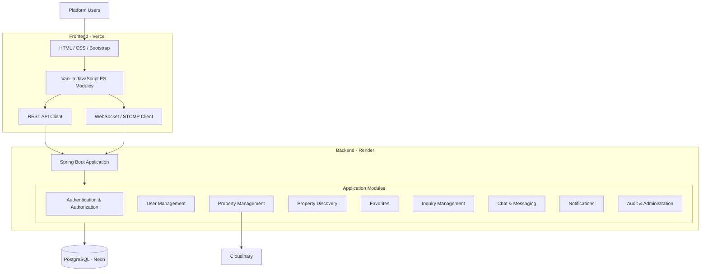
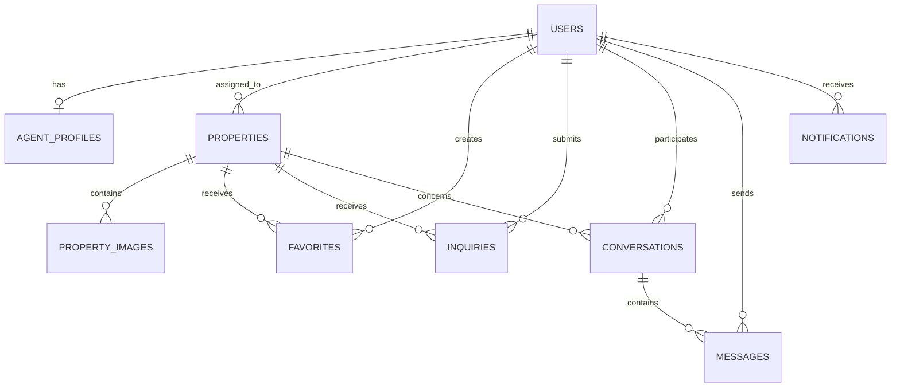
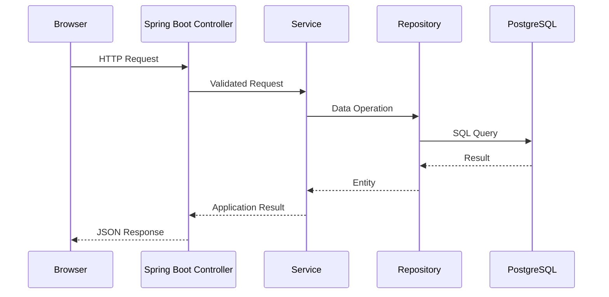
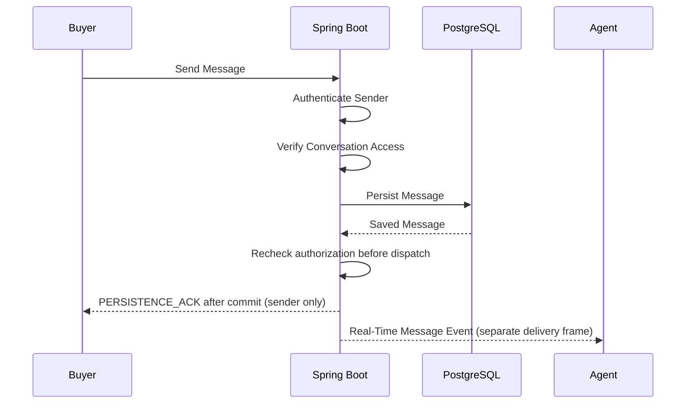
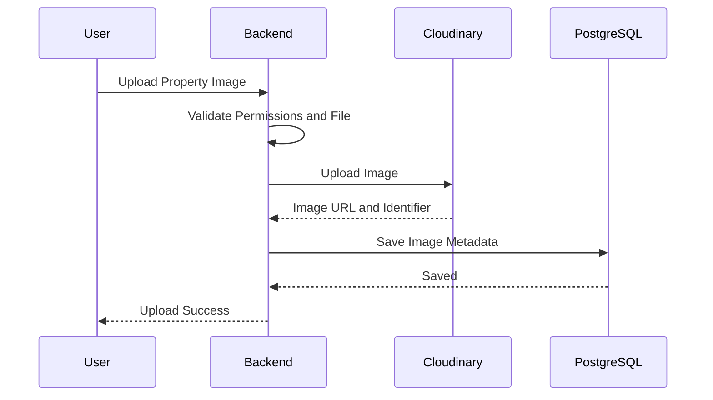
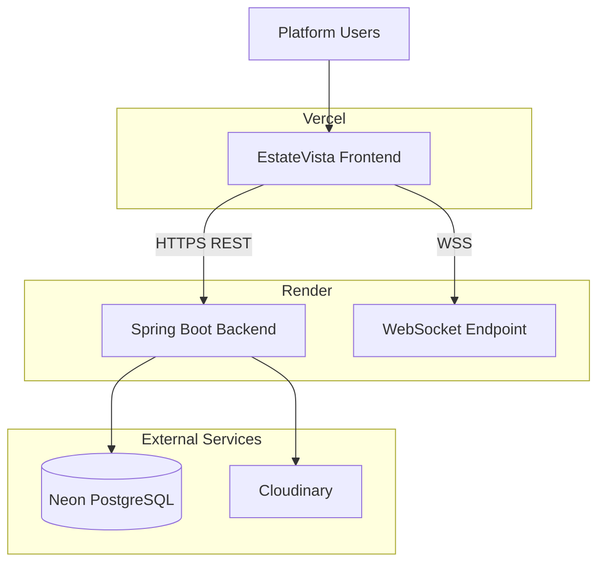

# EstateVista V2 — System Architecture

**Project:** EstateVista V2 — Full-Stack Real Estate Platform  
**Version:** 1.0  
**Status:** Draft for Review — ARC-001–ARC-015 approved; ARC-016 resolved by SD-01  
**Architecture Style:** Modular Monolith  
**Frontend:** Vanilla JavaScript  
**Backend:** Java + Spring Boot  
**Database:** PostgreSQL

---

# 1. Introduction

## 1.1 Purpose

This document defines the technical architecture of EstateVista V2.

It describes the organization and interaction of the frontend, backend, database, real-time communication system, and external services.

The architecture is designed to transform the existing EstateVista static website into a complete full-stack real estate platform.

## 1.2 Architectural Objectives

The architecture must:

1. Preserve the existing frontend foundation.
2. Use Vanilla JavaScript without introducing React.
3. Provide a structured and maintainable backend.
4. Support residential and commercial properties.
5. Enforce role-based access control.
6. Support persistent property-specific conversations.
7. Provide real-time communication.
8. Maintain reliable relational data.
9. Support independent frontend and backend deployment.
10. Allow future feature expansion without requiring a complete architectural rewrite.

## 1.3 Architectural Style

EstateVista will use a **Modular Monolithic Architecture**.

The backend will be deployed as one Spring Boot application, internally divided into independent functional modules.

Each module will have clearly defined responsibilities and controlled interactions with other modules.

Microservices will not be introduced in the initial version.

---

# 2. Technology Stack

## 2.1 Frontend

| Technology | Purpose |
|---|---|
| HTML5 | Page structure |
| CSS3 | Custom styling |
| Vanilla JavaScript | Frontend functionality |
| JavaScript ES Modules | Code organization |
| Bootstrap 5.3.3 | Existing responsive UI framework |
| Tailwind CSS | Optional selective utility styling |
| Fetch API | REST API communication |
| WebSocket + STOMP Client | Real-time communication |

The frontend will remain framework-free.

React, Angular, and Vue will not be introduced.

The existing EstateVista visual identity and working functionality should be preserved wherever practical.

## 2.2 Backend

| Technology | Purpose |
|---|---|
| Java | Backend programming language |
| Spring Boot | Application framework |
| Spring MVC | REST API development |
| Spring Security | Authentication and authorization |
| Spring Data JPA | Database persistence |
| Hibernate | ORM |
| Flyway | Database migrations |
| WebSocket | Real-time communication |
| STOMP | Messaging protocol |
| Bean Validation | Request validation |
| Maven | Dependency and build management |

## 2.3 Database

| Technology | Purpose |
|---|---|
| PostgreSQL | Relational database |
| Neon | Managed PostgreSQL hosting |

PostgreSQL will store:

- Users and roles.
- Agent profiles.
- Property listings.
- Property images and metadata.
- Favorites.
- Inquiries.
- Conversations.
- Messages.
- Notifications.
- Audit records.

## 2.4 External Services

| Service | Purpose |
|---|---|
| Cloudinary | Property image storage |
| Vercel | Frontend deployment |
| Render | Backend deployment |
| Neon | Production database hosting |
| GitHub | Source code management |

External service integrations will be isolated behind appropriate application services wherever practical.

---

# 3. High-Level System Architecture

EstateVista follows a client-server architecture.

The frontend communicates with the backend through REST APIs for standard application operations and WebSocket connections for real-time messaging.

The backend communicates with PostgreSQL for persistent storage and external services for image management.

## 3.1 Architecture Diagram



## 3.2 Communication Responsibilities

| Communication | Protocol | Purpose |
|---|---|---|
| Frontend → Backend | HTTPS | Standard API requests |
| Frontend → Backend | WSS | Real-time messaging |
| Backend → Database | JDBC | Persistent data access |
| Backend → Cloudinary | HTTPS | Image operations |

The frontend must never connect directly to PostgreSQL.

All protected operations must pass through backend authorization.

---

# 4. Frontend Architecture

## 4.1 Overview

The frontend will use static HTML pages with Vanilla JavaScript ES Modules.

The frontend will be responsible for:

- Rendering application interfaces.
- Handling user interactions.
- Client-side form validation.
- Communicating with backend APIs.
- Managing temporary application state.
- Displaying authentication-dependent interfaces.
- Connecting to the real-time messaging system.

Security-sensitive operations and authorization decisions will remain on the backend.

## 4.2 Proposed Directory Structure

```text
frontend/
│
├── index.html
├── properties.html
├── property-details.html
├── about.html
├── contact.html
├── login.html
├── register.html
├── dashboard/
│   ├── buyer/
│   ├── agent/
│   └── admin/
│
├── assets/
│   ├── css/
│   │   ├── style.css
│   │   ├── components/
│   │   └── pages/
│   │
│   ├── js/
│   │   ├── core/
│   │   │   ├── api.js
│   │   │   ├── auth.js
│   │   │   ├── config.js
│   │   │   └── state.js
│   │   │
│   │   ├── components/
│   │   ├── pages/
│   │   ├── services/
│   │   ├── chat/
│   │   └── utils/
│   │
│   └── images/
│
└── README.md
```

This is a proposed structure. The final structure will be established during repository setup.

## 4.3 Frontend Layers

### Presentation Layer

Responsible for:

- HTML structure.
- Page layouts.
- Navigation.
- Forms.
- Property cards.
- Dashboards.
- Chat interfaces.

### Application Layer

Responsible for:

- Page initialization.
- Event handling.
- UI state management.
- User interaction workflows.
- Rendering dynamic content.

### Service Layer

Responsible for:

- Authentication API calls.
- Property API calls.
- Favorites API calls.
- Inquiry API calls.
- Chat API calls.
- Notification API calls.

### Core Layer

Responsible for:

- API configuration.
- Shared request utilities.
- Authentication state integration.
- Common error handling.
- Environment configuration.

## 4.4 Frontend Design Principles

1. Use ES Modules for modular JavaScript.
2. Avoid unnecessary global variables.
3. Separate API communication from DOM manipulation.
4. Reuse shared components and utilities.
5. Keep frontend validation separate from backend validation.
6. Never treat frontend role checks as authorization.
7. Avoid exposing sensitive credentials or secrets.
8. Preserve existing working V1 functionality where possible.

---

# 5. Backend Architecture

## 5.1 Overview

The backend will be implemented using Java and Spring Boot.

It will expose REST APIs for standard operations and WebSocket endpoints for real-time messaging.

The backend will own all business logic, authorization rules, validation, and database operations.

## 5.2 Backend Architectural Layers

The backend will follow a layered architecture within each functional module.

### Controller Layer

Responsibilities:

- Receive HTTP requests.
- Validate request structure.
- Invoke application services.
- Return appropriate HTTP responses.

Controllers must not contain complex business logic.

### Service Layer

Responsibilities:

- Execute business rules.
- Coordinate application operations.
- Enforce domain-level restrictions.
- Manage transactions.
- Coordinate interactions between modules.

### Repository Layer

Responsibilities:

- Database access.
- Entity persistence.
- Data retrieval.
- Query execution.

### Entity Layer

Responsibilities:

- Represent database entities.
- Define relationships.
- Maintain persistence mappings.

### DTO Layer

Responsibilities:

- Define API request structures.
- Define API response structures.
- Prevent direct exposure of persistence entities.

## 5.3 Proposed Backend Structure

```text
backend/
│
├── src/
│   ├── main/
│   │   ├── java/
│   │   │   └── com/estatevista/
│   │   │       │
│   │   │       ├── EstateVistaApplication.java
│   │   │       │
│   │   │       ├── config/
│   │   │       ├── security/
│   │   │       ├── common/
│   │   │       │
│   │   │       ├── auth/
│   │   │       ├── user/
│   │   │       ├── property/
│   │   │       ├── favorite/
│   │   │       ├── inquiry/
│   │   │       ├── chat/
│   │   │       ├── notification/
│   │   │       ├── dashboard/
│   │   │       ├── audit/
│   │   │       │
│   │   │       └── storage/
│   │   │
│   │   └── resources/
│   │       ├── application.yml
│   │       ├── application-dev.yml
│   │       ├── application-prod.yml
│   │       └── db/
│   │           └── migration/
│   │
│   └── test/
│
├── pom.xml
└── README.md
```

Each module should organize its own controllers, services, repositories, entities, DTOs, and validation logic.

Shared configuration and cross-cutting concerns will remain outside individual business modules.

## 5.4 Backend Modules

### Authentication Module

Responsible for:

- User authentication.
- Registration.
- Logout.
- Password management.
- Authentication lifecycle.
- Authorization integration.

### User Management Module

Responsible for:

- Buyer profiles.
- Agent profiles.
- User account management.
- Role management.
- Account status.

### Property Management Module

Responsible for:

- Property creation.
- Property updates.
- Property deletion.
- Property assignment.
- Property availability.
- Property image management.

### Property Discovery Module

Responsible for:

- Public property listings.
- Search.
- Filtering.
- Sorting.
- Pagination.
- Property detail retrieval.

### Favorites Module

Responsible for:

- Adding favorites.
- Removing favorites.
- Retrieving buyer favorites.
- Duplicate prevention.

### Inquiry Module

Responsible for:

- Inquiry creation.
- Inquiry retrieval.
- Inquiry status management.
- Buyer and agent inquiry access.

### Chat Module

Responsible for:

- Conversation creation.
- Conversation participant management.
- Message persistence.
- Message retrieval.
- Real-time delivery.
- Unread message tracking.

### Notification Module

Responsible for:

- Notification creation.
- Notification retrieval.
- Read status management.
- Notification ownership.

### Dashboard Module

Responsible for:

- Buyer dashboard data.
- Agent dashboard data.
- Administrator dashboard data.
- Aggregated statistics.

### Audit Module

Responsible for:

- Administrative activity records.
- Important property changes.
- Account management events.
- Authorized audit retrieval.

### Storage Module

Responsible for:

- Cloudinary integration.
- Image upload.
- Image deletion.
- Image metadata management.

---

# 6. Database Architecture

## 6.1 Database Overview

PostgreSQL will serve as the primary relational database.

The backend will access the database through Spring Data JPA and Hibernate.

Flyway will manage database schema changes.

## 6.2 Main Data Domains

The database will contain the following logical domains:

| Domain | Main Data |
|---|---|
| Identity | Users, roles, profiles |
| Properties | Properties, categories, images, amenities |
| Favorites | Buyer-property relationships |
| Inquiries | Buyer inquiries and statuses |
| Messaging | Conversations and messages |
| Notifications | User notifications |
| Administration | Audit records |

## 6.3 Core Entity Relationships

The following is a conceptual relationship diagram. Exact attributes, constraints, and normalization will be finalized in `DATABASE_DESIGN.md`.



## 6.4 Database Principles

1. Use relational constraints to maintain data integrity.
2. Use foreign keys for entity relationships.
3. Enforce unique constraints where required.
4. Use database transactions for multi-step operations.
5. Store timestamps consistently.
6. Use pagination for large result sets.
7. Avoid unnecessary duplicate data.
8. Maintain message history independently of property availability.
9. Use Flyway migrations for schema changes.
10. Index frequently queried fields based on actual query patterns.

## 6.5 Data Ownership

- Buyers own their favorites and submitted inquiries.
- Agents manage properties assigned to them.
- Administrators manage platform-wide records.
- Conversations belong to their authorized participants.
- Messages belong to conversations and their senders.

---

# 7. REST API Architecture

## 7.1 Overview

The frontend will communicate with the backend through REST APIs over HTTPS.

The API will use JSON for request and response bodies.

## 7.2 API Base Path

Proposed API prefix:

```text
/api/v1
```

All application APIs should use this versioned prefix.

## 7.3 Proposed API Domains

| Domain | Endpoint Prefix |
|---|---|
| Authentication | `/api/v1/auth` |
| Users | `/api/v1/users` |
| Agents | `/api/v1/agents` |
| Properties | `/api/v1/properties` |
| Favorites | `/api/v1/favorites` |
| Inquiries | `/api/v1/inquiries` |
| Conversations | `/api/v1/conversations` |
| Messages | `/api/v1/messages` |
| Notifications | `/api/v1/notifications` |
| Dashboards | `/api/v1/dashboard` |
| Administration | `/api/v1/admin` |

## 7.4 API Design Principles

1. Use appropriate HTTP methods.
2. Use meaningful resource-based endpoint names.
3. Validate incoming requests.
4. Return consistent response structures.
5. Use appropriate HTTP status codes.
6. Enforce authorization on protected endpoints.
7. Support pagination for collection endpoints.
8. Avoid exposing internal entity structures directly.
9. Version APIs to support future changes.

## 7.5 Example Request Flow



---

# 8. Real-Time Communication Architecture

## 8.1 Overview

EstateVista will use WebSocket with STOMP for real-time property-specific messaging.

REST APIs will remain responsible for operations such as conversation creation and historical message retrieval.

WebSocket communication will primarily handle live message delivery and real-time events.

## 8.2 Chat Architecture

The chat system consists of:

- Frontend chat interface.
- WebSocket/STOMP client.
- Spring WebSocket infrastructure.
- Chat application services.
- PostgreSQL message persistence.

## 8.3 Message Flow



A message must be persisted successfully before it is broadcast as a successfully accepted message. The sender-only application `PERSISTENCE_ACK` is emitted after transaction commit and correlated by the mandatory UUID `idempotencyKey`; it is a distinct frame from the real-time delivery frame sent to participants. Native STOMP `RECEIPT` is non-authoritative for application sends, and no recipient, `Delivered` or `Seen` receipt is emitted. Failed persistence produces a safe error carrying the same correlation key, with recovery only through explicit user retry and no automatic replay (P-05, P-08, F-7.1-01).

## 8.4 Conversation Rules

1. One permanent conversation exists per buyer-property combination; reassignment neither transfers an existing conversation to the newly assigned agent nor creates a second conversation with that agent for the same buyer and property (P-02).
2. Each conversation records an immutable snapshot of the original assigned agent (`assigned_agent_id`) as its participant. Agents manage their current assigned properties, while conversation access remains bound to the original agent identity (P-02).
3. New conversation creation requires a `PUBLISHED` property with an active buyer and an active current primary agent; retrieval of an existing permanent conversation by an authorized active original participant is unaffected by later property status or assignment changes (P-13).
4. If the original agent is inactive, history is preserved and remains readable to the buyer, but messaging in that conversation is disabled and no fallback or transfer is introduced (P-03).
5. Messages are stored persistently.
6. Only the original buyer and original assigned agent may access messages; administrators are excluded from private conversations (A-06).
7. Unavailable properties do not automatically delete conversations.
8. Agent reassignment does not silently transfer existing conversations.
9. Messages remain retrievable after reconnection through latest-first `(sent_at DESC, id DESC)` cursor pages rendered chronologically; no new monotonic sequence column is introduced (P-06, F-7.1-04).
10. Reconnection uses participant-scoped REST list/history refresh and message-ID deduplication; no sync endpoint, automatic replay or conversation status mutation is introduced in Stage 7 (P-04, P-09).
11. The backend determines the sender identity from the authenticated connection, not from an arbitrary client-supplied sender ID.
12. Every STOMP SEND carries a mandatory UUID `idempotencyKey`; V19, authorized only in Stage 7.3, adds `UNIQUE (conversation_id, sender_id, idempotency_key)` as the authoritative duplicate guard. No exactly-once network delivery is claimed (P-05).

## 8.5 WebSocket Security

The WebSocket connection must use the application's authentication mechanism.

Authoritative session validation is required at the handshake, STOMP `CONNECT`, heartbeat and every protected frame: resolve the trusted session ID from handshake attributes and validate session existence and expiry through `SessionRepository.findById(sessionId)` and `Session.isExpired()`. Spring Session destruction events alone are not authoritative because JDBC expiry cleanup is cron-based and has no per-socket awareness; missing, expired or mismatched sessions fail closed (F-7.1-02).

The STOMP `CONNECT` frame must carry the session-bound CSRF token from the existing in-memory `X-CSRF-TOKEN` flow as a native header. The backend requires exact token equality against the token stored in the validated session and independently requires an exact `Origin` match; missing, invalid, stale or mismatched tokens and disallowed origins are rejected before subscriptions. Host-only cookies and REST CSRF behavior are unchanged (F-7.1-08).

The backend must validate:

- Connection authentication, session existence and expiry.
- Conversation membership against the original buyer/original agent participant pair; administrators are denied.
- Message sender identity from the authenticated connection.
- Subscription permissions and message destination authorization.
- Authorization again immediately before every outbound dispatch, including participant set, account status, role and session state, so a queued frame is suppressed if authorization was revoked after SEND or subscription (F-7.1-03).

Clients must not be allowed to subscribe to arbitrary private conversation destinations.

Same-site custom domains are approved (P-12); exact production hostnames are Stage 7.7 deployment-verification inputs and are not Stage 7.1 blockers or prerequisites for local Stage 7.2–7.6 implementation.

Exact endpoint and destination contracts are defined in `API_SPECIFICATION.md` §20.

---

# 9. Authentication and Authorization Architecture

## 9.1 Overview

EstateVista will use Spring Security to enforce authentication and authorization.

The platform supports four access categories:

- Visitor.
- Buyer.
- Agent.
- Administrator.

## 9.2 Authorization Principles

1. Authentication identifies the user.
2. Authorization determines what the user can access.
3. Backend authorization is mandatory.
4. Frontend access restrictions are only interface-level controls.
5. Agents can access only their currently assigned properties, while private conversations remain bound to the original `assigned_agent_id` recorded at creation.
6. Buyers can access only their own private records.
7. Administrators have authorized platform-wide access but are excluded from private buyer-agent conversations (A-06).

## 9.3 Authentication Strategy

The authentication mechanism is approved as a technical design; implementation and deployment values remain prerequisites.

The authentication mechanism and its session, CSRF, cookie, reset, activation, and deployment controls are documented in `SECURITY_ARCHITECTURE.md`. The mechanism is **Approved** as a technical design (SD-01, 11 November 2026): server-side session authentication with an opaque host-only cookie, Spring Session JDBC storage, and a session-bound CSRF token. Implementation and deployment hostnames remain prerequisites, so no authenticated feature should be deployed until they are complete.

The security architecture addresses:

- Session-based authentication versus token-based authentication.
- Cookie and token storage.
- CSRF protection.
- Session expiration.
- Refresh and revocation mechanisms, if applicable.
- WebSocket authentication.
- Password recovery.
- Email verification.
- Account deactivation behaviour.

No authentication mechanism should be implemented without following the approved design in `SECURITY_ARCHITECTURE.md` and closing its implementation and deployment prerequisites.

---

# 10. Image Storage Architecture

## 10.1 Overview

Property images will be stored using Cloudinary or a compatible object storage service.

PostgreSQL will store image metadata and references, not the actual image binary files.

## 10.2 Upload Flow



## 10.3 Image Management Rules

- Only authorized users may manage property images.
- File types and sizes must be validated.
- Image references must be associated with properties.
- Image ordering should be supported.
- Removed images should be cleaned up from external storage where appropriate.
- External storage credentials must remain server-side.

---

# 11. Error Handling and Logging

## 11.1 Error Handling

The backend will implement centralized exception handling.

API responses should provide:

- Appropriate HTTP status.
- A consistent error structure.
- A useful error message.
- Validation details where applicable.
- A correlation identifier where appropriate.

Sensitive internal implementation details must not be exposed.

## 11.2 Logging

The backend should log:

- Application startup and shutdown.
- Important application errors.
- Authentication and authorization failures.
- Database connection problems.
- External service failures.
- Important administrative operations.

Passwords, access tokens, secrets, and private message contents must not be written to ordinary application logs.

---

# 12. Deployment Architecture

## 12.1 Deployment Overview

EstateVista will use independently deployed frontend and backend applications.

| Component | Deployment |
|---|---|
| Frontend | Vercel |
| Backend | Render |
| Database | Neon PostgreSQL |
| Image Storage | Cloudinary |
| Source Control | GitHub |

## 12.2 Deployment Diagram



## 12.3 Environment Separation

The application should support separate configurations for:

- Local development.
- Testing.
- Production.

Production credentials must be stored in deployment environment variables or an appropriate secrets-management facility.

They must never be committed to Git.

## 12.4 CORS

The backend must allow requests only from explicitly configured frontend origins.

Production CORS configuration must not use unrestricted wildcard origins with credentialed requests.

---

# 13. Repository Architecture

## 13.1 Repository Strategy

The existing EstateVista GitHub repository will be retained.

V2 development will gradually evolve the repository into a monorepo.

Proposed structure:

```text
estatevista/
│
├── frontend/
│
├── backend/
│
├── docs/
│   ├── PRD.md
│   ├── FRD.md
│   ├── SYSTEM_ARCHITECTURE.md
│   ├── DATABASE_DESIGN.md
│   ├── API_SPECIFICATION.md
│   ├── UI_UX_SPECIFICATION.md
│   ├── SECURITY_ARCHITECTURE.md
│   ├── DEVELOPMENT_SETUP.md
│   └── validation/
│
├── .gitignore
└── README.md
```

The existing frontend must be inspected before files are moved.

A migration plan should preserve the existing working website and its deployment configuration.

## 13.2 Git Workflow

- `main` remains the stable branch.
- Each complete development stage receives its own feature branch.
- Stage-specific implementation and testing happen on that branch.
- Changes are reviewed before merging.
- Each completed stage receives a closure report.

Stage 1 status:

```text
main
```

Stage 1 documentation and environment work were performed directly on `main`. No `v2/stage-1-architecture-setup` branch exists in the repository, so the branch-per-stage convention above was not followed for Stage 1. This deviation is recorded as a Stage 1 closure condition in the Stage 1.9 audit report; the document does not claim that a feature branch was created or reviewed.

---

# 14. Scalability and Future Expansion

The modular monolithic architecture is sufficient for the initial platform.

Future improvements may include:

- Database query optimization.
- Caching.
- Background processing.
- Improved notification delivery.
- Advanced property search.
- Search engine integration.
- Additional external service integrations.
- Separate services if actual scaling requirements justify them.

Microservices will not be introduced solely for architectural complexity.

The initial priority is a reliable, maintainable application.

---

# 15. Architecture Constraints

The following constraints are mandatory unless formally revised:

1. Frontend remains Vanilla JavaScript.
2. React will not be introduced.
3. Backend uses Java and Spring Boot.
4. PostgreSQL is the primary relational database.
5. Backend follows modular monolithic architecture.
6. Property-specific conversations are persistent.
7. WebSocket is used for real-time messaging.
8. Backend owns business logic and authorization.
9. Database schema changes use Flyway.
10. Frontend and backend are independently deployable.
11. Existing EstateVista V1 functionality should be preserved where practical.
12. No production secrets are committed to the repository.

---

# 16. Architecture Decisions

| ID | Decision | Status |
|---|---|---|
| ARC-001 | Use modular monolithic backend architecture. | Approved |
| ARC-002 | Use Java and Spring Boot. | Approved |
| ARC-003 | Use Vanilla JavaScript frontend. | Approved |
| ARC-004 | Retain Bootstrap 5.3.3 where useful. | Approved |
| ARC-005 | Use PostgreSQL. | Approved |
| ARC-006 | Use Spring Data JPA and Hibernate. | Approved |
| ARC-007 | Use Flyway for migrations. | Approved |
| ARC-008 | Use REST APIs for standard application operations. | Approved |
| ARC-009 | Use WebSocket and STOMP for real-time messaging. | Approved |
| ARC-010 | Use Cloudinary or compatible object storage for property images. | Approved |
| ARC-011 | Deploy frontend on Vercel. | Approved |
| ARC-012 | Deploy backend on Render. | Approved |
| ARC-013 | Host PostgreSQL on Neon. | Approved |
| ARC-014 | Retain the existing GitHub repository. | Approved |
| ARC-015 | Use independent frontend and backend deployments. | Approved |
| ARC-016 | Finalize authentication strategy during security design. | Resolved — SD-01 approved |

### 16.1 Stage 6 architecture cross-reference

Owner-approved Stage 6 favorites/inquiries architecture is recorded in `docs/STAGE_6_DECISION_REGISTER.md`. It controls Stage 6 interpretation of REST contracts, favorite retention and batched state synchronization, the inquiry status matrix and duplicate policy, immutable historical assignment, exact rate-limit overlap, generic `404` IDOR behavior, no chat surface or inquiry↔conversation FK, and the Stage 6.4-only V18 authorization. This cross-reference does not modify ARC-001–ARC-015, ARC-016, the document's Draft for Review status, or any Stage 7–9 boundary. V18 is authorized only in Stage 6.4 and must not be created during Stage 6.1.

### 16.2 Stage 7.1 architecture contract cross-reference

Owner-approved Stage 7.1 chat decisions P-01–P-13 and findings F-7.1-01–F-7.1-08 are recorded in `docs/STAGE_7_DECISION_REGISTER.md`. They control §8 interpretation of conversation identity, creation eligibility, idempotency, cursor history, read state, acknowledgement, reconnection and WebSocket security. This is a documentation and architecture-contract approval only: Stage 7.1 does not modify ARC-001–ARC-016, implement chat, create migrations, introduce dependencies, execute acceptance scenarios or change any Stage 7–9 boundary.

---

# 17. Conclusion

EstateVista V2 will use a modular monolithic Spring Boot backend connected to a Vanilla JavaScript frontend.

PostgreSQL will provide persistent relational storage, while WebSocket and STOMP will support real-time property-specific messaging.

The architecture prioritizes maintainability, security, data integrity, and practical deployment.

It provides a foundation for implementing the approved EstateVista V2 product requirements without introducing unnecessary architectural complexity.
