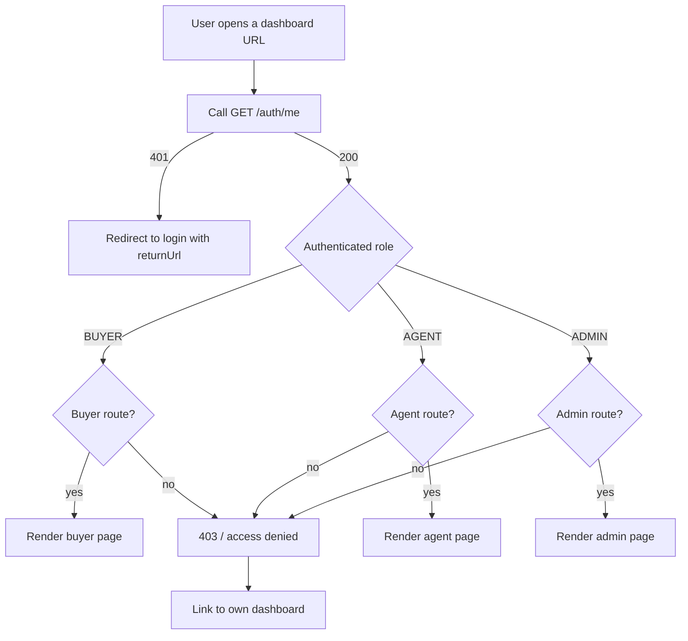

# ESTATEVISTA V2 — UI/UX SPECIFICATION

| Metadata | Value |
|---|---|
| **Project** | EstateVista V2 — Full-Stack Real Estate Platform |
| **Document name** | UI/UX Specification |
| **Stage** | 1.6 — UI/UX Specification |
| **Version** | 1.5 |
| **Status** | **Draft — Corrected, Pending Review and Approval** |
| **Date** | 11 November 2026 |
| **Frontend stack** | HTML5, CSS3, Vanilla JavaScript (ES Modules), Bootstrap 5.3.3 |
| **Backend context** | Java, Spring Boot, Spring MVC REST, Spring Security, PostgreSQL, WebSocket + STOMP |
| **Visual baseline** | EstateVista V1 static site in `frontend/` |

### Related documents

| Document | Version / stage | Status at time of writing | How this document uses it |
|---|---|---|---|
| [`PRD.md`](PRD.md) | 1.0 | Draft — PD-01–PD-11 approved; document approval metadata not recorded | Product scope, roles, approved product decisions, out-of-scope items |
| [`FRD.md`](FRD.md) | 1.0 | Draft — functional baseline reviewed; approval metadata not recorded | Functional requirements and acceptance criteria; source of all FR requirement IDs |
| [`SYSTEM_ARCHITECTURE.md`](SYSTEM_ARCHITECTURE.md) | 1.0 | Draft for Review — ARC-001–ARC-009, ARC-010–ARC-015 approved; ARC-016 resolved by SD-01 | Frontend layers, deployment model, real-time architecture, architectural constraints |
| [`DATABASE_DESIGN.md`](DATABASE_DESIGN.md) | Stage 1.4 | Proposed baseline — §23 records APPROVED clarifications | Entity fields, statuses, constraints, retention rules |
| [`API_SPECIFICATION.md`](API_SPECIFICATION.md) | Stage 1.5 | Proposed baseline — §25 records APPROVED clarifications | Endpoint groups, payload fields, pagination, WebSocket destinations, error format |
| [`../frontend/README.md`](../frontend/README.md) | Stage 6 in progress | Current V1 record | V1 design tokens, component foundations, known limitations |
| [`../frontend/docs/QA.md`](../frontend/docs/QA.md) | Stage 5 | Completed record | Existing accessibility and responsive baseline |

> **Status note.** This UI/UX specification is a draft pending review and approval. The upstream header metadata was reconciled during the Stage 1.6 correction passes. The clarification sections in `DATABASE_DESIGN.md` §23 and `API_SPECIFICATION.md` §25 record **Review Status: APPROVED**; the surrounding bodies remain proposed baselines. `PRD.md` and `FRD.md` record their approved product and functional decisions but do not carry a document-level approval record. `SYSTEM_ARCHITECTURE.md` now records ARC-010–ARC-013 as approved. Stale-metadata inconsistency **D-01 is settled** and is recorded in §20.6. The four former Blocking decisions **D-08, D-14, D-20, and D-21 are settled** by the Security Architecture v0.5 approval and the `PUBLISHED`-only visibility rule; they are recorded in §20.6.

### Decision labels used in this document

Every non-obvious decision carries one of these labels:

| Label | Meaning |
|---|---|
| **[Approved]** | Directly supported by the PRD, FRD, System Architecture, Database Design, API Specification, or the approved Stage 1.6 brief. |
| **[Proposed]** | A UI/UX recommendation made in this document. It is compatible with the approved documents but requires review before implementation. |
| **[Deferred]** | Cannot be finalized because an upstream product, security, API, or workflow decision remains open. |

### Table of contents

1. [Introduction](#1-introduction)
2. [UI/UX Design Principles](#2-uiux-design-principles)
3. [Existing V1 Design Audit](#3-existing-v1-design-audit)
4. [Design System](#4-design-system)
5. [Information Architecture and Sitemap](#5-information-architecture-and-sitemap)
6. [Global Layout and Navigation](#6-global-layout-and-navigation)
7. [Public Website Page Specifications](#7-public-website-page-specifications)
8. [Buyer Dashboard Specifications](#8-buyer-dashboard-specifications)
9. [Agent Dashboard Specifications](#9-agent-dashboard-specifications)
10. [Administrator Dashboard Specifications](#10-administrator-dashboard-specifications)
11. [Real-Time Chat UI/UX](#11-real-time-chat-uiux)
12. [Forms and Validation](#12-forms-and-validation)
13. [Reusable UI Components](#13-reusable-ui-components)
14. [Responsive Design Specification](#14-responsive-design-specification)
15. [Accessibility Requirements](#15-accessibility-requirements)
16. [UI States and Feedback](#16-ui-states-and-feedback)
17. [Frontend Interaction and API Integration Guidelines](#17-frontend-interaction-and-api-integration-guidelines)
18. [Security and Privacy Considerations](#18-security-and-privacy-considerations)
19. [UI/UX Traceability Matrix](#19-uiux-traceability-matrix)
20. [Deferred Decisions and Open Questions](#20-deferred-decisions-and-open-questions)
21. [Stage 1.6 Completion Checklist](#21-stage-16-completion-checklist)
22. [Approval and Change History](#22-approval-and-change-history)

---

## 1. Introduction

### 1.1 Purpose

This document defines the user interface and user experience specification for EstateVista V2. It converts the approved product, functional, architectural, database, and API decisions into implementable interface behaviour: page structures, navigation, components, states, validation, responsive rules, accessibility requirements, and interaction patterns.

It is the visual and interaction reference for later development stages. It does not implement the interface, define new backend behaviour, or replace the API contract.

### 1.2 Scope

In scope:

- All four user experiences: Visitor, Buyer, Property Agent, Administrator.
- All public pages: Homepage, Properties, Property Details, About, Contact, Login, Registration, Forgot Password, Reset Password.
- Buyer dashboard: overview, profile, favorites, inquiries, conversations, individual chat, notifications.
- Agent dashboard: overview, assigned properties, edit property, property images, inquiries, conversations, individual chat, notifications, profile.
- Administrator dashboard: overview, user management, agent management, property management, property assignments, inquiry monitoring, platform activity, audit history, notifications.
- The real-time chat interface and its connection states.
- Shared design system, reusable components, responsive behaviour, accessibility, validation, loading/empty/error states, and security/privacy expectations at the interface level.
- Traceability from interface modules to FRD requirements and API groups.

Out of scope:

- Backend implementation, database schema changes, new API endpoints, or changes to the approved architecture.
- Product features not present in the PRD/FRD: payments, bookings, mortgages, AI recommendations, native apps, video/voice calls, reviews/ratings, CRM integrations, legal automation, third-party listing sync.
- Final authentication mechanism, password-reset mechanics, and account activation are settled as designs (D-14, D-20, D-21); their implementation and deployment prerequisites (email provider, hostnames) remain outside this specification.
- Upload limits, notification delivery preferences, and final status lifecycles remain deferred and are recorded in Section 20.

### 1.3 Intended audience

| Audience | Use of this document |
|---|---|
| Frontend developers | Build the pages, components, states, and interactions described here using HTML, CSS, Vanilla JavaScript ES Modules, and Bootstrap 5.3.3. |
| Backend developers | Understand which interface actions depend on which approved endpoints, payload fields, and error responses. |
| QA engineers | Derive interface acceptance checks for routes, roles, validation, states, responsive behaviour, and accessibility. |
| Design reviewers | Confirm visual continuity with V1 and approve or reject the proposed extensions. |
| Project reviewers | Verify that Stage 1.6 covers the required experiences without contradicting approved decisions. |

### 1.4 Relationship with the other Stage 1 documents

| Document | Relationship |
|---|---|
| **PRD** | Defines why the product exists, who uses it, the MVP scope, and the approved product decisions. This document must not introduce features outside that scope. |
| **FRD** | Defines testable functional requirements. This document maps screens and interactions to FR IDs and treats those IDs as the functional source of truth. |
| **System Architecture** | Defines the frontend layers, Vanilla JavaScript constraint, deployment model, and WebSocket/STOMP approach. This document follows that architecture without redesigning it. |
| **Database Design** | Defines entity fields, statuses, uniqueness rules, and retention behaviour. Form fields and status labels in this document reuse those definitions rather than inventing new data. |
| **API Specification** | Defines the endpoint contract, pagination, error format, and messaging destinations. This document describes how the interface calls those endpoints; it does not redefine them. |

Where the documents conflict, this specification records the conflict in Section 20 rather than silently choosing a new rule.

### 1.5 Design objectives

1. **Preserve the V1 identity.** Keep the forest, ivory, sand, sage, and terracotta palette; Fraunces headings; Inter body text; restrained shadows; editorial spacing; and the calm, photography-led property presentation.
2. **Extend, do not replace.** Add dashboards, authentication, favorites, inquiries, and chat using the same visual language rather than a separate admin template.
3. **Make roles legible.** Each role sees a clear entry point, navigation set, and action set. Unavailable actions are hidden or disabled with an explanation, never silently failing.
4. **Make state visible.** Every network-backed view has defined loading, empty, error, and success behaviour.
5. **Make property comparison easy.** Price, location, type, area, and status remain scannable on cards and detail pages.
6. **Keep chat trustworthy.** Conversation persistence, participant identity, and historical assignment are communicated honestly. No unsupported delivery or read receipts are shown.
7. **Design for small screens and keyboards first.** The V1 site already works on mobile and with a keyboard; V2 dashboards and chat must meet the same bar.
8. **Remain implementable in Vanilla JavaScript.** Components are HTML patterns plus ES Modules with explicit initialization, not framework components.

---

## 2. UI/UX Design Principles

### 2.1 Visual continuity with V1

**Principle.** V2 is the same publication, grown up.

- Reuse the V1 tokens in `frontend/assets/css/theme.css`; do not introduce a second brand palette.
- Reuse Fraunces for display headings and Inter for body/UI text.
- Reuse the 1240px content width, 24px grid gutter, 8px spacing scale, 4/8/12/16px radii, and three restrained shadow levels.
- Reuse the V1 header, footer, `.card-estate`, `.btn-*`, `.ev-badge`, `.ev-chip`, `.ev-notice`, and form-control styling.
- New dashboard surfaces use the same ivory page background, white cards, hairline borders, forest headings, and terracotta accents. Dashboards are denser, not visually unrelated.
- Photography remains the primary visual material. Dashboard screens should not become an undifferentiated grey admin theme.

### 2.2 Simplicity and usability

- One primary action per view. Supporting actions use secondary, ghost, or icon variants.
- Property cards show a small, fixed set of comparison facts: price, title, location, type, bedrooms, bathrooms, area, status.
- Dashboard overview pages answer “what needs attention now?” before presenting exhaustive lists.
- Chat keeps the composer, conversation context, and message history visible without unnecessary chrome.
- Long forms are grouped into labelled fieldsets rather than presented as one undifferentiated column.

### 2.3 Consistency

- The same component behaves the same way everywhere: buttons, badges, form errors, pagination, empty states, confirmation dialogs, and toast placement.
- Status vocabulary is centralized (Section 4.10) and must not drift between cards, filters, tables, and detail pages.
- Dates and times use one display convention: localized date/time derived from ISO 8601 server timestamps.
- Prices use the V1 Indian-format convention (`₹4.85 Cr`, `₹95 L`) and tabular numerals.
- Every protected page uses the same dashboard shell, breadcrumb pattern, and unauthorized state.

### 2.4 Responsive-first design

- Layouts are defined by behaviour at the V1/Bootstrap breakpoints: 576px, 768px, 992px, and 1200px, with the existing 575.98px, 991.98px, and 359.98px refinements.
- Nothing may require horizontal scrolling except data tables, and those must provide an explicit scroll container with a visible cue.
- Touch targets are at least 44 × 44px; primary controls are 48px high as in V1.
- The mobile experience is not a reduced feature set. Mobile users can search, filter, favorite, inquire, chat, and manage records. Dense admin tables may switch to a stacked record view.

### 2.5 Accessibility

- Target WCAG 2.1 AA practices without claiming formal conformance.
- Semantic landmarks, one `<h1>` per page, logical heading order, native controls, visible focus, labelled fields, accessible errors, keyboard-operable dialogs, and reduced-motion support are mandatory.
- Status is never communicated by colour alone; pair colour with text and/or an icon.
- The V1 focus ring (`3px` sage, `2px` offset) and skip link are retained.

### 2.6 Role-based experiences

- Visitor: public discovery plus login/registration entry points.
- Buyer: public discovery plus personal favorites, inquiries, conversations, notifications, and profile.
- Agent: assigned-property management, authorized inquiries, authorized conversations, notifications, and profile.
- Administrator: platform-wide management, assignments, monitoring, audit history, and notifications.
- Role-appropriate navigation is rendered only after `GET /auth/me` confirms the session. Hiding an action is a usability measure, not authorization.
- Agents never see assignment controls. Administrators never see a private-conversation reader in this scope, because administrative access to conversation content is not assumed by the API specification.

### 2.7 Performance

- Public pages should render meaningful structure before data arrives; use skeletons for card grids and tables rather than blank screens.
- Property images use fixed aspect ratios, `loading="lazy"` below the fold, `decoding="async"`, and explicit width/height to prevent layout shift.
- Lists use server pagination (12 for discovery, 20 for management lists by default).
- Avoid duplicate network calls when one dashboard aggregate endpoint can supply the overview.
- Chat history is paginated; the client does not load an unbounded conversation.
- Animations are limited to V1-style short transitions and are disabled under reduced motion.

### 2.8 Clear feedback and error prevention

- Every destructive action requires confirmation that names the record and the consequence.
- Submit buttons enter a busy state immediately and cannot be submitted twice.
- Validation errors appear inline next to the field and in a summary where appropriate; focus moves to the first invalid field.
- Server-side errors are mapped to fields when `error.details[].field` is supplied; otherwise a page-level alert explains what happened.
- Empty states explain what is missing and offer the next useful action.
- Network and WebSocket failures are stated plainly and recoverably; the interface never pretends a failed action succeeded.

---

## 3. Existing V1 Design Audit

This section records what exists in the repository. The V1 site is under `frontend/`; the five approved documents are under `docs/`.

### 3.1 Files inspected

| Area | Files inspected |
|---|---|
| Public pages | `frontend/index.html`, `properties.html`, `property-details.html`, `about.html`, `contact.html`, `404.html` |
| Styles | `frontend/assets/css/theme.css`, `components.css`, `home.css`, `property-details.css`, `about.css`, `contact.css` |
| Scripts | `frontend/assets/js/main.js`, `home.js`, `properties.js`, `property-card.js`, `property-details.js`, `contact.js`, `data.js` |
| Assets | Brand favicon, property placeholder, hero image, category images, property photographs, studio interior |
| Project records | `frontend/README.md`, `frontend/docs/QA.md`, `frontend/DEPLOYMENT.md` |
| Visual evidence | `frontend/docs/screenshots/homepage.png`, `property-listings.png`, `property-details.png` |

### 3.2 Current color palette

All values are declared in `frontend/assets/css/theme.css`.

| Token | Value | Observed role |
|---|---|---|
| `--ev-forest-900` | `#14342B` | Primary brand, headings, primary buttons, footer and CTA backgrounds |
| `--ev-forest-700` | `#1E4D3F` | Hover/active states, focus border |
| `--ev-sage-300` | `#9DB5A5` | Focus ring, muted accents, category arrows, hover borders |
| `--ev-terracotta-500` | `#C05B36` | Decorative accents, active-nav underline, accent marks |
| `--ev-terracotta-700` | `#A44A2A` | Accent text, links, accent buttons, validation text (AA on white) |
| `--ev-ivory-50` | `#FAF7F2` | Page background, light text on forest |
| `--ev-sand-100` | `#F0EAE0` | Alternate surfaces, image placeholders, chips |
| `--ev-charcoal-900` | `#1C1C1A` | Body text |
| `--ev-slate-600` | `#5F6660` | Metadata, secondary text, placeholders |
| `--ev-hairline` | `#E2DCD2` | Borders, dividers |
| `--ev-status-available` | `#2F6F4F` | “Available” status and success feedback |
| `--ev-white` | `#FFFFFF` | Cards, inputs, inverse text |

Semantic aliases already exist: `--ev-color-bg`, `--ev-color-surface`, `--ev-color-surface-alt`, `--ev-color-text`, `--ev-color-text-muted`, `--ev-color-heading`, `--ev-color-brand`, `--ev-color-brand-strong`, `--ev-color-accent`, `--ev-color-accent-text`, `--ev-color-border`, `--ev-color-focus`, `--ev-color-on-brand`.

Bootstrap overrides map primary to forest, secondary to forest-700, success to `#2F6F4F`, links to terracotta-700, and border radii to the V1 radius scale.

**Observed contrast note.** The V1 README records that white on `--ev-terracotta-500` is about 4.4:1 and below AA for normal text; `--ev-terracotta-700` is about 5.8:1 and is the correct fill for text-bearing accents. V2 must preserve this rule.

### 3.3 Typography

| Role | Implementation |
|---|---|
| Display / headings | `"Fraunces", "Iowan Old Style", "Palatino Linotype", Palatino, Georgia, "Times New Roman", serif`; weight 600; tight tracking (`-0.01em`); `text-wrap: balance` |
| Body / UI | `"Inter", -apple-system, BlinkMacSystemFont, "Segoe UI", Roboto, "Helvetica Neue", Arial, "Noto Sans", sans-serif` |
| Base size | `1rem` (16px), line-height `1.6` |
| Scale | `0.75rem` (12px), `0.875rem` (14px), `1rem` (16px), `1.125rem` (18px), `1.25rem` (20px), `1.5rem` (24px), `1.875rem` (30px), and a fluid display size `clamp(2.125rem, 1.6rem + 2.2vw, 3.5rem)` |
| Line heights | tight `1.15`, snug `1.35`, normal `1.6` |
| Weights | 400, 500, 600, 700 |
| Numerals | `font-variant-numeric: tabular-nums` on prices and metadata |
| Font loading | Google Fonts, Fraunces `opsz,wght 9..144,400..700` and Inter `400..700`; fallback stacks are intentional |

Page titles use fluid sizes: hero `clamp(2.25rem, 1.4rem + 2.7vw, 3.75rem)`, detail title `clamp(2rem, 1.5rem + 1.8vw, 3rem)`, detail price `clamp(1.5rem, 1.2rem + 1vw, 2rem)`.

### 3.4 Navigation

- Sticky `<header class="site-header" data-site-header>` with a transparent bottom border that becomes a hairline plus a soft shadow after 4px of scroll (`.is-scrolled`).
- Bootstrap navbar expanded at `lg` (992px); collapse panel below 992px.
- Brand: 36px favicon mark plus “EstateVista” in Fraunces at `1.375rem`.
- Desktop links: Home, Properties, About us, Contact us. Link size `0.9375rem`, weight 500, charcoal; active state is forest, weight 600, with a 2px terracotta underline inset from the text.
- Mobile toggle: 44×44px bordered white button with a three-bar icon that morphs to an X; panel becomes a white card below the header with 48px link rows. Escape closes the menu and returns focus to the toggle; choosing a link closes it.
- There is currently no authentication action, no profile menu, and no notification access.
- Body uses a flex column with `main { flex: 1 0 auto; }` so short pages keep the footer at the viewport bottom.

### 3.5 Footer

- Forest-900 background with ivory/sage text; four columns on large screens: brand/about/notice, Explore links, Discover categories, Contact address.
- Section headings are 12px uppercase with wide tracking in sage.
- Bottom bar separates copyright and technology note with a translucent ivory border.
- A compact footer variant exists for the 404 page.
- Footer content is static demonstration copy. V2 must remove fictional disclaimers where the platform becomes real, but retain the layout; this is a content task, not a redesign.

### 3.6 Buttons and links

| Variant | Observed behaviour |
|---|---|
| `.btn-primary` | Forest-900 fill, white text, 48px min height, 12px/24px padding, 8px radius, weight 600, lifts 1px on hover, sage disabled state |
| `.btn-secondary` | Transparent with forest border/text; fills forest on hover |
| `.btn-accent` | Terracotta-700 fill, white text; forest on hover; used for text-bearing accent actions |
| `.btn-ghost` | Transparent inline action; terracotta text on hover with underline |
| `.btn-on-dark` | Ivory fill for forest/photographic surfaces |
| `.btn-sm` | 40px min height, 8px/16px padding, 14px text |
| Links | Terracotta-700 with a thin underline at 35% opacity; forest on hover; focus-visible outline is 3px sage with 2px offset |

Buttons use `inline-flex`, a gap token, and a 150ms transition. The primary button is intended as the single main call to action on a view.

### 3.7 Cards

`.card-estate` is the existing property card contract:

```text
.card-estate
  .card-estate__badge (optional, over media)
  .card-estate__media > img
  .card-estate__body
    .card-estate__price
    .card-estate__title > a
    .card-estate__location
    .card-estate__meta
    .card-estate__footer
      .ev-badge.ev-badge--neutral (type)
      .card-estate__cta
```

- White surface, hairline border, 12px radius, `--ev-shadow-xs`, 4:3 media, object-fit cover.
- Hover: 3px lift, sage border, `--ev-shadow-md`, 1.03 image scale; disabled under reduced motion.
- The title link uses a stretched `::after` overlay so the whole card is clickable without nested anchors.
- Price is 20px semibold forest; title is 18px Fraunces; location and meta are 14px muted; footer is separated by a hairline.
- A 36px circular `.ev-favorite` control can sit over media; it uses `aria-pressed` and a translucent ivory backdrop.
- Status badges available in V1: Available (forest on translucent green), Reserved (terracotta on sand), Sold (ivory on charcoal). Badges over photography use opaque backgrounds.

### 3.8 Forms

- Labels are 12px uppercase, weight 600, wide tracking, muted.
- Controls are 48px minimum height, 12px/16px padding, white background, hairline border, 8px radius, 16px text.
- Focus changes the border to forest-700 and removes the Bootstrap glow; the global sage `:focus-visible` outline still applies.
- Placeholders use slate-600 at full opacity.
- Contact page pattern: required asterisk with `aria-hidden`, `aria-describedby` pointing to help and error text, inline error paragraphs, `aria-invalid="true"` on invalid controls, a page-level `role="alert"` summary, a first-invalid-field focus move, a disabled submit with “Validating…”, and a `role="status"` success message.
- Helper text uses 12px muted text. Textareas have a 160px minimum height and vertical resize.
- The contact form is explicitly client-side only; no endpoint is called. V1 has no account, inquiry, or property form.

### 3.9 Search and filter interface

- Homepage search is a white panel with a hairline border, 12px radius, `--ev-shadow-sm`, and a four-column grid (`1.6fr 1fr 1fr auto`) on desktop. On 992px and below it becomes two columns with the wide field and action spanning; below 576px it becomes one column.
- On desktop the search panel overlaps the preceding hero section by `-48px`; on smaller screens it sits inline.
- The listing page filter form uses Bootstrap columns: search 6/4, type 2, min price 2, max price 2, sort 2, actions full width. It uses `form-control-sm` and `form-select-sm` inside the filter block while the base control styling still supplies 48px height.
- Results summary is an `.ev-notice` panel with a definition list of active criteria.
- Results count uses `role="status" aria-live="polite"`.
- No-results state: centred search icon, hidden heading, muted guidance to adjust filters.
- Property grid: 1 column below 576px, 2 at `sm`, 3 at `md`, 4 at `lg`.

### 3.10 Property details layout

- Breadcrumb above the detail: Home / Properties / current property; muted links, sage separators, forest bold current item.
- Two-column layout at 992px and above: gallery `1.25fr`, summary `0.85fr`; single column below 992px.
- Gallery: 4:3 main image with 16px radius and shadow-sm; wrap of 104px thumbnails (88px below 576px) using `aria-pressed`; captions in 12px muted text; arrow/Home/End keyboard support in the V1 script.
- Summary: eyebrow, clamp-sized title, muted location, large forest price, badge row, two-column fact tiles (single column below 576px), actions, disclaimer.
- Content: description (full width at 992px+), specifications and amenities in two columns; specifications collapse to one column below 360px.
- Related properties rail: 1/2/3 columns depending on breakpoint, same card component, hidden when no related records.
- Error state: bordered white panel with a 3px terracotta left border, title, explanation, and two actions.

### 3.11 Layout, spacing, and visual hierarchy

| Token / pattern | Observed value |
|---|---|
| Container max width | `1240px` |
| Container padding | `clamp(16px, 3.5vw, 32px)` |
| Grid gutter | `24px` |
| Spacing scale | 4, 8, 12, 16, 24, 32, 48, 64, 96px |
| Section padding | `clamp(40px, 6vw, 96px)` |
| Reading measure | `68ch` |
| Radii | 4, 8, 12, 16px plus pill |
| Shadows | `0 1px 2px rgba(20,52,43,.06)`, `0 2px 8px rgba(20,52,43,.06)`, `0 12px 28px rgba(20,52,43,.12)` |
| Motion | 150ms fast, 220ms base, smooth scroll, all suppressed under reduced motion |

Visual hierarchy is editorial: an uppercase terracotta eyebrow, a Fraunces heading, a muted lede, then content. Section heads place the text block and a right-aligned “view all” link on one baseline on wide screens.

### 3.12 Existing responsive behaviour

V1 relies on Bootstrap 5.3 breakpoints plus custom refinements:

| Breakpoint | Observed use |
|---|---|
| `< 360px` | Property specifications collapse to one column |
| `< 576px` | Hero actions stack and stretch; search panel becomes one column; category tiles become one column; contact form becomes one column; detail facts become one column; detail actions become full width; gallery thumbs shrink to 88px |
| `576–767.98px` | Property grid becomes two columns; category tiles two columns with a full-width third tile; related grid two columns |
| `768–991.98px` | Listing grid three columns; category tiles remain two columns; contact/about/detail two-column layouts stack at 992px, not 768px |
| `< 992px` | Public navigation collapses; hero title widens; search grid two columns; public two-column page grids stack; property detail layout stacks |
| `≥ 992px` | Public nav expands; homepage search overlaps the hero; listing grid four columns; detail layout two columns; detail content two columns; about/contact two-column grids |
| `≥ 1200px` | Bootstrap `xl` column behaviour where used; container remains capped at 1240px |

The site was QA’d at eight viewport sizes with no horizontal overflow reported. V2 must retain that property.

### 3.13 Existing reusable components

| Component | V1 implementation |
|---|---|
| Skip link | `.ev-skip-link` to `#main` |
| Site header / nav | `.site-header`, `.site-nav`, `.site-nav__toggle`, `.site-nav__panel`, `.site-nav__link` |
| Brand | `.site-brand`, `.site-brand__mark`, `.site-brand__name` |
| Footer | `.site-footer`, link columns, contact address, compact variant |
| Buttons | `.btn-primary`, `-secondary`, `-accent`, `-ghost`, `-on-dark`, `-sm` |
| Badges / chips | `.ev-badge` with modifiers; `.ev-chip` with `aria-pressed` |
| Property card | `.card-estate` and shared renderer `property-card.js` |
| Favorite control | `.ev-favorite` |
| Section head | `.ev-section-head`, `__text`, `__link`, `.ev-section-intro` |
| Notice | `.ev-notice` with title, definition list, note, actions |
| Form controls | `.form-label`, `.form-control`, `.form-select`, help and error text patterns |
| Breadcrumb | `.property-breadcrumb` on details |
| Gallery | `.property-gallery` with main image, thumbs, caption |
| Fact/spec lists | `.property-facts`, `.property-specs` |
| Empty/error panels | `.featured__empty`, `.property-error` |
| Price/area formatting | Helpers in `property-card.js` (`formatPrice`, `formatArea`, `countLabel`) |

### 3.14 Assets, icons, and fonts

- Brand mark: 64×64 SVG rounded forest square with an ivory house and terracotta door; used at 36px in the header and 32px in the footer.
- Placeholder: 800×600 SVG sand rectangle with a sage outline house and “Photograph unavailable”.
- Photography: WebP hero, category tiles (apartments, villas, row houses), five property photographs, one studio interior.
- Icons: inline SVG, 16px arrows, 22px principle icons, 24px empty-state search icon; stroke-based, `currentColor`, `aria-hidden="true"` when decorative.
- Fonts: Google Fonts Fraunces and Inter; Bootstrap 5.3.3 and Bootstrap Icons are not used. Bootstrap JS is loaded from CDN with SRI for the collapse component.

### 3.15 Elements worth retaining

| Element | Reason |
|---|---|
| Palette and semantic aliases | Distinctive, accessible, and already applied across all public pages |
| Fraunces/Inter pairing | Strong editorial identity; separates display from UI text |
| Container, spacing, radius, shadow tokens | Consistent rhythm and restrained depth |
| Public header/footer | Recognizable frame; works on mobile and with keyboard |
| `.card-estate` | Proven listing pattern with stretched link and status badge |
| V1 button set | Covers primary, secondary, accent, ghost, dark-surface, and compact actions |
| Form validation pattern | Accessible inline errors, summary alert, focus management, duplicate prevention |
| Details two-column layout and gallery | Strong property presentation on desktop, stacks cleanly on mobile |
| Empty/error panel styling | Calm, on-brand, and already accessible |
| Skip link, focus ring, reduced motion | Existing accessibility baseline to preserve |
| Placeholder image behavior | Graceful handling of missing photography |

### 3.16 Areas requiring extension for V2

| Area | Required extension | Status |
|---|---|---|
| Authentication actions | Login/Register entry points; authenticated profile menu; logout | [Approved] scope; UI [Proposed] |
| Dashboard shell | Sidebar/top bar, page header, breadcrumbs, content grid | [Proposed] |
| Data tables | Admin and agent management lists with search, filters, pagination, row actions | [Proposed] |
| Status system | Map database statuses to badges beyond V1's Available/Reserved/Sold | [Proposed] using existing palette |
| Filter depth | Category, subtype, listing type, city/locality, bedrooms, amenities, sort, pagination | [Approved] by FR-DISC/API |
| Favorites | Card/detail save control wired to API, visitor auth prompt | [Approved] scope; UI [Proposed] |
| Inquiries | Inquiry dialog, buyer history, agent queue, status updates | [Approved] scope; UI [Proposed] |
| Chat | Conversation list, chat view, composer, connection states, unread counts | [Approved] scope; UI [Proposed] |
| Notifications | Bell, unread badge, notification list, mark read/all read | [Approved] scope; UI [Proposed] |
| Modals | Inquiry, confirmation, administrator assignment, image management | [Proposed] using Bootstrap modal |
| Toasts | Non-blocking success/error feedback | [Proposed] |
| Skeletons | Card, table, detail, and chat loading states | [Proposed] |
| Pagination | Discovery and management lists | [Approved] by API; UI [Proposed] |
| Image manager | Upload, reorder, set primary, delete, alt text | [Approved] by FR-PROP-006/API; UI [Proposed] |
| Property creation/editing | Admin-only creation; assigned-agent editing | [Approved] by API §25.1.G and PRD PD-03/PD-04; FR-PROP-001 wording reconciled in the Stage 1.6 correction pass |
| Admin assignment | Assign/reassign dialog with conversation warning | [Approved] by FR-PROP-007/008/API |
| Audit/activity | Read-only tables with filters | [Approved] by FR-AUDIT; UI [Proposed] |
| ES Modules | Convert V1 IIFE scripts into modules with explicit imports | [Approved] by architecture |

### 3.17 Existing implementation limitations relevant to V2

- V1 scripts use ES5-style IIFEs and global objects (`window.EV_PROPERTIES`, `window.EVPropertyCard`). V2 must use ES Modules per the System Architecture.
- The homepage builds cards in `home.js` while the listing/related pages use `property-card.js`; the README flags this duplication. V2 should consolidate into one card module.
- V1 has no backend, authentication, dashboard, chat, notifications, or persistence. The contact form validates locally and sends nothing.
- V1 listing state is carried in the query string with `q`, `type`, `minPrice`, `maxPrice`, and `sort=price-asc|price-desc`. V2 must align parameter names and sort values with the API (`keyword`, `categoryId`, `subtypeId`, `listingType`, `city`, `locality`, `minBedrooms`, `maxBedrooms`, `amenityIds`, `sort=newest|oldest|price_asc|price_desc`, `page`, `size`).
- V1 property details use `?id=<slug>`; V2 API property identifiers are UUIDs. The UI may accept either a UUID or the slug the API returns, but the final routing rule must be confirmed when the detail endpoint shape is implemented.
- V1 status labels are Available/Reserved/Sold; V2 database statuses are DRAFT, PUBLISHED, UNAVAILABLE, SOLD, RENTED, ARCHIVED (proposed values, final lifecycle deferred). The UI must not present the V1 three-state model as the final V2 lifecycle.
- V1 does not define image upload limits, chat pagination direction, delivery receipts, or read receipts. V2 must not invent them.

---

## 4. Design System

### 4.1 Token strategy

V1 declares all tokens in `:root` in `frontend/assets/css/theme.css`. V2 keeps that file as the single source of truth and adds a small set of semantic aliases and component tokens. No page may introduce a raw hex value where an existing token applies.

| Category | Existing V1 tokens | V2 additions |
|---|---|---|
| Brand color | Forest 900/700, sage 300, terracotta 500/700, ivory 50, sand 100, charcoal 900, slate 600, hairline, status available, white | Semantic status aliases; translucent surface helpers derived from existing colors |
| Typography | Fraunces display, Inter body, 8-step size scale, 3 line heights, 4 weights | Named roles for dashboard headings, table text, chat text |
| Spacing | 4–96px scale, section clamp, container 1240px, gutter 24px | Dashboard sidebar width, topbar height, chat column widths |
| Radius | 4/8/12/16px, pill | No new radii |
| Shadow | xs/sm/md | No new elevations; focus ring reused |
| Motion | 150ms/220ms, reduced-motion override | Connection-status pulse (disabled under reduced motion) |

**[Proposed]** New tokens are additive and use existing palette values. They must be added after the V1 block in `theme.css`, not by editing existing token values.

### 4.2 Color tokens

#### Existing brand and surface tokens

| Token | Value | Use in V2 |
|---|---|---|
| `--ev-forest-900` | `#14342B` | Primary buttons, dashboard sidebar, footer, headings, active states |
| `--ev-forest-700` | `#1E4D3F` | Hover/active, focus borders, links on light surfaces |
| `--ev-sage-300` | `#9DB5A5` | Focus ring, dividers on dark surfaces, success accents |
| `--ev-terracotta-500` | `#C05B36` | Non-text accents, active underlines, decorative marks |
| `--ev-terracotta-700` | `#A44A2A` | Link text, accent buttons, destructive/error text |
| `--ev-ivory-50` | `#FAF7F2` | Page background, text on forest |
| `--ev-sand-100` | `#F0EAE0` | Alternate rows/surfaces, skeleton base, chips |
| `--ev-charcoal-900` | `#1C1C1A` | Body text |
| `--ev-slate-600` | `#5F6660` | Secondary text, metadata, placeholder |
| `--ev-hairline` | `#E2DCD2` | Borders, table rules, dividers |
| `--ev-status-available` | `#2F6F4F` | Success text/icons, published/active states |
| `--ev-white` | `#FFFFFF` | Cards, forms, modals |

#### V2 semantic aliases [Proposed]

| Token | Maps to | Purpose |
|---|---|---|
| `--ev-color-info` | `--ev-forest-700` | Informational callouts, in-progress status |
| `--ev-color-success` | `--ev-status-available` | Success messages, resolved/active status |
| `--ev-color-warning` | `--ev-terracotta-700` | Warning text; always paired with an icon or label |
| `--ev-color-danger` | `--ev-terracotta-700` | Validation and destructive actions; always paired with text |
| `--ev-color-neutral` | `--ev-slate-600` | Draft, closed, inactive, archived text |
| `--ev-color-surface-raised` | `--ev-white` | Modals, dropdowns, sticky headers |
| `--ev-color-overlay` | `rgba(20, 52, 43, 0.48)` | Modal backdrop and mobile drawer scrim |
| `--ev-color-sidebar` | `--ev-forest-900` | Dashboard sidebar background |
| `--ev-color-sidebar-text` | `rgba(250, 247, 242, 0.78)` | Sidebar inactive text |
| `--ev-color-sidebar-active` | `--ev-ivory-50` | Sidebar active text |
| `--ev-color-chat-own` | `--ev-forest-900` | Current user's message bubble |
| `--ev-color-chat-other` | `--ev-sand-100` | Other participant's message bubble |

**Rule.** Do not introduce a new red, amber, or blue hue. Error, warning, success, and information are distinguished by the existing forest/terracotta/green palette plus iconography and explicit text. This preserves the V1 identity and avoids colour-only meaning.

#### Contrast rules

- White text is permitted on forest-900, forest-700, and terracotta-700. It is not permitted on terracotta-500 or sage-300 for normal text.
- Body text uses charcoal on ivory/white. Muted text uses slate-600 on ivory/white. Muted text on sand must be checked; if unsure, use charcoal.
- Forest-900 on ivory and terracotta-700 on white meet AA for normal text per the V1 README.
- Disabled controls may be lower contrast but must remain identifiable; disabled text is not the only signal that an action is unavailable.

### 4.3 Typography hierarchy

| Role | Family | Size / line height | Weight | Colour | Notes |
|---|---|---|---|---|---|
| Display / hero | Fraunces | `clamp(2.25rem, 1.4rem + 2.7vw, 3.75rem)` / 1.05 | 600 | Forest-900 | Max 15–20ch; home and about heroes |
| Page title (dashboard) | Fraunces | `1.875rem` mobile, `2.25rem` desktop / 1.15 | 600 | Forest-900 | One `<h1>` per page |
| Section heading `h2` | Fraunces | `1.5rem`–`1.875rem` / 1.15 | 600 | Forest-900 | Section head component |
| Card title `h3` | Fraunces | `1.125rem` / 1.35 | 600 | Forest-900 | Property card title |
| Body | Inter | `1rem` / 1.6 | 400 | Charcoal-900 | Reading measure 68ch |
| Lede | Inter | `1.125rem` / 1.6 | 400 | Slate-600 | Intro paragraphs |
| Metadata | Inter | `0.875rem` / 1.35 | 400 | Slate-600 | Location, counts, timestamps |
| Label / eyebrow | Inter | `0.75rem` / 1.35 | 600 | Terracotta-700 (light) or sage-300 (dark) | Uppercase, `0.08em` tracking |
| Table header | Inter | `0.75rem` / 1.35 | 600 | Slate-600 | Uppercase optional; keep sentence case for long labels |
| Table cell | Inter | `0.875rem` / 1.5 | 400 | Charcoal-900 | Numeric cells tabular |
| Price | Inter | `1.25rem` card, `2rem` detail / 1.35 | 600 | Forest-900 | Tabular numerals |
| Chat message | Inter | `0.9375rem` / 1.5 | 400 | Charcoal-900 or ivory | Own/other contrast rules |
| Helper / error | Inter | `0.75rem`–`0.875rem` / 1.6 | 400 | Slate-600 / terracotta-700 | Error text is never only colour |

**[Proposed]** Dashboard page titles use the existing `--ev-text-3xl` (30px) rather than introducing a new size. The dashboard sidebar brand remains Fraunces at `1.375rem`, matching the public header.

### 4.4 Spacing system

| Token | Value | Primary use |
|---|---|---|
| `--ev-space-1` | 4px | Fine gaps, badge internals |
| `--ev-space-2` | 8px | Inline gaps, meta spacing |
| `--ev-space-3` | 12px | Control padding, compact stacks |
| `--ev-space-4` | 16px | Default card/table cell padding |
| `--ev-space-5` | 24px | Card body, panel padding |
| `--ev-space-6` | 32px | Section sub-blocks, form groups |
| `--ev-space-7` | 48px | Section heads, page blocks |
| `--ev-space-8` | 64px | Footer, large separation |
| `--ev-space-9` | 96px | Maximum section rhythm |
| `--ev-section-pad-y` | `clamp(40px, 6vw, 96px)` | Public sections |
| `--ev-grid-gutter` | 24px | Grid gaps |
| `--ev-measure` | 68ch | Prose width |

**Dashboard rhythm [Proposed].** Page padding: 24px mobile, 32px tablet, 40px desktop. Card padding: 16px mobile, 24px desktop. Stack gap between dashboard sections: 24px mobile, 32px desktop. This is denser than public marketing pages but keeps the same scale.

### 4.5 Container and grid guidelines

- Public pages: `.container.ev-container` with `max-width: 1240px`, inline padding `clamp(16px, 3.5vw, 32px)`, and 24px gutters.
- Dashboard pages: same maximum width, but the content column sits beside a 264px sidebar on screens ≥992px. The content area uses a 12-column Bootstrap grid where useful.
- Property grids: 1 column `<576px`; 2 at `≥576px`; 3 at `≥768px`; 4 at `≥992px` for listings; related properties remain 1/2/3.
- Dashboard summary cards: 1 column `<576px`; 2 at `≥576px`; 4 at `≥992px`.
- Forms: 1 column `<576px`; 2 columns at `≥576px` for short paired fields; full-width fields span both columns.
- Tables: full width inside a scroll container; minimum column widths prevent text crushing.
- Chat: conversation list 320–360px and thread flexible at `≥992px`; single-pane below 992px.
- Never use negative row margins without matching container padding (V1 documents this as an overflow risk).

### 4.6 Border radius

| Token | Value | Use |
|---|---|---|
| `--ev-radius-xs` | 4px | Small badges, nav link hover |
| `--ev-radius-sm` | 8px | Buttons, inputs, notices, thumbnails |
| `--ev-radius-md` | 12px | Cards, panels, search panel |
| `--ev-radius-lg` | 16px | Hero figures, gallery main image |
| `--ev-radius-pill` | 999px | Status badges, chips, avatars, favorite button |

Do not square off dashboard cards or introduce a second radius scale.

### 4.7 Shadows

| Token | Value | Use |
|---|---|---|
| `--ev-shadow-xs` | `0 1px 2px rgba(20, 52, 43, 0.06)` | Resting cards, table containers |
| `--ev-shadow-sm` | `0 2px 8px rgba(20, 52, 43, 0.06)` | Search panel, gallery, dropdowns |
| `--ev-shadow-md` | `0 12px 28px rgba(20, 52, 43, 0.12)` | Card hover, modal, mobile drawer |
| `--ev-focus-ring` | `0 0 0 3px rgba(157, 181, 165, 0.85)` | Selected thumbnails and strong focus contexts |

Rule: do not add heavy material shadows. Dashboard density is expressed through borders and spacing, not elevation.

### 4.8 Buttons and variants

V1 variants are retained. V2 does not add a new visual style; it adds usage rules.

| Class | Visual | V2 use |
|---|---|---|
| `.btn.btn-primary` | Forest fill, ivory text | The single main action: Search, Save changes, Send inquiry, Create property (Administrator), Confirm assignment |
| `.btn.btn-secondary` | Forest outline | Secondary actions: Clear filters, Back, Cancel in a form body, View details |
| `.btn.btn-accent` | Terracotta-700 fill, ivory text | Destructive confirmation actions and high-emphasis accents; always paired with explicit wording |
| `.btn.btn-ghost` | Text only | Inline “view all”, “remove”, low-emphasis navigation |
| `.btn.btn-on-dark` | Ivory fill | Actions on forest CTA bands, sidebar empty states, chat header if dark |
| `.btn.btn-sm` | 40px height | Table row actions, compact toolbars, pagination |
| `.ev-icon-button` [Proposed] | 44×44px, bordered or ghost, icon + accessible name | Favorite, notification bell, close, image reorder, overflow menu |

Button rules:

- Minimum 48px height for primary page actions; 44px for icon controls; 40px only for compact secondary actions in dense toolbars.
- Loading state: disable the button, set `aria-disabled="true"`, keep the original width, replace the label with a spinner plus present-tense text (“Saving…”, “Sending…”). Do not remove the button from the layout.
- Destructive state: use `.btn-accent`, not `.btn-primary`, and require a confirmation dialog that names the record.
- Disabled state: use the native `disabled` attribute for unavailable actions; use `aria-disabled` plus an explanation when the action needs to remain focusable. Do not rely on colour alone.
- Button groups: 8px gap; wrap on narrow screens; never collapse labels into unlabeled icons on mobile.

### 4.9 Form controls

| Control | Spec |
|---|---|
| Text input / email / password / number | `.form-control`; 48px min height; 12px/16px padding; hairline border; 8px radius; white surface; 16px text |
| Select | `.form-select`; same height; right padding 64px; native chevron position 16px from the right |
| Textarea | `.form-control`; min-height 160px; vertical resize; no horizontal resize |
| Search input | `type="search"`; native clear affordance may be kept; label always visible |
| Checkbox / radio | Native control with visible label; 44px minimum row height; no custom-only controls |
| File input | Native file input plus a styled drop zone; the native input remains keyboard-operable |
| Helper text | 12px slate-600, `aria-describedby` |
| Error text | 14px terracotta-700, `aria-describedby`, `aria-invalid="true"` on the control |
| Required indicator | Terracotta asterisk with `aria-hidden="true"` plus a visible “Required” note or the word “required” in the label for screen readers |
| Character counter | 12px muted text, updates politely, only where a limit is approved |
| Fieldset | `<fieldset>` with `<legend>` for grouped property fields, filters, and permissions |

V1 form styling is reused exactly: uppercase 12px labels, 48px controls, forest focus border, sage focus outline. Dashboard forms must not use a different control skin.

### 4.10 Badges and status indicators

Base: `.ev-badge`, pill radius, 12px uppercase semibold text, 2px/12px padding, 1px gap, nowrap.

| Status domain | UI label | Visual treatment | Source |
|---|---|---|---|
| Property `DRAFT` | Draft | Sand background, slate text; optional pencil icon | Database proposed status |
| Property `PUBLISHED` | Published | Available green background, green text | Database proposed status; public surfaces may use “Available” if approved (D-46) |
| Property `UNAVAILABLE` | Unavailable | Sand background, terracotta text | Database proposed status |
| Property `SOLD` | Sold | Charcoal background, ivory text | Database proposed status |
| Property `RENTED` | Rented | Forest-700 background, ivory text | Database proposed status |
| Property `ARCHIVED` | Archived | White/transparent with slate border, slate text | Database proposed status; logical archive |
| Inquiry `NEW` | New | Terracotta-700 background, ivory text | Database proposed inquiry status |
| Inquiry `IN_PROGRESS` | In progress | Forest-700 background, ivory text | Database proposed inquiry status |
| Inquiry `RESOLVED` | Resolved | Available green background, green text | Database proposed inquiry status |
| Inquiry `CLOSED` | Closed | Sand background, slate text | Database proposed inquiry status |
| Account `ACTIVE` | Active | Available green background, green text | Database account status |
| Account `INACTIVE` | Inactive | Sand background, slate text | Database account status |
| Account `SUSPENDED` | Suspended | Terracotta-700 background, ivory text | Database account status |
| Listing type `SALE` | For sale | Neutral outline | API listing type |
| Listing type `RENT` | For rent | Neutral outline | API listing type |
| Property category | Residential / Commercial | Neutral outline | Database category |
| Property subtype | Apartment / Villa / etc. | Neutral outline | Database subtype |

Rules:

- The final property and inquiry lifecycles are deferred. The labels above are the proposed mapping; the UI must read the backend status value and map it through one shared dictionary.
- Never translate an unknown status into “Available”. Unknown values render as the raw status in a neutral badge plus a development-time warning.
- Status badges in tables and dashboards include text; never a coloured dot alone.
- Availability is not the same as inquiry status; do not reuse the same badge colour semantics across domains without the domain label.

### 4.11 Cards

| Card type | Composition | Use |
|---|---|---|
| Property card | Existing `.card-estate` contract | Homepage featured, listings, related, favorites, agent assigned properties |
| Stat card | White surface, hairline border, 12px radius, 24px padding; eyebrow, large number, supporting label, optional link | Dashboard overview |
| Record card | White surface, title row with status badge, 2–4 metadata lines, footer actions | Mobile fallback for tables; inquiry and property summaries |
| Conversation card | Avatar/initials, participant name, property title, last-message preview, timestamp, unread pill | Conversation lists |
| Panel | White surface, 12px radius, 24px padding, section heading | Dashboard sections, forms, alerts |
| Notice | Existing `.ev-notice` with left accent | Criteria summaries, informational messages |

Property card extensions for V2 [Proposed]:

- Add a favorite button in the media area using `.ev-favorite`; it must not trigger the stretched card link. Place it above the stretched-link overlay with a higher z-index and stop event propagation.
- Add a listing-type badge next to the status badge only when space allows; on narrow cards, keep status only and show listing type in the meta row.
- Add a compact variant for dashboard lists: 96px thumbnail left, content right, no stretched link on the whole row; the title is the link.
- Archived cards in buyer history use a muted media treatment and an “Archived” badge, but remain linked to the historical record if the backend permits access.

### 4.12 Modals

Use Bootstrap 5.3 modal behaviour with EstateVista styling.

| Property | Spec |
|---|---|
| Sizes | `modal-sm` for confirmation; `modal-lg` for inquiry and image details; `modal-xl` only for assignment review if needed |
| Header | Fraunces title, 12px eyebrow optional, close button with accessible name |
| Body | 24px padding desktop, 16px mobile; forms use the standard field composition |
| Footer | Actions right-aligned on desktop, stacked full-width on mobile; primary action rightmost |
| Backdrop | `--ev-color-overlay`; no nested modals |
| Focus | Focus moves to the dialog title or first field on open; focus trap while open; Escape closes unless a submit is in progress; focus returns to the trigger |
| Destructive | Title names the record, body states the consequence, confirm button uses `.btn-accent`, cancel is `.btn-secondary` |
| Async | Confirm button enters busy state; dialog cannot be dismissed while a destructive request is in flight unless the request is abortable |
| Accessibility | `role="dialog"`, `aria-modal="true"`, `aria-labelledby`, `aria-describedby`; hidden content is not focusable |

Modals in scope: inquiry submission, favorite auth prompt, logout confirmation, delete/archive property confirmation, remove image confirmation, assignment/reassignment confirmation, status change confirmation, mark-all-read confirmation (optional), and unsaved-changes confirmation.

### 4.13 Alerts and toast notifications

| Pattern | Visual | Behaviour |
|---|---|---|
| Inline notice `.ev-notice` | White panel, hairline border, 3px terracotta left border | Persistent page-level information or criteria summary |
| Inline success `.ev-alert--success` [Proposed] | Green-tinted surface with green left border | Form success, saved state |
| Inline error `.ev-alert--danger` [Proposed] | Terracotta-tinted surface with terracotta left border | Page-level API or validation failure |
| Inline warning `.ev-alert--warning` [Proposed] | Sand surface with terracotta left border and warning icon | Assignment warning, archived property notice |
| Inline info `.ev-alert--info` [Proposed] | Ivory surface with forest left border | Neutral guidance |
| Toast [Proposed] | White raised surface, hairline border, 12px radius, shadow-md, icon, message, optional action | Transient success/failure after an action; auto-dismiss 5s, pause on hover/focus |
| Connection banner [Proposed] | Sticky bar under the dashboard topbar, sand or terracotta tint | WebSocket disconnected/reconnecting; does not auto-dismiss while offline |
| Field error | 14px terracotta text under the control | Inline validation |

Toast rules:

- Desktop: bottom-right, stacked with 8px gaps, above the footer.
- Mobile: bottom, full width minus 16px margins, above the safe area and chat composer.
- Use `role="status"` for success and `role="alert"` for errors; do not steal focus.
- Do not use a toast as the only record of a destructive result; also update the affected list/detail.
- No toast for routine navigation or every keystroke.
- Errors that require a decision use an inline alert or modal, not a disappearing toast.

### 4.14 Tables

| Element | Spec |
|---|---|
| Container | White surface, hairline border, 12px radius, shadow-xs, overflow hidden |
| Toolbar | Search, filters, result count, primary action; wraps below 768px |
| Header | 12px semibold slate, sand or ivory background, sticky within scroll container on long tables |
| Row | 14px text, 12px vertical padding, hairline bottom border, hover sand tint |
| Numeric cells | Tabular numerals, right-aligned where comparison matters |
| Status | Badge with text |
| Actions | `.btn-sm` or icon buttons with accessible names; destructive action separated visually |
| Selection | Only where a bulk action is approved; checkbox column with a labelled header |
| Empty | Table body replaced by an empty-state row/panel, not a blank grid |
| Loading | Skeleton rows preserving column widths |
| Responsive | Horizontal scroll at `<992px` with a visible “Scroll to see more” hint; at `<576px`, prefer stacked record cards for admin/agent lists where practical |
| Accessibility | `<caption>` or `aria-label`; `<th scope="col">`; sortable headers use `aria-sort`; row actions have unique accessible names including the record name |

### 4.15 Pagination

- API pages are zero-based; the interface displays one-based page numbers.
- Property discovery default size is 12; management lists default size 20; maximum general size is 100.
- Controls: Previous, page numbers (with ellipsis for long ranges), Next, and a result summary such as “Showing 1–12 of 48”.
- Disabled Previous/Next use `aria-disabled` and remain visible; do not remove them.
- Current page uses `aria-current="page"`.
- Changing page scrolls to the top of the results list, not the top of the document, and moves focus to the results heading.
- Filter or sort changes reset to page 0.
- On mobile, show Previous/Next and the result summary; page numbers may collapse to a select.
- Pagination is hidden when there is only one page.

### 4.16 Loading indicators

| Context | Pattern |
|---|---|
| Initial page shell | Static header/footer plus a page-level skeleton; never a full-screen spinner that hides navigation |
| Property grid | 3–4 skeleton cards with the same 4:3 media and text block dimensions |
| Property details | Skeleton gallery block, title/price lines, fact tiles; preserve layout height |
| Dashboard overview | Skeleton stat cards and list rows |
| Tables | 5–8 skeleton rows with column-width placeholders |
| Chat history | Skeleton bubbles aligned left/right; composer disabled until history resolves |
| Button action | Inline spinner plus “Saving…”, “Sending…”, “Uploading…” |
| Inline list refresh | Subtle top progress bar or skeleton rows; do not blank the entire page |
| Image load | Sand background placeholder; fade in only if motion is allowed; fall back to the SVG placeholder on error |

Spinner: 16–20px, currentColor, 2px stroke, rotates only when motion is allowed. Skeleton: sand-100 base with a subtle sage shimmer; static under reduced motion.

### 4.17 Empty states

Structure: icon (optional, 48px), heading, one-sentence explanation, primary next action, optional secondary link.

| Context | Message direction |
|---|---|
| No featured properties | “Featured homes are unavailable right now.” Link to all properties. |
| No search results | “No properties match these filters.” Offer Clear filters and a suggestion to widen location/price. |
| No favorites | “You haven’t saved any properties yet.” Link to Browse properties. |
| No inquiries (buyer) | “You haven’t sent an inquiry yet.” Link to properties. |
| No inquiries (agent) | “No inquiries for your assigned properties.” Explain that new inquiries appear here. |
| No conversations | “No conversations yet.” Explain that conversations start from a property. |
| Empty chat | “Start the conversation.” Show property context and a composer. |
| No notifications | “You’re all caught up.” No action required. |
| No assigned properties (agent) | “No properties are assigned to you.” Agents cannot create properties, so no create action is offered. |
| No users/agents/properties (admin) | “No records match these filters.” Offer Clear filters. |
| No audit entries | “No audit activity matches these filters.” |

Do not use a sad-face illustration or jokey copy. V1’s calm, direct tone is the standard.

### 4.18 Error states

| Type | Presentation |
|---|---|
| Field validation | Inline error, `aria-invalid`, summary alert, focus first invalid |
| Page-level API error | Panel with title “Something went wrong”, plain explanation, request reference if provided, Retry button |
| Network offline | Persistent banner “You’re offline. Some actions are unavailable.” Retry when connection returns |
| 401 unauthenticated | Redirect to login with return URL and “Your session expired. Please sign in again.” (session-expiry case) |
| 403 forbidden | Access-denied panel; do not reveal whether the record exists; link to the user’s dashboard |
| 404 not found | Existing V1-style error panel with Browse properties and Home actions |
| 409 conflict | Explain the duplicate/conflict and offer the existing record where safe |
| 413/415 upload | Specific file error, current configured limit if available, retry guidance |
| 422 business state | Explain the state conflict and the allowed next action |
| 429 rate limit | “Too many requests. Try again shortly.” Disable resubmission temporarily |
| 5xx | “The server could not complete this request.” Retry; never show stack traces |
| WebSocket error | Connection banner plus message-level failure state; history remains usable |

V1’s `.property-error` panel (white, hairline border, 3px terracotta left border, title, explanation, two actions) is the base pattern for full-page errors.

### 4.19 Icon usage

- Use inline SVG with `stroke="currentColor"`, 1.5–1.6 stroke width, round caps/joins, and `viewBox="0 0 24 24"` unless matching the existing 16px arrow.
- Decorative icons get `aria-hidden="true"`; icon-only buttons get an `aria-label` and, where practical, a tooltip.
- Common icons: search, location pin, bed, bath, area, heart, bell, chevron, arrow-right, plus, pencil, trash, image, upload, check, alert-triangle, info, clock, message, user, log-out, menu, close, filter, sort, external-link.
- Do not mix filled and outline icon styles in the same surface. The V1 principle icons and arrows are outline; keep that.
- Status icons must match the status label; do not use a heart for “favorite” and also for “liked by agent”.
- Icons are never the only label for a destructive action.

---

## 5. Information Architecture and Sitemap

### 5.1 Route conventions

- Public routes keep the V1 `.html` filenames and live at the frontend root.
- Dashboard routes follow the System Architecture’s proposed `dashboard/buyer/`, `dashboard/agent/`, and `dashboard/admin/` structure.
- Detail routes use query parameters: `?id={propertyId}` for property details and `?id={conversationId}` for a conversation. The property identifier may be a UUID or the API-provided slug; the final rule is deferred with the detail endpoint implementation.
- Filter state uses the approved API query names and is shareable via the URL.
- A proposed `/403.html` supports access-denied routing. It is an interface necessity, not a new product feature.
- All routes are static HTML documents; no client-side router is introduced.

### 5.2 Sitemap diagram

```mermaid
flowchart TB
    ROOT[EstateVista]

    subgraph PUBLIC[Public - no authentication required]
        HOME[Homepage<br/>index.html]
        LIST[Property listings<br/>properties.html]
        DETAIL[Property details<br/>property-details.html?id=]
        ABOUT[About<br/>about.html]
        CONTACT[Contact<br/>contact.html]
        LOGIN[Login<br/>login.html]
        REGISTER[Register<br/>register.html]
        FORGOT[Forgot password<br/>forgot-password.html]
        RESET[Reset password<br/>reset-password.html?token=]
        E404[404<br/>404.html]
        E403[403<br/>403.html - proposed]
    end

    subgraph BUYER[Buyer - authenticated BUYER]
        B_DASH[Buyer dashboard<br/>dashboard/buyer/index.html]
        B_PROFILE[Profile<br/>dashboard/buyer/profile.html]
        B_FAV[Favorites<br/>dashboard/buyer/favorites.html]
        B_INQ[Inquiries<br/>dashboard/buyer/inquiries.html]
        B_CONV[Conversations<br/>dashboard/buyer/conversations.html]
        B_CHAT[Chat<br/>dashboard/buyer/conversation.html?id=]
        B_NOTIF[Notifications<br/>dashboard/buyer/notifications.html]
    end

    subgraph AGENT[Agent - authenticated AGENT]
        A_DASH[Agent dashboard<br/>dashboard/agent/index.html]
        A_PROPS[Assigned properties<br/>dashboard/agent/properties.html]
        A_EDIT[Edit property<br/>dashboard/agent/property-edit.html?id=]
        A_IMAGES[Property images<br/>dashboard/agent/property-images.html?id=]
        A_INQ[Inquiries<br/>dashboard/agent/inquiries.html]
        A_CONV[Conversations<br/>dashboard/agent/conversations.html]
        A_CHAT[Chat<br/>dashboard/agent/conversation.html?id=]
        A_NOTIF[Notifications<br/>dashboard/agent/notifications.html]
        A_PROFILE[Profile<br/>dashboard/agent/profile.html]
    end

    subgraph ADMIN[Administrator - authenticated ADMIN]
        AD_DASH[Admin dashboard<br/>dashboard/admin/index.html]
        AD_USERS[User management<br/>dashboard/admin/users.html]
        AD_AGENTS[Agent management<br/>dashboard/admin/agents.html]
        AD_PROPS[Property management<br/>dashboard/admin/properties.html]
        AD_ASSIGN[Property assignments<br/>dashboard/admin/property-assignments.html]
        AD_INQ[Inquiry monitoring<br/>dashboard/admin/inquiries.html]
        AD_ACTIVITY[Platform activity<br/>dashboard/admin/activity.html]
        AD_AUDIT[Audit history<br/>dashboard/admin/audit.html]
        AD_NOTIF[Notifications<br/>dashboard/admin/notifications.html]
    end

    ROOT --> PUBLIC
    ROOT --> BUYER
    ROOT --> AGENT
    ROOT --> ADMIN

    HOME --> LIST
    LIST --> DETAIL
    DETAIL --> LOGIN
    LOGIN --> B_DASH
    LOGIN --> A_DASH
    LOGIN --> AD_DASH
    REGISTER --> LOGIN
    FORGOT --> RESET
    RESET --> LOGIN

    B_DASH --> B_PROFILE
    B_DASH --> B_FAV
    B_DASH --> B_INQ
    B_DASH --> B_CONV
    B_CONV --> B_CHAT
    B_DASH --> B_NOTIF
    B_FAV --> DETAIL
    B_INQ --> DETAIL
    B_CHAT --> DETAIL

    A_DASH --> A_PROPS
    A_PROPS --> A_EDIT
    A_EDIT --> A_IMAGES
    A_DASH --> A_INQ
    A_DASH --> A_CONV
    A_CONV --> A_CHAT
    A_DASH --> A_NOTIF
    A_DASH --> A_PROFILE
    A_INQ --> DETAIL
    A_CHAT --> DETAIL

    AD_DASH --> AD_USERS
    AD_DASH --> AD_AGENTS
    AD_DASH --> AD_PROPS
    AD_PROPS --> AD_ASSIGN
    AD_DASH --> AD_INQ
    AD_DASH --> AD_ACTIVITY
    AD_DASH --> AD_AUDIT
    AD_DASH --> AD_NOTIF
```



### 5.3 Public routes

| Page | Route | Access | Notes |
|---|---|---|---|
| Homepage | `/index.html` | Public | Published/featured properties only |
| Property listings | `/properties.html` | Public | Published properties only; query-string filters |
| Property details | `/property-details.html?id={propertyId}` | Public, subject to visibility | Unavailable/archived behaviour in 7.3 |
| About | `/about.html` | Public | Static content |
| Contact | `/contact.html` | Public | Informational; no approved contact endpoint |
| Login | `/login.html` | Public | Redirects authenticated users to their dashboard |
| Register | `/register.html` | Public | Buyer registration only |
| Forgot password | `/forgot-password.html` | Public | Request reset; email delivery is a deployment prerequisite |
| Reset password | `/reset-password.html?token={token}` | Public with valid reset token | 30-minute single-use token (D-21); email delivery is a deployment prerequisite |
| 404 | `/404.html` | Public | Existing V1 page |
| 403 | `/403.html` | Public shell, shown after authorization failure | [Proposed] support page |

### 5.4 Buyer routes

| Page | Route | Guard | Notes |
|---|---|---|---|
| Buyer dashboard | `/dashboard/buyer/index.html` | `BUYER` | Own records only |
| Profile | `/dashboard/buyer/profile.html` | `BUYER` | Own profile |
| Favorites | `/dashboard/buyer/favorites.html` | `BUYER` | Own favorites |
| Inquiries | `/dashboard/buyer/inquiries.html` | `BUYER` | Own inquiries |
| Conversations | `/dashboard/buyer/conversations.html` | `BUYER` | Conversations where buyer is participant |
| Chat | `/dashboard/buyer/conversation.html?id={conversationId}` | `BUYER` and participant | Access checked by backend |
| Notifications | `/dashboard/buyer/notifications.html` | `BUYER` | Own notifications |

### 5.5 Agent routes

| Page | Route | Guard | Notes |
|---|---|---|---|
| Agent dashboard | `/dashboard/agent/index.html` | `AGENT` | Assigned-property and authorized-inquiry summary |
| Assigned properties | `/dashboard/agent/properties.html` | `AGENT` | Assigned only; no create or assignment controls |
| Edit property | `/dashboard/agent/property-edit.html?id={propertyId}` | `AGENT` and assigned | Backend verifies assignment |
| Property images | `/dashboard/agent/property-images.html?id={propertyId}` | `AGENT` and assigned | Upload, reorder, primary, alt text, delete |
| Inquiries | `/dashboard/agent/inquiries.html` | `AGENT` | Authorized inquiries only |
| Conversations | `/dashboard/agent/conversations.html` | `AGENT` | Conversations where agent is the original participant |
| Chat | `/dashboard/agent/conversation.html?id={conversationId}` | `AGENT` and participant | Historical conversations remain with original agent |
| Notifications | `/dashboard/agent/notifications.html` | `AGENT` | Own notifications |
| Profile | `/dashboard/agent/profile.html` | `AGENT` | Permitted profile fields only |

### 5.6 Administrator routes

| Page | Route | Guard | Notes |
|---|---|---|---|
| Admin dashboard | `/dashboard/admin/index.html` | `ADMIN` | Platform statistics and recent activity |
| User management | `/dashboard/admin/users.html` | `ADMIN` | Buyers and users; role/status filters |
| Agent management | `/dashboard/admin/agents.html` | `ADMIN` | Create/edit/deactivate agents |
| Property management | `/dashboard/admin/properties.html` | `ADMIN` | All properties; administrator-only create/edit/archive |
| Property assignments | `/dashboard/admin/property-assignments.html` | `ADMIN` | Assign/reassign one primary agent |
| Inquiry monitoring | `/dashboard/admin/inquiries.html` | `ADMIN` | All inquiries; no private conversation reader |
| Platform activity | `/dashboard/admin/activity.html` | `ADMIN` | Recent platform events from overview/dashboard data |
| Audit history | `/dashboard/admin/audit.html` | `ADMIN` | Read-only audit records |
| Notifications | `/dashboard/admin/notifications.html` | `ADMIN` | Own notifications |

### 5.7 Protected-route rules

1. Every dashboard page loads the shared auth guard before rendering protected content.
2. The guard calls `GET /auth/me` (or relies on an equivalent approved session bootstrap) and receives the authenticated user and role.
3. Visitor → dashboard: redirect to `/login.html?returnUrl={encodedPath}` with a message explaining that sign-in is required.
4. Buyer → agent/admin: redirect to `/403.html` or render the access-denied panel; do not reveal record data.
5. Agent → admin: same as above.
6. Admin → buyer/agent dashboard: not a valid route for the admin role; the admin is routed to the admin dashboard. Admin access to buyer/agent private records is not implied.
7. A `401` from any protected API call clears the local auth state and redirects to login with a session-expired message. A `403` renders access denied and keeps the user signed in.
8. Frontend route guards are usability controls only. Every protected API call must still be authorized by the backend.



### 5.8 Navigation hierarchy

| Level | Public | Buyer | Agent | Administrator |
|---|---|---|---|---|
| Primary | Home, Properties, About, Contact | Overview, Favorites, Inquiries, Conversations, Notifications | Overview, Properties, Inquiries, Conversations, Notifications | Overview, Users, Agents, Properties, Assignments, Inquiries, Activity, Audit, Notifications |
| Secondary | Login, Register | Profile, Logout | Profile, Logout | Logout |
| Utility | Skip link, footer links | Skip link, help link (contact), footer | Skip link, help link, footer | Skip link, help link, footer |
| Contextual | Search, property filters | Favorite, inquire, message agent | Edit property, manage images, update inquiry status | Assign agent, change status, archive, view audit |

---

## 6. Global Layout and Navigation

### 6.1 Public navbar

**Structure [Approved visual baseline].**

- Sticky header with ivory background.
- Container: `.container.ev-container`.
- Brand left: 36px mark plus “EstateVista” in Fraunces.
- Primary links: Home, Properties, About us, Contact us.
- Right-side actions [Proposed]: “Log in” ghost link and “Register” `.btn.btn-primary.btn-sm` for visitors; “Dashboard” link, notification bell, and profile menu for authenticated users.
- Mobile toggle at `<992px` with a 44px control and a white dropdown panel.

**Visitor state [Proposed].**

```text
[Brand]        Home   Properties   About us   Contact us        Log in   Register
```

- “Log in” navigates to `/login.html?returnUrl={currentPath}`.
- “Register” navigates to `/register.html`.
- The header does not show a dashboard link or notification bell.

**Authenticated state [Proposed].**

```text
[Brand]   Home  Properties  About  Contact      [Bell 3]  [Avatar ▾]
```

- The profile menu contains: Dashboard, Profile, Notifications, separator, Log out.
- The bell shows an unread count from `GET /notifications/unread-count`; it links to the role-appropriate notifications page.
- The profile menu uses the user’s initials in a 36px circular avatar if no image is available.
- On public pages, the authenticated user still sees the public nav; “Dashboard” is inside the profile menu to avoid duplicating the whole dashboard navigation.

**Active states.** Use `aria-current="page"` and the V1 forest/terracotta underline. The active state is determined from the route, not from a hard-coded class that can drift. On dashboard pages, the sidebar owns active state; the public header is not shown.

**Scroll state.** Retain `.is-scrolled`: after 4px of scroll, add a hairline bottom border and a soft shadow.

### 6.2 Authenticated dashboard shell

**Desktop (≥992px) [Proposed].**

- Fixed forest-900 sidebar, 264px wide, full viewport height.
- Sidebar brand at the top, matching the public brand but with ivory text.
- Role label under the brand (“Buyer”, “Agent”, “Administrator”) in 12px uppercase sage.
- Primary navigation list with 44px rows, icon plus label, 12px horizontal padding, 8px radius.
- Active item: ivory text, translucent ivory/sage background, 3px terracotta or sage left indicator. Use one treatment consistently.
- Sidebar footer: “Help” link to Contact, “Log out” button.
- Main column: topbar 64px high with page title or breadcrumb on the left; notification bell, role badge, and profile menu on the right.
- Content area: ivory background, 24–40px padding, max-width 1240px including the sidebar offset.
- Optional right rail on overview pages for “Recent activity” or “Quick actions”; collapses below 1200px.

**Tablet/mobile (<992px) [Proposed].**

- Sidebar becomes an offcanvas drawer opened by a 44px menu button in the topbar.
- Drawer uses forest-900 background, 280px width, focus trap, Escape to close, backdrop scrim.
- Topbar remains sticky with brand or page title; notification bell and profile menu remain visible if space allows; otherwise move profile into the drawer.
- A bottom navigation bar is not introduced; it would conflict with the established header/footer pattern and complicate chat.

**Dashboard page structure.**

```text
<header topbar>
  [menu] [breadcrumb / page title]              [bell] [role badge] [profile]
</header>
<main>
  <page header: eyebrow, h1, description, primary action>
  <optional alert / connection banner>
  <content sections / cards / table>
</main>
<footer: compact dashboard footer>
```

### 6.3 Mobile navigation

- Public nav: Bootstrap collapse, white panel, 48px link rows, Escape closes and returns focus, link selection closes.
- Dashboard nav: Bootstrap offcanvas; same focus and Escape rules; body scroll locked while open.
- The mobile toggle has an accessible name that changes between “Open navigation menu” and “Close navigation menu”.
- Current page is indicated by `aria-current="page"` and a visible marker, not by colour alone.
- Notification and profile controls remain reachable without opening the drawer where space allows.
- Do not hide the logout action inside a second-level menu on mobile; keep it in the drawer footer.

### 6.4 Footer

**Public footer [Approved visual baseline].**

- Forest-900 background, ivory/sage text.
- Four columns at `lg`: brand/about, Explore, Discover, Contact.
- Explore: Home, Properties, About us, Contact us.
- Discover: Apartments, Villas, Row houses, All properties; V2 adds Residential and Commercial category links.
- Contact: address, email, phone. V2 must use approved, non-fictional contact details.
- Bottom bar: copyright and a short technology/legal note.
- Footer links have visible focus and hover underline.

**Dashboard footer [Proposed].**

- Compact bar inside the content area: “© EstateVista”, Help, Privacy, Terms, and a build/environment label only in non-production.
- No large marketing footer inside the dashboard; the sidebar and topbar carry navigation.
- Chat pages use a minimal footer or none, so the composer remains anchored.

### 6.5 Breadcrumbs

- Use a `<nav aria-label="Breadcrumb">` with an ordered list.
- Pattern: `Home / Properties / {Property title}` on public detail; `Dashboard / Favorites` on dashboard pages; `Dashboard / Conversations / {Property title}` in chat.
- Current item has `aria-current="page"`, forest text, and no link.
- Separators are decorative and hidden from assistive technology.
- On mobile, allow wrapping; do not truncate the current page title so aggressively that it becomes meaningless.
- Breadcrumbs are not a replacement for the browser Back button.

### 6.6 User profile menu

| Item | Buyer | Agent | Admin | Behaviour |
|---|---|---|---|---|
| Dashboard | Yes | Yes | Yes | Role dashboard |
| Profile | Yes | Yes | No (admin profile not in approved scope) | Profile page |
| Notifications | Yes | Yes | Yes | Notifications page |
| Log out | Yes | Yes | Yes | Confirmation then logout |

- Trigger: avatar/initials button with `aria-haspopup="menu"` and `aria-expanded`.
- Menu: white raised surface, 8px radius, shadow-sm, 44px rows.
- Keyboard: Enter/Space opens; arrow keys move; Escape closes and returns focus; Tab exits and closes.
- Show the user’s name and email at the top of the menu, truncated with a title attribute.
- Do not show role-switching controls. A user has one primary role.

### 6.7 Notifications access

- Bell button with accessible name “Notifications, {n} unread” when count > 0, otherwise “Notifications”.
- Unread count is a pill with 12px text; cap display at “99+”.
- Count refreshes on page load and on `/user/queue/notifications` events.
- Clicking a notification marks it read through `PATCH /notifications/{notificationId}/read` and routes by `resourceType`/`resourceId` where the target is authorized; otherwise opens the notifications page.
- “Mark all as read” uses `PATCH /notifications/read-all` with a confirmation only if the list is long.
- No email, SMS, or push preferences are shown; notification delivery preferences are deferred.

### 6.8 Role-specific navigation

**Buyer sidebar.**

```text
Overview
Favorites
Inquiries
Conversations
Notifications
──────────
Profile
Help
Log out
```

**Agent sidebar.**

```text
Overview
Properties
Inquiries
Conversations
Notifications
──────────
Profile
Help
Log out
```

- “Properties” opens the assigned-property list.
- Agents cannot create properties and cannot reassign them. No “Create property” action appears in the agent interface; property creation and assignment belong to the administrator interface (API §25.1.G).
- No “Assignments” item.

**Administrator sidebar.**

```text
Overview
Users
Agents
Properties
Assignments
Inquiries
Activity
Audit history
Notifications
──────────
Help
Log out
```

- “Assignments” opens the assignment worklist; assignment can also be started from a property row.
- No “Conversations” item. Administrative access to private conversation content is not assumed.

### 6.9 Active navigation states

- `aria-current="page"` on the active link.
- Active sidebar item: ivory text, sage/ivory translucent background, and a 3px left indicator.
- Active public link: V1 forest text, weight 600, 2px terracotta underline.
- Parent sections remain visually distinct when a child page is open (for example, “Properties” stays active on edit/images pages).
- Do not use hover styling as the only active indicator.
- Focus state is independent of active state and always visible.

### 6.10 Logout interaction

1. User selects “Log out”.
2. Show a small confirmation dialog: “Log out of EstateVista?” with “You will need to sign in again to access your dashboard.” Cancel / Log out.
3. Confirm calls `POST /auth/logout`.
4. On success: clear local auth state, close any WebSocket connection, redirect to `/index.html`, and show a toast or inline message “You have been signed out.”
5. On failure: keep the session UI, show an error, and offer Retry. Do not pretend the user is logged out if the backend session may still be active.
6. If the session has already expired (`401`), clear local state and redirect to login with the session-expired message.

### 6.11 Public versus dashboard navigation

| Aspect | Public website | Authenticated dashboard |
|---|---|---|
| Purpose | Discover properties and learn about EstateVista | Manage personal records or platform operations |
| Header | Sticky ivory public navbar with brand and public links | Forest sidebar plus compact topbar |
| Primary navigation | Home, Properties, About, Contact | Role-specific task navigation |
| Footer | Full marketing footer | Compact utility footer |
| Search | Homepage panel and listing filters | Contextual list search inside each page |
| Identity | Log in / Register, or profile menu when signed in | Profile menu and role badge always visible |
| Density | Editorial spacing, large imagery | Denser cards/tables, smaller vertical rhythm |
| Mobile | Collapse panel under header | Offcanvas drawer |
| Active state | Terracotta underline | Sidebar background/indicator |
| Chat | Not available | Available to buyers and agents |

The transition between the two must feel like the same product: same brand, typography, palette, buttons, badges, and form controls. Only density and navigation model change.

---

## 7. Public Website Page Specifications

### 7.1 Homepage (`index.html`)

**Purpose.** Establish the brand, offer an immediate search entry point, and surface featured inventory and property categories.

**Data sources [Approved].**

| Region | Endpoint | Notes |
|---|---|---|
| Featured properties | `GET /properties/featured` | Public; published properties only |
| Recent properties (optional rail) | `GET /properties/recent` | Public; published only |
| Categories | `GET /property-categories` | Public |
| Site contact details | Static approved content | No endpoint |

**Page structure.**

```text
<header public navbar>
<main id="main">
  <section hero>
    eyebrow / h1 / lede / two actions
  </section>
  <section search panel>            ← overlaps hero by 48px at ≥992px
    keyword, category, listing type, search action
  </section>
  <section featured properties>     ← section head + 3-card grid + view all
  <section categories>              ← 3 photographic category tiles
  <section value propositions>      ← 3-icon row
  <section CTA band>                ← forest background, single action
</main>
<footer>
```

**Hero [Approved visual baseline].** Full-bleed photograph with forest overlay, ivory text. Eyebrow in sage uppercase, `h1` in Fraunces using the fluid display size with `text-wrap: balance`, lede limited to ~52ch, then “Browse properties” `.btn-on-dark` and “Learn about us” ghost/underlined link. On `<576px` both actions stack and stretch full width.

**Search panel [Approved scope, UI proposed].**

| Field | Control | Behaviour |
|---|---|---|
| Keyword | `type="search"` text input | Placeholder “City, locality, or property name”; submitted as `keyword` |
| Category | Select | Populated from `GET /property-categories`; option “All categories” maps to no `categoryId` |
| Listing type | Select | Any / For sale / For rent → `listingType=SALE` or `listingType=RENT` |
| Submit | `.btn-primary` | “Search properties”; navigates to `properties.html` with query string |

- Grid: `1.6fr 1fr 1fr auto` at `≥992px`; two columns with the wide field and action spanning at `576–991.98px`; one column below 576px.
- Panel: white, hairline border, 12px radius, `--ev-shadow-sm`, 24px padding.
- Labels are visible above controls, not placeholder-only. Placeholder is supplementary.
- Category load failure: the select shows “All categories” only and an inline muted note “Categories could not be loaded.” Search by keyword still works.
- Submitting an empty form is allowed; it navigates to the full listing page with no filter. This matches V1 and avoids a dead end.

**Featured properties.** Section head with eyebrow “Featured”, `h2` “Homes worth a closer look”, right-aligned “View all properties” ghost link. Grid of 3 `.card-estate` cards at `≥768px`, 2 at `≥576px`, 1 below. Each card uses the shared card renderer and shows price, title, location, bedrooms/bathrooms/area, status badge, and category badge. Loading: three skeleton cards. Empty: a bordered panel with “Featured homes are unavailable right now.” plus a “Browse all properties” link. Error: compact inline alert with Retry; the rest of the page remains usable.

**Categories.** Existing three photographic tiles (Apartments, Villas, Row houses) linking to the listing page with the matching `subtypeId` when resolved, otherwise with a keyword fallback. V2 adds category navigation for Residential and Commercial through the `categoryId` filter. Tiles keep the existing hover zoom (disabled under reduced motion) and always include a visible text label; do not rely on the photograph alone.

**Value propositions.** Three-icon row retained from V1 (curated listings, transparent details, local expertise). Icons are decorative and `aria-hidden`. Copy must not promise services the MVP does not deliver (for example, no “verified legal title” claim).

**CTA band.** Forest-900 background, Fraunces heading, one `.btn-on-dark` action to the listing page. The public footer follows.

**API states.** Featured/recent endpoints are public and unauthenticated. A `5xx` must not blank the whole homepage: show the static hero, search panel, categories, and CTA, with the property regions in their error state.

**Traceability.** FR-DISC-001, FR-DISC-004, FR-DISC-008, FR-DISC-010.

### 7.2 Property Listings (`properties.html`)

**Purpose.** Let visitors search, filter, sort, and page through published properties.

**Layout.**

- Page header: eyebrow “Properties”, `h1` “Find your next address”, short lede, result count.
- Filter bar: collapsible panel on mobile, always-visible panel at `≥992px`.
- Active criteria summary: `.ev-notice` with a definition list and “Clear all filters”.
- Results grid: 1 / 2 / 3 / 4 columns at `<576` / `≥576` / `≥768` / `≥992`.
- Pagination below the grid.

**Filter controls [Approved API parameters].**

| Control | Query parameter | Type | Notes |
|---|---|---|---|
| Keyword | `keyword` | Text | Title, description, or location |
| Category | `categoryId` | Select | Residential / Commercial / All |
| Subtype | `subtypeId` | Select | Dependent on category when the category is chosen |
| Listing type | `listingType` | Radio or select | Any / `SALE` / `RENT` |
| City | `city` | Text | Free text; no autocomplete endpoint is approved |
| Locality | `locality` | Text | Free text |
| Min price | `minPrice` | Number | Decimal; no currency selector (INR implied) |
| Max price | `maxPrice` | Number | Must be ≥ min price |
| Bedrooms | `minBedrooms`, `maxBedrooms` | Selects | 1–5+ |
| Amenities | `amenityIds` | Multi-select | From `GET /amenities`; AND semantics |
| Sort | `sort` | Select | `newest`, `oldest`, `price_asc`, `price_desc` |
| Page | `page` | Internal | Zero-based request, one-based display |
| Size | `size` | Internal | Default 12 |

- Amenities use a checkbox list inside a disclosure panel at `<992px`; showing all amenities inline on desktop is acceptable only if the list is short. If long, use the same disclosure at every width.
- Validation: numeric fields must be non-negative integers/decimals; min price greater than max price shows an inline error on the max-price field and blocks submission. Bedroom min greater than max is handled by swapping or by a visible validation message; choose one rule and apply it everywhere.
- Sort and filters are reflected in the URL so the view is shareable and the browser Back button restores the previous result set.
- Filter changes do not auto-submit while typing. They apply on “Apply filters” or on select change for select controls; the final choice is recorded in Section 20 as an interaction detail to confirm.
- “Clear all filters” resets every control to its default and removes the query string.

**Results summary [Approved visual baseline].** `.ev-notice` shows the active criteria as label/value pairs and a count. Count text uses `role="status" aria-live="polite"` so filtering announces the new result count without moving focus.

**Result cards.** Use `.card-estate`. Include a favorite control for authenticated buyers and visitors (visitor click opens the sign-in prompt). Include status badge and listing type. On sale/rent, display price with “/month” only for `RENT` where the data model supplies a period; do not invent a rental period if the API does not return one — the label remains the price with the listing-type badge.

**Loading, empty, and error.**

- Loading: keep the filter bar interactive; replace the grid with 8 skeleton cards; announce “Loading properties”.
- Empty: centred outline search icon, `h2` “No properties match these filters”, guidance to widen price or location, and two actions: “Clear filters” and “Browse all properties”.
- Error: inline alert panel “Properties could not be loaded.” with Retry; filters remain usable.
- Stale response handling: ignore out-of-order responses by request sequence; the latest filter state wins.

**Pagination.** Zero-based API pages displayed one-based. Changing page scrolls to the results heading and moves focus there. Filters and sort reset to page 0.

**Accessibility.** The filter form uses a `<form>` with a labelled `<fieldset>` per group; the results region is a labelled `<section aria-labelledby>`; each card link has a distinct accessible name; the result count is a polite live region; keyboard users can apply and clear filters without a pointer.

**Traceability.** FR-DISC-001 … FR-DISC-010.

### 7.3 Property Details (`property-details.html?id=`)

**Purpose.** Present one property completely and offer the next actions: favorite, inquire, or start a conversation.

**Data sources.**

| Region | Endpoint |
|---|---|
| Property details | `GET /properties/{propertyId}` |
| Related properties | `GET /properties/{propertyId}/related` |
| Favorite state | `GET /favorites` (or the detail response if it includes favorite state; the final shape is deferred) |
| Conversation entry | `POST /properties/{propertyId}/conversations` |

**Layout [Approved visual baseline].**

```text
breadcrumb
two-column grid (1.25fr / 0.85fr) at ≥992px
  left:  gallery (main image + thumbnails + caption)
  right: summary (eyebrow, h1, location, price, badges, facts, actions, disclaimer)
full-width description
two-column specifications + amenities
related properties rail
```

**Summary block.**

- Eyebrow: category and subtype (“Residential · Villa”).
- `h1`: property title, detail clamp size, balanced.
- Location: locality, city, state with a location icon.
- Price: large forest tabular number; for rent include the period only when supplied by the API.
- Badge row: property status (Published/Unavailable/Sold/Rented/Archived), listing type, and featured marker if present.
- Facts: bedrooms, bathrooms, balconies, area, parking, furnishing — show only fields with values. Two-column tiles at `≥576px`, one column below.
- Actions: primary “Contact agent” (opens the inquiry dialog or starts the conversation, see 7.3.1), secondary “Save” / “Saved” with `aria-pressed`, and a ghost “Share” only if a share behaviour is implemented natively (`navigator.share` or copy-link). Do not add a share control that does nothing.
- Disclaimer: short plain-language note that details are provided by the listing agent and should be verified. This replaces V1’s fictional demonstration disclaimer.

**Visibility rules.**

- Public discovery and public detail retrieve only `PUBLISHED` properties. If the API does not return a property (for example `DRAFT`, `UNAVAILABLE`, `SOLD`, `RENTED`, or `ARCHIVED`), the public page renders the V1-style panel: “This property is no longer available.” with “Browse properties” and “Home”. The UI must not render a non-published record from a cached status or a client-supplied override.
- Authenticated historical surfaces (buyer favorites, inquiries, and conversations; agent and admin management views) may display a non-published property with a prominent status banner above the summary. Inquiry and conversation actions are disabled with an explanation (“This property is no longer accepting inquiries.”). This is the approved C-10/D-08 rule recorded in Section 20.6.
- A `404` uses the same public panel with “Property not found.”

**Gallery.**

- 4:3 main image, 16px radius, `--ev-shadow-sm`; thumbnails 104px (88px below 576px), horizontal wrap or scroll.
- Thumbnails are buttons with `aria-pressed`; the gallery supports Left/Right arrow, Home, and End.
- Caption below the main image in 12px muted text.
- Image error falls back to `assets/images/brand/property-placeholder.svg`; alt text comes from the image record when available and otherwise describes the property (“Exterior view of {title}”).
- The gallery is not a lightbox in this scope; do not add a full-screen viewer without an approved requirement.

**Description and specifications.** Prose limited to 68ch. Specifications are a definition list; amenities are a two-column checklist with text labels. Hide sections that have no data rather than showing empty headings.

**Related properties.** 1/2/3 column grid, hidden when empty. Cards use the shared renderer.

**7.3.1 Inquiry and conversation actions [Decision required].**

The approved API exposes two adjacent actions:

- `POST /properties/{propertyId}/inquiries` for a recorded inquiry with a message.
- `POST /properties/{propertyId}/conversations` for a chat thread, with creation and first-message sending separated by Section 25.1.A.

**[Proposed]** The detail page shows one primary action, “Contact agent”, which opens a single dialog offering the buyer a choice: “Send an inquiry” or “Start a chat”. This prevents two competing primary buttons and avoids duplicate intent. The dialog collects one message and routes to the chosen flow. If the product owner prefers only one channel, the other must be removed from the UI entirely rather than shown disabled. Recorded as D-11 in Section 20.

**Chat flow (settled).** “Start a chat” calls `POST /properties/{propertyId}/conversations` **without** `initialMessage` to create or retrieve the buyer-property conversation, then opens the chat page. The first message is sent separately through `/app/chat.send`, exactly like every later message (API §25.1.A). If the buyer typed a first message in the dialog, the chat composer is prefilled with it and the buyer confirms the send; it is never bundled into conversation creation. The `initialMessage` field was removed from API §11.1 in the Stage 1.6 correction pass and is not used by the UI.

**Stage 6 scope note.** For Stage 6, the illustrative contact CTA is replaced with a functional inquiry workflow only. No chat UI, STOMP handler, conversation-creation action, or inquiry↔conversation FK is introduced in Stage 6, and an inquiry is not a prerequisite for chat. The owner-approved decision is recorded in `docs/STAGE_6_DECISION_REGISTER.md` §3 Decision 9; the two-channel proposal above is historical draft text for this document and is superseded for Stage 6 scope. Approval of that scope does not approve this draft document as a whole.

**Visitor behaviour.** Clicking “Contact agent” or “Save” while signed out opens an auth prompt: “Sign in to contact the agent” with Log in and Register actions carrying `returnUrl` back to the property. Do not collect the message before authentication and then discard it; preserve the draft in `sessionStorage` only if this is explicitly approved.

**Traceability.** FR-DISC-002, FR-DISC-003, FR-PROP-002, FR-FAV-001, FR-INQ-001, FR-CHAT-001.

### 7.4 About (`about.html`)

**Purpose.** Explain the platform, its audience, and its approach. No backend data.

**Structure [Approved visual baseline].**

- Editorial hero with eyebrow, `h1`, and lede.
- Two-column introduction: text plus studio interior photograph.
- Principles row with three icons and short copy.
- Team or studio section using the retained studio photograph and approved, non-fictional copy.
- CTA band to browse properties.

**V2 content rules.**

- Remove demonstration-only language and fictional statistics. If metrics are shown, they must be sourced from an approved endpoint; no such endpoint exists, so omit them.
- Keep the existing typography and spacing. Do not add a timeline, testimonial carousel, or team profile cards that have no approved data.
- All photographs keep explicit dimensions and alt text; decorative images use empty alt.

**Traceability.** FR-DISC-001 (public navigation context).

### 7.5 Contact (`contact.html`)

**Purpose.** Provide EstateVista contact information and a local message form.

**Approved constraint.** No contact-submission endpoint exists in the API Specification. The V1 form is client-side only. V2 must not invent an endpoint or silently post elsewhere.

**Structure.**

- Page header with eyebrow, `h1` “Talk to EstateVista”, and lede.
- Two-column layout at `≥992px`: contact form left, contact details right; single column below.
- Contact details: address, email, phone, office hours. Use approved real details at launch; the V2 draft may keep placeholders but must not present them as verified.
- Optional notice explaining that property-specific questions should use the property’s “Contact agent” action, which reaches the assigned agent.

**Form fields (local validation only).**

| Field | Type | Required | Validation |
|---|---|---|---|
| Full name | Text | Yes | 2–80 characters |
| Email | Email | Yes | Valid address format |
| Phone | Tel | No | 7–15 digits if provided |
| Subject | Select | Yes | General, Listing question, Account help, Feedback |
| Message | Textarea | Yes | 20–1000 characters |

**Behaviour.**

- Reuse the V1 contact pattern exactly: uppercase labels, required asterisk with `aria-hidden`, `aria-describedby` for help and error, inline error paragraphs, `aria-invalid`, a page-level `role="alert"` summary, focus to the first invalid control, submit disabled while “Validating…”, and a `role="status"` success message.
- Because nothing is sent, the success message must be honest: “Your message has been validated. Online contact delivery is not yet available — please email us at {address}.” Do not display “Message sent.”
- Keep the form only if this honest message is acceptable. Otherwise replace the form with contact details and a mailto link. **[Deferred]** — Section 20.
- No CAPTCHA, no file attachment, no marketing consent checkbox.

**Traceability.** FR-VAL-001 … FR-VAL-005 (form behaviour), with the delivery gap recorded as an open question.

### 7.6 Login (`login.html`)

**Purpose.** Authenticate a user and route to the correct dashboard.

**Layout.** Single centred card, max-width 440px, white surface, hairline border, 12px radius, shadow-sm, on the ivory page background. Public navbar and footer remain, footer pushed to the viewport bottom.

**Fields.**

| Field | Control | Rules |
|---|---|---|
| Email | `type="email"`, `autocomplete="email"` | Required, valid format |
| Password | `type="password"`, `autocomplete="current-password"` | Required; show/hide toggle with accessible name |
| Remember me | Checkbox | **Deferred** — only include if the backend supports persistent sessions |

**Actions.** Primary “Sign in” full width; secondary text link “Create an account”; ghost link “Forgot password?”.

**Behaviour.**

- Submit → `POST /auth/login`. Disable the button and show “Signing in…”.
- Success → route by role from `GET /auth/me` or the login response: BUYER → buyer dashboard, AGENT → agent dashboard, ADMIN → admin dashboard. Honour `returnUrl` only when it matches an allowed path for that role; otherwise ignore it.
- Invalid credentials (`401`) → page-level alert “Email or password is incorrect.” Do not reveal which field was wrong.
- Locked/inactive account → the approved error message from the API; do not invent a lockout policy.
- Validation: empty fields produce inline errors before any request.
- If `GET /auth/me` reports an active session on page load, redirect immediately to the role dashboard.
- Return-URL safety: accept only same-origin relative paths; reject absolute URLs and protocol-relative paths.

**Accessibility.** Single `h1`, labelled inputs, error summary with `role="alert"`, visible focus, no timeout countdown unless the backend defines one.

**Traceability.** FR-AUTH-002, FR-AUTH-004, FR-AUTH-006.

### 7.7 Register (`register.html`)

**Purpose.** Create a buyer account.

**Layout.** Same centred card pattern, slightly wider (max-width 520px) because of the extra fields.

**Fields [Approved by FR-AUTH-001 and the Register Buyer contract].**

| Field | Control | Rules |
|---|---|---|
| First name | Text | Required, 1–80 characters |
| Last name | Text | Required, 1–80 characters |
| Email | Email | Required, valid, unique (server-enforced) |
| Phone | Tel | Include per the Register Buyer contract; treat as optional unless the backend marks it required |
| Password | Password | Required; policy text shown; strength guidance |
| Confirm password | Password | Must match; client-side check |
| Terms acceptance | Checkbox | Only if approved legal copy exists; otherwise omit |

- Registration creates a `BUYER` only. Do not offer a role selector.
- Password policy must match the backend. Until the backend policy is fixed, show a conservative guidance line (minimum 8 characters) and treat the server response as authoritative. Recorded in Section 20.
- Email uniqueness conflict (`409`) → inline error on the email field: “An account with this email already exists.” plus a “Sign in” link.
- Success → route to login with a `role="status"` message asking the user to sign in. Do **not** auto-login unless the API returns a session; the approved registration response does not confirm that.
- Public buyer registration returns `ACTIVE`; do not show an activation message on this flow. Agent activation is a separate administrative flow (D-14) and must not be implied by buyer registration.

**Traceability.** FR-AUTH-001, FR-AUTH-009, FR-VAL-001.

### 7.8 Forgot Password (`forgot-password.html`)

**Purpose.** Request a password-reset link.

**Layout.** Centred card, max-width 440px.

**Fields.** Email only, required and validated.

**Behaviour.**

- Submit → `POST /auth/forgot-password`.
- The reset token is 256-bit, single-use, stored as a SHA-256 hash, and expires after 30 minutes (D-21). Email delivery depends on the deployment email provider and sender domain, which remain prerequisites.
- Always show the same neutral confirmation: “If an account exists for that email, a reset link has been sent.” This avoids account enumeration.
- Do not reveal whether the email exists.
- Provide a “Back to sign in” link.

**Traceability.** FR-AUTH-007.

### 7.9 Reset Password (`reset-password.html?token=`)

**Purpose.** Set a new password from a reset link.

**Fields.** New password, confirm password.

**Behaviour.**

- On load, validate that a token is present. Missing token → error panel with “This reset link is invalid or incomplete.” and a link to request a new one.
- Submit → `POST /auth/reset-password` with the token and new password. The request field names must follow the approved contract when it is implemented.
- Invalid or expired token → error panel “This reset link has expired.” with a link to `forgot-password.html`.
- Success → confirmation panel plus “Sign in”.
- Same password policy and confirmation rules as registration.
- The token must not be logged to the console or written into analytics.

**Traceability.** FR-AUTH-007.

### 7.10 Access Denied (`403.html`) and Not Found (`404.html`)

- `404.html` keeps the V1 compact header/footer, centred panel, and actions to Home and Properties.
- `403.html` **[Proposed]** reuses the same shell: `h1` “You don’t have access to this page”, explanation that the signed-in role cannot open the requested area, and actions “Go to my dashboard” and “Home”. It must not disclose whether a specific record exists.
- Both pages use the V1 error-panel styling, a single `h1`, and a visible focus target on load only if a skip link is present.

**Traceability.** FR-AUTH-004, FR-DASH-004.

### 7.11 Global public-page states

| State | Behaviour |
|---|---|
| Session check in progress | Public pages render immediately; identity controls show a neutral placeholder until `GET /auth/me` resolves. No layout shift. |
| Session check fails with `401` | Treat as visitor; do not show an error. |
| Session check fails with `5xx` | Treat as visitor but show a small muted note in the profile area: “Account status unavailable.” Do not sign the user out. |
| Category/amenity lookup fails | Keep the page usable; selects fall back to “All”; show a muted inline note. |
| Offline | Public pages remain readable; forms show a submit error; property data shows the network error state with Retry. |

---

## 8. Buyer Dashboard Specifications

### 8.1 Shared buyer dashboard conventions

- Shell: Section 6.2, forest sidebar, ivory content background.
- All data is scoped to the authenticated buyer by the backend. The UI never requests another buyer's identifier.
- Primary data source for the overview: `GET /dashboard/buyer`. Detail pages use their own group endpoints.
- Every list page has a page header with `h1`, one-line description, and at most one primary action.
- Empty, loading, error, and unauthorized states follow Section 4.16–4.18.

### 8.2 Buyer Overview (`dashboard/buyer/index.html`)

**Purpose.** Answer: “What did I save, what did I ask, and who replied?”

**Data.** `GET /dashboard/buyer` — favorite count, recent favorites, inquiry count, active conversations, unread messages, recent notifications.

**Layout.**

```text
page header: "Welcome back, {firstName}"
  eyebrow "Buyer dashboard" / h1 / one-line description
stat row: Saved properties · Inquiries · Active conversations · Unread messages
two-column content at ≥992px:
  left (2/3): Recent favorites (up to 3 cards) + Recent inquiries (up to 5 rows)
  right (1/3): Recent notifications + Quick actions
```

**Stat cards.** White surface, hairline border, 12px radius, 24px padding. Each shows a 12px uppercase label, a 30px tabular number in forest, and a ghost link (“View all”). If the value is zero, the card is still shown with a supporting line (“None yet”). Stat cards are links to their sections except “Unread messages”, which links to conversations.

**Recent favorites.** Up to three compact property cards (or full `.card-estate` at `≥1200px` where space allows). Empty state: “You haven’t saved any properties yet.” with “Browse properties”.

**Recent inquiries.** Five-row list: property title, date, status badge, and a link to the inquiry. Clicking a row opens the inquiry detail (`GET /inquiries/{inquiryId}`) when authorized, with the property linked.

**Recent notifications.** Five most recent, unread marked with a text label and left indicator, not colour alone. “View all” links to the notifications page.

**Quick actions.** “Browse properties”, “View favorites”, “Open conversations”. No action that is not backed by a route.

**Failure behaviour.** If the aggregate call fails, show one page-level alert with Retry; do not render four independent error boxes. If the aggregate response omits a section, render that section's empty state rather than an error.

**Traceability.** FR-DASH-001, FR-FAV-003, FR-INQ-003, FR-CHAT-009, FR-NOTIF-004.

### 8.3 Buyer Profile (`dashboard/buyer/profile.html`)

**Purpose.** View and update the buyer's own account details.

**Data.** `GET /users/me` for profile retrieval; `PATCH /users/me` for permitted updates; `PATCH /users/me/password` for a password change (current password required).

**Fields.**

| Field | Editable | Notes |
|---|---|---|
| First name | Yes | Required |
| Last name | Yes | Required |
| Email | Conditional | Editing usually requires re-verification; only allow if the API supports it. Otherwise read-only with an explanation. |
| Phone | Conditional | Only if returned and accepted by the API |
| Role | No | Read-only, displayed as “Buyer” |
| Account status | No | Read-only badge |
| Member since | No | From `createdAt` |
| Password | Separate action | Opens a change-password dialog using `PATCH /users/me/password`; current password required |

**Layout.** Two-column at `≥992px`: form panel 2/3, account summary 1/3 (avatar/initials, name, email, role badge, status, member since).

**Behaviour.** Save button disabled until a field changes. On save, `PATCH` the approved profile endpoint, show an inline success message, and update the profile menu. Unsaved changes trigger a confirmation before navigation. Validation follows Section 12.

**Traceability.** FR-AUTH-005, FR-AUTH-006, FR-AUTH-007.

### 8.4 Buyer Favorites (`dashboard/buyer/favorites.html`)

**Purpose.** View and manage saved properties.

**Data.** `GET /favorites` for the buyer's saved properties. Remove via `DELETE /favorites/{propertyId}`. Pagination is applied only if the endpoint supports it; otherwise the full returned set is rendered.

**Layout.**

- Page header: “Saved properties”, count, and a “Browse properties” secondary action.
- Grid of `.card-estate` at 1/2/3 columns (dashboard content width, so 3 is the maximum).
- Each card has a working favorite control in the “Saved” state. Removing updates the card immediately, shows a toast, and offers Undo for the duration of the toast only if re-adding is safe. If Undo is not implemented, do not show the word.
- Optional sort: “Recently saved” / “Price”. Only if the endpoint supports sorting; otherwise omit.

**States.**

- Empty: “You haven’t saved any properties yet.” with “Browse properties”.
- Removed property no longer publicly visible: card shows “No longer available” and the favorite control remains so the buyer can remove it, unless the API removes it automatically.
- Error on remove: restore the card, show an inline error with Retry.

**Accessibility.** The favorite button has an accessible name that includes the property title and state (“Remove {title} from favorites”). The card grid is a labelled list.

**Stage 6 scope note.** The favorites page uses `GET /favorites?page=0&size=12&sort=newest` with only `newest` and `oldest` sorting, maximum size `100`. Existing favorites for non-public properties are retained and shown with the generic unavailable placeholder; no automatic API removal is assumed. Collection card state comes from one batched `GET /favorites/status?propertyIds=...` request per displayed collection, and stale responses must not overwrite newer state. See `docs/STAGE_6_DECISION_REGISTER.md` §3 Decisions 3–5.

**Traceability.** FR-FAV-001 … FR-FAV-005.

### 8.5 Buyer Inquiries (`dashboard/buyer/inquiries.html`)

**Purpose.** Review inquiries the buyer has submitted and their current status.

**Data.** `GET /inquiries/me` (buyer inquiry history), paginated. Detail via `GET /inquiries/{inquiryId}` where the backend authorizes the buyer.

**Layout.** Table at `≥992px`, stacked record cards below.

| Column | Content |
|---|---|
| Property | Title with link to the detail page; thumbnail optional |
| Message | Truncated to two lines with a title/full-text disclosure |
| Sent | Localized date/time |
| Status | Badge (New / In progress / Resolved / Closed) |
| Agent | Assigned agent name if returned |
| Action | “View property”; “Open conversation” when a conversation exists |

- Filters: status, date range if supported. Do not add filters the endpoint cannot serve.
- Sort: newest first by default.
- Pagination: 20 per page.
- Row action accessible names include the property title.

**States.** Empty: “You haven’t sent an inquiry yet.” with “Browse properties”. Error: table-level retry. Loading: skeleton rows.

**Status changes.** Buyers do not change inquiry status. Status is read-only for buyers. If the buyer can close their own inquiry, that must be approved first; it is not in the FRD.

**Traceability.** FR-INQ-001, FR-INQ-002, FR-INQ-003, FR-INQ-006.

### 8.6 Buyer Conversations (`dashboard/buyer/conversations.html`)

**Purpose.** List the buyer’s property conversations and enter a thread.

**Data.** `GET /conversations`, scoped by the backend to conversations where the buyer is a participant. Conversation detail via `GET /conversations/{conversationId}`.

**Layout.**

- Page header “Conversations”, unread total.
- Conversation list as cards at `<992px` and a two-pane preview at `≥992px` if the list endpoint returns last-message previews. Otherwise a single list with navigation to the chat page.
- Each row: agent initials avatar, agent name, property title, last message preview, relative timestamp, unread pill.
- Sort: most recent activity first.
- Filter: All / Unread.
- Clicking opens `conversation.html?id={conversationId}`.

**States.** Empty: “No conversations yet.” with an explanation that conversations start from a property page and a “Browse properties” link. Error: list-level retry. Unread counts come from the approved unread information; do not compute them from an incomplete message page.

**Traceability.** FR-CHAT-001, FR-CHAT-002, FR-CHAT-003, FR-CHAT-009, FR-CHAT-010.

### 8.7 Buyer Chat (`dashboard/buyer/conversation.html?id=`)

See Section 11 for the full chat specification. Buyer-specific rules:

- Header shows the agent name, agent role label, and property title with a link to the property.
- The property context card is collapsible on mobile and shows the property thumbnail, title, and status. If the property is unavailable, show “This property is no longer available” while keeping history readable (FR-CHAT-011).
- The participant set is fixed at conversation creation. If the property is reassigned to a different agent, the buyer keeps talking to the original agent in this thread (FR-CHAT-012), and the UI must not silently swap the header identity.
- If the backend returns a reassignment notice, display it as a system line in the thread: “This property was reassigned to another agent on {date}. Your conversation remains with {agent}.” Only show this if the API provides the event.

**Traceability.** FR-CHAT-004 … FR-CHAT-014.

### 8.8 Buyer Notifications (`dashboard/buyer/notifications.html`)

**Purpose.** Read and manage the buyer's notifications.

**Data.** `GET /notifications`, `GET /notifications/unread-count`, `PATCH /notifications/{notificationId}/read`, `PATCH /notifications/read-all`.

**Layout.**

- Page header “Notifications”, unread count, “Mark all as read” secondary action.
- Filter tabs: All / Unread.
- List rows: type icon, title, body, timestamp, unread indicator with text.
- Row click: mark read, then navigate by `resourceType` / `resourceId` if the destination is authorized; otherwise open a detail panel with the full body.
- Unread rows use a left forest/sage indicator plus the word “Unread”; read rows are plain.
- “Mark all as read” shows a confirmation only when more than one unread exists; otherwise apply immediately.

**States.** Empty: “You’re all caught up.” No action. Error: retry. Optimistic read marking must roll back on failure and restore the unread indicator.

**Traceability.** FR-NOTIF-002, FR-NOTIF-004, FR-NOTIF-005, FR-NOTIF-006.

### 8.9 Buyer dashboard access rules

| Rule | Behaviour |
|---|---|
| Not signed in | Redirect to login with `returnUrl` |
| Signed in as another role | Access-denied panel / `403.html` |
| Buyer opens another buyer’s conversation id | Backend `403`; UI shows “This conversation is not available to you.” and a link to the buyer’s conversations. Do not confirm the conversation exists. |
| Stale session mid-page | `401` clears local state and redirects to login with “Your session expired.” |
| Deep-linked page with no data permission | Show access denied, not a broken layout |

**Traceability.** FR-DASH-004, FR-CHAT-010, FR-FAV-005, FR-INQ-006, FR-NOTIF-006.

---

## 9. Agent Dashboard Specifications

### 9.1 Shared agent dashboard conventions

- Same shell as the buyer dashboard, with the agent navigation set (Section 6.8).
- All property data is limited to properties assigned to the authenticated agent, enforced by the backend (`GET /agents/me/properties`, `FR-PROP-010`).
- Agents never see create-property or assignment controls, global user data, audit records, or platform statistics. Property creation and assignment are administrator-only (API §25.1.G).
- Agents never see another agent's inquiries or conversations.
- Agent profile editing is limited to permitted fields; role and account status are read-only.

### 9.2 Agent Overview (`dashboard/agent/index.html`)

**Purpose.** Answer: “Which of my properties need attention, and who is waiting for a reply?”

**Data.** `GET /dashboard/agent` — assigned property count, inquiry information, active conversations, unread messages, recent notifications.

**Layout.**

```text
page header: "Welcome back, {firstName}"
stat row: Assigned properties · New inquiries · Active conversations · Unread messages
two-column at ≥992px:
  left (2/3): Inquiries needing attention (table/list, 5 rows)
              Assigned properties summary (compact list, 5 rows)
  right (1/3): Recent notifications
              Quick actions
```

- “Inquiries needing attention” prioritises `NEW`, then `IN_PROGRESS`, ordered oldest first within status. If the dashboard aggregate does not return this, link to the inquiry list pre-filtered to New.
- Each inquiry row: property title, buyer initials/name, received date, status badge, “Open” action.
- Assigned properties summary: title, status badge, last updated, photo thumbnail.
- Quick actions: “View all properties”, “View inquiries”, “Open conversations”. No create-property action is offered to agents.

**States.** Single page-level error with Retry. Zero-state copy explains that assignments are managed by an administrator.

**Traceability.** FR-DASH-002, FR-INQ-004, FR-CHAT-009, FR-NOTIF-004.

### 9.3 Assigned Properties (`dashboard/agent/properties.html`)

**Purpose.** List and manage properties assigned to the agent.

**Data.** `GET /agents/me/properties`, using the pagination and filters the endpoint supports.

**Layout.**

- Page header “My properties”, count, and a secondary “Browse public listings” link.
- Toolbar: search by title/location if supported; status filter; sort by recently updated.
- Table at `≥992px`; stacked record cards below.

| Column | Content |
|---|---|
| Property | 64px thumbnail, title link, locality/city |
| Type | Category · subtype, listing type |
| Price | Tabular, formatted |
| Status | Badge |
| Inquiries | Count with link to filtered inquiry list, if supplied |
| Updated | Localized date |
| Actions | “Edit”, “Images”, overflow for status change |

- Row actions have accessible names including the property title.
- Agents cannot delete or archive properties; only administrators can (`DELETE /properties/{propertyId}` is Admin). Remove any archive/delete control from the agent UI.
- Agents cannot reassign properties. No assignment column, no “Assign” action.
- Featured status is administrator-controlled (`is_featured`). Agents cannot set or clear it, so no featured control appears in the agent interface.
- Status change: `PATCH /properties/{propertyId}/status` is available to Admin / authorized Agent. The UI offers only the transitions allowed by the backend. Until the lifecycle is finalized, show the status control only if the backend returns the allowed next states; otherwise display the status read-only and record the gap in Section 20.
- Pagination: 20 per page, zero-based API.

**States.** Empty: “No properties are assigned to you.” with an explanation that an administrator manages creation and assignments. No create action is available to agents. Error: retry. Loading: skeleton rows.

**Traceability.** FR-PROP-004, FR-PROP-009, FR-PROP-010, FR-DASH-002.

### 9.4 Property Creation (Not Available to Agents)

Agents cannot create properties. There is no agent create-property route, page, action, or navigation item. Property creation is an administrator function specified in 10.5.1.

The former `dashboard/agent/property-create.html` route is removed. Direct requests to `POST /properties` by an agent are rejected by the backend, not merely hidden by the UI.

**Traceability.** FR-PROP-001 (administrator-only interpretation per API §25.1.G), FR-PROP-010.
### 9.5 Edit Property (`dashboard/agent/property-edit.html?id=`)

**Purpose.** Update permitted fields of an assigned property.

**Data.** `GET /properties/{propertyId}` for prefill; save via `PUT` (full replace) or `PATCH` (partial). Prefer `PATCH` for field-level saves, but use whichever the implementation adopts consistently.

**Layout.** Same fieldsets as creation, plus:

- A sticky summary rail at `≥1200px` showing the property thumbnail, current status, assignment (read-only agent name), created/updated timestamps, and links to “Manage images” and “View public page”.
- A status panel on the page (not in the form) if the agent may change status, with explicit transition buttons and confirmation.

**Rules.**

- Agents may edit only assigned properties (`FR-PROP-004`, `FR-PROP-010`). A non-assigned property returns `403`; show the access-denied panel.
- Category change may invalidate subtype and residential details. Warn before changing category, then reset dependent fields and require re-selection.
- Do not allow the agent to change the assigned agent, creator, or audit fields.
- Read-only fields are displayed as text, not disabled inputs, to avoid implying they can be enabled.
- Unsaved changes prompt before leaving; successful save shows an inline success message and updates the “Updated” timestamp.

**Traceability.** FR-PROP-003, FR-PROP-004, FR-PROP-010.

### 9.6 Property Images (`dashboard/agent/property-images.html?id=`)

**Purpose.** Upload, reorder, set primary, edit alt text, and remove images for an assigned property.

**Data.** Image endpoints from the Property Images API group, with `POST /properties/{propertyId}/images` for upload.

**Layout.**

- Page header with property title and a link back to edit.
- Upload drop zone at the top: dashed hairline border, 16px radius, sand background on hover/drag, visible “Choose files” button, supported formats and size limit text.
- Image grid below: 3 columns at `≥992px`, 2 at `≥576px`, 1 below.
- Each tile: image preview, primary badge, alt text field or “Edit alt text”, reorder controls, remove button.

**Upload rules.**

- Accepted formats and maximum size must come from the backend configuration. Until the limits are approved, display “Supported formats and size limits will be shown here” only if that is acceptable; otherwise defer exposing numeric limits and rely on server validation. Recorded in Section 20.
- Multiple file selection is allowed only if the API supports it; otherwise one file per request is the safe default.
- Client-side pre-check for type and a conservative size guard; the server response is authoritative.
- Per-file progress with a text percentage; no fake progress.
- On `413`/`415`, show a specific error naming the file and the reason.
- A failed upload does not remove already uploaded images.

**Reordering.** Drag-and-drop is optional; because drag-and-drop is not keyboard accessible, always provide “Move up” / “Move down” buttons with accessible names. Persist order through the approved reorder operation; if none is specified, treat order as deferred and make the controls read-only. Recorded in Section 20.

**Primary image.** “Set as primary” replaces the current primary. Exactly one primary image is allowed. The primary badge includes text, not only a border.

**Alt text.** Editable per image, recommended but required only if the backend enforces it. Empty alt is allowed for decorative images, but property images should normally have descriptive alt text.

**Remove.** Confirmation dialog names the image and warns that removal affects the public listing. Removing the primary image requires choosing a new primary or the backend assigns one; the UI must state which will happen.

**Unavailable property.** If the property is archived or not assigned, block editing with an explanatory panel.

**Traceability.** FR-PROP-006, FR-PROP-010, FR-VAL-001.

### 9.7 Agent Inquiries (`dashboard/agent/inquiries.html`)

**Purpose.** Review and update inquiries for assigned properties.

**Data.** `GET /agents/me/inquiries` for the agent's authorized inquiries; status updates via `PATCH /inquiries/{inquiryId}/status` (`FR-INQ-005`). Detail via `GET /inquiries/{inquiryId}` for an authorized record.

**Layout.** Table at `≥992px`, stacked record cards below.

| Column | Content |
|---|---|
| Buyer | Initials avatar and display name |
| Property | Title link, thumbnail optional |
| Message | Two-line preview with full-text disclosure |
| Received | Date/time |
| Status | Badge |
| Action | “Open” / status control |

- Filters: status, property, date. Only include filters the endpoint supports.
- Default sort: newest first for review, with a “Needs attention” filter for `NEW`.
- Status update: inline select or a small menu with the allowed transitions (New → In progress → Resolved → Closed). Confirm the change with a short dialog only for `Closed`, because it ends the exchange. Announce the result with `role="status"`.
- Optimistic update must roll back on failure.
- Agents cannot delete inquiries. No bulk delete.
- Buyer contact details exposed in the UI must match what the API returns; do not fabricate phone numbers or emails.

**Inquiry detail.** A side panel or dialog shows the full message, property context, buyer display name, timestamps, status history if returned, and a link to “Open conversation” when one exists. Because administrative access to private conversations is not assumed, agents see only conversations in which they are participants.

**States.** Empty: “No inquiries for your assigned properties.” Explain that new inquiries appear here. Error: retry. Loading: skeleton rows.

**Traceability.** FR-INQ-002, FR-INQ-004, FR-INQ-005, FR-INQ-006.

### 9.8 Agent Conversations (`dashboard/agent/conversations.html`)

**Data.** `GET /conversations`, scoped by the backend to conversations where the agent is a participant. Conversation detail via `GET /conversations/{conversationId}`.

The list layout follows 8.6, with agent-specific rules:

- List only conversations where the agent is a participant.
- Header identity is the buyer, with property context.
- Reassignment does not move existing conversations to the new agent (`FR-CHAT-012`). The agent keeps the thread.
- When a property is reassigned, the agent's list must not silently lose history. If the conversation remains accessible, keep it; the backend decides access. The UI shows “Property reassigned” context if supplied.
- Unavailable property: history remains accessible; show a status note (`FR-CHAT-011`).
- Sorting: most recent activity first. Filter: All / Unread.
- Empty: “No conversations yet.” Explain that buyers start conversations from a property page.

**Traceability.** FR-CHAT-002, FR-CHAT-009, FR-CHAT-010, FR-CHAT-011, FR-CHAT-012.

### 9.9 Agent Chat (`dashboard/agent/conversation.html?id=`)

See Section 11. Agent-specific rules:

- Header shows the buyer name and the property title.
- The property context card is always visible on desktop and collapsible on mobile.
- No assignment controls, no ability to add participants, no ability to delete the thread.
- If the property is sold/rented/unavailable, the thread remains usable with a status note; do not close the composer unless the backend rejects sending.

**Traceability.** FR-CHAT-004 … FR-CHAT-014.

### 9.10 Agent Notifications (`dashboard/agent/notifications.html`)

Same pattern as 8.8. Agent-specific notification types include new inquiry, new message, and property assignment (`FR-NOTIF-001`, `FR-NOTIF-002`, `FR-NOTIF-003`).

- Assignment notifications route to the assigned-property record.
- Inquiry notifications route to the inquiry.
- Message notifications route to the conversation.
- Do not show notification types the backend does not emit.

**Traceability.** FR-NOTIF-001 … FR-NOTIF-006.

### 9.11 Agent Profile (`dashboard/agent/profile.html`)

Same pattern as 8.3 with agent-specific fields:

| Field | Editable | Notes |
|---|---|---|
| First name / last name | Yes | Permitted profile fields |
| Email | Conditional | Re-verification rules apply |
| Phone | Conditional | If supported |
| Agency name | Conditional | Returned and editable through the agent profile contract; self-edit depends on permitted fields |
| Bio | Conditional | Part of the create-agent contract; edit only if `PATCH /agents/me` permits it |
| Role | No | “Agent” |
| Account status | No | Badge |
| Assigned property count | No | Read-only summary |

**Traceability.** FR-AUTH-005.

### 9.12 Agent access rules

| Rule | Behaviour |
|---|---|
| Not signed in | Login with `returnUrl` |
| Buyer or admin opens an agent route | Access denied; admin is routed to the admin dashboard |
| Agent opens an edit/images URL for a property not assigned to them | `403`; access-denied panel; no record data shown |
| Agent opens another agent's conversation | `403`; “This conversation is not available to you.” |
| Agent attempts to create a property | No create action exists; a direct `POST /properties` is rejected by the backend |
| Agent attempts to reassign a property | No assignment action exists; a direct assignment request is rejected by the backend |
| Agent attempts an admin action through the UI | Action is absent; direct request still rejected by backend |
| Assignment changes while the page is open | On next load or action, reflect the new state; if access is lost, show access denied without losing unsaved work silently (offer to copy unsaved values if practical) |

**Traceability.** FR-AUTH-004, FR-PROP-010, FR-DASH-004, FR-CHAT-010.

---

## 10. Administrator Dashboard Specifications

### 10.1 Shared administrator conventions

- Same visual shell, forest sidebar, role label “Administrator”.
- Data is platform-wide. Every administrative action must be explicitly authorized by the backend.
- Administrative access to private conversation content is **not** assumed. No conversation reader, transcript viewer, or “read messages” action exists in this scope. The admin inquiry view shows inquiry metadata and messages only; it does not open chat threads.
- Every mutating administrative action has a confirmation, a clear success/failure result, and an audit consequence. The UI must not suggest an action is reversible when it is not.
- Destructive actions use `.btn-accent` and name the record.

### 10.2 Administrator Overview (`dashboard/admin/index.html`)

**Purpose.** Answer: “What is the state of the platform, and what needs action?”

**Data.** `GET /dashboard/admin` and/or `GET /admin/overview` — total users, buyers, agents, properties, published/unavailable counts, inquiry statistics, recent platform activity. Exact metrics are marked “to be finalized during Stage 8”; the UI must render whatever subset is returned and must not fabricate metrics.

**Layout.**

```text
page header: "Platform overview"
stat grid: Total users · Buyers · Agents · Properties
secondary stat strip: Published · Unavailable · New inquiries · Audits (today)
two-column at ≥1200px:
  left (2/3): Recent platform activity (list)
              Property status distribution
  right (1/3): Quick actions
              Recent audit entries
```

- Stat cards show label, value, and a one-line delta or supporting text only if the API supplies it. Do not calculate trends from a single snapshot.
- Stat cards link to the corresponding management page with the relevant filter applied.
- “Recent platform activity” rows: actor, action, subject, timestamp. Read-only.
- Quick actions: “Create agent”, “View properties”, “Review inquiries”, “View audit history”.
- If a metric is missing, omit the card rather than showing zero. Distinguish “0” (a real zero) from “unknown” (omitted).
- A single retry covers the aggregate; partial sections degrade independently only if the API supplies them as separate calls.

**States.** Loading skeletons matching the stat grid and list. Error with Retry. No empty state for the whole page; individual sections show “No recent activity.”

**Traceability.** FR-DASH-003, FR-AUDIT-001.

### 10.3 User Management (`dashboard/admin/users.html`)

**Purpose.** View, search, and manage buyer/user accounts.

**Data.** `GET /admin/users` (paginated), `GET /admin/users/{userId}`, `PATCH /admin/users/{userId}/status`.

**Layout.**

- Page header “Users”, total count.
- Toolbar: search by name/email, role filter, status filter, clear filters. `FR-USER-004` requires filtering by role and account status.
- Table at `≥992px`; stacked cards below.

| Column | Content |
|---|---|
| Name | Display name; link opens detail |
| Email | Truncated with full value available |
| Role | Badge: Buyer / Agent / Admin |
| Status | Active / Inactive / Suspended badge |
| Joined | Localized date |
| Last active | Only if returned by the API; omit otherwise |
| Actions | “View”; “Activate” / “Deactivate” depending on status |

- Role filter includes Admin only if the endpoint returns admins; do not imply the UI can create or promote admins.
- The UI must never offer a role-change control: `FR-USER-003` forbids users changing their own roles, and no API operation promotes a buyer to agent or admin. Agent creation is a separate flow.
- Status change opens a confirmation naming the user and explaining the consequence (for example, “Deactivating this account will prevent sign-in and invalidate active access.”). The exact session-invalidation behaviour is backend-defined; copy must not overpromise.
- Do not show a “Delete user” action; no such endpoint exists.

**User detail panel.** Read-only identity, role, status, joined date, and related counts if supplied. Actions limited to status change. No password reset, no impersonation, no message history.

**States.** Empty per filter: “No users match these filters.” with Clear filters. Loading: skeleton rows. Error: retry. Optimistic status change rolls back on failure.

**Traceability.** FR-USER-001, FR-USER-003, FR-USER-004, FR-AUTH-006, FR-AUDIT-003.

### 10.4 Agent Management (`dashboard/admin/agents.html`)

**Purpose.** Create, view, update, activate/deactivate agent accounts.

**Data.** `POST /admin/agents`, `GET /admin/agents`, `GET /admin/agents/{agentId}`, `PATCH /admin/agents/{agentId}`, `PATCH /admin/agents/{agentId}/status`.

**Layout.** Same table pattern as 10.3.

| Column | Content |
|---|---|
| Agent | Name, agency if supplied |
| Email | Contact |
| Phone | If supplied |
| Status | Active / Inactive / Suspended |
| Assigned properties | Count, linking to filtered property list |
| Created | Date |
| Actions | “View”, “Edit”, status toggle |

**Create agent dialog [Approved fields].**

| Field | Required | Notes |
|---|---|---|
| First name | Yes | |
| Last name | Yes | |
| Email | Yes | Unique; server-enforced |
| Phone | No | Per contract example |
| Agency name | No | Per contract example |
| Bio | No | Per contract example; character limit |

- Use a modal (`modal-lg`) with a two-column field grid at `≥576px`.
- On success: close the dialog, insert the agent into the list or refresh it, and show a toast “Agent created.”
- The agent is created as `INACTIVE` and receives a 256-bit single-use `ACCOUNT_ACTIVATION` token with a 72-hour expiry through the purpose-scoped reset flow (D-14; API §5.1). The success message must stay factual: “Agent account created. Account activation details will follow the approved activation process.” Do not claim an email was sent unless the backend confirms it and the deployment email provider is configured.
- On `409` duplicate email, show an inline field error.

**Edit agent.** Same fields, prefilled. Status and role are not editable through this form; status uses the dedicated status action.

**Deactivate.** Confirmation explains that the agent will be unable to sign in and that assigned properties remain assigned unless reassigned manually. Do not offer automatic reassignment; `FR-PROP-008` requires explicit administrator reassignment.

**States.** Empty, loading, error as above. No bulk deactivate until a bulk operation is approved.

**Traceability.** FR-AUTH-008, FR-USER-002, FR-AUDIT-003.

### 10.5 Property Management (`dashboard/admin/properties.html`)

**Purpose.** View and manage all properties, including creation, editing, status, archiving, and assignment entry points.

**Data.** `GET /admin/properties` (paginated), `POST /properties`, `PUT`/`PATCH /properties/{propertyId}`, `PATCH /properties/{propertyId}/status`, `DELETE /properties/{propertyId}` (archive), `PATCH /admin/properties/{propertyId}/assignment`.

**Layout.**

- Page header “Properties”, total count, primary action “Create property”.
- Toolbar: keyword search, status filter, category filter, listing type, assigned-agent filter, clear filters.
- Table at `≥992px`; stacked cards below.

| Column | Content |
|---|---|
| Property | Thumbnail, title link, locality/city |
| Type | Category · subtype, listing type |
| Price | Tabular |
| Status | Badge |
| Assigned agent | Agent name; inline “Assign/Reassign” action |
| Updated | Date |
| Actions | “View”, “Edit”, “Images”, “Assign/Reassign”, overflow with “Archive” |

- Every property has one primary agent; there is no unassigned state, so the table always shows a name and never an “Unassigned” placeholder (Database Design §23.1.C; PRD PD-03).
- Archive uses `DELETE /properties/{propertyId}`. The confirmation must state that deletion is a logical archive: the property is removed from public discovery, and related inquiries, conversations, messages, and audit history are retained (`FR-PROP-005`). The UI must not say “permanently deleted.”
- Archived properties remain visible in the admin list when the archived filter is active. The final retrieval rule for archived records is deferred; if the API excludes them, the archive confirmation still holds.
- Create/edit reuse the administrator create form (10.5.1) and the property edit structure (9.5), with the assignment control added. This is the only property-creation entry point in the product.
- Status control offers only allowed transitions; if the backend does not return allowed transitions, show the status read-only and defer the control.
- Featured status is administrator-controlled (`is_featured`, API §25.1.D). Only the administrator interface may set or clear it; agents cannot. The control is omitted if the approved endpoint for changing featured status is not available.

**States.** Empty per filter. Loading skeleton rows. Error with retry. Row-level action failure shows an inline error and leaves the row unchanged.

**Traceability.** FR-PROP-001, FR-PROP-003, FR-PROP-004, FR-PROP-005, FR-PROP-009, FR-AUDIT-002.

#### 10.5.1 Administrator Property Creation Form

**Settled permission rule.** Administrators create properties and assign a primary agent; assigned agents manage only their assigned properties. Agents cannot create or reassign properties (API §25.1.G; PRD PD-03/PD-04/PD-05). This form appears only in the administrator interface; there is no agent route or action.

**Placement.** Rendered from the administrator property management page. The exact URL or modal presentation is an implementation detail.

**Form structure.** Grouped fieldsets, two-column at `≥768px`, single column below.

**Fieldset 1 — Basics**

| Field | Control | Rules |
|---|---|---|
| Title | Text | Required, 10–120 characters |
| Description | Textarea | Required, 40–4000 characters, character counter |
| Category | Select | Required; from `GET /property-categories` |
| Subtype | Select | Required; filtered by category from `GET /property-subtypes` |
| Listing type | Radio | Required; `SALE` or `RENT` |

**Fieldset 2 — Primary agent**

| Field | Control | Rules |
|---|---|---|
| Primary agent | Select with search | Required; options are `ACTIVE` agents with the `AGENT` role from `GET /admin/agents`. The property is created already assigned; there is no unassigned state. Submits `primaryAgentId` (API §6.1; Database Design §23.1.C; PRD PD-03). |

**Fieldset 3 — Pricing and area**

| Field | Control | Rules |
|---|---|---|
| Price | Number | Required, > 0, INR |
| Currency | Read-only | `INR`; do not offer a selector unless the data model supports multiple currencies |
| Area value | Number | Required, > 0 |
| Area unit | Select | Required; `SQ_FT` and other approved units |

**Fieldset 4 — Location**

| Field | Control | Rules |
|---|---|---|
| Address line | Text | Required |
| Locality | Text | Required |
| City | Text | Required |
| State | Text | Required |
| Country | Text | Required, default India |
| Postal code | Text | Required, 6 digits for India |
| Latitude / Longitude | Number pair | Optional; validated range if provided |

No map picker is specified: no map provider is approved and no geocoding endpoint exists. A static coordinate pair is sufficient for the current contract.

**Fieldset 5 — Residential details**

Rendered only when the selected category is Residential.

| Field | Control | Rules |
|---|---|---|
| Bedrooms | Number | Required for residential, 0–50 |
| Bathrooms | Number | Required for residential, 0–50 |
| Balconies | Number | Optional, 0–20 |
| Furnishing status | Select | Optional; approved enum values |
| Parking spaces | Number | Optional, 0–20 |

The exact category-specific field set is marked “to be finalized during property management implementation” in the API Specification. The UI must be driven by a field configuration object so fields can be added without rewriting the form logic.

**Fieldset 6 — Amenities**

- Checkbox grid from `GET /amenities`, grouped if the endpoint supplies groups.
- Search/filter within amenities if the list is long.
- Submits `amenityIds`.

**Actions.** “Save as draft” (if draft status is approved for creation) and “Create property” primary. If drafts are not supported, show only “Create property”. Cancel returns to the administrator property list with an unsaved-changes confirmation.

**Behaviour.**

- Client-side validation mirrors the rules; the server remains authoritative.
- On success, route to the administrator image manager for the new property with a success message, because a listing without images is incomplete. If images are optional, route to the administrator property list.
- On `409`/duplicate, map to the relevant field.
- On `403`, show the access-denied panel with an explanation; do not silently fail.
- Submit is disabled while in flight; the form cannot be double-submitted.
- Unsaved changes are protected by `beforeunload` only when at least one field has changed.

**Traceability.** FR-PROP-001 (administrator-only interpretation per API §25.1.G), FR-PROP-002, FR-PROP-003, FR-PROP-007, FR-VAL-001, FR-VAL-002.

### 10.6 Property Assignments (`dashboard/admin/property-assignments.html`)

**Purpose.** Assign or reassign one primary agent per property.

**Data.** `PATCH /admin/properties/{propertyId}/assignment`; agent options from `GET /admin/agents` filtered to active agents.

**Layout.**

- Page header “Property assignments”, with a short explanation of the one-primary-agent rule.
- One working view: **All properties** — property, current agent, last changed, “Reassign”.
- There is no unassigned queue because every property is created with a primary agent and cannot be unassigned (Database Design §23.1.C; PRD PD-03). The page is for reassignment only.
- Assignment dialog: property summary (thumbnail, title, status), agent select with search, a note about the current agent, and a warning when reassigning.

**Assignment dialog rules.**

- Agent options show name and agency; only `ACTIVE` agents with the `AGENT` role are selectable (`FR-PROP-007`, API validation).
- If there are no active agents, show an empty state with “Create agent”.
- **Reassignment warning.** When the property already has an agent, the dialog must state: “Reassigning changes who manages this property. Existing buyer conversations remain with the current agent.” This reflects `FR-PROP-008` and `FR-CHAT-012`. Do not imply conversations transfer.
- Confirm button: “Reassign property”. Busy state while saving.
- On success, update the row, show a toast including the agent name, and record that an audit entry is expected (`FR-AUDIT-002`). Do not display an audit entry that the API has not returned.
- On `409`/`422`, explain the conflict and keep the dialog open with the selection intact.
- No bulk assignment until a bulk operation is approved.

**States.** Empty list: “No properties match these filters.” Empty agent list: “No active agents available.” with “Create agent”. Error with retry.

**Traceability.** FR-PROP-007, FR-PROP-008, FR-CHAT-012, FR-AUDIT-002.

### 10.7 Inquiry Monitoring (`dashboard/admin/inquiries.html`)

**Purpose.** Monitor inquiry volume and status across the platform without entering private conversations.

**Data.** `GET /admin/inquiries` (paginated), `GET /inquiries/{inquiryId}`, `PATCH /inquiries/{inquiryId}/status`.

**Layout.**

- Page header “Inquiries”, total count.
- Toolbar: search by buyer/property, status filter, property filter, date range if supported.
- Table: buyer, property, agent, received, status, action “View”.
- Detail panel: full inquiry message, property context, buyer identity, assigned agent, timestamps, status history if returned, and a status control if the admin chooses to update it.

**Rules.**

- Admin may update inquiry status (`PATCH /inquiries/{inquiryId}/status` is Admin-authorized). Use the same confirmation and optimistic-rollback rules as the agent view.
- No link to a private conversation. If a conversation exists, the admin may see only its existence/count if the API supplies it, never its messages.
- Do not expose buyer contact details beyond what the API returns and the administrative purpose requires.
- No bulk status change until approved.

**States.** Empty per filter, loading, error as standard.

**Traceability.** FR-INQ-005, FR-INQ-006, FR-AUDIT-001.

### 10.8 Platform Activity (`dashboard/admin/activity.html`)

**Purpose.** Show recent platform activity that the dashboard/overview supplies, in a readable timeline or table.

**Data.** `GET /admin/overview` and/or `GET /dashboard/admin` recent-activity data. There is no dedicated activity endpoint; do not invent one.

**Layout.**

- Page header “Platform activity”, with a note that the list is a recent summary and full history is in Audit history.
- Filter by event type if the payload supports it; otherwise no filter.
- Table/timeline rows: timestamp, actor, action, subject, optional link to the affected record when the admin is authorized.
- Read-only. No editing or deleting activity records.

**States.** Empty: “No recent activity.” Loading skeleton rows. Error with retry.

**Traceability.** FR-DASH-003, FR-AUDIT-001.

### 10.9 Audit History (`dashboard/admin/audit.html`)

**Purpose.** Read-only record of important administrative operations.

**Data.** `GET /admin/audit-logs` (paginated).

**Layout.**

- Page header “Audit history”, total count.
- Toolbar: date range, actor, action type, subject type, search. Only include filters the endpoint supports.
- Table: timestamp, actor, action, subject, summary, optional metadata disclosure.

| Column | Content |
|---|---|
| Timestamp | Localized date/time with seconds where useful; source is server time |
| Actor | Name and role; “System” if supplied |
| Action | Human-readable label mapped from the raw action code |
| Subject | Record type and identifier/title |
| Details | Disclosure showing returned metadata as labelled key/value pairs |

- Read-only. No edit, delete, export, or replay. Export is not approved.
- Unknown action codes render as the raw code in a neutral badge plus the available metadata; do not hide them.
- Long metadata values wrap and are not truncated irrecoverably.
- Audit pages are accessible only to administrators (`FR-AUDIT-004`); a `403` shows the access-denied panel.

**States.** Empty per filter: “No audit activity matches these filters.” Loading skeleton rows. Error with retry. Pagination default 20, maximum 100.

**Traceability.** FR-AUDIT-001, FR-AUDIT-002, FR-AUDIT-003, FR-AUDIT-004.

### 10.10 Administrator Notifications (`dashboard/admin/notifications.html`)

Same pattern as 8.8. Administrator notification types depend on what the backend emits; do not invent types. Likely candidates are assignment and account-status events. The page shows only records returned for the administrator.

**Traceability.** FR-NOTIF-004, FR-NOTIF-005, FR-NOTIF-006.

### 10.11 Administrator access rules

| Rule | Behaviour |
|---|---|
| Not signed in | Login with `returnUrl` |
| Buyer or agent opens an admin route | Access denied; no record data |
| Admin opens a buyer/agent dashboard route | Redirect to admin overview with a note, or access denied; choose one and apply consistently. The admin dashboard is the only valid landing page. |
| Admin requests a conversation transcript | No UI exists; direct API access is not authorized by the specification |
| Admin action fails with `403` | Access-denied panel; keep the session |
| Admin action fails with `409`/`422` | Explain the conflict; do not force the change |
| Admin archiving a property | Confirm; state that inquiries and conversations are retained |
| Admin deactivating an agent | Confirm; state that properties remain assigned |

**Traceability.** FR-AUTH-004, FR-DASH-004, FR-AUDIT-004, FR-PROP-008.

---

## 11. Real-Time Chat UI/UX

### 11.1 Scope and constraints

- Chat is property-specific and persistent. One conversation per buyer–property pair (`FR-CHAT-003`).
- The conversation participant set is fixed at creation. A property reassignment does not move the conversation (`FR-CHAT-012`).
- Messages are persisted before broadcast and retrieved chronologically (`FR-CHAT-005`, `FR-CHAT-013`).
- Real-time delivery uses WebSocket/STOMP at `/ws`, subscribing to `/user/queue/messages` and publishing to `/app/chat.send`. Notification events arrive on `/user/queue/notifications`. Errors arrive on `/user/queue/errors`.
- **Read state** is updated through `PATCH /conversations/{conversationId}/read-state`. The `/app/chat.read` destination is not used in the initial implementation. There are **no read receipts**: the UI must never show “Seen”, “Read at”, blue double ticks, or a read indicator for the other participant. Own messages show only sent/pending/failed states.
- There are **no delivery receipts** beyond the message appearing in history. Do not show a “Delivered” tick.
- Typing indicators, presence (“online”), attachments, emoji reactions, editing, deleting, and message search are not approved. Do not include them.

### 11.2 Chat layout

**Desktop (`≥992px`).**

```text
┌──────────────────────────────────────────────────────────────┐
│ topbar: menu  Dashboard / Conversations / {property}   bell  │
├───────────────┬──────────────────────────────────────────────┤
│ conversation  │ chat header: buyer/agent name · role · property│
│ list (320px)  │              [property context]  [status]      │
│               ├──────────────────────────────────────────────┤
│ [search/filter│ message history (scrolls)                     │
│  optional]    │   date divider                                │
│ row           │   other bubble     own bubble                 │
│ row (active)  │   ...                                         │
│ row           ├──────────────────────────────────────────────┤
│               │ connection banner (only when degraded)        │
│               │ composer: textarea              [Send]        │
└───────────────┴──────────────────────────────────────────────┘
```

- The conversation list is optional on the chat page. If the page is reached from the list, the list may remain visible at `≥1200px`; at `992–1199px`, show the thread full width to protect message space.
- The thread column has a maximum readable width for message bubbles but fills available height.
- The composer is anchored to the bottom of the content area, above the dashboard footer. On mobile, it respects the on-screen keyboard and safe-area insets.
- The message history is the only scrolling region on desktop; the page itself does not scroll behind a fixed composer.

**Tablet/mobile (`<992px`).**

- Single pane. The conversation list is a separate page/section; opening a conversation replaces it with the thread.
- Back control in the chat header returns to the conversation list and restores scroll position.
- The property context collapses into a one-line summary that expands on tap.
- The composer remains visible; the send button is at least 44px.

### 11.3 Conversation list item

| Element | Spec |
|---|---|
| Avatar | 40px circle with initials; image only if the API supplies one |
| Participant | Name, 14px semibold, truncated with full value available |
| Property | Property title, 12px muted, truncated |
| Preview | Last message, one line, muted; prefix “You: ” for own messages |
| Time | Relative (“2h ago”) with an absolute value in the `title` attribute; exact date after 24h |
| Unread | Pill with count, plus the accessible text “{n} unread” |
| Active | Sage/ivory background and a left indicator; not colour alone |

- Unread counts come from server data; do not compute them from only the loaded page of messages.
- A conversation with a failed send shows a small “Not sent” marker in the list until resolved.

### 11.4 Message bubbles

| Aspect | Spec |
|---|---|
| Own message | Forest-900 background, ivory text, right-aligned, radius 12px with a 4px corner on the sender side |
| Other message | Sand-100 background, charcoal text, left-aligned, same radius logic |
| Max width | 68ch or 72% of the thread width, whichever is smaller |
| Metadata | Time under the bubble in 12px muted text; sender name only for the other participant and only when the participant changes or after a long gap |
| Grouping | Consecutive messages from one sender within 5 minutes share spacing; every bubble still has its own timestamp in the DOM |
| Content | Plain text only; preserve line breaks; escape HTML; do not render links automatically unless a link policy is approved |
| Long content | Wrap at word boundaries; break long unbroken strings |
| System line | Centred, 12px muted, optional icon: date dividers, property reassignment notice, property unavailable notice |

Message states for own messages:

| State | Visual | Accessible text |
|---|---|---|
| Sending | Bubble at 70% opacity with a small clock icon and “Sending” | “Sending message” |
| Sent (acknowledged by server event/history) | Full opacity, timestamp | “Sent at {time}” |
| Failed | Bubble with a terracotta left border, alert icon, “Not sent”, and a “Retry” action | “Message not sent. Retry.” |

- Do not display a state until it is known. A message typed while offline should fail immediately with a clear reason rather than sitting in “Sending” forever.
- Retry resends the same content with a new client-generated idempotency key if the backend supports one; otherwise warn that a duplicate is possible. The idempotency mechanism is deferred.
- Failed messages are removed from history on retry success or replaced in place; do not duplicate the bubble.

### 11.5 Date dividers and ordering

- Messages render in chronological order, oldest at the top, newest at the bottom (`FR-CHAT-013`).
- Date dividers: “Today”, “Yesterday”, then a localized date (for example, “6 Nov 2026”).
- Timestamps come from `sentAt`; the client formats them but never invents a time.
- If an incoming event has a timestamp older than the last rendered message, insert it in the correct position only if the history window covers that point; otherwise refresh the history rather than appending out of order.
- Duplicate events for the same message `id` must be ignored. This is required because reconnect + history refresh can deliver the same message twice.

### 11.6 Pagination and loading history

- History loads through `GET /conversations/{conversationId}/messages?page=0&size=30`.
- The exact pagination direction (newest-first page 0 vs oldest-first) is **deferred** by the API Specification. The UI must be written against one explicit contract and must not guess.
- **Proposed default:** page 0 returns the most recent 30 messages in chronological order; the client prepends older pages when the user scrolls to the top or selects “Load earlier messages”.
- Because automatic scroll-triggered loading can jump the viewport, provide an explicit “Load earlier messages” control at the top of the thread in the initial implementation. Prepend older messages while preserving the scroll anchor.
- Show a small “Beginning of conversation” marker when the earliest page is reached.
- Initial load: show skeleton bubbles and disable the composer until the history request resolves, so a user cannot send into an unknown context.
- History load failure: keep already loaded messages, show an inline “Earlier messages could not be loaded” with Retry.
- Never load an unbounded history.

### 11.7 Scroll behaviour

- On first load, scroll to the newest message.
- When the user is within 80px of the bottom, new messages auto-scroll into view.
- When the user has scrolled up, new messages do not yank the viewport. Show a “New messages” pill above the composer; selecting it scrolls to the newest message and marks read.
- Preserve scroll position when prepending older messages.
- Focusing the composer on mobile must not hide the newest message; the composer scrolls into view.

### 11.8 Sending a message

1. The composer is a textarea that grows from one to five lines, then scrolls internally.
2. `Enter` sends; `Shift+Enter` inserts a newline. This is the desktop convention. On touch devices, the send button is the primary action.
3. Empty or whitespace-only content cannot be sent. The send button is disabled when the composer is empty.
4. On send:
   - Create a local message with a temporary client id, state “Sending”, and the current local time.
   - Publish to `/app/chat.send` with only `conversationId` and `content`. Never send a sender id.
   - Append the bubble immediately, clear the composer, and keep focus in the composer.
   - On server acknowledgement (matching message event or history refresh), replace the temporary message with the server record and its `sentAt`.
   - On explicit error from `/user/queue/errors`, timeout, or socket closure before acknowledgement, mark the message “Not sent” with Retry.
5. Disable the send action while the socket is not connected; keep the text in the composer and explain why it cannot be sent.
6. Enforce the backend message-size limit. Until it is configured, use a conservative client cap and show a character counter only near the cap. Server rejection is authoritative.
7. Rate-limit feedback: if the server rejects for rate limiting, show “You’re sending messages too quickly. Try again in a moment.” and re-enable after a short delay.
8. The first message in a new conversation follows this same path. The conversation is created first through `POST /properties/{propertyId}/conversations`; creation never carries message content, and `initialMessage` is not sent.

### 11.9 Read-state behaviour

- Mark a conversation read when:
  - The thread is open and visible, the newest message is rendered, and the document is not hidden.
  - The user returns to the tab and the thread is still open.
  - The user selects the “New messages” pill.
- Debounce read-state updates (for example, at most once every few seconds) and send the latest `lastReadMessageId`.
- Use `PATCH /conversations/{conversationId}/read-state`. Do not use `/app/chat.read`.
- Update the local unread badge optimistically, but reconcile with `GET /notifications/unread-count` on the next page load or event.
- Do not mark read while the thread is scrolled away from the newest message if the product wants “read” to mean seen. **Proposed:** mark read only when the newest message has been visible for a short dwell period. This avoids marking messages read merely because the page opened. Recorded in Section 20.
- Never display the other participant's read position.

### 11.10 Connection states

| State | Trigger | UI |
|---|---|---|
| Connecting | Initial page load | Chat header shows a muted “Connecting…” with a static dot; history still loads over REST |
| Connected | STOMP session established | No persistent indicator; optionally a brief “Connected” toast on recovery |
| Reconnecting | Socket closed unexpectedly | Sticky banner under the topbar: “Reconnecting… Messages may be delayed.” with a manual Retry |
| Offline (browser) | `navigator.onLine === false` | Banner: “You’re offline. Messages can’t be sent.” Send disabled; composer text preserved |
| Disconnected | Retries exhausted or auth failure | Banner: “You’re disconnected. Reload to reconnect.” with Reload; composer disabled |
| Auth failure | WebSocket handshake rejected | Stop retrying; show “Your session expired. Sign in again.” and redirect to login after acknowledgement |

- Use exponential backoff with jitter for reconnection; cap attempts and then offer manual reload. Do not retry aggressively.
- The banner is `role="status"` for reconnecting and `role="alert"` for auth failure. It must not steal focus.
- The connection banner never hides the composer or the newest message; it sits above the composer or below the topbar.
- Under reduced motion, the status dot is static.

### 11.11 Reconnection and missed messages

- On reconnect, resubscribe to `/user/queue/messages`, `/user/queue/notifications`, and `/user/queue/errors`.
- Refresh the current conversation history from the newest page and reconcile by message `id`. This recovers messages missed while disconnected (`FR-CHAT-014`).
- Refresh the unread count and conversation list.
- If a replayed event duplicates a rendered message, ignore it.
- If the reconnect occurs while a message is “Sending”, keep it pending until either the acknowledgement arrives or a timeout marks it failed.
- Do not silently reorder or drop messages.

### 11.12 Chat header and property context

- Header: participant name, role label (“Property agent” / “Buyer”), and property title linking to the detail page.
- Property context card: thumbnail, title, location, price, status badge, “View property”.
- If the property is `SOLD`, `RENTED`, `UNAVAILABLE`, or `ARCHIVED`, show a status note. History remains available (`FR-CHAT-011`). The composer stays enabled unless the backend rejects sending; if it does, explain the restriction.
- If the property was reassigned, show a system line only when the backend supplies the event. Never change the participant identity in the header.
- No participant management UI: no add/remove participant, no leave conversation, no block.

### 11.13 Unread and notification integration

- Incoming message for a different conversation → increment that conversation's unread count if supplied, refresh the total, and show a notification event.
- Incoming message for the open, visible conversation → append and mark read without incrementing the visible unread state.
- Notification rows for `NEW_MESSAGE` route to the conversation.
- The bell count includes unread messages and other notification types as the backend defines. Do not double-count message unread twice.
- There is no sound by default. Sound, desktop notifications, and email digests are deferred.

### 11.14 Chat accessibility

- The message history is a `role="log"` with `aria-live="polite"` and `aria-relevant="additions"`. Do not use `aria-live="assertive"` for routine messages.
- Each message is a list item with an accessible label including sender and time. Own messages are distinguishable by text (“You”), not only alignment or colour.
- Date dividers are headings or labelled separators, not just visual lines.
- The composer has a visible label (“Message”) and a helper line for the Enter/Shift+Enter behaviour.
- The send button has an accessible name and a busy state.
- Failed-message retry buttons are reachable and named with the message preview.
- New-message announcements do not interrupt typing. If the user is composing, the live region still announces but focus does not move.
- Focus order follows visual order. The conversation list is a list of links, not a grid of divs.
- Keyboard: Tab reaches the list, header actions, history (scrollable region with `tabindex="0"` and a label), composer, and send. Escape does not close the conversation.

### 11.15 Chat empty and error states

| State | Presentation |
|---|---|
| No conversations | List empty state; no chat panel |
| Conversation with no messages | Thread area shows “Start the conversation.” plus property context; composer enabled |
| History load error | Inline panel with Retry; composer disabled until resolved |
| Send error | Bubble marked “Not sent” with Retry; toast optional but not the only signal |
| Conversation not found / not authorized | Full-panel “This conversation is not available to you.” with a link to conversations; do not confirm existence |
| WebSocket error payload | Inline system line or banner with a plain explanation; do not expose raw server codes |
| Session expired | Redirect to login with a return URL back to the conversation |

**Traceability.** FR-CHAT-001 … FR-CHAT-014, FR-NOTIF-002.

---

## 12. Forms and Validation

### 12.1 Principles

1. **Backend is authoritative.** Every submitted value is validated on the server (`FR-VAL-001`). Client validation improves speed and clarity; it never replaces server checks (`FR-VAL-002`).
2. **Validate on blur and on submit, not on every keystroke.** After a field has been marked invalid, re-validate on input so the error clears as soon as it is fixed.
3. **Errors are specific and actionable.** “Enter a price greater than 0” beats “Invalid input”.
4. **Errors never rely on colour alone.** Text, icon, and `aria-invalid` are used together.
5. **Prevent duplicate submission.** Disable the submit action while a request is in flight (`FR-VAL-005`).
6. **Preserve user input.** Never clear a form because of a network error.

### 12.2 Field anatomy

```text
<label for="price">Price <span aria-hidden="true">*</span></label>
<input id="price" aria-describedby="price-help price-error" aria-invalid="true" />
<p id="price-help">Enter the amount in INR.</p>
<p id="price-error" class="field-error">Enter a price greater than 0.</p>
```

- Label is always visible; placeholder is supplementary.
- Required fields have a visible indicator plus a screen-reader-visible “required” cue. Do not rely on the asterisk alone.
- Help text is associated with `aria-describedby`. Error text is appended to the same description list.
- Error state: terracotta border plus the error message; focus ring remains visible.
- Success state is not shown per field by default; it is noisy. Use a form-level confirmation.
- Read-only values are rendered as text, not disabled inputs, unless the value must be submitted with the form.

### 12.3 Form-level validation flow

1. On submit, run client checks in visual order.
2. If any fail:
   - Prevent the request.
   - Set `aria-invalid` on each invalid control.
   - Render inline errors.
   - Render a summary at the top of the form with `role="alert"`, listing each error as a link to its field.
   - Move focus to the summary if it was a submit-triggered failure; otherwise move focus to the first invalid field. Choose one rule and apply it consistently. **Proposed:** focus the summary on submit; focus the field when validation happens on blur.
3. If client checks pass, disable the submit action, set `aria-disabled`, and show “Saving…”/“Sending…”/“Creating…”.
4. On server `400`/`422` with `error.details[]`:
   - Map each `field` to its control and show the server message.
   - Fields without a matching control are shown in the summary as non-field errors.
   - Focus the summary.
5. On server `401`: redirect to login with the session-expired message.
6. On server `403`: show the access-denied panel; do not discard the form silently.
7. On server `409`: map to the relevant field when the conflict is a uniqueness rule (for example, email); otherwise show a page-level conflict message.
8. On network/timeout/`5xx`: re-enable the submit action, keep values, show a page-level error with Retry. Do not mark fields invalid.
9. On success: show a form-level success message, then either stay with a reset form or navigate, as specified per form.

### 12.4 Common validation rules

| Data type | Client rule | Notes |
|---|---|---|
| Required text | Trimmed length > 0 | Whitespace-only is empty |
| Name | 1–80 characters | Allow letters, spaces, hyphens, apostrophes, periods; do not over-restrict international names |
| Email | Single `@`, domain with a dot, no spaces, max 254 | Use `type="email"` plus a light pattern check; server is authoritative |
| Password | Minimum length from policy; confirmation must match | Never trim passwords; never log them; show/hide toggle |
| Phone | Digits, spaces, `+`, `-`, parentheses; 7–15 digits | Do not assume a country format beyond the approved field rules |
| Number | Finite, within min/max, correct decimal places | Reject leading/trailing whitespace and non-numeric characters |
| Price | > 0, max two decimals for currency | Display formatting is separate from the submitted value |
| Area | > 0 | Unit chosen separately |
| Postal code | Required; 6 digits for India | Do not hard-code unless the country is India |
| Coordinates | Latitude −90..90, longitude −180..180 | Both or neither |
| Date | Valid calendar date; range rules per form | Never accept a malformed string silently |
| Message / description | Min and max length; character counter near the limit | Count Unicode code points consistently with the backend if possible |
| Selection | Value must be one of the loaded options | Reject stale IDs with a clear “This option is no longer available” message |
| File | Type and size per backend config | One error per file |

### 12.5 Text inputs and selects

- Use semantic `type` values: `email`, `tel`, `password`, `number`, `search`, `url` where applicable.
- Use `inputmode` for numeric fields on mobile: `numeric` for integers, `decimal` for price and area.
- Use `autocomplete` tokens: `given-name`, `family-name`, `email`, `tel`, `current-password`, `new-password`, `postal-code`, `address-level2` (city), `address-level1` (state), `country-name`.
- Selects must include a neutral “Select…” option with an empty value and `disabled` only if a choice is mandatory; do not use a disabled placeholder as the only label.
- Dependent selects (category → subtype) clear the child value when the parent changes and announce the change.
- Never use a custom select that loses native keyboard behaviour.

### 12.6 Password fields

- Show/hide toggle is a button inside the field with an accessible name that reflects the action (“Show password” / “Hide password”).
- Password requirements are shown before submission, near the field, not only after failure.
- Confirmation mismatch error appears on the confirmation field.
- Do not impose composition rules beyond the approved policy; do not block paste.
- The login form uses `autocomplete="current-password"`; registration and reset use `new-password`.

### 12.7 File upload

- The native file input remains present and focusable; the drop zone is an enhancement, not a replacement.
- Show the chosen file name, type, and size before upload.
- Validate type and size client-side with a clear message; still handle server `413`/`415`.
- Multiple files: show a per-file row with progress, success, and failure. Do not collapse failures into a single message.
- Allow removing a queued file before upload.
- Do not start uploads automatically on selection unless the flow is explicitly an auto-save surface; use an explicit “Upload” action.
- Alt text is collected after upload or in the same step, depending on the implementation; never silently default to the file name.

### 12.8 Destructive and confirmation forms

- Confirmation dialogs name the record and state the consequence.
- The confirm action repeats the verb (“Archive property”, “Deactivate account”, “Reassign property”), not a generic “OK”.
- The cancel action is “Cancel” and is the initially focused control for destructive dialogs, unless the dialog is informational.
- For high-impact actions, require typing the record name only if the product approves it; do not invent friction.
- Show a busy state on confirm; prevent double submission.
- After completion, close the dialog and update the underlying view. Do not leave stale row data.

### 12.9 Autosave and unsaved changes

- No form autosaves in this scope. Do not show “Saved automatically”.
- Track dirty state after the first change. On navigation away, show a confirmation with “Leave” and “Stay”.
- Do not trigger the browser `beforeunload` prompt for a pristine form.
- After a successful save, clear the dirty state before navigating.

### 12.10 Inquiry dialog

- Opened from the property detail page.
- Fields: subject (prefilled, editable, required) and message (required, 20–1000 characters).
- Shows property context (thumbnail, title, price) so the buyer knows what they are asking about.
- Submit calls `POST /properties/{propertyId}/inquiries`.
- On success: close the dialog and show a confirmation with “View my inquiries” and “Keep browsing”. Do not claim the agent has read it.
- Duplicate inquiry handling: `FR-VAL-005` applies to unique records; the API may allow multiple inquiries for one property. Do not block a second inquiry unless the backend rejects it; if rejected with `409`, explain the existing inquiry and link to it.
- If the buyer is not signed in, the dialog is not shown; the auth prompt is shown instead.

**Stage 6 scope note.** The approved Stage 6 contract controls over this draft: `subject` is optional, may be omitted or `null`, and is at most 200 characters when supplied; `message` is required, nonblank after trimming, and at most 5,000 characters. At most one active inquiry (`NEW` or `IN_PROGRESS`) may exist per buyer/property, and a duplicate active submission returns `409`. See `docs/STAGE_6_DECISION_REGISTER.md` §3 Decisions 1–2 and §5.2.

### 12.11 Validation copy standards

| Situation | Copy pattern |
|---|---|
| Required field empty | “Enter your {field}.” |
| Invalid email | “Enter a valid email address, such as name@example.com.” |
| Password mismatch | “Passwords do not match.” |
| Invalid number | “Enter a number greater than 0.” |
| Out of range | “{Field} must be between {min} and {max}.” |
| Invalid file type | “{File} is not a supported image type. Use JPG, PNG, or WebP.” (only if these are the approved types) |
| File too large | “{File} is larger than the {limit} limit.” |
| Duplicate email | “An account with this email already exists. Sign in instead.” |
| Server unavailable | “We couldn’t save your changes. Check your connection and try again.” |

- Use sentence case, plain language, and no blame.
- Do not expose HTTP status codes or stack traces in user-facing copy.
- Do not use “Oops”, “Uh oh”, or exclamation marks.

**Traceability.** FR-VAL-001 … FR-VAL-005, FR-AUTH-007, FR-INQ-001, FR-PROP-006.

---

## 13. Reusable UI Components

### 13.1 Component inventory

| Component | Class / module | Used on |
|---|---|---|
| Skip link | `.ev-skip-link` | Every page |
| Public header | `.site-header`, `.site-nav` | Public pages |
| Dashboard topbar | `.dash-topbar` [Proposed] | Dashboard pages |
| Dashboard sidebar | `.dash-sidebar` [Proposed] | Dashboard pages |
| Brand | `.site-brand` | Header, sidebar, auth cards |
| Footer | `.site-footer` | Public pages |
| Compact footer | `.site-footer--compact` | 404/403, auth pages, dashboard content area |
| Button | `.btn`, `.btn-primary/secondary/accent/ghost/on-dark/sm` | All |
| Icon button | `.ev-icon-button` [Proposed] | Favorite, bell, close, row overflow |
| Badge | `.ev-badge` + modifier | Cards, tables, status |
| Chip / filter toggle | `.ev-chip` | Filters |
| Property card | `.card-estate` + `property-card.js` | Discovery, favorites, related, agent lists |
| Compact property row | `.property-row` [Proposed] | Dashboards, assignment queue |
| Stat card | `.stat-card` [Proposed] | Dashboards |
| Panel | `.ev-panel` [Proposed] | Dashboard sections, forms |
| Section head | `.ev-section-head` | Public sections |
| Notice | `.ev-notice` | Criteria summary, guidance |
| Alert | `.ev-alert` [Proposed] | Page-level success/error/warning/info |
| Toast region | `.ev-toasts` [Proposed] | Global feedback |
| Modal | Bootstrap modal + `.ev-modal` [Proposed] | Confirmations, inquiry, assignment |
| Drawer / offcanvas | Bootstrap offcanvas + `.ev-drawer` [Proposed] | Dashboard mobile navigation |
| Tabs | `.ev-tabs` [Proposed] | Notifications All/Unread, assignment views |
| Table | `.ev-table` [Proposed] | Management lists |
| Pagination | `.ev-pagination` [Proposed] | Discovery, management lists |
| Empty state | `.ev-empty` [Proposed] | All lists |
| Error panel | `.property-error` / `.ev-error` [Proposed] | Page errors |
| Skeleton | `.ev-skeleton` [Proposed] | Loading |
| Breadcrumb | `.property-breadcrumb` / `.ev-breadcrumb` | Details, dashboard |
| Form controls | `.form-label`, `.form-control`, `.form-select` | All forms |
| Field error | `.field-error` [Proposed] | All forms |
| Avatar | `.ev-avatar` [Proposed] | Header menu, chat, tables |
| Conversation row | `.conversation-row` [Proposed] | Chat lists |
| Message bubble | `.msg`, `.msg--own`, `.msg--other` [Proposed] | Chat |
| Connection banner | `.ev-connection-banner` [Proposed] | Chat |
| Drop zone | `.ev-dropzone` [Proposed] | Image upload |
| Gallery | `.property-gallery` | Property details |
| Fact list | `.property-facts`, `.property-specs` | Property details |

### 13.2 Component contract rules

Every component must define:

1. **Anatomy** — required and optional parts.
2. **Variants** — visual and semantic variants, with no variant used for two meanings.
3. **States** — default, hover, focus-visible, active, disabled, loading, error, empty.
4. **Responsive behaviour** — what changes at 576/768/992/1200px.
5. **Accessibility** — role, name, keyboard, announcements.
6. **Content limits** — truncation rules and full-value access.

### 13.3 Button contract

| State | Behaviour |
|---|---|
| Default | Variant styling; 48px (primary page action) or 40px (`btn-sm`) |
| Hover | V1 hover treatment; no layout shift |
| Focus-visible | 3px sage outline, 2px offset; never removed |
| Active/pressed | Forest-700 or darker fill |
| Disabled | Native `disabled`; reduced contrast; cursor not-allowed; accessible name retained |
| Busy | `aria-disabled="true"`, spinner, present-tense label, width preserved, no double submit |
| Destructive | `.btn-accent`; confirmation required |
| On dark | `.btn-on-dark`; ensure contrast on forest and photography |

- Icon-only buttons must have an `aria-label` and a 44px target.
- Buttons that navigate should be links (`<a>`), not buttons with click handlers. Exception: actions that also need button semantics in a form.
- Do not nest interactive elements.

### 13.4 Property card contract

Required parts:

- Media with 4:3 aspect ratio and `object-fit: cover`.
- Optional badge overlay: status and/or featured.
- Optional favorite button, above the stretched link overlay.
- Price, title link, location, meta (bedrooms, bathrooms, area).
- Footer: type badge and CTA.

Rules:

- The whole card is clickable through the stretched title link, but the favorite button must be a separate, focusable control above it.
- Hover elevation and image zoom are disabled under reduced motion.
- Missing image uses the placeholder SVG; broken image triggers the fallback once, without an infinite loop.
- Long titles clamp to two lines; the full title is available through the link text and `title` attribute.
- Price and area use the shared formatters; do not reimplement currency formatting per page.
- In dashboard contexts, use the compact row variant instead of forcing a large editorial card into a narrow column.

### 13.5 Table contract

- Wrapped in a container with `overflow-x: auto` and `tabindex="0"` plus `role="region"` and an `aria-label` when the table can scroll.
- `<caption>` (visually hidden if needed) or `aria-label` describing the table.
- `<th scope="col">` for headers; `<th scope="row">` for the primary identifier cell where useful.
- Sortable headers are buttons inside `<th>` with `aria-sort` on the header cell.
- Row actions use a menu or inline buttons; each has a unique accessible name including the record.
- No horizontal scrolling on the page itself.
- Below 576px, management tables convert to stacked record cards with labelled values. If a table must remain, keep only the identifier, status, and action columns.

### 13.6 Modal contract

| Requirement | Detail |
|---|---|
| Trigger | Button or link with `aria-haspopup="dialog"` where appropriate |
| Open | Focus moves to the first meaningful element; body scroll locked |
| Close | Close button, Escape, backdrop click (unless destructive in progress), and Cancel |
| Focus trap | Required |
| Return focus | To the trigger |
| Title | Required, referenced by `aria-labelledby` |
| Description | Optional, referenced by `aria-describedby` |
| Sizes | sm, lg, xl only as specified in 4.12 |
| Stacking | No nested modals |
| Async | Busy state on the confirm action; dismissal rules per 4.12 |
| Destructive | Confirm uses `.btn-accent`; cancel is focused first |

### 13.7 Toast contract

- Region is a live region (`role="status"` for success, `role="alert"` for error) placed once per page.
- Maximum three visible; older toasts are dismissed first.
- Success auto-dismisses after 5 seconds; errors persist until dismissed or resolved.
- Pause the timer on hover and focus.
- Never the only signal for a destructive or data-changing outcome.
- No toast for validation errors that belong inline.

### 13.8 Empty state contract

- Optional icon, `h2` or `h3` heading, one or two sentences, one primary action, optional secondary link.
- The heading level follows document structure; do not use `h1`.
- The explanation says why the state is empty and what to do next.
- No illustration that implies failure when the state is normal (for example, first use).

### 13.9 Skeleton contract

- Skeletons mirror the final layout's dimensions to prevent layout shift.
- No text placeholders that look like real content.
- Animate only when motion is allowed; use a static sand block under reduced motion.
- Announce “Loading” once via a polite status, not per skeleton.
- Replace the whole skeleton region on success or error; never leave a partial skeleton behind.

### 13.10 Avatar contract

- Image if available, otherwise initials on a forest or sand surface.
- Decorative when the name is adjacent; `aria-hidden` on the initials if the name is already read.
- Sizes: 32px (table), 36px (header), 40px (chat list), 48px (chat header).
- Initials derive from the first and last name; fall back to the first character of the email.
- Do not generate a colour from the name; use the approved palette consistently.

### 13.11 Tabs contract

- Use real buttons with `role="tab"`, `aria-selected`, and arrow-key navigation, or use links styled as tabs when the tab changes the URL. Do not mix both models.
- The tab panel is labelled by its tab.
- Only the selected tab is in the tab order; arrow keys move between tabs.
- Do not use tabs for content that must be deep-linkable unless each tab has a URL.

### 13.12 Pagination contract

Covered in 4.15. Component specifics:

- `<nav aria-label="Pagination">`.
- Previous/Next are links or buttons with visible labels.
- Page numbers use `aria-current="page"`.
- Ellipsis is not focusable and has an accessible label (“More pages”).
- The result summary is outside the nav but adjacent.

### 13.13 Shared formatters and utilities

| Utility | Responsibility |
|---|---|
| `formatPrice(value, currency)` | Indian grouping and compact display (`₹4.85 Cr`, `₹95 L`, `₹12,500`) |
| `formatArea(value, unit)` | Number plus unit label |
| `formatDate(iso, options)` | Localized date/time; never invent a timezone |
| `formatRelativeTime(iso)` | “2h ago” with absolute fallback in `title` |
| `statusLabel(domain, value)` | Single mapping for all statuses |
| `statusBadgeClass(domain, value)` | Single visual mapping |
| `countLabel(count, singular, plural)` | “1 property”, “4 properties” |
| `escapeHtml(text)` | Required before inserting user content into HTML |
| `initials(name)` | Avatar initials |
| `debounce(fn, ms)` | Search and resize handlers |

- These live in `assets/js/lib/` as ES Modules and are imported explicitly. No globals.
- Formatters must be unit-testable and must not depend on DOM state.
- `escapeHtml` is mandatory for every user-supplied value, including property titles, names, message previews, and error messages echoed from the server.

**Traceability.** FR-VAL-002, FR-PROP-003, FR-DISC-001, FR-CHAT-008.

---

## 14. Responsive Design Specification

### 14.1 Breakpoint system

V1 uses Bootstrap 5.3.3 breakpoints with custom refinements. V2 adds no new breakpoints.

| Name | Range | Source | Primary changes |
|---|---|---|---|
| Compact | `< 360px` | V1 custom `359.98px` | Property specifications and fact tiles collapse to one column; reduce horizontal padding; avoid side-by-side controls |
| Mobile | `360–575.98px` | Bootstrap `sm` boundary | Single-column layouts; stacked actions; one-column forms; chat single pane |
| Small tablet | `576–767.98px` | Bootstrap `sm` | Two-column property grid; two-column form pairs; record cards for tables |
| Tablet | `768–991.98px` | Bootstrap `md` | Three-column property grid; two-column dashboard panels; public nav still collapsed |
| Desktop | `992–1199.98px` | Bootstrap `lg` | Public nav expands; dashboard sidebar appears; discovery four columns; detail two columns; chat two panes |
| Wide | `≥ 1200px` | Bootstrap `xl` | Optional right rail on overview pages; wider chat list; no container growth beyond 1240px |

Custom media queries must use `0.02px` subtraction consistently (`max-width: 991.98px`) to avoid overlap with Bootstrap's min-width rules.

### 14.2 Global responsive rules

- No horizontal page scrolling at any width from 320px upward. The only permitted horizontal scroll is inside an explicitly labelled table or thumbnail strip.
- Use `min-width: 0` on flex/grid children that contain long text, and `overflow-wrap: anywhere` for unbroken identifiers.
- Images are `max-width: 100%`, with explicit aspect ratios.
- Buttons and links meet 44×44px touch targets; primary buttons 48px.
- Body text remains at least 16px; do not shrink base text on mobile.
- Sticky elements must not consume more than ~20% of viewport height on small screens.
- Avoid hover-only affordances; all actions are reachable by tap and keyboard.
- Test at 320, 360, 375, 414, 576, 768, 992, 1200, and 1440px.

### 14.3 Public navigation

| Range | Behaviour |
|---|---|
| `< 992px` | Collapse toggle visible; links in a white panel under the header; 48px rows; identity actions inside the panel; Escape closes and returns focus |
| `≥ 992px` | Links inline; identity actions at the right; active underline |
| `< 360px` | Brand name may remain; if space is insufficient, the mark plus name still fit — do not hide the name unless it genuinely cannot fit |

The collapsed panel must not push the page content horizontally; it overlays or expands within the header flow.

### 14.4 Homepage

| Range | Hero | Search panel | Cards | Categories |
|---|---|---|---|---|
| `< 576px` | Single column; actions stacked and full width | One column; no overlap; full-width button | 1 column | 1 column |
| `576–767.98px` | Single column | Two columns; keyword and action span | 2 columns | 2 columns with third tile full width |
| `768–991.98px` | Single column | Two columns | 3 columns | 3 columns |
| `≥ 992px` | Two-column editorial hero | Four columns, overlapping hero by 48px | 3 columns | 3 columns |

Search panel field order on mobile: keyword, category, listing type, submit. Keep labels visible; do not collapse to placeholders.

### 14.5 Listings

| Range | Filters | Grid | Pagination |
|---|---|---|---|
| `< 576px` | Disclosure panel; full-width controls; Apply/Clear sticky at the panel bottom | 1 column | Prev/Next plus summary |
| `576–767.98px` | Two-column fields inside the disclosure | 2 columns | Prev/Next plus summary |
| `768–991.98px` | Two-column fields | 3 columns | Numbers plus Prev/Next |
| `≥ 992px` | Always-visible filter bar; multi-column | 4 columns | Full pagination |

- The active-criteria notice wraps and never truncates a value.
- Filter disclosure state must not reset results.
- On mobile, the Apply action is reachable without scrolling past a long filter list; a sticky footer inside the panel is acceptable.

### 14.6 Property details

| Range | Layout | Gallery | Facts | Actions |
|---|---|---|---|---|
| `< 360px` | Single column | 88px thumbnails; horizontal scroll if needed | 1 column | Full-width stacked |
| `360–575.98px` | Single column | 88px thumbnails | 1 column | Full-width stacked |
| `576–991.98px` | Single column | 104px thumbnails | 2 columns | Inline, wrap |
| `≥ 992px` | Two columns (1.25fr / 0.85fr) | Sticky summary optional; 104px thumbnails | 2 columns | Inline |

- The summary column must not be sticky if it is taller than the viewport.
- Related properties: 1/2/3 columns at mobile/small tablet/desktop.
- Long specification values wrap; labels do not force a horizontal scroll.

### 14.7 Authentication pages

| Range | Layout |
|---|---|
| `< 576px` | Full-width card with 16px page margins; no card shadow if it adds visual noise; stacked actions |
| `576–991.98px` | Centred card, max 480px |
| `≥ 992px` | Centred card, max 440–520px, with generous vertical space |

- The public header remains but may be reduced to brand plus a back link if the full navigation crowds the card. Keep the footer.
- Keyboard opening on mobile must not hide the active field or the submit button.

### 14.8 Dashboard shell

| Range | Sidebar | Topbar | Content |
|---|---|---|---|
| `< 576px` | Offcanvas drawer, 280px | Sticky, 56px; menu, title, bell, profile | 16px padding; single column; stacked cards |
| `576–991.98px` | Offcanvas drawer | Sticky, 64px | 24px padding; 1–2 columns |
| `≥ 992px` | Fixed 264px forest sidebar | 64px | 24–32px padding; 2–4 columns |
| `≥ 1200px` | Fixed sidebar | 64px | Up to 1240px content, optional right rail |

- The drawer must trap focus, lock body scroll, close on Escape and backdrop, and return focus to the menu button.
- The page title must remain visible in the topbar when the content scrolls.
- The profile menu must not overflow the viewport; align it to the right edge and allow it to scroll if tall.

### 14.9 Dashboard tables

| Range | Behaviour |
|---|---|
| `≥ 992px` | Full table with all columns |
| `768–991.98px` | Table remains but hides low-priority columns (for example, “Updated”, “Created”) |
| `576–767.98px` | Horizontal scroll container with a visible cue, or convert to record cards |
| `< 576px` | Record cards by default |

Record card pattern:

```text
[thumbnail]  Title                     [status]
             Locality, City
             Price · Type
             Updated 6 Nov 2026
             [Primary action]  [Overflow]
```

- Every card exposes the same actions as the table row.
- Do not hide the only path to an action behind horizontal scrolling on mobile.

### 14.10 Dashboard forms

- Single column below 576px.
- Two columns at `≥ 576px` for short paired fields; long text, address, and description span both.
- Sticky save bar at the bottom on mobile if the form is longer than two viewports; it must not cover the last field, and it must respect the safe area.
- The form summary moves to the top and is reachable.
- Image upload grid: 1/2/3 columns at mobile/small tablet/desktop.

### 14.11 Chat

| Range | Layout |
|---|---|
| `< 992px` | Single pane: conversation list or thread; back control in the header |
| `992–1199.98px` | Two panes: thread plus optional context; list is a separate page or a narrow column |
| `≥ 1200px` | Conversation list 320px, thread flexible, optional property context |

- The composer sticks above the bottom of the content area.
- On mobile, the on-screen keyboard must not cover the composer; use `100dvh` and safe-area insets.
- Long words in messages break; bubbles never cause horizontal scroll.
- The chat header truncates the property title gracefully and keeps a back control.
- The “New messages” pill sits above the composer and is reachable by keyboard.

### 14.12 Touch and pointer

- Hover effects must have a non-hover equivalent.
- Do not rely on swipe gestures; all actions have buttons.
- Drag-and-drop image reordering has move up/down buttons.
- Sticky headers must not block anchor targets; use `scroll-margin-top`.
- Double-tap zoom must not be disabled globally; allow users to zoom.
- Form controls use input modes appropriate to the data.

### 14.13 Responsive testing matrix

| Viewport | Public pages | Auth | Buyer | Agent | Admin | Chat |
|---|---|---|---|---|---|---|
| 320×568 | Required | Required | Required | Required | Required | Required |
| 360×640 | Required | Required | Required | Required | Required | Required |
| 375×667 | Required | Required | Required | Required | Required | Required |
| 576×800 | Required | Required | Required | Required | Required | Required |
| 768×1024 | Required | Required | Required | Required | Required | Required |
| 992×768 | Required | Required | Required | Required | Required | Required |
| 1200×800 | Required | Required | Required | Required | Required | Required |
| 1440×900 | Required | Required | Required | Required | Required | Required |

Checks per viewport: no horizontal overflow, all actions reachable, no clipped text that hides meaning, focus visible, dialogs fit, chat composer visible, tables readable.

**Traceability.** FR-DISC-001, FR-DASH-001 … FR-DASH-004, FR-CHAT-004.

---

## 15. Accessibility Requirements

### 15.1 Target and scope

Target: WCAG 2.1 Level AA practices across all four role experiences and public pages. This is a design and implementation target; formal conformance is not claimed in this document.

V1 already provides a skip link, visible focus styling, semantic landmarks, labelled controls, reduced-motion support, and an accessible contact-form pattern. V2 must preserve these and extend them to dashboards, tables, and chat.

### 15.2 Structure and semantics

- Every page has one `<h1>`.
- Heading levels descend logically; do not skip levels for visual size.
- Use `<header>`, `<nav>`, `<main id="main">`, `<footer>`, `<section>` with accessible names, and `<aside>` where appropriate.
- Do not use ARIA roles to replace native elements when a native element exists.
- Landmarks are unique or labelled when repeated (for example, two `<nav>` elements).
- Lists of records use `<ul>`/`<ol>` or table semantics, not a pile of `<div>`s.
- The skip link is the first focusable element and targets `#main`.

### 15.3 Keyboard access

| Requirement | Detail |
|---|---|
| All functionality | Operable by keyboard alone |
| Focus order | Follows visual reading order |
| Focus visibility | 3px sage outline, 2px offset; never removed |
| No traps | Except intentionally trapped modals/drawers, which must close with Escape |
| Skip link | Visible on focus |
| Menus | Enter/Space opens, arrows move, Escape closes and returns focus |
| Tabs | Arrow keys move, Home/End optional, selected tab in tab order |
| Cards | The title link is focusable; the favorite button is separately focusable |
| Tables | Scroll container focusable and labelled when scrollable |
| Chat | History region focusable for scrolling; composer and send reachable |
| Custom controls | No div-based buttons or checkboxes |

### 15.4 Focus management

- Moving focus programmatically requires a reason: opening a dialog, closing a dialog, submitting an invalid form, changing pages in a paginated list, or activating a “skip to results” link.
- Do not move focus on every asynchronous update.
- After route-like navigation in a single-page section, move focus to the new `h1` or a page-status region.
- Return focus to the trigger after closing a dialog, drawer, or menu.
- When a list item is removed, move focus to a stable neighbour or the list heading; never leave focus on a removed node.
- The active navigation item is not automatically focused on page load.

### 15.5 Colour and contrast

- Body text: at least 4.5:1. Large text: at least 3:1.
- UI component boundaries and focus indicators: at least 3:1 against adjacent colours.
- White on `--ev-terracotta-500` is not permitted for normal text (about 4.4:1 per the V1 README). Use terracotta-700 for text-bearing accents.
- Muted text on sand must be verified; use charcoal if contrast is insufficient.
- Status is never colour-only: pair with text and/or an icon.
- Charts and status distribution graphics must use patterns or labels in addition to colour. If no chart library is approved, use labelled bars with values.
- Disabled controls may be exempt from contrast minimums but must remain identifiable and must have an accessible explanation for why they are unavailable.

### 15.6 Forms and errors

- Every control has a programmatic label.
- Required state is exposed with `required` or `aria-required="true"` and a visible cue.
- Help and error text are associated with `aria-describedby`.
- Invalid controls set `aria-invalid="true"`.
- Errors are announced through a summary with `role="alert"` and are also inline.
- Grouped controls use `<fieldset>` and `<legend>`.
- Do not use placeholder as the only label.
- Autocomplete tokens are provided where applicable.
- Time limits: none are introduced by the UI. If a server session expires, explain it and preserve the return URL.

### 15.7 Tables

- `<caption>` or `aria-label`.
- `<th scope="col">` and, where useful, `<th scope="row">`.
- Sortable headers expose `aria-sort` and an accessible button label.
- Row actions include the record name in their accessible name.
- Scrollable containers are focusable and labelled.
- Do not use layout tables.
- Do not hide rows from assistive technology to achieve a visual responsive effect; render a different, complete structure instead.

### 15.8 Images, icons, and media

- Informative images have concise alt text describing the property or content.
- Decorative images use `alt=""`.
- Icon-only controls have an accessible name; decorative icons are `aria-hidden="true"`.
- No image of text is used for headings or controls.
- The brand mark has an accessible name when it is the home link; otherwise it is decorative.
- Photographs do not carry essential information that is unavailable in text.

### 15.9 Dynamic content and live regions

| Content | Live behaviour |
|---|---|
| Result count after filtering | `role="status"`, polite |
| Form success | `role="status"`, polite |
| Form error summary | `role="alert"` |
| Toast success | `role="status"` |
| Toast error | `role="alert"` |
| Connection lost | `role="alert"` |
| Reconnecting | `role="status"` |
| New chat message | `role="log"`, polite |
| Unread count change | Not announced on every change; expose the count in the button's accessible name |
| Loading state | A single polite “Loading…” announcement |

- Do not use `aria-live` on containers that update frequently with large content.
- Avoid duplicate announcements from both a toast and a live region.

### 15.10 Dialogs and drawers

- `role="dialog"`, `aria-modal="true"`, `aria-labelledby`, optional `aria-describedby`.
- Focus moves into the dialog on open and is trapped.
- Escape closes unless the dialog is mid-destructive-request.
- Background content is inert (`inert` attribute or equivalent) and not focusable.
- Return focus to the trigger.
- Visible close control with an accessible name.

### 15.11 Chat accessibility specifics

- Message list is a labelled `role="log"` with `aria-live="polite"`.
- Each message identifies the sender in text, not only by alignment/colour.
- Timestamps are available to assistive technology without cluttering visual design.
- Failed-message Retry is keyboard reachable and named with the message preview.
- The composer has a label and a described Enter/Shift+Enter behaviour.
- Connection status is announced once when it changes, not repeatedly.
- Unread counts are part of the conversation link's accessible name.
- Typing is never interrupted by focus changes from incoming messages.

### 15.12 Motion, timing, and preferences

- Respect `prefers-reduced-motion: reduce`: disable card lifts, image zoom, smooth scroll, skeleton shimmer, spinner rotation (use a static indicator or a text label), and the connection pulse.
- Do not auto-play video or audio.
- Auto-dismissing toasts pause on hover and focus; errors persist.
- No content flashes more than three times per second.
- Carousels are not used; the gallery is user-controlled.

### 15.13 Text, zoom, and reflow

- The layout must remain usable at 200% zoom and at a 320px viewport width without horizontal scrolling (except labelled data-table scroll containers).
- Text must not be clipped when the user increases the base font size.
- Do not use `maximum-scale=1` or `user-scalable=no`.
- Line height is at least 1.5 for body text; paragraph spacing is adequate.
- Avoid fixed heights on text containers; use min-height.

### 15.14 Language and readability

- `<html lang="en">`; mark any other-language content with `lang`.
- Use plain language, short sentences, and consistent terminology.
- Expand abbreviations on first use where they are not obvious.
- Format dates and numbers with `Intl` APIs using the page locale.
- Error messages identify the field and the fix.

### 15.15 Accessibility acceptance checks

| Check | Applies to |
|---|---|
| Keyboard-only pass for every primary task | All roles |
| Screen-reader pass for login, search, property detail, inquiry, favorites, chat, and one admin table | All roles |
| Visible focus on every interactive element | All |
| One `h1` and logical headings | All |
| Landmarks and skip link | All |
| Form labels, help, errors, and summary | All forms |
| Dialog focus trap and return | All dialogs |
| Table caption, scopes, sort state | All tables |
| Live-region behaviour for results, errors, chat | Relevant pages |
| Reduced-motion pass | All |
| 200% zoom and 320px reflow | All |
| Contrast spot-check of every text/background pair | All |
| No keyboard trap outside modals | All |
| No horizontal page scroll at any tested width | All |

**Traceability.** FR-VAL-001, FR-VAL-002, FR-DISC-001, FR-CHAT-007, FR-CHAT-009.

---

## 16. UI States and Feedback

### 16.1 State model

Every network-backed region must define these states explicitly:

| State | Meaning | Minimum presentation |
|---|---|---|
| Idle | Nothing requested yet | Static structure or prompt |
| Loading | Request in flight, no data yet | Skeleton preserving layout |
| Refreshing | Data exists, a new request is in flight | Existing data plus subtle progress; no blanking |
| Success | Data returned | Content |
| Empty | Request succeeded, no records | Empty state with next action |
| Error | Request failed | Error panel or inline alert with Retry |
| Partial | Some sections loaded, others failed | Successful sections remain; failed sections show local errors |
| Unauthorized | `401` | Redirect to login or session-expired message |
| Forbidden | `403` | Access-denied panel; no record confirmation |
| Offline | Browser reports offline | Persistent banner; actions disabled or fail clearly |
| Degraded | Connected but real-time transport down | Connection banner; REST features remain |

### 16.2 Page state matrix

| Page / region | Loading | Empty | Error | Special |
|---|---|---|---|---|
| Homepage featured | 3 skeleton cards | “Featured homes are unavailable right now.” + browse link | Inline Retry | Rest of page unaffected |
| Homepage categories | Skeleton tiles | Category section hidden | Muted note | Search still usable |
| Listings grid | 8 skeleton cards | No-results panel with Clear filters | Inline Retry | Result count announces |
| Listings filters | Static | — | Select fallback to “All” + note | Apply disabled only while invalid |
| Property details | Skeleton gallery + summary | — | “Property not found” / “No longer available” panel | Public: non-published not returned; authorized history: status banner |
| Property gallery | Sand placeholder | Placeholder image | Fallback SVG once | Alt text always present |
| Related properties | 3 skeleton cards | Section hidden | Section hidden | Does not block page |
| Login | Button busy | — | Credential alert | Session-expired message variant |
| Register | Button busy | — | Field-mapped errors | Duplicate email variant |
| Buyer overview | Stat + list skeletons | Per-section empty copy | One page-level Retry | Partial sections degrade |
| Favorites | Skeleton cards | “You haven’t saved any properties yet.” | Retry | Remove rollback |
| Buyer inquiries | Skeleton rows | “You haven’t sent an inquiry yet.” | Retry | Status read-only |
| Conversations | Skeleton rows | “No conversations yet.” | Retry | Unread filter |
| Chat history | Skeleton bubbles | “Start the conversation.” | Retry, composer disabled | Reconnect banner |
| Notifications | Skeleton rows | “You’re all caught up.” | Retry | Read rollback |
| Agent overview | Skeletons | Assignment explanation | Retry | — |
| Assigned properties | Skeleton rows | “No properties are assigned to you.” | Retry | No create action is available to agents |
| Create/edit property | — | — | Field errors or page alert | Unsaved-changes guard |
| Property images | Skeleton tiles | “No images yet.” + upload | Per-file errors | Upload progress |
| Agent inquiries | Skeleton rows | “No inquiries for your assigned properties.” | Retry | Status optimistic rollback |
| Admin overview | Skeleton stats + rows | Per-section empty copy | Retry | Missing metric omitted |
| Users / agents | Skeleton rows | “No users match these filters.” | Retry | Status rollback |
| Admin properties | Skeleton rows | “No properties match these filters.” | Retry | Agent name always shown; no unassigned badge |
| Assignments | Skeleton rows | “No properties match these filters.” | Retry | Reassignment warning |
| Admin inquiries | Skeleton rows | Per-filter empty | Retry | No conversation link |
| Activity | Skeleton rows | “No recent activity.” | Retry | Read-only |
| Audit | Skeleton rows | “No audit activity matches these filters.” | Retry | Unknown codes shown raw |

### 16.3 Loading rules

- Never replace the whole application shell with a spinner. Header/sidebar remain usable where safe.
- Skeletons match final dimensions; no layout shift when content arrives.
- Show loading only after a short delay (about 150–200ms) to avoid flashing on fast responses. If the request resolves first, never show the skeleton.
- Do not show a spinner and a skeleton for the same region.
- Announce loading once per region via a polite status.
- Buttons show inline busy state; the page does not show a full-screen overlay for a single action.
- Long uploads show per-file progress with real percentages.

### 16.4 Empty-state rules

- Empty is not an error. Use neutral, calm copy and the V1 visual language.
- Distinguish “nothing exists yet” from “nothing matches your filters”.
- Filtered empty states always offer “Clear filters”.
- First-use empty states offer the primary next action.
- Do not use red, warning icons, or error language for a normal empty state.
- Do not show a table header over an empty body; replace the region with the empty panel or keep a single spanning row.

### 16.5 Error rules

| Error class | User-facing handling |
|---|---|
| Validation (`400`, `422`) | Inline field errors + summary; focus summary |
| Authentication (`401`) | Clear local auth; redirect to login with return URL and session-expired note |
| Authorization (`403`) | Access-denied panel; do not reveal record existence |
| Not found (`404`) | Not-found panel or “no longer available” for property |
| Conflict (`409`) | Explain duplicate/state conflict; offer existing record or retry guidance |
| Payload too large / unsupported (`413`, `415`) | Specific file error; do not retry automatically |
| Rate limited (`429`) | Explain and temporarily disable the action; show retry timing only if supplied |
| Server (`5xx`) | Generic explanation + Retry; never show stack traces or internal codes |
| Network / timeout | “Check your connection and try again.” + Retry |
| WebSocket error | Connection banner; message-level failure where applicable |

- Every error message says what happened, what it means for the user's data, and what to do next.
- Errors are not dismissed automatically if the user must act.
- Do not use a toast as the only error signal for a failed page load.
- Do not clear form values on error.
- Include a request/trace reference only if the backend supplies one; do not fabricate it.

### 16.6 Success feedback

| Action | Feedback |
|---|---|
| Save profile | Inline success at the top of the form + updated values |
| Add favorite | Favorite control changes to “Saved”; toast “Saved to favorites” |
| Remove favorite | Control changes to “Save”; toast with no Undo unless implemented |
| Submit inquiry | Confirmation panel with next actions |
| Create property (Administrator) | Toast + navigation to images or list |
| Upload image | Per-file success state + thumbnail |
| Update inquiry status | Badge updates + polite status announcement |
| Assign agent | Row updates + toast naming the agent |
| Deactivate account | Row status updates + toast |
| Archive property | Row updates/filter change + toast stating history is retained |
| Mark notification read | Row style updates, unread count decrements |
| Send message | Bubble moves from Sending to Sent; no toast |
| Logout | Redirect + inline “You have been signed out.” |

- Success messages are specific (“Property saved”, not “Success!”).
- Do not celebrate routine actions with confetti or sound.
- Do not show a success message before the server confirms.

### 16.7 Optimistic updates

Optimistic UI is allowed only where reversal is safe and visible:

- Favorite add/remove.
- Notification read / mark all read.
- Inquiry status change.
- Message send (with explicit pending and failure states).

Rules:

- Apply the optimistic state immediately, keep a snapshot of the previous state, and roll back on failure with an explanatory message.
- Do not optimistically create, archive, assign, or deactivate records. These require server confirmation.
- Do not optimistically change permissions, roles, or account status.
- If the user navigates away before rollback, the next page load reflects server truth.

### 16.8 Conflict and concurrency

- If a record changed on the server between load and save, surface the conflict rather than overwriting silently. Use the backend's conflict response; do not implement client-side last-write-wins.
- For assignment conflicts (property already assigned to a different agent), show the current agent and ask the admin to confirm the new choice.
- For duplicate favorites, treat the existing favorite as success and render the saved state.
- For duplicate conversations, the API returns the existing conversation; route to it instead of creating a second.
- For duplicate inquiries, follow the server response and explain the existing inquiry if rejected.

**Stage 6 scope note.** An existing favorite on a `PUBLISHED` property returns `200` and is rendered as saved; an add for a nonexistent or non-public property returns generic `404`. Favorite removal returns `204` whether or not a row existed. Optimistic UI must not overwrite authoritative status from stale in-flight reads, and Stage 6 mutations must not set `retryOnCsrfFailure`. See `docs/STAGE_6_DECISION_REGISTER.md` §3 Decisions 3, 5, and 9.

### 16.9 Offline and degraded behaviour

- Detect offline with `navigator.onLine` plus failed requests. Do not trust the flag alone.
- Show a persistent, dismissible-only-when-online banner.
- Disable actions that require the network, or allow the click and fail with a clear message; do not silently queue actions that will be lost.
- Public content already rendered remains readable.
- Chat: keep loaded history visible; disable send; preserve composer text.
- Forms: keep values; show the network error on submit.
- When connectivity returns, offer Retry rather than auto-resubmitting mutations (which could duplicate actions).

### 16.10 Permissions and session states

| Situation | UI |
|---|---|
| Session checking | Neutral identity placeholder; page content may render for public pages |
| Session valid | Role navigation and identity controls |
| Session expired mid-action | Inline “Your session expired” then redirect to login after the user acknowledges, or immediate redirect with a message |
| Role lacks permission | Access-denied panel, no data flash |
| Record access revoked | Access-denied panel; do not show cached record details |
| Account deactivated | On next request, `401`/`403` per backend; sign out with an explanatory message |

### 16.11 Feedback placement

| Feedback type | Placement |
|---|---|
| Field error | Directly below the field |
| Form summary | Top of the form |
| Page-level error | Top of the main content, below the page header |
| Section-level error | Inside the section, replacing its content |
| Action success | Toast or inline near the action |
| Connection status | Sticky below the topbar |
| Chat send failure | On the message bubble |
| Unread change | Badge and list row, not a toast |

**Traceability.** FR-VAL-002, FR-VAL-003, FR-VAL-004, FR-VAL-005, FR-CHAT-014.

---

## 17. Frontend Interaction and API Integration Guidelines

### 17.1 Architecture alignment

- Static HTML pages plus Vanilla JavaScript ES Modules (System Architecture §4).
- Proposed module layout: `assets/js/core/` (`api.js`, `auth.js`, `config.js`, `state.js`), `components/`, `pages/`, `services/`, `chat/`, `utils/`.
- Each page imports only the modules it needs. No global `window` objects, no inline event-handler attributes, no inline scripts beyond JSON bootstrap where unavoidable.
- All API calls go through one `api.js` wrapper so authentication, error normalization, and base URL handling are consistent.
- No framework, bundler, or state library is introduced.

### 17.2 API client contract

`api.js` should expose a small, typed-by-convention surface:

```text
api.get(path, { query, signal })
api.post(path, { body, signal })
api.patch(path, { body, signal })
api.put(path, { body, signal })
api.del(path, { signal })
api.upload(path, { formData, onProgress, signal })
```

Responsibilities:

| Concern | Rule |
|---|---|
| Base URL | From `config.js`; `/api/v1` prefix; no hard-coded hosts in page modules |
| Credentials | Session authentication uses the opaque host-only `HttpOnly` cookie (D-20); send `credentials: "include"`. Never store credentials, tokens, or session identifiers in `localStorage` or `sessionStorage`. |
| Headers | `Accept: application/json`; `Content-Type: application/json` except uploads (`multipart/form-data`) |
| CSRF | Read the session-bound token from the `X-CSRF-TOKEN` response header, hold it in memory only, and echo it in the `X-CSRF-TOKEN` request header on mutating requests (SD-05, SD-53). No CSRF cookie exists. |
| Parsing | Parse JSON once; tolerate empty bodies for `204` |
| Response envelope | Success: `{ success, message?, data, meta? }`; error: `{ success:false, error:{ code, message, details? }, timestamp, path }` |
| Error normalization | Throw a single `ApiError` with `status`, `code`, `message`, `details[]`, `isNetworkError` |
| Timeouts | Use `AbortController` with a sensible timeout; do not leave requests hanging |
| Retries | Retry only idempotent `GET` requests, at most twice, with backoff. Never auto-retry mutations. |
| 401 handling | Clear auth state, emit a session-expired event, redirect once with `returnUrl` |
| 403 handling | Do not retry; surface an access-denied state |
| Logging | Log method/path/status in development only; never log bodies containing passwords or message content in production |

### 17.3 Request state management

- Each page module owns its local view state: `idle`, `loading`, `refreshing`, `success`, `empty`, `error`, plus the data.
- Use `AbortController` to cancel stale requests when filters change or the page unloads.
- Track a request sequence number for search/list requests and ignore out-of-order responses.
- Do not keep duplicate copies of the same server data in multiple modules; pass data through explicit function arguments or a small page-level store.
- Do not persist server data in `localStorage` beyond what is strictly necessary. The approved use is limited to non-sensitive UI preferences (for example, last selected filter), and even that is optional.

### 17.4 Query-string building

- Build query strings from an explicit allow-list of API parameters (Section 7.2). Do not forward unknown URL parameters.
- Omit empty, `null`, and default values rather than sending `undefined`.
- Encode values with `URLSearchParams`.
- Arrays (`amenityIds`) must use the format the backend expects; confirm whether repeated parameters or comma-separated values are accepted. Until confirmed, use repeated parameters and record the decision in Section 20.
- Keep the URL readable: do not include `page=0` or `size=12` when they are defaults.
- On page load, parse the URL into the filter model, validate each value, and drop invalid entries with a visible note rather than failing the page.

### 17.5 Authentication integration

- `auth.js` owns the session bootstrap: call `GET /auth/me` once per page load, cache the result in memory for the page lifetime, and expose `getCurrentUser()`, `requireRole(role)`, `logout()`.
- Do not call `/auth/me` from every component. One bootstrap call per page.
- Role guards run before protected content is revealed. Render a neutral skeleton during the check; do not flash protected content.
- `returnUrl` is validated as a same-origin relative path before use.
- Logout calls `POST /auth/logout`, clears in-memory state, closes the WebSocket, and redirects.
- Session authentication is settled as a server-side session with an opaque host-only `HttpOnly` cookie (D-20). The CSRF token is session-bound, delivered in the `X-CSRF-TOKEN` response header, held in memory, and echoed on mutating requests. Session-lifetime values and the authentication wiring remain implementation details; they must follow the approved security design rather than invent a token model.

### 17.6 Pagination integration

- API pages are zero-based. UI pages are one-based.
- Send `page` and `size`; read `meta.page`, `meta.size`, `meta.totalElements`, `meta.totalPages`, `meta.hasNext`, `meta.hasPrevious`.
- Do not compute `totalPages` from a page length when `meta` is present.
- If `meta` is missing, show the result count only and disable numbered pagination rather than guessing.
- Keep the current page in the URL for shareable management views where appropriate.
- On deletion/archival of the last item on a page, move to the previous page rather than showing an empty page.

### 17.7 Formatting and localization

- Use `Intl.NumberFormat('en-IN', { style: 'currency', currency: 'INR', maximumFractionDigits: 0 })` for full prices, with the approved compact display for large values (`₹4.85 Cr`, `₹95 L`).
- Use `Intl.DateTimeFormat` with the browser locale for dates and times. Display the server timestamp converted to local time; include a timezone label only where ambiguity matters (for example, audit records).
- Use `Intl.RelativeTimeFormat` for “2h ago”, but always provide the absolute timestamp in a `title` or adjacent text.
- Do not hard-code month names or `DD/MM/YYYY` strings.
- Numbers use tabular figures in tables and prices.
- Area units come from the API enum and are mapped to display labels in one dictionary.

### 17.8 WebSocket integration

- `chat/socket.js` owns the STOMP connection, subscriptions, reconnection, and teardown.
- Connect only on authenticated chat pages (or wherever live notifications are enabled) to avoid idle sockets.
- Subscribe to `/user/queue/messages`, `/user/queue/notifications`, and `/user/queue/errors`. Never subscribe to arbitrary conversation destinations.
- Publish to `/app/chat.send` with `{ conversationId, content }` only.
- Do not send sender identity.
- Read state uses REST (`PATCH /conversations/{conversationId}/read-state`), not `/app/chat.read`.
- Provide a single connection-state event that the UI subscribes to; do not let each component open its own socket.
- On logout or role change, disconnect and clear subscriptions.
- Reconnection: exponential backoff with jitter, capped; stop on authentication failure.
- The exact STOMP client library is not chosen in this document; the wrapper isolates it.

### 17.9 Idempotency and duplicate prevention

- Disable submit controls while in flight.
- For conversation creation, rely on the backend's uniqueness constraint; the UI routes to the existing conversation on `200`.
- For favorites, treat `409` as already-favorited and render the saved state.
- For messages, ignore duplicate events by message `id`. If the backend supports a client idempotency key, include it; the mechanism is deferred.
- Do not implement client-side “create if missing” loops that can generate duplicates.

### 17.10 Caching and freshness

- No service worker or offline cache is introduced in this scope.
- Use HTTP caching only if the backend sets explicit headers; do not add client-side cache layers that can show stale permissions.
- Re-fetch list data after a mutation that changes the list's membership or ordering.
- Re-fetch the unread count after marking notifications or messages read only when the local state cannot be reconciled.
- Avoid polling. Real-time updates come from WebSocket events; a manual Retry is available.

### 17.11 Error mapping table

| Backend signal | UI mapping |
|---|---|
| `error.details[]` with `field` | Field-level error on the matching control |
| `error.details[]` without `field` | Form summary as a general error |
| `error.code = VALIDATION_ERROR` | Summary + field errors |
| `error.code` for duplicate/conflict | Field or page conflict message |
| `403` | Access-denied panel |
| `404` | Not-found panel or “no longer available” |
| `409` | Conflict explanation |
| `413`/`415` | File-specific error |
| `429` | Rate-limit message with retry delay if supplied |
| `5xx` | Generic error + Retry |
| Missing body / parse failure | Generic error; log status only in development |

Do not display raw `error.code` values to end users. Use them to select copy.

### 17.12 Content security and DOM insertion

- Never use `innerHTML` with unescaped user or server content. Use `textContent`, `createElement`, or a vetted escape function.
- Build DOM through helper functions; keep templates in HTML where possible.
- Do not evaluate server data as code.
- Do not insert URLs from the server into `href` or `src` without validating the scheme (`https:`, same-origin relative, or `data:image/` for approved images). Reject `javascript:` and unknown schemes.
- If a rich-text description is ever approved, sanitize it with an allow-list; plain text is the current rule.

**Traceability.** FR-VAL-002, FR-VAL-003, FR-VAL-004, FR-VAL-005, FR-CHAT-007, FR-CHAT-014, FR-AUTH-002.

---

## 18. Security and Privacy Considerations

### 18.1 Division of responsibility

The interface is never a security boundary. Every authorization decision is enforced by the backend (System Architecture, API §21). The frontend's job is to:

- Avoid exposing data or actions the current role should not see.
- Avoid creating a false sense of security.
- Handle failures safely.
- Collect and transmit only what is needed.
- Avoid leaking sensitive data into logs, URLs, or storage.

### 18.2 Role and record visibility

| Data | Visitor | Buyer | Agent | Admin |
|---|---|---|---|---|
| Published property details | Yes | Yes | Yes | Yes |
| Unpublished/archived property | No | No | Assigned only, if the API returns it | Yes, via admin endpoints |
| Own profile | No | Yes | Yes | Yes |
| Other users' profiles | No | No | No | Yes, admin endpoints |
| Favorites | No | Own | No | No |
| Inquiries | No | Own | Assigned properties | All |
| Conversations and messages | No | Participant | Participant | **No access assumed** |
| Notifications | No | Own | Own | Own |
| Audit records | No | No | No | Yes |
| Assignment controls | No | No | No | Yes |

- The UI hides unauthorized navigation and actions, but a direct request must still be rejected by the backend.
- Never render a record from a cached response after a `403`. Clear the region.
- Do not confirm the existence of a record the user cannot access. Use the same access-denied message for missing and forbidden records where the API allows.

### 18.3 Authentication UI

- Do not reveal whether an email exists on login, registration conflict beyond the necessary message, or password reset.
- Login errors are generic: “Email or password is incorrect.”
- Password reset always returns the same neutral confirmation.
- Password fields are never pre-filled, never logged, and never placed in a URL.
- The show/hide password toggle is local only.
- Do not store credentials, tokens, or session identifiers in `localStorage` or `sessionStorage`. Authentication uses the opaque host-only `HttpOnly` session cookie; the frontend never receives a browser-readable credential.
- Do not render the session token or CSRF token into the DOM.
- Clear in-memory auth state, including the CSRF token, and disconnect WebSocket on logout.
- Every mutating request includes the session-bound `X-CSRF-TOKEN` header (SD-05, SD-53).

### 18.4 Session and timeout behaviour

- The session expiry behaviour is backend-defined. The UI must:
  - Detect `401` on any request and redirect once.
  - Preserve the intended destination in `returnUrl` when safe.
  - Show “Your session expired. Please sign in again.”
  - Not loop redirects when the login page itself returns `401` for `/auth/me`.
- Do not implement client-side “stay signed in” timers that contradict the backend.
- Do not auto-retry an authenticated request after a `401`.

### 18.5 URL and input safety

- Validate `returnUrl` as a same-origin relative path. Reject absolute URLs, protocol-relative URLs, and backslash tricks.
- Validate any externally supplied identifier before using it in a path.
- Never place secrets, tokens, passwords, or full message content in the URL.
- Property and conversation identifiers in the URL are acceptable; they must still be authorized server-side.
- Escape all user and server content before DOM insertion (17.12).
- Do not allow `javascript:` or unknown URL schemes in any generated link or image source.

### 18.6 Data minimization

- Collect only the fields the API requires.
- Do not add optional profile fields “for completeness”.
- Do not display buyer contact details to agents unless the API returns them and the product requires it.
- Do not expose internal identifiers, audit metadata, or administrative fields on public pages.
- The public property response must not leak private agent data; the UI must not attempt to render fields that are not part of the public contract.
- Do not cache personal data in shared browser storage on shared devices.

### 18.7 Chat privacy

- Chat is visible only to its participants. The admin UI has no transcript reader.
- Do not include message content in notification bodies beyond what the API supplies; the API example uses generic text.
- Do not put message content in the page `<title>`, URL, or analytics events.
- Failed-send errors must not echo full message content into a toast that could be seen on a shared screen; keep the error on the bubble.
- Do not implement typing indicators or presence, which would leak activity.
- On logout, close the socket and clear decrypted/loaded message state from memory where practical.
- Do not persist messages to `localStorage`.

### 18.8 File upload safety

- Accept only the configured image types; validate on the client as a convenience and rely on the server.
- Do not render an uploaded file from an untrusted URL without validating the scheme and origin.
- Do not execute SVG uploads as markup; if SVG is allowed, render it as an image source only.
- Show file names as text, escaped.
- Do not expose storage-provider credentials or signed URLs in the UI beyond the image `src` the backend supplies.
- The maximum size, allowed formats, and image count are pending configuration; the UI must read them from configuration or display a generic message until they are approved.

### 18.9 Action safety

- Destructive actions require confirmation and an explicit verb.
- Admin actions that affect access (deactivate, reassign, archive) show their consequences before confirmation.
- No action is silently retried.
- Double submission is prevented at the control level and tolerated by the backend.
- The UI never claims an action succeeded before the server confirms.
- “Undo” is offered only where the backend supports a true reversal.

### 18.10 Error and log hygiene

- User-facing errors contain no stack traces, SQL, internal paths, or raw exception messages.
- Development-only details are behind a development flag and never enabled in production builds.
- Avoid logging request bodies for auth, profile, inquiry, or chat endpoints.
- Do not log tokens, cookies, or full URLs containing sensitive query values.
- Client-side error reporting, if added later, must scrub personal data; it is not in scope now.

### 18.11 Privacy expectations

- Explain in plain language what data is collected on registration and inquiry forms, and why, if a privacy notice is approved. Do not invent legal copy.
- Provide a path to account help through the Contact page.
- Do not add tracking pixels, third-party analytics, advertising scripts, or social embeds in this scope.
- Google Fonts is the only external asset dependency inherited from V1. If a stricter privacy posture is required, self-host the fonts; record the decision rather than adding new third parties.
- No cookies beyond the authentication/session mechanism should be set by the frontend.

### 18.12 Security review checklist for the interface

| Check | Status |
|---|---|
| No secrets in frontend source or config committed to the repo | Required |
| No token or password in URL, localStorage, or logs | Required |
| Role-based navigation hides unauthorized actions | Required |
| Every protected page handles `401` and `403` distinctly | Required |
| `returnUrl` validated | Required |
| User content escaped before DOM insertion | Required |
| Upload type and size handled safely | Required |
| Destructive actions confirmed | Required |
| Admin has no conversation transcript access | Required |
| Public pages do not render private agent fields | Required |
| No third-party scripts beyond the approved font/CDN dependencies | Required |
| Error messages contain no internal details | Required |
| Logout clears state and closes the socket | Required |
| Session expiry redirect does not loop | Required |

**Traceability.** FR-AUTH-004, FR-AUTH-005, FR-AUTH-006, FR-AUTH-009, FR-VAL-003, FR-CHAT-010, FR-AUDIT-004, FR-NOTIF-006.

---

## 19. UI/UX Traceability Matrix

Each functional requirement is mapped to the interface modules where it becomes visible or testable. “UI coverage” names the sections and routes in this document. API groups are the approved groups from `API_SPECIFICATION.md`.

### 19.1 Authentication and accounts

| FR ID | Requirement | UI coverage | API group |
|---|---|---|---|
| FR-AUTH-001 | Buyer registration | 7.7 `register.html` | Auth |
| FR-AUTH-002 | User login | 7.6 `login.html`; 6.1 header identity | Auth |
| FR-AUTH-003 | Logout | 6.10 logout interaction; profile menu | Auth |
| FR-AUTH-004 | Role-based access | 5.7 route guards; 7.10 `403.html`; 8.9, 9.12, 10.11 | Auth |
| FR-AUTH-005 | Account profile | 8.3, 9.11 buyer/agent profile | Users |
| FR-AUTH-006 | Account status | 7.6 inactive-account handling; 10.3 status badges/actions | Auth, Admin |
| FR-AUTH-007 | Password management | 8.3 change-password dialog; 7.8, 7.9 reset pages | Users, Auth |
| FR-AUTH-008 | Agent account creation | 10.4 create agent dialog | Admin |
| FR-AUTH-009 | Administrative account protection | 7.7 no role selector; 10.3 no role-change UI | Auth, Admin |

### 19.2 Users and roles

| FR ID | Requirement | UI coverage | API group |
|---|---|---|---|
| FR-USER-001 | Buyer management | 10.3 user management | Admin |
| FR-USER-002 | Agent management | 10.4 agent management | Admin |
| FR-USER-003 | Role integrity | 10.3 no role change; 9.11 no self-role edit | Users, Admin |
| FR-USER-004 | User search and filtering | 10.3 toolbar; 10.4 filters | Admin |

### 19.3 Property management

| FR ID | Requirement | UI coverage | API group |
|---|---|---|---|
| FR-PROP-001 | Create property | 10.5.1 administrator-only create form (includes required primary agent); 10.5 admin property management | Properties |
| FR-PROP-002 | Categories and subtypes | 7.2 filter selects; 10.5.1 category/subtype fields | Properties |
| FR-PROP-003 | Property details | 7.3 detail page; 10.5.1/9.5 form fields | Properties |
| FR-PROP-004 | Update property | 9.5 edit; 10.5 admin edit | Properties |
| FR-PROP-005 | Delete/archive property | 10.5 archive action; 7.3 archived visibility | Properties |
| FR-PROP-006 | Property images | 9.6 image manager; 7.3 gallery | Property Images |
| FR-PROP-007 | Property assignment | 10.6 assignment dialog | Admin, Properties |
| FR-PROP-008 | Agent reassignment | 10.6 reassignment warning; 11.12 reassignment notice | Admin, Properties |
| FR-PROP-009 | Property status | 4.10 badge map; 9.3/10.5 status controls | Properties |
| FR-PROP-010 | Agent property access | 9.1, 9.3, 9.12; 5.7 guards | Properties, Agents |

### 19.4 Discovery

| FR ID | Requirement | UI coverage | API group |
|---|---|---|---|
| FR-DISC-001 | Browse listings | 7.1 homepage; 7.2 listings | Properties |
| FR-DISC-002 | Keyword search | 7.2 keyword field | Properties |
| FR-DISC-003 | Category filtering | 7.2 category/subtype | Properties, Property Categories |
| FR-DISC-004 | Location filtering | 7.2 city/locality | Properties |
| FR-DISC-005 | Price filtering | 7.2 min/max price | Properties |
| FR-DISC-006 | Listing type filtering | 7.2 listing type; 7.1 search panel | Properties |
| FR-DISC-007 | Sorting | 7.2 sort select | Properties |
| FR-DISC-008 | Pagination | 4.15; 7.2 pagination | Properties |
| FR-DISC-009 | Property details | 7.3 detail page | Properties |
| FR-DISC-010 | Unavailable properties | 4.10 status badges; 7.3 visibility rules; 8.4 removed favorite | Properties |

### 19.5 Favorites

| FR ID | Requirement | UI coverage | API group |
|---|---|---|---|
| FR-FAV-001 | Add favorite | 7.3 save action; 13.4 card favorite; visitor auth prompt | Favorites |
| FR-FAV-002 | Remove favorite | 8.4 remove control | Favorites |
| FR-FAV-003 | View favorites | 8.4 favorites page; 8.2 overview | Favorites |
| FR-FAV-004 | Duplicate prevention | 16.8 duplicate handling (server-authoritative) | Favorites |
| FR-FAV-005 | Favorite access control | 8.9 access rules; own-data scoping | Favorites |

### 19.6 Inquiries

| FR ID | Requirement | UI coverage | API group |
|---|---|---|---|
| FR-INQ-001 | Submit inquiry | 7.3.1 inquiry dialog; 12.10 | Inquiries |
| FR-INQ-002 | Inquiry association | 8.5 buyer history; 9.7 agent view; 10.7 admin view | Inquiries |
| FR-INQ-003 | Buyer inquiry history | 8.5 buyer inquiries | Inquiries |
| FR-INQ-004 | Agent inquiry access | 9.7 agent inquiries | Inquiries, Agents |
| FR-INQ-005 | Inquiry management | 9.7 status control; 10.7 admin status | Inquiries |
| FR-INQ-006 | Inquiry access control | 8.9, 9.12, 10.11; backend authorization | Inquiries |

### 19.7 Chat and messaging

| FR ID | Requirement | UI coverage | API group |
|---|---|---|---|
| FR-CHAT-001 | Initiate conversation | 7.3.1; 8.6 empty state | Conversations |
| FR-CHAT-002 | Conversation association | 8.6, 9.8 list context; 11.12 header | Conversations |
| FR-CHAT-003 | Unique conversation | 11.1; 16.8 duplicate handling | Conversations |
| FR-CHAT-004 | Send message | 11.8 composer; `/app/chat.send` | Messages, WebSocket |
| FR-CHAT-005 | Persistent messages | 11.6 history retrieval; 11.11 reconnect | Messages |
| FR-CHAT-006 | Message history | 11.6 pagination; 11.11 refresh | Messages |
| FR-CHAT-007 | Real-time delivery | 11.10 connection states; 11.13 integration | WebSocket |
| FR-CHAT-008 | Message timestamps | 11.4 metadata; 11.5 date dividers | Messages |
| FR-CHAT-009 | Unread messages | 11.3 unread pill; 11.9 read state; 6.7 bell | Messages, Notifications |
| FR-CHAT-010 | Conversation access control | 8.9, 9.12, 10.11; 11.15 unavailable panel | Conversations |
| FR-CHAT-011 | Property availability | 8.7, 9.9, 11.12 status note | Conversations, Properties |
| FR-CHAT-012 | Agent reassignment | 8.7, 9.8, 10.6 warning, 11.12 system line | Conversations, Admin |
| FR-CHAT-013 | Message ordering | 11.5 ordering rules | Messages |
| FR-CHAT-014 | Connection recovery | 11.10, 11.11 reconnect and refresh | WebSocket, Messages |

### 19.8 Notifications

| FR ID | Requirement | UI coverage | API group |
|---|---|---|---|
| FR-NOTIF-001 | New inquiry notification | 9.10 agent notifications; routing | Notifications |
| FR-NOTIF-002 | New message notification | 6.7 bell; 8.8; 9.10; 11.13 | Notifications |
| FR-NOTIF-003 | Property assignment notification | 9.10 agent notifications | Notifications |
| FR-NOTIF-004 | Notification listing | 8.8, 9.10, 10.10 | Notifications |
| FR-NOTIF-005 | Read status | 6.7, 8.8 mark read/all read | Notifications |
| FR-NOTIF-006 | Notification access control | Own-data scoping; 8.9/9.12/10.11 | Notifications |

### 19.9 Dashboards

| FR ID | Requirement | UI coverage | API group |
|---|---|---|---|
| FR-DASH-001 | Buyer dashboard content | 8.2 overview; 8.3–8.8 | Dashboard |
| FR-DASH-002 | Agent dashboard content | 9.2 overview; 9.3–9.10 | Dashboard |
| FR-DASH-003 | Administrator dashboard content | 10.2 overview; 10.5–10.9 | Dashboard, Admin |
| FR-DASH-004 | Role-specific dashboard access | 5.7, 8.9, 9.12, 10.11 | Auth, Dashboard |

### 19.10 Audit

| FR ID | Requirement | UI coverage | API group |
|---|---|---|---|
| FR-AUDIT-001 | Administrative activity records | 10.2 recent activity; 10.8 activity; 10.9 audit | Admin |
| FR-AUDIT-002 | Property change auditing | 10.5, 10.6 action confirmations and expected audit effect | Admin, Audit |
| FR-AUDIT-003 | Account change auditing | 10.3, 10.4 status actions | Admin, Audit |
| FR-AUDIT-004 | Audit access restriction | 10.9 admin-only; 10.11 access rules | Audit |

### 19.11 Validation and errors

| FR ID | Requirement | UI coverage | API group |
|---|---|---|---|
| FR-VAL-001 | Input validation | 12.1–12.4; all forms | All |
| FR-VAL-002 | Consistent errors | 4.18; 12.3; 17.11 error mapping | All |
| FR-VAL-003 | Unauthorized requests | 5.7; 16.10; 18.2 | All |
| FR-VAL-004 | Missing resources | 4.18; 7.3 not-found; 16.5 | All |
| FR-VAL-005 | Duplicate operations | 12.3; 12.10; 16.8; 17.9 | All |

### 19.12 Coverage summary

| Domain | Requirements | Covered by a named UI module |
|---|---|---|
| Authentication | 9 | 9 |
| Users | 4 | 4 |
| Property management | 10 | 10 |
| Discovery | 10 | 10 |
| Favorites | 5 | 5 |
| Inquiries | 6 | 6 |
| Chat | 14 | 14 |
| Notifications | 6 | 6 |
| Dashboards | 4 | 4 |
| Audit | 4 | 4 |
| Validation | 5 | 5 |
| **Total** | **77** | **77** |

Coverage means the requirement has a defined interface behaviour and a testable presentation. It does not mean the backend endpoint is implemented or that the requirement is complete.

---

## 20. Deferred Decisions and Open Questions

This section records every point where the interface could not be finalized from the approved documents. Each unresolved item is classified exactly once:

| Classification | Meaning | Effect on development |
|---|---|---|
| **Blocking** | Must be resolved before the affected functionality can be implemented safely or correctly. Often an authorization, ownership, security, or irreversible-data rule. | Gate that specific feature; other work continues. |
| **Non-blocking** | Can be decided during the development stage that implements the affected functionality. | Proceed; record the decision before that feature ships. |
| **Out of Scope** | Explicitly excluded from the current MVP or not part of any approved requirement. | Do not implement; revisit only with a new approved requirement. |

Settled items are removed from the unresolved tables and recorded in 20.6. A settled item is not a deferred decision.

**Current register:** 36 unresolved items — **0 Blocking**, **33 Non-blocking**, **3 Out of Scope** — plus 11 settled or removed items (D-01, D-02, D-03, D-04, D-08, D-14, D-17, D-20, D-21, D-33, D-47).

### 20.1 Document-level inconsistencies

| # | Issue | Evidence | Classification | Rationale and handling |
|---|---|---|---|---|
| D-05 | API endpoint list and directory map differ slightly | API §12 “Message APIs” vs System Architecture `/api/v1/messages` group | Non-blocking | Frontend module naming only. Decide during frontend structure work (Stage 2); keep UI modules by feature (`chat/`). |
| D-06 | Dashboard metrics explicitly provisional | API §14: “Exact dashboard metrics will be finalized during Stage 8” | Non-blocking | Dashboard presentation detail. Decide in Stage 8; render only returned metrics and omit missing cards. |

### 20.2 Product and workflow decisions

| # | Decision needed | Why it matters | Classification | Rationale and stage | Current UI stance |
|---|---|---|---|---|---|
| D-07 | Final property status lifecycle and transitions | Badge labels, allowed agent/admin actions, public visibility, and archive behaviour depend on it | Non-blocking | Decide during property management implementation. Status controls stay hidden until allowed transitions are supplied, so no unsafe action ships. | Proposed map in 4.10; controls shown only when the backend returns allowed transitions |
| D-09 | Inquiry status transitions and who may set them | Agent/admin status controls and buyer visibility | Non-blocking | Decide during inquiry management implementation. Backend remains authoritative. | Proposed New → In progress → Resolved → Closed |
| D-10 | Whether buyers can close their own inquiry | Affects buyer inquiry actions | Non-blocking | Decide during inquiry implementation; default is no until approved. | Buyers see status read-only |
| D-11 | One channel or two on the property page (inquiry vs chat) | Two adjacent primary actions compete; both endpoints exist | Non-blocking | Product UX choice for property details implementation. Either flow is implementable with approved endpoints. | Proposed single “Contact agent” dialog with a choice |
| D-12 | Contact form delivery | No approved contact endpoint; the V1 form is local-only | **Out of Scope** | Backend contact delivery is not in the MVP and no endpoint is approved. The Contact page remains informational. Revisit only with a new requirement. | Keep the form honest (“validated, not delivered”) or replace with mailto; do not claim delivery |
| D-13 | Real launch contact details and legal copy | Footer and Contact page currently use demonstration content | Non-blocking | Pre-launch content task. Must be completed before public launch, not before interface implementation. | Use approved details before launch; do not present placeholders as verified |
| D-15 | Notification delivery preferences (email, SMS, push) | Affects whether a preferences UI is needed | **Out of Scope** | The MVP provides in-app notifications only. Delivery preferences are not an approved requirement. | No preferences UI; in-app only |
| D-16 | Whether admins may ever read private conversations | Affects admin navigation and inquiry detail | **Out of Scope** | Administrative transcript access is explicitly not assumed or approved for the MVP. | No transcript UI; admin inquiry view only |

### 20.3 API and integration decisions

| # | Decision needed | Why it matters | Classification | Rationale and stage | Current UI stance |
|---|---|---|---|---|---|
| D-18 | Whether draft properties can be created and by whom | Affects the create form's “Save as draft” action | Non-blocking | Decide during property management implementation. The form omits the action until approved. | Omit draft action unless approved |
| D-19 | Whether archived properties remain visible in admin lists | Affects archive feedback and filters | Non-blocking | Decide during admin property management implementation. | Assume the admin filter can retrieve them; confirm |
| D-22 | Message pagination direction and ordering contract | Scroll/prepend behaviour and “load earlier” | Non-blocking | Decide during chat implementation. The UI uses an explicit Load earlier control. | Proposed newest page 0 in chronological order |
| D-23 | Message idempotency key support | Retry after unknown outcome could duplicate | Non-blocking | Decide during chat implementation with the messaging contract. | Retry with a warning until idempotency is confirmed |
| D-24 | Chat message size and rate limits | Composer cap and error copy | Non-blocking | Server enforces the real limits; the UI can adapt during chat implementation. | Conservative client cap; server authoritative |
| D-25 | Image formats, maximum size, and maximum count | Upload guidance and pre-checks | Non-blocking | Decide during image upload implementation; the server already validates. | Read from configuration; generic message until approved |
| D-26 | Image reorder persistence | Whether move up/down can save | Non-blocking | Decide during image manager implementation based on the metadata contract. | Use `PATCH .../images/{imageId}` if it carries order; otherwise read-only |
| D-27 | Property detail identifier: UUID or slug | Routing and links | Non-blocking | Decide during property details implementation. | Accept the API identifier; do not assume slug support |
| D-28 | `amenityIds` query serialization (repeated vs comma-separated) | Filter requests | Non-blocking | Confirm while wiring discovery filters. | Use repeated parameters; confirm with backend |
| D-29 | Whether the property detail response includes favorite state | Avoids an extra status call | Non-blocking | Confirm during favorites/detail integration. | Use `GET /favorites/{propertyId}/status` until confirmed |
| D-30 | Whether conversation list returns last-message preview and unread counts | Two-pane preview and list design | Non-blocking | Decide during chat list implementation. | Render only supplied fields; degrade to a simple row |
| D-31 | Audit log filters and pagination shape | Audit toolbar and paging | Non-blocking | Decide during audit implementation. | Include only filters the endpoint supports; default 20 |
| D-32 | Whether `GET /admin/overview` and `GET /dashboard/admin` return the same data | Duplicate calls and inconsistent stats | Non-blocking | Decide during dashboard implementation (Stage 8). | Prefer `/dashboard/admin`; use `/admin/overview` for activity if it is the only source |
| D-34 | Whether property assignment is audited synchronously | Whether the UI can show an audit reference | Non-blocking | Decide during assignment/audit implementation. | Do not display audit confirmation unless returned |
| D-35 | Session expiry UX: immediate redirect vs acknowledgement | Preserves unsaved work vs security | Non-blocking | Decide during authentication implementation. | Preserve `returnUrl`; warn before discarding unsaved input where possible |

### 20.4 Interaction and visual decisions

| # | Decision needed | Current UI stance | Classification | Rationale and stage |
|---|---|---|---|---|
| D-36 | Filter application model (auto-apply vs explicit Apply) | Explicit Apply for text/number; selects may apply immediately; needs consistency sign-off | Non-blocking | Discovery-page interaction detail; decide during listing implementation. |
| D-37 | Mark-as-read timing (on open vs after dwell + visibility) | Proposed dwell + visible + newest message; needs approval | Non-blocking | Chat interaction detail; decide during chat implementation. |
| D-38 | Whether “Undo” is offered for favorite removal | Only if re-adding is safe and implemented; otherwise no Undo | Non-blocking | Favorites interaction detail; decide during favorites implementation. |
| D-39 | Whether a share control is included | Only if a real share/copy behaviour is implemented | Non-blocking | Optional UI enhancement; not required by the PRD. Decide during property details implementation. |
| D-40 | Whether a 403 page is added | Proposed `403.html`; otherwise use an inline access-denied panel everywhere | Non-blocking | Routing/presentation detail; decide during dashboard shell implementation. |
| D-41 | Admin opening a buyer/agent dashboard URL | Proposed redirect to admin overview; needs consistency sign-off | Non-blocking | Route-guard detail; decide during auth/dashboard implementation. |
| D-42 | Dashboard sidebar active indicator colour (terracotta vs sage) | Choose one; proposed sage with ivory text | Non-blocking | Visual detail; decide during dashboard component work. |
| D-43 | Mobile dashboard table strategy (scroll vs record cards) | Proposed record cards below 576px; scroll between 576–991px | Non-blocking | Responsive detail; decide during table component work. |
| D-44 | Whether the public header shows both “Log in” and “Register” | Proposed yes for visitors; one primary action (Register) | Non-blocking | Header presentation detail; decide during public shell implementation. |
| D-45 | Whether chat uses a conversation list inside the chat page at 992–1199px | Proposed full-width thread, list on a separate page | Non-blocking | Chat layout detail; decide during chat implementation. |
| D-46 | Public label for the `PUBLISHED` property status | Proposed “Published” everywhere for consistency with the database; V1 used “Available”. The same status must not carry two labels on one screen. | Non-blocking | Copy/presentation detail; decide during property card implementation. |

### 20.5 Out-of-scope feature list (MVP exclusions)

The following are explicitly **not** part of this specification and must not be added without a new approved requirement:

- Payments, bookings, deposits, or transaction flows.
- Mortgages, loans, or affordability calculators.
- AI recommendations, price prediction, or chatbots.
- Reviews, ratings, or testimonials.
- Voice/video calls, attachments, or media messages.
- Native mobile applications.
- CRM, calendar, or third-party listing integrations.
- Map search, geocoding, or map pickers.
- Saved searches and alerts.
- Analytics dashboards beyond the approved platform statistics.
- Audit export, editing, or deletion.
- Admin conversation transcript access.
- Email/SMS/push notification preferences.
- Multi-agent assignment per property.
- Backend contact-form submission and delivery.

### 20.6 Settled clarifications and resolution log

| Item | Authority | Settled rule |
|---|---|---|
| D-01 Stale upstream header metadata | Stage 1.6 reconciliation across `PRD.md`, `FRD.md`, `SYSTEM_ARCHITECTURE.md`, `DATABASE_DESIGN.md`, `API_SPECIFICATION.md` | The upstream headers now state their actual status: `PRD.md` and `FRD.md` record approved product/functional decisions without a document-level approval record; `SYSTEM_ARCHITECTURE.md` records ARC-010–ARC-013 as approved, consistent with Security Architecture v0.5; `DATABASE_DESIGN.md` §23 and `API_SPECIFICATION.md` §25 record approved clarifications over a proposed baseline. No upstream document is represented as fully approved when it is not. |
| D-02 Property creation and assignment permissions | API §25.1.G; PRD PD-03, PD-04, PD-05; FR-PROP-010 | Administrators create properties and assign one primary agent. Assigned agents manage only their assigned properties. Agents cannot create properties and cannot reassign them. The agent create-property route and action are removed. FR-PROP-001 was reconciled in the Stage 1.6 correction pass. |
| D-03 Conversation creation and first message | API §25.1.A | Conversation creation and message sending are separate operations. `POST /properties/{propertyId}/conversations` creates or returns the existing conversation and never carries message content. The first message is sent through `/app/chat.send`. `initialMessage` is not used, and the stale API §11.1 field was removed in the Stage 1.6 correction pass. |
| D-04 Read state | API §25.1.B | REST `PATCH /conversations/{conversationId}/read-state` is authoritative for the initial implementation. `/app/chat.read` is not required, was removed from API §20, and is not used. |
| D-33 Conversation access after property reassignment | `DATABASE_DESIGN.md` critical conversation rules 2–7 and “Agent Reassignment Scenario”; API §25.1.F; PRD PD-09; FR-CHAT-012 | Every conversation stores the original `assigned_agent_id` as a historical snapshot. Reassigning a property does not transfer existing conversations. The original agent remains associated with them and retains authorized access to the history; the newly assigned agent does not automatically gain access to historical conversations. The UI must never swap the participant identity in the header or assume a transfer. |
| D-17 Agent property creation | Duplicate of D-02 | Removed as a duplicate. D-02 records the settled rule. |
| D-47 FRD property-creation wording | `FRD.md` FR-PROP-001; API §25.1.G; PRD PD-03/PD-04/PD-05 | `FR-PROP-001` now states that administrators create and assign properties and that agents update only assigned properties. The wording no longer conflicts with the API or PRD, so the item is settled and removed from the unresolved register. |
| D-08 Non-published public visibility | Security Architecture v0.5 §18.7, §21.3 (C-10); PRD §6.1; FRD FR-DISC-010; Database Design §6.3; API §7 | Only `PUBLISHED` properties and their publicly servable images are retrievable without authorization. `DRAFT`, `UNAVAILABLE`, `SOLD`, `RENTED`, and `ARCHIVED` records are hidden from public discovery and public detail; authenticated participants retain historical access through their own surfaces. Public pages never render a non-published record from a cached or client-supplied status. The lifecycle is unchanged. |
| D-14 Agent initial password and activation | Security Architecture v0.5 §9.5, §18.7 (SD-12); API §5.1; FR-AUTH-008 | Administrators create an agent as `INACTIVE`; the system issues a 256-bit single-use activation token with a 72-hour expiry, and the agent sets their own password through the purpose-scoped reset flow. No admin-known or temporary password is displayed or emailed. Delivery depends on the email-provider prerequisite (SD-11). |
| D-20 Authentication mechanism | Security Architecture v0.5 §8, §18.7 (SD-01); System Architecture §9.3; API §3 | Server-side session authentication with an opaque host-only `HttpOnly` session cookie; Spring Session JDBC storage; session-bound CSRF token delivered through the `X-CSRF-TOKEN` response header; no JWT and no browser-readable credential. The UI isolates credential handling in `api.js`/`auth.js`, uses `credentials: "include"`, holds the CSRF token in memory only, and never stores credentials in browser storage. Deployment hostnames remain an SD-48 prerequisite. |
| D-21 Password reset token and delivery | Security Architecture v0.5 §9.6, §18.7 (SD-11); API §3.3 | 256-bit single-use token, stored only as a SHA-256 hash, 30-minute expiry, neutral responses, all sessions revoked on success. Delivered by email; the email provider and sender domain remain a deployment prerequisite. The UI does not promise delivery or invent expiry copy beyond the approved rule. |

**Resolution and classification log**

| Date | Change |
|---|---|
| 7 Nov 2026 | D-04 read-state recorded as settled by API §25.1.B. |
| 7 Nov 2026 | D-03 first message recorded as settled by API §25.1.A. |
| 7 Nov 2026 | D-02 property creation recorded as settled by API §25.1.G; agent creation UI removed. |
| 7 Nov 2026 | D-17 removed as a duplicate of D-02. |
| 7 Nov 2026 | D-33 conversation access after reassignment recorded as settled by `DATABASE_DESIGN.md` critical conversation rules, API §25.1.F, and PRD PD-09. |
| 7 Nov 2026 | D-16 administrative conversation access classified Out of Scope in 20.2. |
| 7 Nov 2026 | All remaining items classified as Blocking, Non-blocking, or Out of Scope. |
| 9 Nov 2026 | D-01 settled by reconciling upstream header metadata; removed from the unresolved register. |
| 9 Nov 2026 | D-47 settled by correcting `FRD.md` FR-PROP-001; removed from the unresolved register. |
| 11 Nov 2026 | D-08 settled by the `PUBLISHED`-only public visibility rule (C-10) in Security Architecture v0.5; removed from the unresolved register. |
| 11 Nov 2026 | D-14, D-20, and D-21 settled by Security Architecture v0.5 (SD-12, SD-01, SD-11); removed from the unresolved register. No Blocking item remains. |

The unresolved items change interface behaviour, implementation detail, or documentation metadata. None of them changes the approved backend contract. No Blocking item remains; the Non-blocking items gate only the feature that implements them.

---

### 20.7 Stage 6 owner-approved UI scope

`docs/STAGE_6_DECISION_REGISTER.md` records owner approval on 24 November 2026 for Stage 6 UI scope only. Its scoped rules control over historical draft text where they conflict: the functional inquiry CTA replaces the illustrative contact CTA; only authenticated BUYER accounts submit inquiries; anonymous users receive an auth prompt; AGENT/ADMIN accounts receive no buyer mutation controls; buyer inquiry status is read-only; loading, empty, error, validation, and success states are accessible. The shared Vanilla JavaScript client is reused, untrusted content is rendered with safe DOM APIs, and inquiry content is never stored in browser storage or exposed in URLs/logs/error toasts. Stage 6 has no chat UI, STOMP handler, conversation-creation UI, or inquiry↔conversation FK.

This cross-reference resolves D-09, D-10, D-11, and D-29 for Stage 6 only and adds no new UI/UX `D-01…D-47` item. It does not approve this draft document, change its review status, alter approval counts or sign-off fields, or reopen any Stage 1–5 decision.

---

## 21. Stage 1.6 Completion Checklist

### 21.1 Required coverage

| # | Requirement | Status | Where |
|---|---|---|---|
| 1 | Document metadata, status, related documents | Done | Header |
| 2 | Decision labels (approved/proposed/deferred) | Done | Header |
| 3 | Introduction, purpose, scope, audience | Done | §1 |
| 4 | UI/UX design principles | Done | §2 |
| 5 | V1 design audit with actual tokens, type, spacing, components | Done | §3 |
| 6 | Design system: colour, type, spacing, radius, shadow, buttons, forms, badges, cards, modals, alerts, tables, pagination, loading, empty, error, icons | Done | §4 |
| 7 | Sitemap and route conventions for all four roles | Done | §5 |
| 8 | Global layout: public navbar, dashboard shell, mobile nav, footer, breadcrumbs, profile menu, notifications, logout | Done | §6 |
| 9 | Homepage, listings, property details, about, contact | Done | §7.1–7.5 |
| 10 | Login, registration, forgot/reset password, 403/404 | Done | §7.6–7.10 |
| 11 | Buyer dashboard: overview, profile, favorites, inquiries, conversations, chat, notifications | Done | §8 |
| 12 | Agent dashboard: overview, assigned properties, edit, images, inquiries, conversations, chat, notifications, profile | Done | §9 |
| 13 | Admin dashboard: overview, users, agents, properties, admin-only creation, assignments, inquiries, activity, audit, notifications | Done | §10 |
| 14 | Real-time chat UI/UX, connection states, read state, reconnection, accessibility | Done | §11 |
| 15 | Forms and validation, error mapping, copy standards | Done | §12 |
| 16 | Reusable component inventory and contracts | Done | §13 |
| 17 | Responsive specification with V1 breakpoints | Done | §14 |
| 18 | Accessibility requirements | Done | §15 |
| 19 | UI states and feedback | Done | §16 |
| 20 | API integration guidelines | Done | §17 |
| 21 | Security and privacy at interface level | Done | §18 |
| 22 | Traceability to all FR IDs | Done | §19 |
| 23 | Deferred decisions, settled clarifications, and classifications | Done | §20 |
| 24 | Approval and change history | Done | §22 |

### 21.2 Consistency checks

| Check | Result |
|---|---|
| All colours come from V1 tokens; no new brand hues | Pass |
| Fraunces/Inter pairing preserved | Pass |
| V1 breakpoints preserved (576/768/992/1200 plus 575.98/991.98/359.98) | Pass |
| V1 component classes reused where they exist | Pass |
| All four roles have distinct navigation and access rules | Pass |
| Every public route from V1 is covered | Pass |
| Dashboard routes follow the proposed architecture structure | Pass |
| Every endpoint referenced exists in the approved API contract | Pass, except where explicitly marked deferred (image limits, message pagination) |
| No endpoint invented for the contact form | Pass |
| No delivery/read receipts specified | Pass |
| Admin has no conversation transcript access | Pass |
| Status labels map to existing palette and are never colour-only | Pass |
| Admin-only property creation is represented consistently | Pass |
| Agents have no create-property or reassignment action | Pass |
| Conversation creation never uses `initialMessage` | Pass |
| Every remaining deferred item has one classification | Pass (Blocking, Non-blocking, or Out of Scope) |
| D-02 and D-03 are recorded as settled, not deferred | Pass |
| D-04 and D-33 are recorded as settled; D-17 removed as a duplicate | Pass |
| D-01 and D-47 are recorded as settled and removed from the unresolved register | Pass |
| D-08, D-14, D-20, and D-21 are recorded as settled; no Blocking item remains | Pass |
| Upstream documents are labelled with their actual approval status | Pass |
| All FR IDs appear in the traceability matrix | Pass |
| Deferred items are labelled and not presented as approved | Pass |
| Document status is Draft — Corrected, Pending Review and Approval | Pass |

### 21.3 Validation performed

| Validation | Method |
|---|---|
| FR IDs exist in `FRD.md` | Extracted and compared programmatically |
| Section headings match the table of contents | Checked against the TOC |
| Routes are consistent across §5, §7–§10, and §19 | Cross-checked |
| API endpoints match `API_SPECIFICATION.md` | Cross-checked against the endpoint tables |
| Statuses match the documented values in `DATABASE_DESIGN.md` | Cross-checked; final lifecycle remains D-07 |
| Deferred items classified exactly once | Reviewed against the D-01–D-47 register |
| Settled items removed from unresolved tables | D-01, D-02, D-03, D-04, D-08, D-14, D-17, D-20, D-21, D-33, D-47 checked |
| Role permissions match API §25.1.G and PRD PD-03–PD-05 | Cross-checked |
| Conversation flow matches API §25.1.A | Checked against §7.3.1 and §11.8 |
| Markdown links resolve to existing files | Verified relative paths |
| No application code modified | This task changed only this document; pre-existing working-tree changes are unrelated |

### 21.4 Known gaps accepted for this stage

- Account activation and password-reset flows are settled as designs (D-14, D-21); the email provider and sender domain remain deployment prerequisites, so the UI must not promise delivery until they are configured.
- Non-published public visibility is settled (D-08): only `PUBLISHED` records are publicly retrievable.
- Image limits, reorder persistence, and storage behaviour are deferred and classified Non-blocking.
- Chat pagination direction, idempotency, and message limits are deferred and classified Non-blocking.
- Property and inquiry lifecycles are proposed, not final; classified Non-blocking.
- Agent property creation is settled: administrators create and assign; agents cannot create or reassign (D-02).
- Conversation access after property reassignment is settled: the original agent retains historical access and the newly assigned agent does not automatically gain it (D-33).
- Backend contact-form delivery is Out of Scope; the Contact page remains informational (D-12).
- Dashboard metrics are provisional pending Stage 8 and classified Non-blocking.

These gaps are documented and classified in §20. No Blocking item remains; the remaining Non-blocking and Out of Scope items gate only their affected features and do not block the whole specification from review.

---

## 22. Approval and Change History

### 22.1 Document status

| Field | Value |
|---|---|
| Status | **Draft — Corrected, Pending Review and Approval** |
| Version | 1.5 |
| Stage | 1.6 — UI/UX Specification |
| Prepared | 7 November 2026 |
| Corrected | 7 November 2026 |
| Revised | 12 November 2026 (Stage 1.9 audit corrections; prior revision 11 November 2026) |
| Approved | **No** (this document); the former Blocking decisions D-08, D-14, D-20, and D-21 are settled by Security Architecture v0.5 |
| Next action | User review and approval of this specification; the remaining items are Non-blocking or Out of Scope |

This document has not been approved. It must not be cited as an approved baseline until the review below is complete. Owner approval recorded in `docs/STAGE_6_DECISION_REGISTER.md` applies only to the Stage 6 favorites/inquiries scope in §20.7 and does not approve this document, add a sign-off, or change the review record below.

### 22.2 Review record

| Role | Name | Review date | Outcome | Notes |
|---|---|---|---|---|
| Product owner | — | — | Pending | Confirm D-07, D-09, D-10, D-11, D-13, D-19 and the Non-blocking interaction decisions |
| Backend lead | - | - | Pending | Confirm the remaining API and integration decisions. The former Blocking items D-08, D-14, D-20, and D-21 are settled by Security Architecture v0.5; SD-01, SD-03, SD-11, SD-12, and SD-48 there are Approved as designs with implementation/deployment prerequisites recorded. |
| Frontend lead | — | — | Pending | Confirm component naming, module boundaries, D-36–D-46 |
| Design reviewer | — | — | Pending | Confirm V1 continuity and status palette |
| QA lead | — | — | Pending | Confirm testability of states and traceability |

### 22.3 Change history

| Version | Date | Author | Change |
|---|---|---|---|
| 0.1 | 7 Nov 2026 | Stage 1.6 author | Initial draft: scope, principles, V1 audit |
| 0.2 | 7 Nov 2026 | Stage 1.6 author | Design system and information architecture |
| 0.3 | 7 Nov 2026 | Stage 1.6 author | Global layout, public pages |
| 0.4 | 7 Nov 2026 | Stage 1.6 author | Buyer, agent, and admin dashboards |
| 0.5 | 7 Nov 2026 | Stage 1.6 author | Chat, forms, components, responsive, accessibility, states |
| 0.6 | 7 Nov 2026 | Stage 1.6 author | API integration, security, traceability, deferred decisions |
| 1.0 | 7 Nov 2026 | Stage 1.6 author | Draft complete; submitted for review; status set to Draft — Pending Review |
| 1.1 | 7 Nov 2026 | Stage 1.6 correction pass | Settled D-02 (admin-only property creation/assignment) and D-03 (no `initialMessage`); recorded D-04 as settled; removed agent create-property route/action; updated approval metadata; classified every remaining deferred item; added D-47 FRD wording correction; status set to Draft — Corrected, Pending Review and Approval |
| 1.2 | 7 Nov 2026 | Stage 1.6 correction pass | Recorded D-33 (conversation access after reassignment) as settled and removed it from the Blocking list; updated unresolved counts to 42 (4 Blocking, 35 Non-blocking, 3 Out of Scope); corrected an encoding artifact in 9.4 |
| 1.3 | 9 Nov 2026 | Stage 1.6 correction pass | Settled D-01 (upstream header metadata reconciled) and D-47 (`FRD.md` FR-PROP-001 corrected); removed them from the unresolved register; updated counts to 40 unresolved (4 Blocking, 33 Non-blocking, 3 Out of Scope) plus 7 settled; removed the unassigned-property state and queue because every property has a primary agent; added the required primary-agent field to the administrator create form |
| 1.4 | 11 Nov 2026 | Stage 1.6 approval reconciliation | Settled D-08 (only `PUBLISHED` publicly retrievable), D-14 (agent activation), D-20 (server-side session authentication), and D-21 (password reset) from Security Architecture v0.5; removed them from the unresolved register; updated counts to 36 unresolved (0 Blocking, 33 Non-blocking, 3 Out of Scope) plus 11 settled; aligned the §7.3 public-detail visibility treatment and the `SYSTEM_ARCHITECTURE.md` ARC status in the related-documents table |
| 1.5 | 12 Nov 2026 | Stage 1.9 documentation audit | Removed stale deferrals for authentication, CSRF, reset-token lifetime, and agent activation; aligned §1.2, §5.3, §7.7–7.9, §10.4, §17.2, §17.5, and §18.3 with SD-01/SD-05/SD-11/SD-12 and D-14/D-20/D-21. Unresolved register unchanged at 36 items; status remains Draft — Pending Review and Approval; no approval or stakeholder sign-off added |
| — | 24 Nov 2026 | Stage 6 documentation reconciliation | Added §20.7 and scoped Stage 6 notes for inquiry CTA/validation, favorite retention/state, conflict handling, and API client behavior. Document version, status, unresolved counts, review outcomes, and sign-off fields are unchanged. |

### 22.4 Approval sign-off

| Approver | Role | Signature | Date |
|---|---|---|---|
| — | Product owner | — | — |
| — | Technical lead | — | — |
| — | Design lead | — | — |

**Approval statement (to be completed only after review):**

> This UI/UX Specification will become the approved interface baseline for EstateVista V2 once the review and sign-off above are complete, subject to the deferred decisions recorded in Section 20. It is not approved yet.

### 22.5 Maintenance rules after approval

- Any change to a route, status label, component contract, or role visibility requires a version increment and a change-history entry.
- Resolving a deferred item must update both the relevant section and Section 20.
- New features must add an FR ID before they add UI.
- The document must not drift from the API contract; if they conflict, record the conflict rather than silently diverging.
- Screenshots or prototypes added later must be dated and linked from the relevant section.

---
